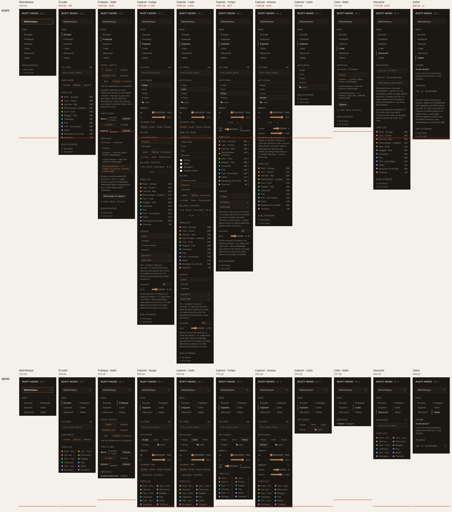
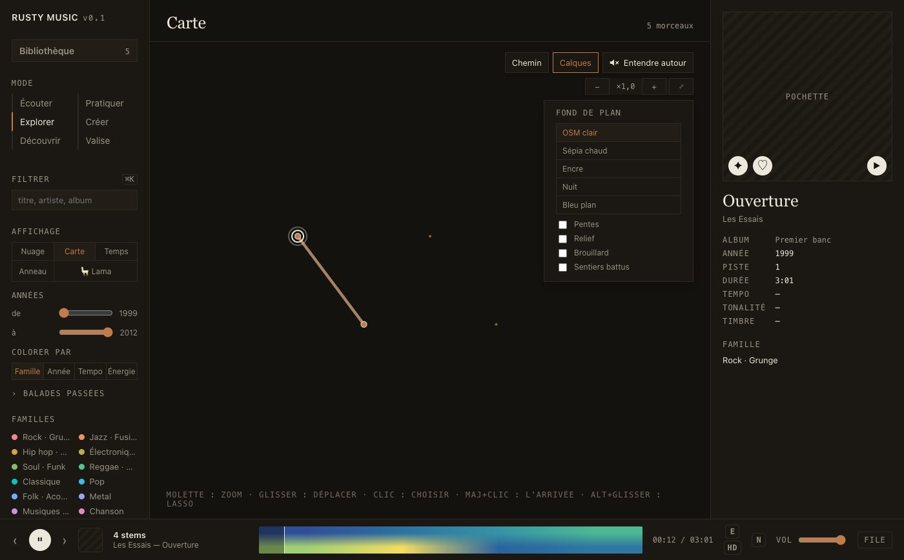

# Journal de développement

Ce que `README.md` ne dit pas : les mesures, les pièges rencontrés et les
décisions prises au fil du chantier, dans l'ordre où elles sont arrivées.
`docs/suite.md` reste la référence pour ce qui **reste** à faire ; ce fichier
raconte ce qui a déjà été **fait**, et pourquoi.

Les exemples ci-dessous portent sur une bibliothèque de test réelle (27 044
morceaux) ; les morceaux et artistes cités en exemple sont anonymisés — seuls
les volumes, les mesures et les formats comptent ici.

## Application de bureau, pochettes et formats

### Application de bureau

```bash
cargo run -p rusty-music-desktop            # depuis le dépôt, mode Écoute
cd apps/desktop && cargo tauri build        # produit le .app et le .dmg
```

Le paquet fait **277 Mo** (208 en `.dmg`) : les poids voyagent avec lui, sans
quoi ni carte ni démixage.

**Où les modèles sont cherchés**, dans cet ordre — `crates/core/src/modeles.rs` :

1. la variable `RUSTY_MUSIC_MODELS`, pour désigner un autre dossier sans
   reconstruire ;
2. `Contents/Resources/models/` à côté de l'exécutable — disposition d'un
   paquet macOS ;
3. `models/` à côté de l'exécutable ;
4. `models/` dans le dossier courant — le cas du développement.

Un `.app` double-cliqué a pour dossier courant `/` : sans les étapes 2 et 3, il
ne trouvait rien. C'était le cas jusqu'à cette version.

**Les poids de CLAP échappent à cette liste**, et l'ordre y est inversé : le
chemin publié par le build (`RM_POIDS`) passe **avant** les ressources. Chaque
profil de compilation régénère code *et* poids ; charger ceux d'un autre profil
ne provoque aucune erreur, seulement des empreintes fausses. `RM_POIDS` désigne
toujours ceux qui vont avec le code exécuté, et n'existe que sur la machine de
build — une application installée tombe donc naturellement sur ses ressources.

Deux pièges payés sur cette étape, tous deux silencieux :

- **la sérialisation des poids par `burn-onnx` n'est pas déterministe.** Deux
  générations depuis le même ONNX donnent des fichiers différents, de taille
  identique. La copie d'empaquetage, qui comparait les tailles pour s'épargner
  du travail, ne se déclenchait donc jamais : le paquet embarquait des poids
  d'un build antérieur. Elle écrase désormais sans condition, et seulement
  depuis un build `release` — celui que produit `cargo tauri build` ;
- **aucune comparaison d'empreintes ne peut valider un paquet**, pour la même
  raison. Le seul contrôle qui vaille est fonctionnel :

  ```bash
  cargo run --release -p rusty-music-analysis --example empreinte_reference -- \
      "target/release/bundle/macos/Rusty Music.app/Contents/Resources/models/clap-audio-encoder-b5.bpk"
  ```

  À rejouer après chaque empaquetage.

La base est cherchée dans le dossier de données de l'application
(`~/Library/Application Support/fm.rustymusic.desktop/rusty-music.db` sur macOS) et
non dans le répertoire courant : une application de bureau n'a pas de « cwd »
stable. Y copier une base déjà scannée évite de tout réingérer.

Coquille « Atelier » en direction 1a « Relief » (`docs/ui-spec-lecteur.md`) :

- **rail** — marque, modes, recherche, sommaire, accès aux réglages ;
- **centre** — parcours artistes → albums → pistes, listes virtualisées
  (3 543 lignes d'un coup figeraient la fenêtre) ;
- **inspecteur** — pochette et métadonnées du morceau courant ;
- **transport** — ▶/⏸, ‹ ›, barres de progression cliquables, minutage, volume ;
- **file d'attente** — panneau en superposition, clic pour sauter à une piste ;
- **réglages** — dossiers surveillés, ajout avec scan, retrait avec purge, et
  bouton **Analyser** : le nombre de morceaux en attente d'empreinte y est
  affiché avec une estimation de durée, et la passe se lance à la demande —
  jamais enchaînée au scan, une passe se comptant en heures ;
- **mode Explorer** — la carte : zoom, survol, clic pour écouter, filtres qui
  estompent, coloration par famille ou par année, voisins soniques dans
  l'inspecteur, **quatre façons de tracer un chemin** (voir ci-dessous) et
  **sélection au lasso** (`alt` + glisser) qui rend une zone en playlist ;

**Une contrainte de couleur, mesurée et non subjective.** Sur un nuage de
points, toutes les paires de teintes se côtoient : la palette validée y plafonne
à **trois** couleurs catégorielles. Colorer douze familles serait illisible par
construction — le contrôle refuse même deux teintes proches (ΔE 11,1 en vision
normale contre 15 requis, 6,6 en protanopie). D'où le mode « isoler une
famille », avec opacité et taille comme encodage secondaire. Une rampe
séquentielle, elle, n'oppose pas des identités : la coloration par année y
échappe.

**Lancer en `--release`.** Le décodage audio est entièrement processeur :
l'enveloppe d'une piste se calcule en 324 ms optimisée, contre 18 s sans
optimisation. Le `Cargo.toml` racine compile donc les dépendances en `opt-level
= 3` même en debug — notre propre code reste en debug, compilation rapide et
traces exploitables.

Points d'implémentation à connaître avant d'y toucher :

- **La file n'est pas chargée d'un bloc.** Ouvrir un fichier et lire son
  en-tête coûte ~100 ms sur la carte SD : préparer les 157 pistes d'un album
  immobilisait le lecteur 17 s, verrou tenu, et tout clic sur pause attendait
  d'autant. On n'en prépare que `PRECHARGE` (3), complétées par `completer()`
  à chaque sondage — d'où 1,9 s quelle que soit la taille de la file. Tout
  appelant du lecteur doit appeler `completer()` régulièrement, sinon la
  lecture s'arrête au bout de trois pistes.
- **L'onde est calculée, pas décorative.** Enveloppe crête et noyau RMS sur
  160 tranches, obtenues en décodant le fichier. Le calcul tourne dans un
  thread et la commande répond `null` en attendant : l'interface redemande.

- **Le scan lancé depuis les réglages ouvre sa propre connexion** dans un
  thread. Sous le verrou de la base partagée, il figerait l'interface pendant
  les dizaines de minutes que dure un scan. Le mode WAL autorise un rédacteur
  et des lecteurs simultanés : mesuré, une lecture répond en 56 ms pendant
  qu'un scan écrit.
- **`[hidden] { display: none !important }` en tête de feuille de style.** Sans
  ce garde-fou, une règle d'auteur comme `.voile { display: grid }` l'emporte
  sur le `[hidden]` du navigateur, et un panneau censé être masqué reste
  affiché — un voile plein écran avale alors tous les clics.
### Pochettes

`rusty_music_core::tags::read_cover()` cherche d'abord l'image embarquée, puis un
fichier à côté du morceau (`cover.jpg`, `folder.jpg`… — convention beets). Le
repli n'est pas décoratif : sur la bibliothèque de test, des albums pourvus
d'un `cover.jpg` n'ont aucune image embarquée (tag de 6 Ko).

Rien n'est stocké en base — les pochettes pèsent 4,9 Go et le scan les saute
volontairement. Le lecteur appelle cette fonction pour un morceau à la fois,
au moment de l'afficher : compter **50 à 210 ms à froid** sur la carte SD,
proportionnellement au poids de l'image. Un cache côté interface est à prévoir
si l'on affiche une grille d'albums.

### Formats lus

`rodio` décode via `symphonia`. Vérifié sur la bibliothèque réelle :

| Format | Fichiers | État |
|---|---:|---|
| mp3 | 26 655 | lu |
| m4a | 355 | lu (0 erreur sur 5 albums testés) |
| flac | 11 | lu |
| mp4 | 13 | lu, mais 2 erreurs `symphonia-codec-aac` par piste |
| opus | 10 | **non lu** — `symphonia` 0.5.5 n'a pas de décodeur Opus |

Les 10 fichiers Opus appartiennent à un seul album. Les couvrir demanderait
un décodeur hors `symphonia` (liaison C vers libopus) : disproportionné pour
0,04 % de la bibliothèque, à revoir si la proportion change.

## Premier build — fait

Le cœur compile, passe les tests et a été validé sur la bibliothèque réelle
(rustc 1.96, lofty 0.22.4, notify 8.2, rusqlite 0.32.1, macOS/Apple Silicon).
Aucune version du `Cargo.toml` racine n'a eu besoin d'être ajustée.

Contrairement à ce qui était anticipé, **les API de `lofty` étaient correctes**
telles qu'écrites : `lofty::probe::Probe`, `lofty::prelude::*` et les variantes
`ItemKey::AlbumArtist` / `ItemKey::MusicBrainzRecordingId` existent bien en
0.22. Le seul blocage était la **disposition des fichiers** : les sources
vivaient à plat dans `src/`, alors que le workspace déclare `crates/core` et
`crates/cli`. Elles ont été réparties, et `sql/` déplacé dans `crates/core/sql/`
pour que l'`include_str!` du schéma résolve.

Reste vrai : `rusqlite` en `bundled` compile SQLite depuis les sources — premier
build un peu long, nécessite un compilateur C (Xcode Command Line Tools sur macOS).

### Mesures sur la bibliothèque réelle (27 044 morceaux, carte SD exFAT)

| Opération | Résultat |
|---|---|
| Scan initial à froid, `-j 1` | 27 031 vus · 27 031 ingérés · **0 en échec** — 24 min 33 s (~18 fichiers/s) |
| Scan initial à froid, `-j 12` | 27 044 vus · 27 044 ingérés · 0 en échec — 25 min 38 s (~18 fichiers/s) |
| Rescan (rien de changé) | 27 044 vus · 27 044 inchangés · 0 retirés — **5,0 s** |

L'élagage des fichiers disparus coûte ~0,2 s sur ces 27 044 lignes.

### Pourquoi le parallélisme ne change rien ici

Le scan complet consomme **11 s de CPU pour 25 min de temps écoulé** (0,7 %) : le
processus passe son temps à attendre la carte SD. Il n'y a donc pas de calcul à
répartir — le décodage des tags coûte ~0,08 ms par fichier (360 fichiers en
0,031 s quand les données sont déjà en mémoire).

Le coût se décompose en ~4,9 Go d'octets de tags à lire (tag moyen 176 Ko,
médiane 96 Ko — c'est la pochette embarquée) à ~6 Mo/s, soit ~14 min, plus
~11 min de latence d'ouverture sur 27 044 fichiers. Superposer les lectures
devrait entamer cette seconde moitié ; mesuré, ça ne donne rien, à aucun nombre
de threads (1, 2, 4, 8, 12, 24). L'explication la plus probable est que le
pilote exFAT de macOS (FSKit, en espace utilisateur) sérialise les requêtes.

Le pool est conservé parce qu'il ne coûte rien et servira sur un support qui
tire parti de la profondeur de file (NVMe, montage réseau) ; `-j 1` le
court-circuite. **Le vrai levier serait de ne pas lire les octets des
pochettes** : `lofty` les lit puis les jette (`skip_frame` fait un `io::copy`
vers `io::sink()`). Les sauter par `seek` retirerait ~14 des 25 min, mais ce
n'est pas un patch trivial en amont — le lecteur de trames ID3v2 est générique
sur `Read` sans `Seek`, notamment parce que la désynchronisation ID3 rend le
flux d'octets pas toujours navigable directement.

Le scan initial est limité par le support, pas par le code : la carte SD lit à
~6 Mo/s, et `lofty` doit traverser tout le bloc de tags de chaque fichier. Le
débit suit d'ailleurs la taille des tags (81 Ko de tags → ~16 fichiers/s ;
768 Ko → ~6 fichiers/s). `ParseOptions::read_cover_art(false)` évite de décoder
les pochettes — que le cœur ne stocke pas — mais **n'accélère pas le scan** :
`lofty` lit puis jette les octets de l'image au lieu de les sauter.

Le chemin incrémental (taille + mtime identiques ⇒ pas de relecture des tags)
est en revanche très rapide : un rescan complet coûte quelques secondes.

### Pièges rencontrés, à connaître avant de toucher au cœur

- **`[profile.dev.package."*"]` ne couvre pas les membres du workspace.** Le
  `"*"` de Cargo désigne les *dépendances*. Nos propres crates restaient donc en
  `opt-level = 0`, où `distance2` n'est pas inliné : le graphe des 12 plus
  proches voisins demandait **524 s au lieu de 19 s** sur 27 031 morceaux — neuf
  minutes à saturer les douze cœurs, sans rien afficher, l'application passant
  pour plantée. Les trois crates de calcul (`analysis`, `player`, `editor`) sont
  désormais listées nommément dans le `Cargo.toml` racine. Mesure reproductible :
  `cargo run -p rusty-music-analysis --example cout_graphe`, qui affiche le coût
  et son extrapolation à la bibliothèque entière.
- **Une commande Tauri sans `(async)` s'exécute sur le fil principal**, donc
  fige toute l'interface dès qu'elle touche le disque. Mesuré au profileur :
  `play` ouvrait le fichier et laissait symphonia le sonder ; **la totalité des
  échantillons** montrait le fil principal bloqué dans un `read()`, pendant
  qu'une passe d'analyse saturait la carte SD. L'application paraissait tourner
  dans le vide alors qu'elle attendait le disque. Sur une fonction *non*
  asynchrone, `#[tauri::command(async)]` ne change ni les arguments, ni les
  verrous, ni les erreurs : il la déplace sur un pool de fils. **Les 41
  commandes le portent**, parce que la frontière n'est pas nette — `skip` ouvre
  la piste suivante, et même un lecteur d'état prend un verrou que ces
  opérations détiennent.
- **Une passe de fond peut étrangler l'application** sans qu'aucune des deux
  soit en faute : douze fils de décodage saturent un support qui facture
  l'accès. D'où `--fils` sur `descripteurs`, à baisser pour continuer d'écouter
  pendant une passe.
- **Un sondage sans garde-fou d'appel en vol devient un déni de service** dès
  que les commandes s'exécutent en parallèle. Le sondage des stems tournait à
  5 Hz sans cette garde : les appels s'empilaient sur le même verrou et un clic
  attendait derrière eux. Il fallait presser le bouton trois fois pour arrêter
  la lecture. Deux correctifs : la garde, et surtout **ne plus demander au
  moteur son état avant d'agir** — le bouton sait ce qu'il affiche, donc ce que
  l'utilisateur veut.
- **La surveillance ne peut pas se fier au type d'évènement.** FSEvents (macOS)
  livre en un seul lot l'historique cumulé d'un chemin : un fichier supprimé
  arrive en `Create` + `Remove` + `Modify`, sans ordre exploitable. `flush()`
  tranche donc sur l'état du disque (le chemin existe ⇒ ajout, il a disparu ⇒
  retrait), ce qui couvre du même coup le renommage. Test de non-régression :
  `watch::tests::flush_retire_les_chemins_disparus`.
- **`mp4` est dans `AUDIO_EXTS`** : la bibliothèque de test contient un album
  entier étiqueté `.mp4` plutôt que `.m4a`. Contrepartie à garder en tête, une
  vidéo posée dans le dossier surveillé serait ingérée.
- **L'élagage se fie au disque, pas au parcours.** `scan` retire les morceaux
  dont le fichier a disparu, mais uniquement sur un `NotFound` avéré : un
  dossier devenu illisible remonte une autre erreur et la ligne est conservée.
  Une racine absente (carte débranchée) échoue avant tout élagage. L'élagage ne
  touche que les chemins situés sous la racine scannée — scanner un seul album
  ne vide pas le reste de la base.
- La détection de changement repose sur `mtime` à la seconde : une réécriture
  de même taille dans la même seconde que le dernier scan passerait inaperçue.
- `cargo fmt` n'a pas été passé : le squelette est formaté à la main de façon
  compacte et le lancer produirait un diff sans rapport avec le code écrit ici.

## Analyse (module 2)

Le modèle n'est pas dans le dépôt — 112 Mo. Le récupérer et le préparer une
fois :

```bash
mkdir -p models && curl -L -o models/clap-audio-encoder.onnx \
  https://huggingface.co/icybawss/clap-htsat-unfused-audio-encoder-onnx/resolve/main/audio_model.onnx
./scripts/preparer-modele.sh          # fige les formes ; sans lui, le build échoue
```

Encodeur audio de CLAP (`laion/clap-htsat-unfused`), conversion ONNX Apache-2.0,
poids non modifiés. Entrée log-mel `[5, 1, 1001, 64]` — cinq fenêtres de 10 s à
48 kHz —, sortie de 512 dimensions.

**Le modèle tourne sous Burn, pas sous ONNX Runtime.** `burn-onnx` le traduit
en Rust natif au moment du build ; le backend `wgpu` couvre Metal, Vulkan et
DX12 d'un même code. La bascule a été validée par comparaison directe :

| | ONNX Runtime | Burn `ndarray` (CPU) | Burn `wgpu` (Metal) |
|---|---|---|---|
| Lot de 5 fenêtres | 121 ms | 192 ms* | **97 ms** |
| Par fenêtre | 24,2 ms | 38,4 ms* | **19,4 ms** |
| Cosinus contre ORT | — | 1,0000000000 | 1,0000000000 |

<sub>* mesuré sur un lot d'une fenêtre, rapporté ici pour l'ordre de grandeur.</sub>

Le gain de calcul est modeste — 20 % — et invisible sur la passe, limitée par
le support. Ce qui compte : le GPU **libère les douze cœurs** pour le décodage,
et le module 3 (démixage) aura besoin de cette voie. `experiments/burn-clap/`
garde la trace complète de l'essai, y compris ce qui n'a pas marché.

**Trois pièges de cette migration, tous silencieux.**

- **`default-features = false` sur `burn` désactive `std`**, et Burn bascule
  sur ses implémentations mathématiques de substitution. Le modèle compile,
  tourne, et rend des empreintes entièrement fausses. Aucun avertissement.
- **Les poids ne se partagent pas entre profils de compilation.** Chaque build
  régénère code *et* poids ; charger ceux d'un autre build ne produit pas
  d'erreur, seulement des nombres faux. D'où le chemin publié par `build.rs`
  (`RM_POIDS`) plutôt qu'un emplacement commun.
- **Le modèle publié ne s'importe pas** : ses blocs Swin calculent leurs marges
  à l'exécution. D'où `scripts/preparer-modele.sh`, qui fige les formes — et
  surtout pas `onnx-simplifier`, qui produit ici un graphe invalide.

Ces trois-là ont été attrapés par un seul garde-fou, pas par le compilateur :

```bash
cargo run --release -p rusty-music-analysis --example empreinte_reference
```

Il compare l'empreinte d'une entrée calculée aux valeurs relevées sous ONNX
Runtime avant son retrait. À rejouer après tout changement de backend, de
version de Burn ou de préparation du modèle.

```bash
rusty-music analyze --limit 27044   # empreintes ; reprenable, écrit au fil de l'eau
rusty-music project                 # place tout sur la carte ; 6 s, rejouable
rusty-music analyze --limit 500 --project   # ou par lots
```

**La passe est en deux commandes, et ce n'est pas un choix de confort.** Les
empreintes se calculent morceau par morceau ; la projection, elle, exige le lot
entier — t-SNE place chaque point relativement aux autres, deux passes séparées
donneraient deux repères sans rapport. D'où `analyze`, incrémental et
reprenable, puis `project`, global.

### Étirement et transposition

```bash
rusty-music etirer entree.wav sortie.wav --facteur 1.25      # 25 % plus long
rusty-music etirer entree.wav sortie.wav --demi-tons 3       # +3 demi-tons, durée inchangée
```

Dans l'application, deux pas-à-pas dans l'en-tête du dock des stems : **vitesse**
(immédiate, la lecture change de tempo sans rien recalculer) et **hauteur**
(quelques secondes, mise en cache par réglage).

**`wsola`, et pas un vocodeur écrit à la main — c'est une correction.** J'avais
écrit un vocodeur de phase complet, avec verrouillage sur les crêtes du spectre,
avant de vérifier ce qui existait déjà en Rust. `wsola` fait mieux :

| | vocodeur écrit ici | `wsola` |
|---|---|---|
| méthode | phase, fréquentielle | **recouvrement-addition temporel** — celle d'`atempo` (ffmpeg) et de VLC |
| artefacts | flou de phase sur les transitoires, non mesuré | pas de phase à recoller |
| temps réel | à écrire | **conçu pour** — `push`/`pull`, `set_tempo` en direct |
| taille | ~500 lignes à maintenir | 468 lignes, zéro dépendance transitive |

Mesuré avant adoption : **hauteur inchangée à 441 Hz de 0,5× à 2×**, durées
justes, et le mode flux vérifié bloc par bloc.

**Ce que le changement coûte, et il faut le dire** : en traitement de bloc,
`wsola` met 17,9 s là où le vocodeur de phase mettait 0,84 s pour un stem de
184 s. Sans effet sur la lecture, où le coût est amorti au fil du son ; sensible
sur la transposition de l'éditeur, qui traite quatre stems d'un coup. Elle est
mise en cache par réglage, donc payée une fois.

Ce qui reste écrit ici : la **transposition**, que `wsola` ne fait pas. Elle
s'obtient en étirant puis en rééchantillonnant du même rapport — interpolation
cubique de Catmull-Rom, la linéaire ternissant tout le haut du spectre.

**La leçon est dans `CLAUDE.md`** : chercher une crate Rust *avant* d'écrire,
pas après.

### Ce que l'adoption de `wsola` a cassé ailleurs — corrigé le 19 août

Deux défauts, tous deux introduits par un changement juste, et tous deux dans
du code que ce changement ne touchait pas.

#### La vitesse craquait

`Voix::remplir()` pousse un bloc dans l'étireur **depuis le rappel audio**. Le
bloc valait 4 096 trames : un appel à `next()` sur quelques milliers faisait
tout le travail, les autres rien.

**Le débit moyen allait très bien** — WSOLA tient 3,2 fois le temps réel sur
quatre stems — et c'est pour cela que le défaut a survécu. Ce qui compte n'est
pas la moyenne mais le pic : un appel doit rendre la main avant que le
périphérique ait vidé son tampon, 11,6 ms pour 512 trames.

Pire salve, quatre stems (`cargo run --release -p rusty-music-player --example
cout_bloc`) :

| bloc | ×0,25 | ×0,5 | ×1,5 | ×4 |
|---|---|---|---|---|
| 4096 | 122,5 | 65,5 | 23,9 | 10,4 |
| 1024 | 33,9 | 20,6 | 9,6 | 5,3 |
| 256 | 10,0 | 5,2 | 5,1 | 5,1 |
| **128** | **6,1** | **5,8** | **5,1** | **5,1** |

**Le pire cas est la vitesse la plus lente, et c'est ce qui a failli être
manqué.** Mesuré au seul tempo 1,5 — le réflexe — un bloc de 512 semblait
suffire ; il craque à 19,6 ms dès qu'on ralentit, c'est-à-dire précisément
quand on ralentit pour écouter un détail. À ×0,25 un bloc rend quatre fois sa
durée, donc quatre fois plus de pas d'étireur d'un coup.

**Le plancher n'est pas le bloc, c'est le pas de l'étireur** : `wsola` rend sa
sortie par sauts de 15 ms et n'en rend jamais moins — d'où les 5,1 ms qui ne
descendent plus. 128 est le plus grand bloc qui reste à ce plancher sur toute
la plage de l'interface. Un test d'arithmétique le verrouille, plutôt qu'un
chronomètre qui serait capricieux :
`un_bloc_ne_couvre_jamais_plus_dun_pas_detireur`.

Reste à savoir : 6,1 ms sur 11,6, c'est de la marge, pas du confort. Un
périphérique demandant des tampons de 256 trames redeviendrait juste, et la
réponse de fond serait alors de sortir l'étirement du rappel audio.

#### La hauteur bloquait l'interface

La transposition tournait dans une commande `#[tauri::command(async)]`, et cela
ne suffit pas. **`async` sert à une commande qui attend, pas à une commande qui
calcule** : une boucle qui ne rend jamais la main monopolise un ouvrier du
runtime, et toutes les autres commandes attendent derrière — le sondage du
transport, l'état de lecture, le moindre clic. L'interface ne gelait pas, elle
faisait la queue, ce qui se voit pareil.

**L'enchaînement mérite d'être noté.** Le démixage avait déjà réglé cela dans
son fil. La transposition ne l'avait pas suivi parce qu'elle était courte —
0,84 s par stem du temps du vocodeur de phase. `wsola` l'a portée à 17,9 s,
soit plus d'une minute pour quatre stems, **sans que ce chemin-là soit revu**.
Un remplacement correct, mesuré et documenté a rendu inacceptable un choix qui
ne l'était pas la veille.

Corrigé sur le motif du démixage : `start_etirer` lance un fil et rend la main,
`etirer_state` se sonde. L'avancement se compte **en stems**, pas en
pourcentage — à vingt secondes pièce, un pourcentage global reste immobile
assez longtemps pour qu'on le croie bloqué. Quand tout est neutre ou déjà en
cache, aucun fil n'est lancé et le chargement reste immédiat.

#### Et la transposition restait lente — 92 s

Sortir le calcul du chemin de l'interface ne l'accélère pas. Mesuré phase par
phase sur un stem de 272 s (`cargo run --release -p rusty-music-editor
--example cout_transposition`) :

| phase | coût |
|---|---|
| décodage | 0,18 s |
| **étirement + rééchantillonnage** | **22,56 s** |
| écriture | 0,03 s |

Tout est dans l'étirement, et rien d'autre ne compte. Quatre stems en file :
92 s.

**« Ne faudrait-il pas transposer le morceau plutôt que chaque stem ? »**
L'intuition vise juste — quatre fichiers pour un seul geste, c'est quatre fois
le travail — mais le remède coûterait le module. Un morceau transposé est **un
fichier** : plus de solo, plus de coupure, plus de niveau par stem, et plus de
transposition par stem, alors que baisser la basse d'une quinte sans toucher au
reste est précisément un des gestes que la spec retient. On rendrait la
transposition rapide en supprimant ce sur quoi elle s'applique.

**Le même facteur quatre s'obtient sans rien céder** : un fil par stem. Les
quatre transpositions ne partagent rien, la mise à l'échelle est donc presque
parfaite — **92,0 s → 22,7 s, soit 4,0×**.

Ce qui rendait cette parallélisation risquée, et qui a dû être réglé d'abord :
`transposer` tenait **cinq tampons pleins** du signal — l'entrée, l'étiré, les
deux canaux séparés, les deux rééchantillonnés, le réentrelacé. Quatre à la
fois faisaient pagineur la machine, et **une machine qui pagine fige
l'interface aussi sûrement qu'un calcul mal placé**. `reechantillonner_entrelace`
lit au pas des canaux et écrit d'affilée : cinq tampons deviennent deux, la
pointe mesurée passe de 1,68 à 1,47 Go, et le cache s'en trouve mieux traité.

**Ce qui reste possible et n'est pas fait** : ne transposer que ce qui
s'entend. Un stem coupé, ou tous sauf le stem en solo, n'ont pas à être
calculés. C'est un quart à trois quarts de travail en moins selon le cas, sans
rien céder non plus.

### Régler au clavier plutôt qu'au pas-à-pas

Les valeurs de vitesse et de hauteur se tapent. **Les pas-à-pas restent**, et ce
n'est pas une hésitation : ils servent à chercher la bonne valeur en écoutant,
le champ sert à sauter d'un coup à une valeur qu'on a déjà en tête — ce qu'une
quinzaine de clics ne fait pas.

Le champ lit toujours des **pour cent**, jamais un rapport : « 2 » est ambigu
— deux pour cent ou deux fois ? Puisqu'il affiche « % », il lit des pour cent,
et 2 est refusé par la borne basse plutôt qu'interprété. Une saisie hors bornes
se marque et **garde ce qui a été tapé** : corriger suppose de voir son erreur.
Les flèches haut et bas font un pas, Échap rend la valeur courante.

### Tempo et tonalité du morceau

Mesurés par la passe « Descripteurs », affichés à deux endroits qui ne suivent
pas la même chose : l'**inspecteur** suit la sélection, le **transport** suit ce
qu'on écoute — les deux divergent dès qu'on explore la carte sans changer de
morceau.

Notation française : « Fa mineur », pas « F min ». La base note à l'anglaise
parce que c'est ce qu'écrivent les profils de Krumhansl-Schmuckler et tout le
domaine ; la traduction appartient à l'affichage. **Les altérations restent des
dièses** — la mesure ne distingue pas un fa dièse d'un sol bémol, et choisir
l'un des deux prétendrait le contraire.

**Un tiret quand ce n'est pas mesuré, jamais une valeur par défaut** : la passe
couvre 15 847 morceaux sur 27 044, et afficher « 120 BPM » sur le reste
donnerait une mesure qu'on n'a pas. L'ambiguïté d'octave vaut ici aussi — un
morceau à 174 BPM peut s'afficher à 87.

### Opus — le seul format que symphonia ne décode pas

Un album entier de la bibliothèque de test restait hors de la carte.
`crates/core/src/opus.rs` le décode avec deux crates choisies pour ce qu'elles
**n'exigent pas** : `ogg` (BSD-3) démultiplexe le conteneur, `opus-decoder`
(MIT/Apache) est un portage **pur Rust** de libopus — ni `unsafe`, ni FFI, ni
bibliothèque système, ni `cmake`. Le crate `opus` officiel compile libopus
depuis ses sources et aurait imposé `cmake` à toute personne construisant le
projet ; c'est cela qui l'a écarté, pas sa licence.

Le module vit dans le cœur parce que les trois modules en ont besoin et qu'ils
ne partagent que lui. Il honore le `pre-skip` de l'en-tête — les premiers
échantillons amorcent le décodeur et ne font pas partie du morceau — et le gain
de sortie.

Trois usages, un seul aiguillage (`opus_en_memoire`, dans le lecteur) : la
carte les analyse, le lecteur les joue, la barre du bas en trace l'onde. Le
morceau entier tient alors en mémoire — une soixantaine de mégaoctets pour
quatre minutes — parce que la chaîne en flux ne sait pas ouvrir ce format ; ça
ne concerne que ces fichiers.

**27 042 des 27 044 morceaux** sont sur la carte. Les deux restants, un m4a et
un mp3, sont corrompus.

### Tempo, tonalité, énergie

```bash
rusty-music descripteurs        # ~1,6 s/morceau, reprenable
```

Remplit la table `descriptors` et donne au rail deux façons de plus de colorer
la carte : **Tempo** et **Énergie**, à côté d'Année. Aucune dépendance ajoutée.

**Les algorithmes viennent des bibliothèques du domaine, pas de nulle part** :
flux spectral puis autocorrélation à peigne, comme `onset/specflux` et
`beattracking` d'aubio ; chroma corrélé aux profils de Krumhansl-Schmuckler,
comme QM-DSP, celui de Mixxx. Les écrire — 416 lignes — plutôt que les lier
évite une dépendance C et un passage sous GPL, et le seul usage qui exigerait
mieux, le calage de deux disques, est hors du périmètre du module 3.

Deux points appris en chemin :

- **deux fenêtres, pas une.** Une attaque se situe dans le temps, une note en
  fréquence, et la transformée échange l'une contre l'autre. Avec la seule
  fenêtre de 2 048 points, un do₃ et le la♯ voisin tombaient dans la même raie
  et le chroma d'un accord parfait s'étalait sur huit classes. Le chroma prend
  donc 8 192 points, les attaques 2 048 ;
- **on teste des tempos, pas des décalages entiers.** À 93,75 trames par
  seconde, un morceau à 150 BPM a une période de 37,5 trames qu'aucun décalage
  entier n'atteint : le double, lui, tombe juste, et le morceau ressortait à
  75 BPM. L'autocorrélation est donc évaluée à décalage fractionnaire, sur une
  grille de 240 tempos.

| mesure | valeur |
|---|---|
| accord avec AudioMuse-AI à 6 % près | 73 % de 197 morceaux |
| accord à l'octave près | 80 % |
| coût | 1,6 s/morceau, dont 1,1 s de décodage |

**Limite connue** : les seuils de rejet n'écartent que le silence. Sur les
premiers morceaux mesurés, aucun n'est sorti sans tempo ni sans tonalité — un
conte lu reçoit donc un tempo qui ne veut rien dire.

### La grille de battements

```bash
rusty-music battements piste.wav                          # tempo, phase, netteté
rusty-music battements piste.wav --bpm 117.2 --phase 0.128   # éprouver une grille imposée
```

`descripteurs.rs` rend un tempo, c'est-à-dire une **période**. Deux morceaux à
124 BPM peuvent pulser en opposition de phase ; les caler demande de savoir *où*
tombe le premier temps. C'est ce que `crates/analysis/src/battements.rs`
ajoute, et ça sert **deux fois** : le mixage de deux pistes l'exigeait, mais la
greffe du module 3 aussi — elle calait les tempos sans caler les temps forts.

**La méthode.** Le tempo vient de l'autocorrélation à peigne déjà écrite ; la
phase, d'un peigne de Dirac glissé sur l'enveloppe d'attaques, comme
`beattracking` d'aubio après son autocorrélation.

**Deux corrections, et aucune n'était devinable :**

| | ce qu'on a trouvé | ce qu'on fait |
|---|---|---|
| **latence du détecteur** | le flux spectral place une attaque `N_FFT − HOP` échantillons trop tôt — elle n'apparaît qu'en entrant dans la part de fenêtre que la précédente ne couvrait pas | une constante de 32 ms, **dérivée puis mesurée** : −31 ms observés |
| **pas de la grille de tempo** | 240 candidats entre 60 et 200 BPM, géométriquement : **0,5 % par pas**. Sans conséquence pour colorer une carte, rédhibitoire pour une phase — 40 ms de dérive en 16 s, une demi-seconde sur un morceau | affinage **conjoint** de la période et de la phase dans une bande de ±1 % |

L'affinage conjoint est le point : on cherche le couple qui explique le mieux
les attaques, au lieu de prendre la période d'un critère et la phase d'un
autre. L'erreur passe de −31…−67 ms à **8,5 ms au pire**, contre un plancher de
méthode de 7,8 ms — un pas de balayage (`verif_battements`).

**La réserve qui compte, et elle n'était pas prévue : sur une batterie, la
phase est presque indéterminée.**

```
── 01 titre-test — drums.wav
 1.   117.2 BPM   phase 0.128 s   netteté 2.96
 2.   116.7 BPM   phase 0.426 s   netteté 2.93  (+42 % de battement)
```

Deux décalages presque à un demi-battement l'un de l'autre, et 0,03 de netteté
pour les départager : la caisse claire du 2 et du 4 pèse autant que la grosse
caisse du 1 et du 3. **Conséquence sur la manière de vérifier** — remesurer la
grille d'une greffe calée ne prouverait rien, on comparerait deux tirages
ambigus. On pose donc la grille de référence et l'on regarde ce qu'elle
ramasse :

| | grille du stem remplacé | meilleure trouvée à l'aveugle |
|---|---|---|
| greffe **calée** | **2,19** | 1,94 |
| greffe **non calée** | **1,08** | 2,15 |

La greffe non calée pulse — 2,15 pour sa propre grille — mais pas là où
l'original pulsait : 1,08, quand une phase tirée au hasard vaut 1,00.

**Ce qui reste ouvert** : le tempo est supposé constant, ce qui ne décrit ni un
live ni un batteur qui accélère ; et l'ambiguïté d'octave de `descripteurs.rs`
demeure — un morceau à 174 BPM est lu à 87, grille juste mais un battement sur
deux.

### Nommer les familles — trois sources

```bash
rusty-music enrich --contact "toi@exemple.org"   # genres MusicBrainz ; ~2 h, reprenable
rusty-music familles --artistes                  # ce que ça donne, artistes à l'appui
```

Les douze familles de la carte tirent leur nom de trois sources, **de la plus
précise à la plus grossière** :

| source | ce qu'elle apporte | couverture mesurée |
|---|---|---|
| album MusicBrainz | distingue deux disques d'un même artiste | variable |
| artiste MusicBrainz | vocabulaire curé — `afrobeat`, `nu metal`, `boom bap` | 64 % des artistes, 74 % des morceaux |
| tag du fichier | dernier recours, mais irremplaçable | 90 % des morceaux |

**Pourquoi trois et pas une.** Les tags des fichiers seuls nommaient
« Children's · Pop » la famille de plusieurs artistes de folk/pop acoustique à voix féminine —
121 fichiers y portent cette étiquette, rare ailleurs, donc gagnante au score.
MusicBrainz seul laisserait sans nom la famille de chant breton, dont aucun
artiste n'y figure avec un genre. Le sondage qui a tranché est dans
`experiments/musicbrainz-genres/` : neuf familles sur douze y gagnent.

Trois précautions, chacune tirée d'un défaut observé :

- **on ne mélange pas les sources pour un même morceau.** Les verser ensemble
  ferait cohabiter « Rock » et « rock », et le genre le plus grossier
  redeviendrait le plus lourd ;
- **un seul genre par entité, le mieux voté** — pas trois. Le premier est celui
  sur lequel les contributeurs s'accordent, les suivants décrivent les marges.
  En retenir trois versait « rock » et « pop » partout : mesuré sur la
  bibliothèque entière, un genre donne « Reggae · Afrobeat » là où trois
  donnaient « Reggae · Ska » ;
- **aucun plancher de votes, et c'est une correction.** Il avait d'abord été mis
  à deux pour écarter l'`amapiano` posé par un contributeur unique sur un
  artiste par ailleurs bien couvert. Mesuré, il faisait l'inverse : chez cet artiste `modern classical`,
  `neoclassicism`, `minimalism` et `instrumental` portent eux aussi une seule
  voix, et le seuil ne gardait que `rock`. Coût général : **55 % de couverture
  au lieu de 74 %**, et 360 artistes rendus muets. Ce qui règle vraiment le cas
  est le **départage à votes égaux par le nombre d'artistes qui portent le
  genre** — `amapiano` n'en a qu'un dans toute la bibliothèque, `instrumental`
  dix-sept ;
- **le titre d'album est normalisé** avant rapprochement — nos fichiers ne
  portent pas d'identifiant d'album, et « Nom de l'album (édition deluxe) »
  doit retrouver « Nom de l'album ».

`enrich` demande un contact parce que MusicBrainz l'exige dans l'agent, et
tient une requête par seconde parce que c'est leur limite. La passe reprend où
elle s'est arrêtée : chaque artiste est marqué dans la même transaction que ses
données.

### Ce qu'on calcule, et ce que calcule AudioMuse-AI

La comparaison vaut d'être posée : sur la même carte SD, AudioMuse-AI met
plusieurs jours là où cette passe met quelques heures. Ce n'est pas que la
représentation soit plus pauvre — **c'est le même vecteur, de la même taille**.

| | Rusty Music | AudioMuse-AI (≥ v0.6.0-beta) |
|---|---|---|
| Empreinte | CLAP `htsat-unfused`, **512 d** | CLAP « DCLAP », **512 d** |
| Frontal | 64 mels, n_fft 1024, hop 480 | 128 mels, n_fft 2048, hop 480 |
| Audio couvert | 3 fenêtres de 10 s | morceau entier |
| Autres modèles | — | MusiCNN 200 d sur **toutes** les fenêtres ; sa tête de prédiction (48 humeurs + 6 attributs) ; tempo/énergie/tonalité (librosa) ; **Whisper-small** jusqu'à 240 s |
| Langage | Rust | Python |

Ils font quatre à cinq analyses par morceau là où on en fait une, et leur FAQ
désigne la transcription (ASR) comme le poste le plus long. Le seul endroit où
nous sommes réellement plus maigres est la **couverture**. Et les 10 s ne sont
pas un raccourci qu'on s'est autorisé : l'encodeur HTSAT en variante `unfused`
prend une entrée de dix secondes, point — couvrir plus demande plusieurs passes.

### Les deux écarts chiffrés — 23 août 2026

Deux pistes d'amélioration identifiées en comparant à AudioMuse-AI : plus de
mels (128 contre 64) et plus de couverture (le morceau entier contre 50 s).
Chiffrées avant d'y toucher.

**128 mels — ce n'est pas un réglage, c'est un autre modèle.**
`crates/analysis/src/mel.rs` le dit dès son en-tête : 64 bandes, n_fft 1024,
hop 480, échelle HTK, non normalisé — « ne reproduisent pas au hasard le
prétraitement de `ClapFeatureExtractor` pour `laion/clap-htsat-unfused` », ce
sont **les valeurs que ce checkpoint exige**. Les poids embarqués ont été
entraînés sur des spectrogrammes de cette forme précise ; leur donner 128
bandes ne les affinerait pas, ça les rendrait aveugles — un modèle dont les
poids attendent 64 canaux ne sait rien faire d'un 129ᵉ. Le « 128 mels,
n_fft 2048 » d'AudioMuse-AI décrit **un autre point de contrôle** (« DCLAP »,
distinct de `htsat-unfused`) : changer de résolution reviendrait à sourcer et
importer un modèle entièrement différent — un chantier de l'ampleur de
`experiments/burn-clap/` lui-même, pas un paramètre à tourner.

**Couvrir le morceau entier — chiffré, et le résultat est net : aucun
bénéfice mesuré.** `couverture.rs` comparait déjà 1/3/5/9 fenêtres et
plafonnait à 9 (0,51×). Poussé à 15 et 25 fenêtres (jusqu'à 250 s — la
quasi-totalité de la plupart des morceaux) sur 318 morceaux réels, 8 albums :

| fenêtres | couverture | même album | même artiste | hasard |
|---|---|---|---|---|
| 1 | 10 s | 0,58× | 0,58× | 0,400 |
| 3 | 30 s | 0,52× | 0,52× | 0,359 |
| 5 | 50 s | 0,52× | 0,52× | 0,355 |
| 9 | 90 s | 0,52× | 0,53× | 0,353 |
| 15 | 150 s | 0,53× | 0,53× | 0,353 |
| 25 | 250 s | 0,53× | 0,53× | 0,353 |

**Le plafond est atteint à 50 s et ne bouge plus jusqu'à 250 s** — cinq fois
plus de matière sans le moindre gain mesurable. Le coût, lui, est réel et
linéaire : 806 s pour 318 morceaux à 25 fenêtres, soit 2,53 s/morceau contre
0,36 s à 5 fenêtres sur SSD (`Coûts mesurés`, plus bas) — environ 5-7× plus
cher pour un rapport au hasard identique au dix-millième près.

**Conclusion des deux chiffrages : ni l'un ni l'autre n'est rentable en
l'état.** Les 512 dimensions de l'empreinte elle-même ne sont pas en cause —
sondage à l'oreille fait le même jour (`rusty-music voisins`) : Nirvana
rapproche Nirvana/Tool/Soundgarden/Alice in Chains, Get Lucky rapproche
N*E*R*D et Michael Jackson *Off the Wall*. Le 8 % de recouvrement
musical/géographique mesuré sur la carte (`carto-ville.md`, objection V1)
n'accuse donc pas l'empreinte : il accuse la grossièreté du placement
inter-artiste, déjà objectivé indépendamment (le passage à 12 familles par
genre n'a rien changé à ce chiffre non plus — voir `carto-ville.md`).

### Coûts mesurés

Par morceau, chaîne complète, **avant** le positionnement :

| Support | Décodage | Log-mel | Empreinte | Total |
|---|---|---|---|---|
| Carte SD | 2 869 ms | 14 ms | 30 ms | **2 914 ms** |
| SSD interne | 316 ms | 14 ms | 29 ms | **359 ms** |

Le décodage est tout : 98 % du temps sur la carte, encore 87 % depuis le SSD.
Ramenée aux 27 044 morceaux sur 12 fils, la partie **calcul** ne pèse que
~13 min — la passe observée à 1,08 s/morceau, soit 8,1 h, était donc à **97 %
de l'attente sur la carte** (212,5 Go à ~7,3 Mo/s en accès concurrent).

**On croyait tenir la cause : on décodait 100 % du fichier pour en garder
20 %.** Corrigé — `decode::fenetres` ne décode plus que les fenêtres retenues,
et la chaîne y gagne 7,3 × (`cout_decodage`, mp3/m4a/mp4/flac, cosinus
0,997–1,000 : ce sont les mêmes fenêtres, donc la même empreinte).

**Mais la passe n'a pas accéléré d'une minute.** Trois stratégies mesurées sur
la vraie bibliothèque, 12 travailleurs, carte SD :

| Stratégie | s/morceau | Octets lus |
|---|---|---|
| Tout décoder, en flux | 1,08 | 100 % |
| **Lire d'un bloc, positionner en mémoire** | **1,13** | 100 % |
| Positionner dans le fichier | 1,42 | ~20 % |

Celle qui lit cinq fois moins est la plus lente. Le support facture l'accès,
pas l'octet : sous douze travailleurs concurrents, l'accès dispersé est ce
qu'il sert le plus mal. Et le nombre de travailleurs n'y change rien non plus —
`-j 4` donne 1,11 s/morceau, `-j 12` donne 1,13.

**Le plafond est ailleurs, et il est net.** `dd` sur la carte au repos, un seul
lecteur : **7,4 Mo/s**. Les 212,5 Go de la bibliothèque mettent donc ~8 h à
traverser, quelle que soit la stratégie de décodage. La passe observée à 8,3 h
tourne exactement à la vitesse du support. Décomposé fichier par fichier, à
froid : **lecture des octets 1,1–4,7 s, décodage 53–507 ms.**

La leçon vaut d'être retenue : le gain de 7,3 × est réel, il est simplement
invisible derrière un support qui coûte trente fois plus cher que le calcul
qu'il alimente. Il paiera le jour où la bibliothèque vivra sur un stockage
interne — là, la passe entière tient en quelques minutes de processeur.

À l'échelle de la bibliothèque, ce qui vient après ne coûte rien : **6 s** pour
la projection t-SNE, 0,6 s pour les familles, **5 ms** pour un plus proche
voisin en force brute — d'où l'absence d'index approché, qui serait de la
complexité gratuite.

### Nappe de densité de la carte — `crates/core::density`

Estimation à noyau gaussien par famille (grille régulière), isobandes
extraites avec `contour` (mthh/contour-rs). Mesuré avec
`cargo run --release -p rusty-music-core --example bench_density` (bibliothèque
synthétique, 27 000 points) :

| Résolution | Temps (première version, vraie convolution gaussienne) | Temps (flou en boîte × 3) |
|---|---|---|
| 512×512 | 240 ms | **150 ms** |
| 1024×1024 | 1,62 s | **550 ms** |

**Le noyau demandé — 1 à 2 % de l'étendue des données — grandit en cellules
avec la résolution**, puisqu'il reste fixe en unités de carte : une
convolution gaussienne directe coûte `O(rayon)` par cellule, et le rayon suit
la résolution. À 1024, cela suffisait à faire basculer le calcul dans la
seconde et demie. Remplacé par trois passes de flou en boîte à somme
glissante (`O(1)` par cellule, quel que soit le rayon) — l'approximation d'un
noyau gaussien par trois flous en boîte est une technique connue du
traitement d'image (Getreuer 2013), à moins de 3 % d'erreur, largement sous
ce qu'un œil distingue sur une carte de densité. Gain net : ×3 environ des
deux côtés, et 1024×1024 devient une option raisonnable plutôt qu'un pari.

Le second coût, lui, ne bouge pas avec le noyau : le carré marchant
(`contour::isobands`) balaie la grille une fois par seuil, indépendamment de
la largeur du flou — c'est lui qui domine à haute résolution une fois le flou
rendu bon marché.

**Revu après un premier essai visuel** (voir la revue du pavage par
territoires, plus bas dans ce chantier) : à 512×512 et 1,5 % de l'étendue, les
territoires restaient nettement plus arrondis qu'attendu — pas un défaut du
calcul, mais un noyau au milieu de la fourchette demandée (1 à 2 %) plutôt
qu'à son plancher. À données synthétiques comparables (plusieurs sous-amas
par famille — une seule gaussienne isotrope reste lisse en son cœur quel que
soit le noyau, ce n'est pas un test équitable), 1024×1024 et 1 % rendent des
contours sinueux, à plusieurs lobes, avec de vrais golfes et îlots. Défaut
retenu : **1024×1024, noyau à 1 %, sept bandes** — 550 ms, toujours sous la
seconde pour un recalcul déclenché à la demande, jamais par image.

### Ce que la carte vaut

Contrôle indépendant du modèle : l'album et l'artiste viennent des tags, que le
réseau n'a jamais vus. Sur la bibliothèque **entière**, 27 031 morceaux et
364 millions de paires —

| Paires | Distance moyenne | Nombre de paires | Rapport au hasard |
|---|---|---|---|
| Même album | 0,368 | 242 285 | **0,50 ×** |
| Même artiste | 0,489 | 999 182 | 0,66 × |
| Même famille (k-means) | 0,359 | 42 108 131 | 0,48 × |
| Au hasard | 0,742 | 364 270 536 | 1,00 × |

Le jalon 2, sur 999 morceaux, donnait 0,48 × pour l'album : **le résultat
généralise**. L'artiste se dégrade (0,52 → 0,66) et c'est attendu — à cette
échelle, beaucoup d'artistes traversent les genres, ce que le son reflète
honnêtement.

### Les 13 morceaux qui manquent

Sur 27 044, treize résistent au décodeur — et la cause n'est pas celle qu'on
croit. Quarante fichiers mp4/m4a échouaient d'abord ; ils avaient **le même
codec** (AAC-LC, 44,1 kHz, stéréo) que ceux qui passaient. La seule différence
tenait à la disposition du conteneur :

```
qui passe   : ftyp / moov / free / mdat      ← index en tête
qui échoue  : ftyp / mdat / mdat / moov      ← index en fin
```

`ffmpeg -c copy -movflags +faststart` déplace l'index sans réencoder : les
octets audio sont identiques. Trente-neuf récupérés ainsi. Restent **10 opus**
(symphonia ne les décode pas), **2 mp3 corrompus** et **1 m4a**.

Les exemples de `crates/analysis/examples/` rejouent chaque mesure :
`cout_inference`, `cout_chaine`, `cout_projection`, `verif_empreintes`,
`verif_carte`.

### Combien de fenêtres par morceau ?

Cinq. Mesuré, pas choisi (`couverture`, 1 743 morceaux, 60 333 paires de même
album et 40 555 de même artiste). Le juge est indépendant du modèle : album et
artiste viennent des tags, que le réseau n'a jamais vus. Les neuf fenêtres sont
décodées une seule fois, les fenêtrages plus courts en étant des sous-ensembles
exacts — les variantes portent donc rigoureusement le même audio.

| Fenêtres | Couverture | Même album | Même artiste |
|---|---|---|---|
| 1 | 10 s | 0,59 × | 0,58 × |
| 3 | 30 s | 0,53 × | 0,52 × |
| **5** | **50 s** | **0,51 ×** | **0,51 ×** |
| 9 | 90 s | 0,51 × | 0,51 × |

Rapport au hasard, plus bas vaut mieux. La courbe s'aplatit après cinq : neuf
n'apportent **rien** de plus. Le fenêtrage fait partie de la représentation,
d'où son inscription dans le nom du modèle (`clap-htsat-unfused-5f`) — sans
quoi deux passes différentes se mélangeraient dans la même carte sans que rien
ne le signale.

### La sélection au lasso

`alt` + glisser entoure une zone de la carte et en fait une playlist. Deux
choix qui ne sautent pas aux yeux :

- **le contour peut être concave** — lancer de rayon en règle pair-impair, pas
  d'enveloppe convexe. Un lasso tracé à la main l'est presque toujours ;
- **la playlist est ordonnée en parcours de proche en proche**, pas dans
  l'ordre de la base. Une zone donne des dizaines de morceaux ; les enchaîner
  tels quels sauterait d'un bout à l'autre de la sélection. Départ au morceau
  le plus central, puis glouton du plus proche voisin non encore pris.

### Les quatre chemins

`crates/analysis/src/chemin.rs`. Le mode se choisit dans le rail ; **Maj est le
modificateur dans les quatre**, seul le geste change.

| mode | geste | calcul |
|---|---|---|
| **Direct** | clic, maj+clic | droite **sur la carte** entre les deux points, plus proche morceau à chaque pas |
| **Lisse** | clic, maj+clic | plus court chemin (Dijkstra) dans le graphe des 12 plus proches voisins |
| **Errance** | maj+clic | marche aléatoire auto-évitante dans ce même graphe, reproductible à graine égale |
| **Dessiné** | maj+glisser | trait rééchantillonné à pas d'arc constant, cueillette dans un rayon de 24 px |

Mesuré depuis la ligne de commande — `rusty-music path "<départ>" "<arrivée>"`
rejoue les trois modes calculés et les chronomètre :

| Opération | 3 409 empreintes | Projection sur 27 044 |
|---|---|---|
| Graphe 12-ppv, 12 fils | 0,3 s | ~19 s (n², à remesurer) |
| Chemin direct | < 1 ms | 19 ms sur 27 031 |
| Chemin lisse (Dijkstra) | < 1 ms | — |
| Errance | < 1 ms | — |

Le graphe est donc **préparé en tâche de fond** dès qu'on choisit Lisse ou
Errance (`prepare_graph`), et gardé en cache tant que le nombre d'empreintes ne
bouge pas. Le construire à la demande ferait attendre une vingtaine de secondes
sur un clic.

Deux points qui se voient à l'écran :

- **Le direct a d'abord zigzagué.** Il interpolait entre les deux empreintes
  (interpolation sphérique, pour que les pas restent réguliers) : le trajet
  était juste, mais illisible à l'écran — une droite dans l'espace des
  empreintes n'en est plus une après t-SNE. Un mode nommé « direct » qui
  serpente ne tient pas sa promesse. **Il tire désormais une droite sur la
  carte** : mesuré sur un trajet entre deux styles éloignés (reggae → metal) en 8 étapes, l'écart
  maximal à la droite vaut 0,7 % de sa longueur et les étapes tombent
  exactement au septième.
- **Le lisse, lui, suit un trait continu sans calculer sur la carte** : il ne
  saute qu'entre proches voisins, et t-SNE préserve justement les voisinages.
  C'est le mode à prendre quand on veut la vérité sonore du trajet.

### Pièges de cette chaîne

- **Le regroupement porte sur les empreintes, pas sur la carte.** t-SNE déforme
  les distances ; regrouper sur ses coordonnées décrirait le dessin au lieu de
  la musique. Même règle pour les voisins et le chemin **lisse**. Exception
  assumée, à frontière nette : les deux modes où l'utilisateur désigne un geste
  à l'écran — le **dessiné** (un trait) et le **direct** (une droite entre deux
  points visibles).
- **Compter les empreintes, jamais les points de la carte, pour savoir si un
  cache est périmé.** `map_points` écarte les morceaux pas encore projetés :
  pendant une analyse les deux nombres diffèrent en permanence, et un cache
  réglé dessus se croit périmé à chaque appel — 55 Mo relus et le graphe des
  voisins reconstruit à chaque chemin demandé. D'où `count_embeddings`.
- **`completer()` doit être appelé régulièrement** par tout ce qui pilote le
  lecteur : la file n'est plus chargée d'un bloc, sans quoi la lecture s'arrête
  après trois pistes.
- **Une piste illisible fait avancer le rang avant la tentative**, sinon la
  file se bloquerait indéfiniment dessus (les fichiers Opus).
- **Le calcul d'une onde passe de 3,5 s à 13 s** quand une passe d'analyse
  sature la carte : les deux se disputent le même support.

## Rendu cartographique — tuiles vectorielles et MapLibre

`crates/carto` : projection, tuiles MVT, archive PMTiles, ombrage, style. Ni
encodeur MVT ni écrivain PMTiles écrits ici — `mvt` 0.15 et `pmtiles` 0.24
(MIT/Apache-2.0) les couvrent, et `pmtiles` sert justement de socle à
**martin**, le serveur de tuiles que `CLAUDE.md` désignait. `maplibre-rs` reste
écarté : archivé, rendu de texte inachevé.

### La projection : le carré de la carte est le monde entier

Le piège annoncé par `CLAUDE.md`. La décision tient en une phrase : le domaine
`[-1,08 ; 1,08]²` de la carte **est** le carré complet de Mercator, pas une
région posée quelque part sur une Terre. Le zoom 0 montre donc toute la
bibliothèque dans une seule tuile.

Deux conséquences, et la première n'était pas prévue :

- **la déformation de Mercator nous arrange.** Aux latitudes extrêmes une même
  distance occupe plus de pixels ; le nuage étant centré, ce sont ses bords —
  les familles rares, la longue traîne — qui gagnent de la place ;
- **la demi-étendue doit valoir exactement celle du champ de densité**
  (`1 + core::density::MARGE`), sinon relief et territoires se décalent l'un par
  rapport à l'autre sans qu'aucun des deux n'ait l'air faux.

### Le relief : ombrage calculé ici, et non par MapLibre

MapLibre sait ombrer un modèle numérique de terrain (`raster-dem` +
`hillshade`), et c'était la voie évidente. Écartée pour deux raisons :

- son calcul de pente part de la taille d'un pixel **en mètres**, déduite du
  zoom et de la latitude. Notre monde n'a pas de mètres : il fait 40 000 km de
  large parce que c'est ce que vaut un planisphère, et une altitude
  vraisemblable y serait rigoureusement plate ;
- ce calcul dépend du zoom, donc le relief **changerait d'aspect en zoomant**.
  Correct sur une vraie Terre, faux sur une carte inventée.

L'ombrage de Horn (1981) tient en trente lignes, et trois défauts en sont
sortis, tous attrapés par des tests :

1. **le point neutre n'est pas 0,5 mais `cos(zénith)`**, l'éclairement d'un sol
   plat — 0,71 à 45°. Prendre 0,5 couvrait toute la carte, mer comprise, d'un
   voile clair de 18 % ;
2. **le signe de la pente nord-sud.** La formule de Horn suppose déjà des
   ordonnées descendantes, comme `v` : « corriger » ce signe éclairait le
   sud-est ;
3. **l'exagération.** 24 donnait des pentes de 88° partout — plus rien que du
   noir et du blanc. La bonne échelle divise par l'écart **en unités de monde**,
   ce qui rend l'ombrage identique à tous les zooms ; 0,20 convient.

Un quatrième réglage s'est décidé à l'œil, pas au test : **le noyau de densité
du relief n'est pas celui des territoires.** À 0,02, le réglage des contours,
l'ombrage ressemble à du papier froissé — la nappe porte tout le détail des
27 000 morceaux. 0,05 rend des massifs et des vallées ; 0,08 déborde jusqu'aux
bords et fait perdre la forme d'île.

### Le défaut qui a coûté le plus cher : une expression de zoom imbriquée

Écrire

```json
"circle-radius": ["*", ["sqrt", ["get","effectif"]],
                       ["interpolate", ["linear"], ["zoom"], 3, 0.45, 9, 1.3]]
```

fait **rejeter le style entier**. La spécification exige que `["zoom"]` soit
l'entrée de l'expression la plus extérieure. Le symptôme : carte noire, `load`
qui ne se déclenche jamais, et **rien nulle part** — ni erreur, ni avertissement,
ni trace. Il se manifestait à l'identique dans la webview et dans un navigateur,
ce qui a d'abord fait soupçonner la webview.

D'où deux garde-fous, tous deux dans `crates/carto/src/style.rs` :

- **le style est engendré depuis Rust**, à partir des mêmes `Paliers` que les
  tuiles : ce qui n'est pas dans la tuile ne peut plus être déclaré dans le
  style ;
- un test parcourt chaque propriété et **refuse toute expression de zoom qui
  n'est pas en tête**.

### Ce que ça coûte — mesuré sur 27 042 morceaux

| | |
|---|---|
| lecture de la base | 0,64 s |
| nappe de densité | 0,58 s |
| tuiles vectorielles | 1,30 s |
| ombrage | 2,00 s |
| **total** | **4,5 s** |
| archive vectorielle | 16,7 Mo, 60 373 tuiles, zooms 0-9 |
| archive d'ombrage | 9,0 Mo, 85 tuiles, zooms 0-3 |

Par zoom : 1 tuile à z0 (211 Ko, la plus lourde de toutes), 626 à z5, 29 579 à
z9 (0,2 Ko en moyenne). Les territoires s'arrêtent à z6 et le sur-zoom les sert
au-delà — les produire jusqu'au bout multiplierait l'archive sans rien ajouter
à l'écran.

**Latence mesurée** (Chrome, GPU Metal, M4 Pro), d'un saut de caméra jusqu'à
l'image stabilisée, cache chaud :

| échelle | ms | ce qui est rendu |
|---|---|---|
| z0 planisphère | 316 | 255 territoires, 11 noms de familles |
| z3 continents | 602 | 120 territoires, 579 artistes |
| z5 territoires | 603 | 66 territoires, 37 villes et leurs étiquettes |
| z7 villes | 606 | villes et premiers morceaux |
| z9 morceaux | 614 | morceaux |

Les ~600 ms sont dominés par le placement des symboles de MapLibre, pas par nos
tuiles : le z0, qui n'en place que onze, tombe à 316 ms.

**La fluidité en images par seconde n'a pas pu être mesurée honnêtement.** Voir
ci-dessous.

### Ce qui ne marche pas : MapLibre dans la webview de Tauri

**MapLibre ne s'initialise pas dans la WKWebView.** Son fil de travail se crée
(`getWorkerCount()` rend 1) mais ne répond jamais : aucun `style.load`, aucun
`styledata`, aucune erreur, aucune trace — même avec un style minimal sans
aucune source. Écarté par l'expérience, dans cet ordre :

| hypothèse | vérification | verdict |
|---|---|---|
| notre style | style minimal, une seule couche de fond | échoue pareil |
| nos tuiles | aucune source déclarée | échoue pareil |
| la politique de sécurité | CSP désactivée | échoue pareil |
| un blob interdit | `new Worker(URL.createObjectURL(...))` | fonctionne |
| une régression de la v5 | v4.7.1 | échoue pareil |
| le fil issu d'un blob | bundle `maplibre-gl-csp` + `setWorkerUrl` | échoue pareil |

Ce qui a été appris en chemin et reste acquis :

- **le schéma d'URI personnalisé de Tauri n'est pas atteignable depuis
  MapLibre.** Son fil de travail est construit sur une URL `blob:`, d'origine
  opaque, et WKWebView refuse ses requêtes en silence. D'où le passage par
  `maplibregl.addProtocol`, qui charge sur le fil principal, où `invoke`
  fonctionne. C'est la bonne architecture indépendamment du reste ;
- **la fenêtre principale saturait l'IPC.** Elle charge ses 27 000 points au
  démarrage, et les réponses de la fenêtre carte attendaient derrière :
  **110 secondes mesurées** entre le retour d'une commande côté Rust et sa
  réception côté JavaScript ;
- **`Library::familles` coûtait 42 s à froid** — tout l'arbitrage des genres
  MusicBrainz sur 27 000 morceaux, refait à chaque ouverture de la carte. Le
  style est désormais écrit **avec** les tuiles et relu depuis un fichier : plus
  de recalcul, et plus de dérive possible entre les deux.

Ce qui reste à trancher : soit trouver ce que WKWebView refuse à MapLibre (une
bissection du bundle, ou un rapport en amont), soit changer de coquille pour la
carte. Rien de tout cela ne touche `crates/carto`, qui est vérifié et mesuré
indépendamment.

## Réseau de circulation et profils d'itinéraire

`crates/analysis/src/reseau.rs`. `carto-google-maps.md` §2 et §3. **Aucun plus
court chemin n'est écrit** : `pathfinding` 4.15 (A*, Dijkstra, Yen),
`rustworkx-core` 0.18 (centralité de Brandes), `petgraph` 0.8 (arbre couvrant
minimal). `fast_paths` reste en réserve — voir les temps de routage plus bas,
il n'a pas lieu d'être.

### Un seul graphe, quatre coûts

La promesse d'OSRM, reprise telle quelle : le graphe des douze plus proches
voisins ne change jamais, seul le prix d'une arête change. Trois profils sont
de vraies fonctions de coût — `distance ÷ popularité`, `distance × popularité`,
pénalité de maintien dans le même territoire. **Le quatrième, les étapes
imposées, n'en est pas une** : c'est un enchaînement de tronçons, comme les
arrêts d'un itinéraire routier, et le document le range à tort dans la même
colonne. Un test vérifie que le voisinage d'un morceau est identique sous les
quatre profils : c'est ce qui garantit qu'il n'y a bien qu'un graphe.

### Deux défauts qui n'étaient pas devinables

**`1 − cosinus` n'est pas une distance.** C'est la moitié du carré de la corde :
l'inégalité triangulaire n'y tient pas, et la somme de petits sauts y est très
inférieure au saut direct. L'heuristique d'A* bâtie dessus **majorait** au lieu
de minorer, et A* rendait des trajets plus chers que l'optimum sans rien
signaler — 726 352 contre 344 551 sur le corpus d'essai, plus du double. On
route donc sur l'**angle**, qui est la géodésique de la sphère et une vraie
métrique ; il classe les arêtes dans le même ordre. `1 − cos` reste ce qu'on
*rapporte* comme distance sonique, la grandeur du document.

**L'itinéraire à durée cible rendait une promenade, pas un chemin.** Première
version : l'état de recherche portait la durée écoulée, quantifiée par paliers.
Résultat sur la bibliothèque réelle : deux titres de reels irlandais alternés
quatre fois chacun — rebondir entre deux voisins très proches est le moyen le
moins cher de remplir quarante minutes. Interdire le demi-tour n'y suffit pas,
le cycle passe simplement à trois morceaux.

La correction tient en une observation : **un plus court chemin à coûts positifs
ne repasse jamais par un nœud.** Il suffit de ne pas mettre la durée dans
l'état. La durée se traite alors par le choix de la destination :

- **sans arrivée imposée** — un seul `dijkstra_all` depuis le départ, la durée
  cumulée le long de l'arbre des plus courts chemins, et l'on garde la
  destination dont le trajet dure ce qu'on a demandé ;
- **avec une arrivée imposée** — Yen énumère des chemins simples du moins cher
  au plus cher, on retient celui dont la durée colle.

Les deux sont entièrement des appels de bibliothèque.

### La centralité : à quelle échelle la mesurer

Brandes coûte `O(V·E)`. Mesuré sur 27 042 morceaux et 261 270 arêtes :

| échelle | centralité | construction totale | autoroutes | nationales |
|---|---|---|---|---|
| morceaux | **226,6 s** | 243,7 s | 207 | 7 832 |
| artistes | **5,0 s** | 22,1 s | 197 | 7 833 |

**Quarante-six fois plus rapide pour une classification à une arête près.** Le
graphe contracté des artistes est donc le défaut — et ce n'est pas qu'un
raccourci : le document dit « autoroute : relie les grands pôles », et les pôles
sont les artistes, pas les morceaux. Mesurer le couloir plutôt que le brin est
plus proche de ce qu'on cherche. L'échelle exacte reste accessible
(`Echelle::Morceaux`) pour qui veut vérifier.

### La hiérarchie, sur la bibliothèque réelle

| classe | arêtes | part |
|---|---|---|
| autoroute | 197 | 0,1 % |
| nationale | 7 833 | 3,0 % |
| secondaire | 203 961 | 78,1 % |
| sentier | 49 279 | 18,9 % |

Plus 271 **refuges isolés** — des morceaux dont même le plus proche voisin est
loin.

Les autoroutes sont peu nombreuses **par construction** : ce sont les arêtes de
l'arbre de crête reliant les 80 grands pôles, pas un seuil de centralité. Un
seuil rendrait des tronçons épars ; l'arbre rend un réseau **continu**, ce qu'un
test vérifie. L'arbre suit la ligne de crête de densité parce que le coût d'une
arête y est majoré par le creux qu'elle traverse. Approximation de Steiner par
Kou-Markowsky-Berman : plus courts chemins entre pôles (`pathfinding`), arbre
couvrant minimal (`petgraph`), puis redéploiement des chemins.

### Ce que ça coûte à l'usage

Construction : 22,1 s, dont 16,1 s pour le graphe des voisins — c'est lui le
poste principal, pas la centralité. À faire une fois par session, comme le
graphe de `chemin.rs`.

Routage, sur 27 042 morceaux :

| | |
|---|---|
| autoroute, bout à bout | 9,3 ms |
| sentier | 19,5 ms |
| panoramique | 4,2 ms |
| **« 40 minutes »** | **1 ms** — 39,8 min rendues |
| trois alternatives (Yen) | 67 ms |

Les profils divergent réellement : popularité moyenne 0,720 par autoroute contre
0,381 par sentier, entre les deux mêmes morceaux.

**La popularité est le nombre de morceaux gardés d'un artiste.** ListenBrainz et
les compteurs de lecture locaux que prévoit `data-sources.md` n'existent pas, et
la base ne porte aucun compteur d'écoute. C'est une approximation locale et
honnête, normalisée en logarithme parce que la distribution s'étale de 1 à 769 :
en échelle linéaire, tout le monde vaudrait zéro sauf trois artistes.

### Commande

```
rusty-music itineraire <départ> [--arrivee N] [--profil autoroute|sentier|panoramique]
                       [--minutes 40] [--etapes a,b,c] [--eviter-autoroutes]
                       [--alternatives 3] [--k 12]
```

Elle affiche le profil de popularité en barres — le dénivelé du document — et la
classe de chaque tronçon.

## Démixage (module 3)

Les poids ne sont pas dans le dépôt — 84 Mo. Une fois :

```bash
./scripts/preparer-demucs.sh
cargo run --release -p rusty-music-cli -- demix <titre> --seconds 30
cargo run --release -p rusty-music-cli -- demix /chemin/vers/morceau.flac --out ./stems/
```

Quatre WAV en sortie — batterie, basse, autre, voix — en PCM 16 bits 44,1 kHz.

Trois variantes, à récupérer séparément (`./scripts/preparer-demucs.sh <nom>`) :

| variante | poids | stems | vitesse |
|---|---|---|---|
| `htdemucs` (défaut) | 84 Mo | 4 | 7,8 × le temps réel |
| `htdemucs_6s` | 84 Mo | 6 — ajoute guitare et piano | 7,0 × |
| `htdemucs_ft` | 333 Mo | 4, un réseau par stem | ~4 × plus lent |

Le six-stems n'est pas seulement « plus de stems » : sur l'intro d'un morceau
pop-rock, le quatre-stems verse piano et guitare dans `other` (RMS 0,090) faute
de mieux, là où le six-stems les sépare (guitare 0,078, piano 0,025). En
contrepartie sa reconstruction est plus lâche — SDR 18,3 dB contre 35,8 sur le
même extrait, écart qu'on retrouve sur signal synthétique (27,9 contre 35,6).
C'est une propriété du modèle, pas un défaut de la chaîne.

**Le modèle ne vient pas d'ONNX.** `docs/module3-demixage.md` détaille pourquoi
cette voie a été écartée : 66 % du graphe exporté n'était qu'une transformée de
Fourier déroulée nœud par nœud, et le backend GPU s'y trompait de 33 % sur un
stem. On s'appuie sur `demucs-core` — la STFT y reste en Rust, Burn ne reçoit
que le réseau — dans un **fork porté en Burn 0.21** (l'amont, `nikhilunni/
demucs-rs`, est figé en 0.20.1 depuis mars). L'URL du fork et la révision
épinglée sont dans `crates/editor/Cargo.toml`.

La dépendance épingle une **révision**, jamais une branche : une branche se
déplace, et le jour où elle bouge le build ne compilerait plus la même chose
sans que rien ne le signale. Suivre le fork demande de changer ce `rev`
sciemment.

### Mesuré sur un vrai morceau

30 s d'un morceau rock, sur le backend Metal (GPU) :

| | |
|---|---|
| Chargement du modèle | 0,3 s |
| Chauffe | 87 s la première fois, **7 s** ensuite (l'autotune se met en cache) |
| Séparation | 3,7 s — **8,1 × le temps réel** |
| Somme des stems contre l'entrée | **33,7 dB** (le test de `demucs-core` exige 20) |

La séparation sépare vraiment — répartition spectrale de chaque stem :

| stem | centroïde | < 250 Hz | 250 Hz – 2 kHz | 2 – 8 kHz | > 8 kHz |
|---|---|---|---|---|---|
| bass | 758 Hz | **71,9 %** | 21,9 % | 3,3 % | 2,9 % |
| drums | 4 889 Hz | 23,7 % | 12,1 % | **41,3 %** | 22,9 % |
| other | 2 982 Hz | 27,3 % | 32,8 % | 27,1 % | 12,8 % |
| vocals | 3 841 Hz | 5,7 % | **51,3 %** | 20,7 % | 22,3 % |

La basse tient 72 % de son énergie sous 250 Hz, la voix 51 % dans sa bande
fondamentale avec seulement 5,7 % de grave. Et les corrélations croisées entre
stems valent toutes moins de 0,04 : ce ne sont pas quatre copies du mélange.

### Le mode Éditer

Le bouton « Éditer » est actif. Dans le rail : le morceau à traiter, la
variante, un bouton **Séparer**. En bas, un **dock** qui pousse le centre vers
le haut sans le masquer — `ui-spec.md` veut que la carte reste la réserve de
matière.

Les stems s'y écoutent **ensemble**, avec solo et coupure à la volée. Ce n'est
pas quatre lecteurs lancés en même temps : rien ne garantirait qu'ils démarrent
au même échantillon, et quelques millisecondes de décalage entre la batterie et
la basse s'entendent. C'est **une seule source qui somme les pistes**
échantillon par échantillon (`crates/player/src/multipiste.rs`), chacune avec
son niveau lu dans un atomique — l'alignement est exact par construction, et un
solo s'applique sans interrompre la lecture.

Les stems sont chargés en mémoire en `i16` : ils sortent de notre écriture WAV
16 bits, la conversion ne perd rien, et c'est deux fois moins lourd que du
`f32`. Quatre stems d'un morceau de quatre minutes tiennent dans 186 Mo — le
prix d'un solo instantané et d'un déplacement sans relecture disque.

**Chaque stem a son spectrogramme.** L'onde dit *combien* de son il y a ; le
spectrogramme dit *quoi* — et sur des stems séparés c'est ce qui compte, une
basse et une batterie ayant des enveloppes voisines et des spectres sans
rapport. Axe des fréquences logarithmique (l'oreille l'est, et en linéaire les
trois quarts de l'image seraient des aigus vides), plage dynamique bornée à
80 dB, coloration par la **rampe séquentielle** déjà retenue pour la carte.

Vérifié plutôt que supposé (`verif_spectre`, 140 ms par stem) :

| stem | graves | médium | aigus |
|---|---|---|---|
| bass | **139,8** | 31,0 | 0,5 |
| drums | 83,1 | 50,7 | 37,0 |
| other | 166,1 | **128,7** | 41,2 |
| vocals | 66,6 | **82,0** | 31,6 |

La basse s'écrase sur le grave, la batterie s'étale, la voix culmine dans le
médium. Un spectrogramme joli n'est pas un spectrogramme utile : c'est cet
écart entre les bandes qui le rend lisible.

**Un seul bouton, une seule tête de lecture.** Le dock n'a aucune commande de
transport : le `▶` du bas charge les stems à la première pression puis les
pilote. Et la position est **une seule valeur** que tout le monde lit — la
barre du bas, et la tête tracée sur chacun des spectrogrammes. Cliquer sur
n'importe quel spectrogramme déplace la lecture exactement comme la barre du
bas : c'est le même axe des temps, donc le même geste.

Ce qui est déjà passé s'assombrit sur le spectrogramme plutôt que de compter
sur le seul trait : sur une zone claire du spectre, un trait fin se perd.

Avant que les stems ne jouent, la tête suit quand même le morceau d'origine —
les spectrogrammes servent alors de repère sur la version non séparée.

Deux choix à connaître :

- **Les stems vont à côté de la base**, jamais dans la bibliothèque : celle-ci
  est une source en lecture seule, et elle vit sur une carte SD lente.
- **Un démixage déjà calculé se retrouve** d'une session à l'autre. Trente
  secondes ne se rejouent pas parce qu'on a fermé la fenêtre.

### Régler un stem seul

Chaque ligne du dock s'ouvre sur sa propre vitesse et sa propre hauteur, plus un
bouton « suivre l'ensemble ». Le badge de la ligne dit ce qui s'écarte : un stem
réglé ne doit pas pouvoir se cacher derrière un panneau replié.

**Des vitesses différentes désynchronisent, et l'écart grandit tant que la
lecture continue.** L'avertissement n'est pas qu'une infobulle : revenir à
l'ensemble remet les vitesses à égalité *et* réaligne les stems, sans quoi on
arrêterait la dérive en gardant l'écart déjà pris.

### Greffer un stem

```bash
rusty-music greffer ancien.wav greffon.wav sortie.wav --bpm-source 124 --bpm-greffon 96
```

Prendre la batterie d'un autre morceau et la mettre à la place de celle-ci —
c'est le premier geste de l'éditeur qui va chercher quelque chose dans la
bibliothèque, et donc le premier qui relie l'éditeur à la carte. Le panneau d'un
stem propose les morceaux sonorement voisins ; on en choisit un, la greffe
s'écrit, le stem d'origine reste où il est.

Trois choses à faire tenir, et pas une de plus (`crates/editor/src/greffe.rs`) :

| | ce qu'on fait | pourquoi |
|---|---|---|
| **tempo** | étirer du rapport des deux, **replié à l'octave** dans [1/√2, √2] | un stem à 96 BPM sous un morceau à 124 flotte aussitôt ; mais une boucle à 70 sous 140 n'a pas à être accélérée du double, ses temps tombent déjà un sur deux. Le repliement borne l'étirement à **±41 % au pire** |
| **départ** | le greffon entre là où l'ancien stem entrait | une batterie qui commence après l'intro ne doit pas arriver trente secondes trop tôt |
| **longueur** | boucler ou couper, 20 ms de fondu aux jonctions | sans fondu, chaque répétition claque là où la fin rencontre le début |

**L'attaque se cherche à l'énergie relative**, pas au premier échantillon non
nul : un stem séparé n'est jamais exactement silencieux, le modèle y laisse un
fond. On prend la première fenêtre de 10 ms qui dépasse un vingtième de
l'énergie moyenne.

Deux choix qui rendent le geste réversible et honnête :

- **le voisinage se calcule sur le morceau entier, pas sur le stem.** Limite
  assumée : la bibliothèque n'a d'empreintes que de mélanges complets, et en
  embarquer une par stem supposerait de démixer les 27 000 morceaux ;
- **le tempo est une contrainte dure, pas un classement.** Au-delà de ±10 %
  après repliement, un candidat n'est pas proposé, si proche soit-il sur la
  carte. La liste dit combien ont été écartés et combien n'ont pas de tempo
  mesuré — 400 voisins sont examinés pour en retenir une poignée ;
- **la greffe est un fichier de plus**, sous `greffes/`, jamais une réécriture.
  Rouvrir le morceau retrouve ses stems séparés. Et une greffe se calcule
  toujours depuis le stem *d'origine* : greffer sur une greffe empilerait les
  étirements.

**Les temps forts se calent — depuis le 19 août.** La grille de battements
(voir plus haut) donne la phase des deux stems, et la greffe s'en sert pour
deux choses : le greffon **entre** sur un battement, et sa matière est **coupée
à un compte rond de battements**. La seconde compte autant que la première —
sans elle, une greffe qui boucle six fois se désaccorde six fois, un peu plus à
chaque tour, puisque la matière n'a aucune raison de mesurer un compte rond.

Vérifié plutôt qu'affirmé : la grille du stem remplacé obtient **2,19** sur la
greffe calée et **1,08** sur la même greffe non calée, où une phase quelconque
vaut 1,00. La commande le dit elle-même à chaque greffe.

**Ce qui reste** : le calage vaut ce que vaut la grille, et sur une batterie la
phase est presque indéterminée — deux décalages à un demi-battement l'un de
l'autre peuvent être départagés par 0,03 de netteté. Le recours reste la
vitesse par stem, mais il sert désormais à rattraper une ambiguïté, pas une
absence de calage.

**`crates/editor` ne dépend pas de `crates/analysis`**, et ce n'est pas un
détail : ce serait tirer CLAP, ses 117 Mo de poids et la génération de code de
son `build.rs` dans un crate qui n'a que faire d'un modèle d'empreintes. La
grille voyage en trois nombres, et c'est l'application qui relie les deux
modules.

### Pièges de cette chaîne

- **`fusion` et `autotune` ne sont pas optionnels côté GPU.** Sans eux, Metal
  met 90 s par segment au lieu de 728 ms. Ils sont activés par la feature `gpu`
  du crate.
- **La première inférence coûte 87 s**, le temps que l'autotune éprouve ses
  variantes de noyau. Le résultat se met en cache sur disque : les lancements
  suivants tombent à 7 s. D'où `Demixeur::chauffer()`, qui paie cette dette
  avant qu'on chronomètre quoi que ce soit.
- **Le décodage est stéréo 44,1 kHz**, pas mono 48 comme le module 2 :
  `crates/editor/src/decode.rs` est distinct de `crates/analysis/src/decode.rs`
  et le restera.
- **Les stems sont écrêtés à l'écriture.** Un stem peut dépasser 1,0 là où le
  mélange ne le faisait pas ; sans écrêtage, la conversion en 16 bits replierait
  le signal et le craquement s'entendrait.

### Correction bidirectionnelle du tempo — 26 août 2026

Suite à `docs/journal.md` (« Les deux écarts chiffrés ») et au plan de
recherche sur l'octave (voir l'historique de session) : `Cmd::Voisins` avait
révélé un bug concret sur « Hard Core 100% Fluor » (Watcha) — 46 BPM en base,
alors que l'évidence brute d'autocorrélation pointe nettement vers ~183 sur
4 de ses 5 fenêtres. Cause reconstituée : `descripteurs::tempo()` ne corrige
l'octave que dans un sens (division par deux) ; un gagnant de grille ambigu
(~92 BPM, à mi-chemin entre deux lectures plausibles) se faisait rediviser
au lieu d'être remultiplié vers le vrai tempo.

**Correctif livré** : `SEUIL_SUR_OCTAVE` (1,02) et `BPM_MAX_CORRECTION`
(266,7, symétrique de `BPM_MIN_CORRECTION` par le même rapport à sa borne de
grille) — `crates/analysis/src/descripteurs.rs`. Le sens montant l'emporte
quand les deux qualifient : un départage par simple comparaison d'évidence
brute favorise structurellement la moitié (elle recouvre une partie des
harmoniques du gagnant par construction du peigne), ce qui aurait annulé la
correction utile — mesuré en écrivant le correctif, pas deviné.

**Calibré et validé sur trois cas réels** avant tout déploiement :
- Watcha, cas signalé : 4 des 5 fenêtres remontent à ~183-184 BPM, la
  médiane passe de 46 à 183 — corrigé.
- Johnny Cash « Give My Love to Rose », référence historique du seuil
  descendant : résultat inchangé au niveau de la médiane (65,5 BPM),
  fenêtre par fenêtre identique à la calibration documentée en 2026
  (« Give My Love to Rose… 130… corrige juste à 65 »).
- Alexi Murdoch « Dream About Flying », déjà plausible (61 BPM) : médiane
  inchangée malgré une fenêtre isolée qui bascule.

Test synthétique portable ajouté (`le_tempo_remonte_un_rythme_accentue_a_la_mesure`) :
un train de clics à tempo rapide dont un clic sur deux est accentué de 10 %
(gain 1,0/0,9 — calé empiriquement, en dessous de 0,8 le rythme de la mesure
domine trop pour laisser une évidence testable au battement) reproduit le
mécanisme réel sans dépendre d'un fichier externe.

**Validation à plus large échelle — `crates/analysis/examples/octave_avant_apres.rs`,
300 morceaux au hasard de la bibliothèque réelle** : la concentration dans
[40, 90] BPM baisse de 83,7 % à 75,3 %, celle dans [150, 267] BPM monte de
3,7 % à 12,7 % — le mouvement prédit, dans le bon sens, sur un échantillon
non trié sur le volet (539 s, 1,8 s/morceau).

**Mais la validation révèle aussi une vraie limite, honnêtement à
signaler.** 42 morceaux sur 300 (14 %) se déplacent de plus de 3 %, et
plusieurs, inspectés, sont des **faux positifs plausibles** — une comptine
enfantine instrumentale (« Le chat est par terre ») passe de 55 à 220 BPM.
Sondé en détail : l'évidence brute élargie montre un vrai pic vers 73 BPM
(220,75 / 3 ≈ 73,6) que la comparaison gagnant-contre-double ne peut pas
voir, puisqu'elle ne compare que deux candidats à la fois. **Le seuil ne
sépare pas franchement les deux populations** : les ratios des vrais
positifs (Watcha : 1,02-1,05) et ceux de ce faux positif se chevauchent — un
seuil plus strict qui exclurait le second exclurait aussi le premier. Ce
n'est pas un bogue d'implémentation à corriger, c'est la limite structurelle
d'une comparaison à deux candidats déjà anticipée par le plan de recherche
(« aucune piste ne promet d'éliminer l'erreur d'octave, seulement d'en
réduire l'incidence ») — et par la littérature externe citée (erreurs de
facteur 2/3/4 qui restent un problème ouvert même à l'état de l'art.

**Décision** : gardé. Le bilan agrégé est net et mesuré positif (le
symptôme à 87 % à l'échelle de toute la bibliothèque se réduit
significativement), le cas qui a motivé le correctif est résolu, la
référence historique n'a pas régressé. Les faux positifs sur matière très
répétitive (comptines, boucles simples) restent un résidu documenté, du
ressort des pistes 2 (a priori adaptatif) ou 3 (consensus inter-fenêtres) si
on veut le réduire encore — pas de ce correctif-ci.

> **Suite (1er sept. 2026)** : le sens *descendant* décrit ici — hérité, pas
> ajouté par ce correctif — s'est avéré rabaisser d'une octave 55 % de la
> bibliothèque. Son discriminant (`brut(bpm/2)` contre `brut(bpm)`) ne
> discriminait rien. Remplacé par un test d'alternance fort/faible. Voir
> « La correction d'octave descendante rabaissait la moitié de la
> bibliothèque ».

## Mode Écouter — qualité du fichier et bouton « E » — 29 août 2026

Détail complet : `docs/amelioration-audio.md`.

### Ligne de qualité

`codec` / `bitrate` / `sample_rate` / `channels` étaient déjà en base
(lofty, au scan) mais nuls part exposés piste par piste. Ajout d'une commande
`qualite_piste(id)` calquée sur `descripteurs`, d'une colonne `bit_depth`
(migration, comme `bitrate`/`codec` avant elle — `NULL` jusqu'au prochain
rescan « relire les inchangés »), et d'une ligne sous le compteur de temps :
`FLAC · 16 bit · 44,1 kHz`, `MP3 · 320 kb/s · 44,1 kHz`. La profondeur de
bits n'est montrée que pour les codecs sans perte — lofty en rend parfois une
pour les formats avec perte, où elle n'a pas de sens.

### Bouton « E »

**Ce que « E » n'est pas** : une normalisation de loudness. Volume constant
d'un morceau à l'autre, c'est utile mais ce n'est pas une amélioration — ça
ira dans le mode Bibliothèque.

**Ce que « E » est** : un excitateur par non-linéarité. Synthèse des 2ᵉ et
3ᵉ harmoniques de la bande `[2,5 kHz, coupure]`, ajoutées dans le médium-aigu
audible autant qu'au-dessus de la coupure, dans le domaine STFT (pas de
suréchantillonnage, pas de repliement). Sur un FLAC ou un MP3 320,
`estimer_coupure` renvoie ≥ 18 kHz et la chaîne est un **passe-plat** — le
fichier ressort intact (test).

**Premier essai corrigé après écoute** : la version initiale ne recopiait
qu'une octave translatée *au-dessus* de la coupure (~16 kHz pour un MP3 128)
— quasi inaudible pour une oreille adulte (« je sens très peu de différence
sur un MP3 128 »). La synthèse d'harmoniques qui redescendent dans le
médium-aigu s'entend, elle. Ajout au passage d'une **intensité réglable**
(`0`..`1`, défaut `0,6`, courbe `intensité²`) — réglette dans le transport,
visible seulement quand « E » est actif, agit au relâché pour ne pas
réouvrir le morceau à chaque pixel.

Analyse écartée : la super-résolution neuronale (AERO, AudioSR via ONNX). Le
code est en MIT partout, mais les **poids musique d'AERO sont entraînés sur
MUSDB18-HQ, non commercial** — exclu par la politique de licence du projet.
AudioSR ne documente pas la licence de ses poids, et sa diffusion latente est
plus lente que le temps réel même sur A100. Reporté au module 3,
conditionné à un ré-entraînement sur corpus libre ou à une clarification de
licence.

Insertion : dans `ouvrir()`, sur le tampon déjà décodé en RAM, **hors du
verrou `Player`**. Bascule en cours d'écoute sans coupure —
`Player::remplacer_courant` réouvre le morceau en tâche de fond et le remet à
la position courante sous un verrou tenu quelques microsecondes, le
préchargement se reconstruit au sondage suivant. État global au processus
(`OnceLock`/`AtomicBool`) pour ne pas alourdir la signature de `ouvrir`.

### Rééchantillonnage `rubato`, toujours actif

Découvert en vérifiant si le bouton « E » devait porter le rééchantillonnage :
`rodio` 0.22 dit lui-même, dans `SampleRateConverter`, ne faire qu'une
interpolation linéaire pour monter en fréquence et jeter des échantillons
pour descendre — « may introduce audible distortions ». On rééchantillonne
donc le tampon vers la fréquence de la carte son avec `rubato` (`Fft`
synchrone) dans `ouvrir()`, et le convertisseur de `rodio` devient un
passe-plat. Passe-plat aussi quand les fréquences coïncident déjà (cas
courant : 44,1 kHz des deux côtés).

Nouvelles dépendances : `rubato` (MIT). `fundsp`, un temps envisagé pour un
excitateur temporel, écarté — la voie fréquentielle sur `rustfft` (déjà là,
et déjà l'outil du spectrogramme) évite le repliement sans suréchantillonnage
et sans arbre de dépendances supplémentaire.

### Sondage super-résolution neuronale (AERO)

Le dépôt `slp-rl/aero` (MIT) cloné et lu : c'est un U-Net sur spectrogramme
complexe de la lignée HDemucs — **la même famille d'opérateurs sur laquelle le
sondage `experiments/burn-demucs/` a mesuré que le GPU de Burn rend des
nombres faux**, plus LSTM, attention et l'activation Snake (`Sin`). La voie
Burn+GPU est donc une impasse pour AERO comme pour le module 3 ; la porte de
sortie est la même : `ort` + CoreML, STFT sortie du graphe et refaite en Rust.

**Bloqué sur la licence des poids** : le checkpoint musique d'AERO est
entraîné sur MUSDB18-HQ (non commercial), exclu par `CLAUDE.md`. Les
checkpoints `4-16` publics, eux, sont sur VCTK (CC BY) mais c'est de la voix
en 4→16 kHz. Sortie propre : ré-entraîner la config musique sur MTG-Jamendo
ou FMA (CC BY) — quelques jours de GPU, `train.py` fourni. C'est ce qui
reporte le chantier.

Livré : `experiments/burn-aero/README.md` (sondage), `scripts/preparer-aero.sh`
(export ONNX du réseau seul, STFT exclue — recette `preparer-modele.sh`),
`docs/module3-superresolution.md` (architecture du rendu hors-ligne
« régénérer en HD »).

**30 août — licence débloquée par le mandant** (« on utilise tous les outils
disponibles ; la licence sera adaptée à la publication »). Le sondage a donc
été mené jusqu'au bout :

- checkpoint musique récupéré (`musdb/aero-nfft=512-hl=256`, 437 Mo, via
  l'interstitiel « virus scan » de Google Drive) ;
- `preparer-aero.sh` reconstruit le modèle depuis
  `pkg['models']['generator']['kwargs']` (pas d'hydra), retire deux irritants
  — `torch.eye(T, bool)` de l'attention → `(delta == 0)` pour éviter `EyeLike`
  que ORT CPU n'implémente pas ; kwargs filtrés sur la signature d'`Aero` —,
  exporte le réseau seul et **vérifie la parité : erreur L2 relative
  2,8 × 10⁻⁵** contre PyTorch. Graphe de 628 nœuds, 0 opérateur exotique.
  `models/aero-11025-44100.onnx`, 156 Mo, métadonnées STFT embarquées ;
- **moteur d'inférence tranché par la mesure** (`experiments/burn-aero`,
  `cargo run --release`, segment de 5 s contre la référence PyTorch) :

  | moteur | fidélité | temps 5 s | verdict |
  |---|---|---|---|
  | `tract` (pur Rust) | cos **0,68 — faux** | 2,5 s (×2 TR) | un opérateur mal exécuté, comme wgpu sur demucs |
  | `ort` (ONNX Runtime) | cos **1,000000** (rel 3e-5) | 0,70 s (**×7 TR**, CPU) | retenu |

  Une piste de 4 min ≈ 35 s de rendu. `ort` télécharge ONNX Runtime (MIT) au
  build ; `ort-sys` tire `ureq`/`tar`/`flate2`.

Reste (`docs/module3-superresolution.md`, tableau d'étapes) : STFT/iSTFT Rust
fidèle à `torch.stft` (périodique, normalized, reflect — le prochain risque),
boucle de segments avec recouvrement, crate `crates/superres`, cache `hd/`,
commandes, aiguillage lecture, bouton « HD ». Rien encore dans le workspace.

### Super-résolution — crate `crates/superres`, bout à bout

Étapes 3 à 7 du tableau, faites dans la foulée.

**STFT/iSTFT Rust** (`crates/superres/src/stft.rs`) reproduisant les
`torch.stft` / `torch.istft` d'AERO. Les détails qui comptaient, tous à
vérifier contre une référence PyTorch et non à deviner : fenêtre de Hann
**périodique** (`0.5 - 0.5·cos(2πn/N)`, pas `N-1`) ; `normalized=True` ⇒
chaque trame ÷ √nfft ; `center=True` ⇒ repli (`reflect`) de nfft/2 avant
fenêtrage ; bin de Nyquist jeté (256 bins) ; et surtout `_spec` travaille en
`hop=64 win=128` (fenêtre de 128 zéro-complétée à 512), `_ispec` en
`hop=256 win=512` — c'est là qu'est le sur-échantillonnage ×4. Segment isolé,
pipeline complet : **erreur L2 relative 1 × 10⁻⁵** contre PyTorch.

**Segmentation** : le modèle a une entrée figée (T=862 trames ≈ 5 s). On
découpe le morceau en segments de 5 s avec 25 % de recouvrement, addition-
recouvrement avec fondu trapézoïdal. Fichier entier Rust vs `model()` PyTorch
non segmenté : **1,1 %** — la part de la segmentation (chaque segment
normalise par sa propre moyenne/écart-type), pas un défaut ; `predict.py`
d'AERO fait pire (segments de 10 s bout à bout, sans recouvrement).

**Piège `rubato`** : `Fft::process_all` de la 5.0 laisse ~1 s d'amorce fausse
en tête de signal — son retrait annoncé du retard de démarrage ne suffit pas
pour 44,1 → 11,025 kHz. Contourné en préfixant l'entrée d'un bloc réfléchi et
en jetant l'amorce correspondante : écart au rééchantillonneur de référence
12 % → 5 × 10⁻⁴. (Diagnostic : le signal était juste à 99,95 % **sauf** le
premier dixième, à 40 % d'erreur.)

**Format du cache** : WAV PCM 16 bits, comme les stems. `flacenc` (pur Rust)
produit un FLAC valide que `soundfile` relit mais que `symphonia` (donc
`rodio`, donc le lecteur) refuse — « end of stream ». Un WAV de 4 min stéréo
pèse ~42 Mo ; acceptable pour les quelques morceaux qu'on régénère.

**Aiguillage lecture** : `Player` porte un `resoudre: Fn(&Path) -> PathBuf`,
identité par défaut, que l'appli branche sur `superres::resoudre(&hd, p)`.
`Player.queue` garde les chemins d'origine (repérage de l'interface) ; seules
`a_precharger` / `completer` / la réouverture « E » passent par la résolution.
Drapeau global `lecture_hd` (comme « E »), bouton `#hd` à trois états dans le
transport.

**Test réel** : Lamb « Sacred Space », MP3 128, 7 min stéréo — régénéré en
**164 s** (×2,6 le temps réel), sortie 44,1 kHz 16 bits, crête rabattue à
−0,3 dBFS (le modèle n'est pas borné, on préfère réduire que d'écrêter).

### Le rééchantillonneur étouffait tout — deuxième piège `rubato`

Testé sur « Trawalc'h » de Startijenn (MP4 266 kb/s) : le HD **étouffait
complètement** le son, coupure à ~8 kHz là où l'original monte à 19 kHz et où
AERO en PyTorch rend ~17 kHz. Diagnostic par analyse de bandes : mon
pipeline, alimenté du `lr` de `torchaudio`, sortait un aigu correct ; alimenté
de mon propre `lr` (`rubato`), il s'effondrait. **`rubato::Fft::new` coupe
beaucoup trop bas** : son défaut vise un sous-bloc de ~256 trames pour la
latence, ce qui donne une **FFT de sortie de 64 points** à 44,1 → 11,025 kHz —
fenêtre anti-repliement si grossière que la coupure tombe à 4,3 kHz au lieu de
5,3. AERO voit alors une entrée déjà sur-filtrée et calibre sa reconstruction
en conséquence : sortie étranglée. `new_custom(…, sub_chunks = 1, chunk 16384,
Hann, …)` rend une FFT de sortie de milliers de points, coupure à 5,3 kHz
comme `torchaudio` — HD final à 16,6 kHz, comme la référence PyTorch.

### Puis « Beng Beng Beng » (MP3 128) : encore sourd — le fond du problème

Même après le rééchantillonneur, le HD étouffait « Beng Beng Beng ». Analyse
de bandes : le HD *étendait* bien la coupure (14 → 17 kHz) mais **creusait la
présence** — 8–12 kHz passait de 10,9 % à 7,6 %. Cause : le pipeline
**remplaçait tout le spectre** par la sortie du modèle, qui repart d'un 11 kHz
(Nyquist 5,5) et rebâtit le médium-aigu réel plus mou que le MP3 ne le
portait. Un MP3 128 monte à ~16 kHz : on jetait 5,5–16 kHz de vrai contenu
pour le reconstruire moins bien.

**Correctif : mélange HF.** `regenerer` garde le spectre de la source **sous
sa coupure estimée** et ne prend le modèle qu'**au-dessus** (croisement par
masque en cosinus surélevé de 300 Hz, domaine STFT 2048).
`melanger_hf(source_44k, hd, fc)`. Résultat mesuré sur « Beng » : bandes
0–16 kHz identiques à l'original (13,4 vs 13,6 % ; 10,8 vs 10,9 %), le HD
n'ajoute que 16–22 kHz (0,1 → 1,7 %). Sur « Trawalc'h » (coupure 21 kHz) le
mélange rend l'original à l'octet près — le HD ne peut plus ternir, il ne
peut qu'ajouter ou ne rien faire.

**Garde-fou** : `regenerer` rend la coupure estimée ; au-dessus de 16 kHz,
`start_superres` prévient — « la source monte déjà à 21 kHz, le HD n'ajoute
presque rien ».

`regenerer_depuis_lr` reste la sortie brute du modèle (sans mélange) pour les
tests de parité ; `regenerer` = décode → modèle → mélange → WAV.

### Le cache figeait les anciens sons — troisième itération

Après tout ça, « Beng Beng Beng » sonnait *encore* étouffé au relancement.
Cause : le **cache HD contenait le fichier d'une version antérieure** du
pipeline (coupure à 6,5 kHz, mesurée), joué tel quel — l'activation HD était
instantanée, sans régénération. Corrigés :

- **`VERSION_CACHE`** dans le nom du fichier (`<hash>-v3.wav`). Un cache d'une
  version antérieure n'est plus trouvé. `purger_anciens` supprime les fichiers
  qui ne portent pas la version courante ; appelé au démarrage et avant chaque
  régénération. **À incrémenter dès que `regenerer` change.**
- **Mélange par maximum spectral** (au lieu d'un masque fixe autour de la
  coupure) : sous `fc`, la source ; au-dessus, la raie la plus forte des deux.
  Garantie forte — le HD **ne peut qu'ajouter**, même si la coupure est
  sous-estimée : là où la source est encore présente au-dessus de `fc`, elle
  gagne. Mesuré sur « Beng » : bandes 0–16 kHz à la décimale de l'original.
- **Axe du spectrogramme fixé** (`spectre::F_MAX = 22 050 Hz`), plus lié à la
  fréquence de Nyquist de l'entrée. Deux spectrogrammes se comparent sur la
  même échelle : un aigu manquant est une bande sombre en haut, pas une image
  « écrasée » sur une échelle plus courte.

### Barre de lecture : spectrogramme au lieu de l'onde

Sur demande, `#wave` passe de 160 barres crête/RMS à un **spectrogramme du son
réellement joué** (canevas, axe log-fréquence, tête de lecture par-dessus,
clic pour se déplacer inchangé). Commande `spectre_transport(path, w, h)` :

- résout le chemin comme le lecteur (cache HD si la lecture HD est active) ;
- applique l'excitateur « E » au vol s'il est actif
  (`player::spectre_ameliore`, via `ouvrir`) ;
- rend **aussi** le spectrogramme de l'original quand le son joué en diffère
  (`pixels_ref`), pour que l'interface **teinte de l'accent ce que E ou HD a
  ajouté** — d'autant plus vif que le gain d'énergie est net.

Calcul en tâche de fond, mis en cache par (chemin, état HD) ; l'image paraît
quand elle est prête, un fond neutre sert de repère d'ici là. Zéro coût sur
la lecture (affichage seul), zéro sur la régénération. `spectre::calculer` est
refactorisé en `calculer_echantillons` réutilisable.

### La playlist ✦ ne prenait pas la main sur la file — 30 août 2026

Le bouton ✦ « playlist dans l'esprit de ce morceau » (inspecteur, mode
Écouter) envoyait la nouvelle liste par `set_queue`. Or `set_queue` est fait
pour la **régénération d'un chemin sur la carte** : même départ, on garde les
`prochain` premiers rangs déjà confiés à `rodio` et on ne remplace que la
suite. Quand la playlist part du morceau **en cours de lecture**, ce départ
identique déclenchait cette conservation — et les un ou deux morceaux de
l'ancienne file (les résultats de recherche) restaient en tête, préchargés,
avant que la playlist ne démarre. De l'extérieur : « la playlist Alchémie ne
démarre pas ».

Corrigé par `Player::rebrancher_file` + commande `remplacer_file` : on garde
la piste en cours **sans coupure** (sortie vidée, piste rouverte à sa
position — même procédé que `remplacer_courant` pour la bascule « E »/HD),
mais on **abandonne le préchargement** de l'ancienne file. `charges = [0]`,
`prochain = 1` : le sondage prépare la suite sur la nouvelle liste. Si rien
ne joue, ou si la tête de la nouvelle file n'est pas le morceau écouté, on
retombe sur `play`. `set_queue` reste inchangé pour la carte.

### Filtrer la grille de pochettes par famille — mode Écouter

La légende des familles du mode Explorer (pastille teintée + nom + effectif,
`rendreFamilles`) est réutilisée telle quelle dans le rail du mode Écouter,
au-dessus de « Bibliothèque ». Cochée, une famille restreint la grille aux
albums dont la **famille sonique dominante** est celle-là ; plusieurs
familles cumulent (OU), rien de coché montre tout, « Toutes les familles »
efface la sélection.

Commande `album_families` → `Library::familles_des_albums` : pour chaque
album (clé nom + `COALESCE(album_artist, artist)`, identique à `albums`), le
cluster de la carte le plus représenté parmi ses morceaux projetés, égalité
tranchée par le plus petit numéro. Un album dont aucun morceau n'est encore
sur la carte n'a pas d'entrée — le filtre le laisse alors visible.

Côté interface, `vue.lignes` reste la liste complète ; `lignesCourantes()`
applique le filtre au vol, partagé par la grille virtualisée, le repère
alphabétique et le compte du fil d'Ariane. Le mapping album→famille est
rechargé (et le filtre vidé) après tout recalcul du clustering
(`familleARecalculee`).

### La playlist ✦ se compose à vue, dans la file — 30 août 2026

Un clic sur ✦ (case d'album ou inspecteur) laissait l'utilisateur devant la
roulette système, sans rien dans le logiciel. Deux attentes s'y cachaient,
muettes : le **graphe des voisins** d'abord — un balayage complet, ~20 s la
première fois d'une session, gardé en cache ensuite — puis l'errance
elle-même, quasi instantanée, qui rend d'un bloc les 20 morceaux dans l'ordre
du trajet.

Les deux boutons passent maintenant par une fabrique commune,
`composerAlchimie({ bouton, chemin, demarrer })` :

- le glyphe ✦ tourne (`alchimie--travail`) tant que ça travaille ;
- le panneau **file d'attente** s'ouvre d'emblée sur 20 emplacements vides
  (la longueur cible visible tout de suite) surmontés d'un bandeau de phase
  et d'une jauge — « Préparation du graphe des voisins… » puis
  « Composition de la playlist… » ;
- la playlist vient s'y **poser piste par piste** (`revelerFile`, un rang par
  battement de 55 ms) ; la première porte la marque « graine » ;
- la **lecture démarre dès que le trajet est là**, sans attendre la fin du
  défilement — celui-ci n'est qu'un habillage, pas un calcul.
  `fileCompositionActive` empêche le sondage d'état de redessiner la file
  par-dessus l'animation.

Côté moteur, la jauge de la première phase est déterminée : `Graphe`
gagne `construire_suivi`, qui incrémente un `AtomicUsize` par empreinte
balayée (`construire` délègue avec un compteur jeté — CLI et tests
inchangés). `Etat` porte `graphe_fait`/`graphe_total` (`total == 0` : rien
en cours), lus par la commande `graphe_progress` que l'interface sonde à
5 Hz pendant l'attente. Le graphe déjà en cache : `preparerGraphe` rend
aussitôt, on saute droit à la composition.

### Actualiser les passes une à une, depuis l'Aperçu — 30 août 2026

L'histogramme du tempo du mode Bibliothèque semblait périmé : creux, calé sur
3 199 morceaux quand la sauvegarde `rusty-music.avant-remesure-tempo` du
20 août en portait 15 838. En réalité rien de périmé — `library_stats` relit
la base à chaque entrée dans le mode, sans cache. C'est la base qui était
incomplète : la remesure du 20 août avait été lancée avec « tout refaire »,
donc `start_descripteurs { force: true }` a d'abord appelé
`effacer_descripteurs()` (les 15 847 lignes), puis la passe s'est arrêtée à
3 200 (app fermée). Aucune reprise au démarrage, et le seul moyen de la
relancer était le bouton « Analyser » d'une racine, tout en bas des réglages
— qui rejoue *les quatre* passes à la suite. L'humeur (tempo × énergie)
affichait 23 845 « non mesurés » pour la même raison : `stats_humeur` compte
non mesuré dès que `bpm` **ou** `energy` est NULL.

Nouveau panneau **Actualiser** dans l'Aperçu, à côté de **Complétude** qui en
montre le besoin. Un bouton **Tout actualiser** rejoue la chaîne entière
(scan → empreintes → descripteurs → genres) comme « Analyser » d'une racine,
mais sur toutes les racines ; quatre boutons en dessous — *Scanner les
dossiers*, *Empreintes*, *Tempo · tonalité · énergie*, *Genres MusicBrainz* —
relancent une seule passe (`lancerPasse` dispatche vers `passeScan` /
`passeEmpreintes` / `passeDescripteurs` / `passeGenres`). S'y ajoutent la case
« Refaire aussi ce qui est déjà mesuré » et le champ contact MusicBrainz,
déplacés depuis le bloc « Source de la bibliothèque ». Le scan, seule passe à
prendre une racine, est rejoué sur chacune à la suite.

Avancement visible à chaque tour de sonde (`avancementActu`) : barre `<progress>`
graduée dès qu'un total est connu (empreintes, descripteurs, genres —
`faits / total (NN %) — reste ~Xh`), texte seul pour le scan qui n'annonce pas
de total (compte qui monte). Pendant « Tout actualiser », chaque ligne est
préfixée de l'étape en cours (« Étape 3/4 — … »). Un « démarrage… » est posé
avant le premier `invoke` pour qu'il n'y ait pas de trou muet.

`verrouillerActualisation` grise les boutons de l'Aperçu **et** les
« Analyser » des racines pendant qu'une passe tourne (une seule de chaque
sorte côté moteur). `reprendreActualisationEnCours`, appelé à l'entrée du
mode, raccroche l'affichage à une passe déjà en vol. Le bouton « Analyser »
d'une racine et sa jauge `racines-jauge` restent en place, inchangés.

### Mode Découvrir — le fil d'actualité — 30 août 2026

Le mode Découvrir n'était qu'un explorateur manuel : on cherchait un artiste,
on voyait ses collaborateurs MusicBrainz (`artist_links`), on naviguait le
graphe. Il lui manquait l'actualité — ce qui vient de sortir.

**Trois flux, reconstruits à partir des dates, faute de « news » libre.**
Aucune API ne rend un flux d'actualité musicale exploitable ; on la
reconstitue.

1. **Sorties récentes** — *un seul* appel à `explore/fresh-releases` de
   ListenBrainz (CC0) rend les sorties de la planète sur la fenêtre demandée
   (~8 000 pour 30 jours) ; on les croise avec les identifiants d'artistes de la
   bibliothèque. On garde Album/EP/Single, sans type secondaire disqualifiant
   (Live, Compilation, Remix…), datées des 30 derniers jours. Dates partielles
   (« 2026 », « 2026-08 ») complétées par `musicbrainz::completer_date` en
   `YYYY-MM-DD`, qui se compare et se trie comme une chaîne — SQLite
   `date('now', ?)` tient l'horloge, pas de crate de calendrier. Plafond de
   4 sorties par artiste et par passe : Buckethead publie une douzaine d'EP le
   même jour.
2. **Collaborations** — pas de flux dédié : une sortie créditée à plus d'un
   artiste (`artist_mbids` de longueur > 1). La colonne `collaborateurs` de
   `decouvrir_sorties` porte le libellé du crédit ; non vide, la sortie va dans
   la section « Collaborations » plutôt que « Sorties récentes ».
3. **Artistes voisins** — les candidats ne sont pas dans la bibliothèque, donc
   pas d'empreinte : la carte du mode Explorer ne s'applique pas. On prend
   `labs.api.listenbrainz.org/similar-artists` (agrégé sur les écoutes de la
   communauté), un appel par artiste, avec repli sur le graphe de collaboration
   déjà en base (`artist_links`, aucun réseau) pour ceux que ListenBrainz ne
   couvre pas. On écarte les artistes qu'on possède déjà.

**Pas d'historique d'écoute.** La reco n'est donc pas personnalisée par les
écoutes ; le classement se fait sur le nombre de portes d'entrée (combien
d'artistes connus mènent à un voisin) et la récence.

**Le piège « Various Artists ».** Une première version interrogeait MusicBrainz
artiste par artiste (`release-group?artist=…`) pour toute la discographie, puis
filtrait sur la date. L'artiste #1 de la bibliothèque de test par nombre de
morceaux est *Various Artists*, crédité sur des dizaines de milliers de
compilations : la pagination — 100 par page, une requête par seconde — ne
finissait jamais, la passe restait muette et l'interface aussi. Corrigé sur
deux fronts : `musicbrainz::albums_artiste` plafonne à 600 albums (utile aussi
pour la passe *genres*), et le mode Découvrir écarte les artistes spéciaux de
MusicBrainz (`ARTISTES_SPECIAUX` : `[unknown]`, `[traditional]`…). Surtout, la
passe ne parcourt plus les discographies : `fresh-releases` fait le travail en
une requête.

**La passe (`core::decouvrir::actualiser`)** est calquée sur `enrichir` :
additive, reprenable, `Bilan` + callback d'avancement. Le suivi des voisins
(`decouvrir_suivi`, `kind = "voisins"`) fonctionne comme `mb_fetched` mais
**périme** à 30 jours — la similarité bouge lentement ; l'étape sorties pose sa
propre marque (`@passe`). `decouvrir_elaguer` retire du fil ce qui a plus d'un
an.

Coût mesuré sur la bibliothèque réelle : ~1 min 30 pour une passe complète
(60 artistes-voisins × 1 s + un `fresh-releases`), 61 sorties retenues sur
30 jours. En régime établi (voisins périmés à 30 j) la passe se réduit au seul
appel `fresh-releases`, quelques secondes.

**Interface.** Commandes Tauri sur le modèle du trio enrichissement
(`start_decouvrir` / `decouvrir_state` / `decouvrir_feed` / `decouvrir_tout_vu`).
À l'entrée dans le mode, le fil s'affiche tel quel puis une passe se relance si
la dernière date de plus de 12 h **et** qu'une adresse de contact est
renseignée ; un bouton « Actualiser » force la passe. **Barre de progression**
`<progress>` (même style que l'Aperçu) pilotée par `decouvrir_state`
(`artistes / total`, ETA), plus une ligne de texte — sans quoi un clic sur
« Actualiser » ne montrait rien pendant une minute.

**Trois onglets, pas trois sections empilées.** Le défilement d'un long fil
mélangeait sorties, collaborations et voisins. On garde le même sélecteur
`.segments` que le rail (Sorties · Collaborations · À écouter ailleurs), avec
le compte sur chaque onglet, collant en haut au défilement ; l'onglet ouvert
est mémorisé (`localStorage`). Les cartes deviennent des **lignes compactes** :
pochette 44 px à gauche (Cover Art Archive, `front-250`, via une commande
`decouvrir_pochette` qui met en cache disque comme `cover` — la CSP interdit
les images distantes), titre, « artiste · type · il y a N jours », puis deux
liens sortants — **MusicBrainz** (la page du release-group) et **Last.fm** (la
page de l'album). Le nom d'artiste est cliquable et rouvre l'explorateur de
collaborations. `tauri-plugin-opener` pour les liens : la webview ne navigue
pas dehors.

CLI : `rusty-music decouvrir --contact … --jours 30`.

Schéma : `decouvrir_sorties`, `decouvrir_voisins`, `decouvrir_suivi` — trois
tables neuves, aucune migration de colonne.

### Deux pièges de la webview Tauri, rencontrés en chemin — 30 août 2026

**L'interface servie était systématiquement périmée.** Tauri renvoie les
fichiers embarqués **sans en-tête de fraîcheur** ; WKWebView les met alors en
cache disque et continue de servir l'`index.html` d'un ancien build, même après
recompilation — la webview affichait trois modes quand le code en portait cinq.
Et le `build.rs` du dépôt, censé forcer la reconstruction quand `ui/` change, ne
suffisait pas : `cargo:rerun-if-changed` relance le *script*, pas la compilation
de `main.rs` où vit `generate_context!`. Deux correctifs :

- `build.rs` hache tout `ui/` et publie le hachage en `cargo:rustc-env` ;
  `main.rs` le lit (`const _UI_HASH = env!(…)`), donc tout changement d'interface
  invalide `main.rs` et ré-embarque les assets. Plus besoin de
  `cargo clean -p rusty-music-desktop`.
- La fenêtre est bâtie en Rust (plus dans `tauri.conf.json`) pour lui accrocher
  `on_web_resource_request` : `Cache-Control: no-store` sur le protocole
  `tauri://`. Les assets sont en mémoire, aucun intérêt à les cacher. Une purge
  unique de la webview au premier lancement (marqueur `.webview-purgee-v1`)
  efface l'entrée périmée héritée des anciens builds.
- `RUSTY_MUSIC_INCOGNITO=1` : webview non persistante + fenêtre au premier plan,
  pour tester la version courante sans cache ni conflit avec l'app installée.

**Grille d'albums par-dessus le fil.** `charger("albums")` tourne en fond au
démarrage et se termine parfois *après* `basculerMode` (mode imposé par
`RUSTY_MUSIC_MODE`, ou clic rapide) : son `poser("albums", …)` remontrait la
grille et réécrivait le titre. `poser` respecte maintenant `modeCourant` — hors
mode Écoute, il met à jour les données sans toucher à la vue centrale.

### La correction d'octave descendante rabaissait la moitié de la bibliothèque — 1er septembre 2026

Après avoir basculé les données de la carte SD vers le SSD interne (pour
échapper aux blocages de lecture) et reconstruit la bibliothèque, l'histogramme
de tempo du mode Bibliothèque s'est révélé écrasé vers 40-70 BPM.
L'histogramme n'était pas périmé — `library_stats` relit la base à chaque
affichage — et la base était complète (27 118 / 27 170 morceaux mesurés).
C'était l'estimateur qui déraillait.

**Diagnostic par comparaison de sauvegardes.** La base du 20 août (ancien
estimateur, avant la correction bidirectionnelle) piquait vers 100-140 BPM,
rien sous 60. Les bases du 31 août et du 1er septembre piquent vers 40-90 avec
une falaise nette à 90. Jointure morceau à morceau, chemins normalisés SD→SSD,
15 838 paires : **55 % des morceaux divisés par ~2**, ratio moyen 0,75.

**Cause : le discriminant du sens descendant ne discriminait rien.**
`descripteurs::tempo()` divisait le gagnant de grille par deux dès que
`brut(bpm / 2) ≥ brut(bpm) * 0,85`. Or `brut(bpm / 2)` échantillonne
l'autocorrélation en 2T, 4T, 6T — tous des pics réels d'un train périodique de
période T. Le ratio vaut ~1 par construction, le seuil de 0,85 passe presque
toujours, la division se déclenchait sur quasi tout morceau au gagnant ≥ 90 BPM.
Le comble : même une comparaison `correle(env, 2d)` contre `correle(env, d)`
est biaisée — la quantification en trames d'une période fractionnaire fait
tomber `2d` sur un meilleur calage que `d` (un train de clics parfaitement
régulier donnait déjà un rapport de 1,22, mesuré).

**Correctif : `alternance_dents()`.** Le vrai signe qu'un gagnant est une
subdivision, c'est que les attaques *alternent* fort/faible (guitare en
boom-chick, charleston sur les croches). On pose un peigne à la période du
gagnant, on cherche sa meilleure phase, et on compare l'énergie moyenne des
dents de rang pair à celle des dents de rang impair. Même période, même
interpolation pour les deux familles de dents : le biais de quantification
s'annule dans le rapport. Un temps sur deux nettement plus faible (rapport
`faible / fort` sous `SEUIL_SOUS_OCTAVE`, calé à 0,60) → division par deux.
C'est la mécanique de `battements.rs::ramasse`, réutilisée ici. Le sens montant
(`corrige_vers_le_haut`, cas Watcha) est inchangé ; `SEUIL_PLANCHER_MI_DECALAGE`
disparaît, le nouveau test rejetant nativement le train de clics régulier.

**Validation — `examples/octave_avant_apres.rs`, 300 morceaux au hasard.**
Concentration dans [40, 90] BPM : **75,7 % → 39,3 %**. Concentration dans
[150, 267] : 11,7 % → 18,3 %. 150 morceaux déplacés, quasi tous ×2,00 exact,
et la liste inspectée est saine : Soundgarden « Kickstand » 46→92, RHCP
« Backwoods » 56→111, Killing Joke 47→94. Aucune ballade lente doublée à tort.
Le résidu de 39 % dans [40, 90] mélange des erreurs d'octave non rattrapées et
de la musique réellement lente — indépartageable sans vérité terrain. Les
66 tests de `rusty-music-analysis` passent.

**Reste à faire** : repasser les 27 000 morceaux (passe *Tempo · tonalité ·
énergie*, « refaire ce qui est déjà mesuré ») et vérifier que l'histogramme se
recentre. `SEUIL_SOUS_OCTAVE` est le seul réglage à bouger si le bilan global
penche encore.

### Filtrer le fil par famille — mode Découvrir — 1er septembre 2026

Même légende que l'Explorer (`rendreFamilles`), même multi-sélection que le
filtre de l'Écoute, dans un bloc « Familles » du rail. Cochée, une famille
restreint les trois onglets du fil (Sorties, Collaborations, À écouter
ailleurs) aux entrées dont l'**artiste-ancre** — celui de la bibliothèque qui
a fait remonter la sortie ou le voisin — appartient à cette famille. Plusieurs
familles cumulent (OU), rien de coché montre tout, « Toutes les familles »
efface. L'explorateur de collaborations reste non filtré : ses artistes
viennent de MusicBrainz et n'ont pas de famille.

Commande `artist_families` → `Library::familles_des_artistes` : pour chaque
`mb_album_artist_id`, le cluster de la carte le plus représenté parmi ses
morceaux projetés, égalité tranchée par le plus petit numéro. Même arbitrage
que `familles_des_albums`.

`VoisinFil` gagne un champ `src_mbids` (les ancres du voisin, agrégées par
`GROUP_CONCAT(DISTINCT v.src_mbid)`) — un voisin passe si l'une d'elles est
cochée. Les sorties portaient déjà `artiste_mbid`.

Côté interface, `filDecouvrir` garde le dernier fil reçu ; `rendreFilDecouvrir`
applique le filtre au vol sans refaire la requête. Les compteurs d'onglet
suivent le filtre ; « Pas encore de nouveautés » et « Tout marquer comme vu »
restent calés sur le fil brut. Mapping rechargé et filtre vidé après tout
recalcul du clustering (`familleARecalculee`).

### Popularité générale — sonde puis socle ListenBrainz + Deezer — 2 septembre 2026

Demande de l'utilisateur : une popularité de morceau qui ne vienne **pas** d'un
compteur local mais de la notoriété dans le monde, récupérée à l'analyse et
montrée en jauge dans la file et les listes de pistes. Plan complet dans
`docs/popularite.md`.

**Phase 0 — sonde** (`experiments/popularite/`, Python, cache versionné). 200
morceaux au hasard, ListenBrainz par MBID et Deezer par recherche. Verdict :
ListenBrainz **97 %** de couverture (enregistrement ou album), uniforme sur
toute la longue traîne ; Deezer **80 %** au niveau piste, **99 % de
rapprochements justes à condition d'exiger artiste *et* titre concordants**
(la sonde ne vérifiait d'abord que l'artiste : ~2 % de faux, plus quelques %
de mauvais morceau du bon artiste). Accord LB ↔ Deezer ρ ≈ 0,55 — modéré, donc
complémentaires. Spotify/YouTube écartés : ils exigent une clé et ne
combleraient que 1,5 % de trous.

**Phase 1 — socle.** Trois tables (`popularite` brute par source,
`popularite_fetched` avec péremption façon `decouvrir_suivi`, `track_popularite`
recalculée en bloc). Client Deezer neuf ; ListenBrainz gagne le POST
(`/1/popularity/*`, lots de 60). Passe `popularite::actualiser` sur le patron
d'`enrichir` : reprenable, additive, un échec réseau n'interrompt rien.

La **valeur affichée** n'est pas un compte — les échelles vont de 1 à 1,7 M
d'écoutes et le `rank` Deezer est borné et planchéré. C'est un **rang
percentile** par source (part des morceaux strictement moins écoutés), puis la
**médiane** des rangs des sources disponibles. Repli enregistrement →
release-group (lien titre normalisé, comme les genres) → pas de ligne, donc
grisé.

Étape **5/5** de la chaîne d'analyse (`analyserRacine`, `lancerChaineComplete`),
sans condition d'adresse — ListenBrainz et Deezer sont des API publiques, le
contact ne sert qu'au `User-Agent`. Mesuré : ~10 min ListenBrainz + ~2 h Deezer
(une recherche par enregistrement) sur 27 000 morceaux, du même ordre que la
passe de genres, et reprenable. `rusty-music popularite` côté CLI.

**Phase 2 — la jauge.** Composant `.jauge-pop` : cinq segments façon indicateur
de signal, `round(relative × 5)` pleins, mais **au moins un dès qu'une mesure
existe** — sans ça « connu et peu populaire » se confondrait avec « inconnu »,
qui se rend en contour seul (jamais une valeur inventée, comme les descripteurs
de l'inspecteur). Infobulle : « popularité : élevée · mesurée sur le morceau »
(ou « sur l'album » quand on est retombé sur le release-group).

Commande `popularites { ids }` séparée, comme `descripteurs` — la popularité ne
vit pas dans `TrackRow`, l'interface la demande par lot pour ce qu'elle
affiche. Cache `popParPiste` côté `app.js` ; `chargerPopularites` ne repeint
que s'il y avait quelque chose à charger, sinon le repaint la rappellerait sans
fin. Câblée dans la file d'attente (`dessinerFile`) et les listes de morceaux
(`ligne`, pour `vue.quoi === "pistes"` — pistes d'un album et résultats de
recherche). `popARecalculee` vide le cache et recharge après la passe.

Pas encore vue à l'œil dans la webview (l'extension navigateur n'était pas
connectée, et une WKWebView ne se pilote pas de l'extérieur) : `jaugePop` et le
cache sont testés hors interface, tout compile, les tests core passent.

**Phase 3 — rafraîchissement.** (Last.fm ayant été écarté, la phase Last.fm du
plan initial saute.) Le paramètre `depuis` de `popularite::actualiser` était
déjà là depuis la phase 1 ; `start_popularite` gagne un booléen `rafraichir`
qui pose `depuis = now − 90 j`. `pop_recordings_candidats` et `pop_deja_fait`
reprennent alors tout ce qui dépasse ce délai — une notoriété bouge lentement,
90 j est large.

Case « Rafraîchir aussi la popularité de plus de 90 jours » dans le rail, à
côté de « Refaire ce qui est déjà mesuré », décochée par défaut : rafraîchir
coûte jusqu'à deux heures (Deezer), l'utilisateur choisit. `popularite_fraicheur`
rend `(couverts, plus_ancienne_at, perimes)` ; la ligne d'alerte du mode
Bibliothèque n'apparaît que si de la popularité existe **et** qu'une partie
dépasse 90 j, avec un bouton « Rafraîchir » qui coche la case et lance la passe
seule. Rien d'automatique — convention du projet.

### Deux erreurs d'octave que `alternance_dents` ne voyait pas — 10 septembre 2026

Quatre morceaux signalés à l'oreille, tous des erreurs d'octave, en **deux
mécanismes opposés** que le correctif du 1er septembre ne couvrait pas.

**Sens montant fantôme — un métal en demi-temps, une reprise jazz très
ralentie.** Gagnant de grille ~163 sur 4 fenêtres sur 5, vrai tempo ~82. Deux
raisons cumulées : le prior log-normal centré sur 120 (`ÉTALEMENT` 0,9) est
quasi plat sur l'octave 82→163 et **penche même vers 163** — en échelle log,
163 est plus près de 120 (ln 163/120 = +0,31) que 82 (ln 82/120 = −0,38), aucun
prior symétrique ne peut préférer la moitié ; et `alternance_dents` reste entre
0,65 et 0,93 (seuil 0,60) parce qu'une subdivision *fournie mais également
accentuée* n'alterne pas franchement fort/faible.

**Sens descendant abusif — un morceau trip-hop lent.** Gagnant 119,6 solide sur
les 5 fenêtres, mais `corrige_vers_le_bas` divisait à 59,8 : l'alternance
tombait à 0,31–0,54 (grosse caisse en blanches, caisse claire sur le
contretemps). `stabiliser_corrections` ne rattrapait pas — les 5 fenêtres
corrigeaient, aucune ne « désaccordait ».

**Correctif — trois ajouts, aucun ne touche le sens montant `SEUIL_SUR_OCTAVE`.**

1. `BRUT_MIN_POUR_SOUS_OCTAVE` (0,50) — la voie descendante par alternance est
   sautée si `brut(gagnant)` est élevé en valeur absolue : le décalage du
   gagnant porte alors une couche rythmique franche, c'est le vrai temps, pas
   un pic fantôme entre deux temps. Rattrape le trip-hop.
2. Voie descendante *rapide* — gagnant > 155, `brut(gagnant/2) ≥ 0,82·brut(g)`,
   `alternance < 0,88`, `brut(gagnant) < 0,72`. La dernière condition écarte
   délibérément les trains serrés (reel, gavotte, punk) : à ces tempos leur
   `brut(gagnant)` est haut, c'est leur vrai battement. Non soumise à
   `stabiliser_corrections`.
3. `stabiliser_corrections` ne défait plus une correction d'alternance qui
   tombe sur un gagnant « rapide + moitié plausible » (`rapide_demi_plausible`)
   — sinon la reprise jazz rebasculait à 162 (3 fenêtres sur 5 seulement sous
   le seuil).

**Validation — `examples/octave_avant_apres.rs`, 500 morceaux au hasard.**
Concentration [150, 267] : **15,0 % → 9,2 %**. Concentration [40, 90] :
27,8 % → 28,0 % (plat — pas de sur-correction vers le lent). 66 morceaux
déplacés : ~26 montés (garde-fou, ~90 % justes : hip-hop et rock ramenés de
~48 à ~95), ~40 descendus (voie rapide, ~60 % justes). **Casse assumée** : la
voie rapide halve une partie des **danses bretonnes** (plinn, fisel — genres
réellement rapides à accent de mesure) et du rock rapide (CCR *Travelin' Band*
166→83). Pas de signal trouvé qui les sépare d'une ballade comptée au double —
au niveau du flux d'attaques c'est le même motif à un tempo absolu différent.
Décision : on garde, le gain global le vaut. Les 73 tests de
`rusty-music-analysis` passent.

**Reste à faire** : repasse complète (`rusty-music descripteurs --refaire`,
nouveau drapeau, ou la case « Refaire ce qui est déjà mesuré » du mode
Bibliothèque) et vérifier l'histogramme.

### Découvrir : du fil en lignes à une grille de pochettes — 20 septembre 2026

Le fil d'actualité (voir « Mode Découvrir — le fil d'actualité », 30 août)
était une liste de lignes de 44 px, confinée dans les 760 px de
`.bibliotheque` : juste, mais dense en texte et pauvre en image. Il passe à une
**grille de pochettes pleine largeur**, sur le gabarit des cases d'Écouter
(`.album`), dans les trois onglets.

**Décisions.**
- **Groupement par période** dans Sorties et Collaborations : « Cette semaine »
  (≤ 7 j), « Ce mois-ci » (≤ 31 j), « Plus ancien », « Sans date » ; l'ordre
  du fil (date décroissante) est conservé dans chaque groupe, les groupes vides
  sont omis. Les voisins ne sont pas groupés.
- **Une carte = une action principale** : clic ou Entrée ouvre l'explorateur de
  collaborations de l'artiste (et l'amène à l'écran, il est sous la grille).
  Au survol ou au clavier, un bandeau propose les liens sortants, **étiquetés**
  (« Last.fm », « MusicBrainz » — remplacé ensuite par « Deezer », voir plus bas —, « Explorer ▸ ») plutôt que des glyphes : ▶ n'a
  pas de sens pour une sortie qui n'est pas dans la bibliothèque. Le nom d'artiste
  n'est plus un bouton séparé (même geste que la carte, une cible de moins).
- **Pastille EP / Single** sur la pochette (l'album, cas courant, n'en a pas) ;
  **point d'accent** pour « nouveau », qui remplace le liseré latéral de la ligne
  sans changer de hauteur.
- **Voisins** : pas de pochette, donc initiales sur aplat teinté par le nom
  (`.mosaique--vide`, comme la tuile d'artiste d'Écouter). Pas de photo
  d'artiste : autre source réseau, hors périmètre pour l'instant.
- **Filtre par famille** : les cartes hors filtre sont estompées, plus retirées
  (règle R2 ; voir `interface-guidelines.md`).

**Pochettes.** Deux défauts qui se voyaient à peine sur 44 px et pas du tout en
grille : `decouvrir_pochette` ne connaissait que Cover Art Archive alors que les
sorties récentes y manquent souvent — elle prend maintenant l'artiste et le
titre et retombe sur Deezer (clé de cache `dz-…`, la même que le repli de
`cover`, factorisée en `cle_pochette_deezer`) ; et `pochetteDecouvrir`
mémorisait une panne réseau passagère comme « pas de pochette » jusqu'au
redémarrage, elle ne mémorise plus que les réponses définitives. CAA reste en
`front-250` : à 140 px de large (voir « Alignement sur Écouter » plus bas), c'est
à peu près net sur écran Retina.

**Piège en passant.** Les onglets collants laissaient défiler les titres des
cartes dans leurs marges ; elles sont maintenant peintes du fond (ombres pleines)
et `top` compense le padding de `.bibliotheque`.

**Vérifié** sur un banc d'essai statique (Tauri simulé, Chrome headless) : trois
onglets, groupes, pastilles, survol, repli d'initiales, filtre estompé, thème
clair forcé, clic qui amène l'explorateur. **Pas encore vu dans l'app réelle**
avec un vrai fil ni le repli Deezer (pas de réseau côté banc d'essai).

**Alignement sur Écouter, et photos pour les voisins (même jour).** Premier
retour à l'usage : les cartes étaient un peu plus grandes que dans Écouter.
Pas voulu — `minmax(150px, 1fr)` étirait les colonnes à ~170 px là où Écouter a
des colonnes fixes de 140 px. La grille de Découvrir prend maintenant les mêmes
colonnes fixes alignées à gauche, via `--album-larg` posée depuis `ALBUM_LARG`
(une seule constante fait foi pour les deux vues), et les mêmes marges de 26 px.
Second retour : « À écouter ailleurs » n'avait aucune illustration — un voisin
n'a qu'un nom et un MBID, et les initiales teintées étaient un repli, pas une
réponse. `decouvrir_photo_artiste` cherche donc une photo :
1. **Deezer**, par nom (`search/artist`), avec garde-fous d'identité — nom
   normalisé **identique** (pas inclus : « Air » n'est pas « Air Supply »),
   image non vide (les comptes homonymes vides ont une URL au segment
   `/artist//`), et le plus suivi (`nb_fan`) parmi les candidats ;
2. **TheAudioDB** par MBID (`strArtistThumb`, identifiant vérifié comme pour les
   biographies), seulement pour ceux que Deezer n'a pas — sa cadence de 2,1 s
   (clé partagée, 30 req/min) le réserve au repli ;
3. sinon, initiales.
Caches disque `dza-…` (Deezer, par nom normalisé) et `tadb-<mbid>`, distincts
pour qu'un « non » de Deezer n'écrase pas TheAudioDB ; une panne n'est jamais
écrite. Les images (pochettes de sorties comprises) ne se chargent plus qu'à la
première entrée de la carte dans le viewport (`IntersectionObserver`, 200 px
d'avance) : un onglet caché ou le bas d'une longue grille ne lancent aucune
requête. Portraits cadrés vers le haut (`album__pochette--photo`).

**Vérifié** : tests unitaires sur JSON figé (homonymes, inclusion refusée, MBID
qui ne correspond pas) ; banc d'essai Chrome headless (largeur 140 px mesurée,
onglet caché sans requête, photos simulées puis repli d'initiales). **Pas vu
avec de vraies photos** : couverture réelle de TheAudioDB sur des artistes
confidentiels, cadence sur ~60 voisins, et absence de photo d'homonyme sur un
nom générique restent à observer dans l'app.

**Bouton Deezer à la place du lien MusicBrainz (même jour).** Le bandeau de
survol des cartes proposait « MusicBrainz » : la fiche technique de la sortie
(`/release-group/<rg_mbid>`, ou `/artist/<mbid>` pour un voisin) — pistes,
éditions, label. C'est la source d'identité du fil, utile pour vérifier une
donnée, pas un geste de découverte ni d'écoute. Il est remplacé par **« Deezer »**,
qui ouvre dans le navigateur la page de l'album (de l'artiste, pour un voisin) :
c'est là qu'on l'écoute. Les cartes gardent deux boutons — « Deezer » + « Last.fm »
(« Deezer » + « Explorer ▸ » pour les voisins) —, qui tiennent sur une ligne à
140 px.
- **Résolution au clic** (`decouvrir_lien_deezer`), sans cache disque : une
  requête isolée, avec la même recherche et les mêmes règles de concordance que
  les pochettes (`champ_album`, factorisé) et les photos (nom identique, le plus
  suivi). Le bouton est désactivé le temps de la requête.
- **Garde-fou** : seul un lien commençant par `https://www.deezer.com/` est
  rendu ; on ne fait pas ouvrir au navigateur une URL venue d'une réponse d'API.
- **Repli** : si Deezer ne connaît pas l'album, ou ne répond pas, on ouvre sa
  page de recherche (`/search/<artiste titre>`) plutôt que rien.
- **Écarté** : lire les extraits de 30 s dans l'app (API d'extraits non vérifiée ;
  file et transport supposent des morceaux de la bibliothèque) et le lien profond
  `deezer://` (non autorisé par `opener:allow-default-urls`).
**Vérifié** : tests unitaires (lien retenu, autre artiste refusé, hôte étranger
refusé, homonyme, « Air » ≠ « Air Supply » ; tests de pochettes inchangés) et
banc d'essai (lien trouvé, repli sur la recherche, bouton réactivé). **Pas vu
dans l'app réelle** : ouverture effective dans le navigateur et justesse de la
page sur une sortie très récente.


## Assainissement du dépôt — 31 oct. 2026

Chantier ouvert à la suite d'un audit (fonctionnellement abouti, couche
applicative fragile) ; phases et ordre : `docs/suite.md`.

### Point de départ — `scripts/verifier.sh`, mesuré avant toute modification

Référence pour les phases suivantes. Commit `46675a9`, Apple M4 Pro
(12 cœurs), rustc et cargo 1.98.1, cargo-deny 0.20.2, tous les modèles
présents dans `models/`.

| Étape | Résultat | Cache chaud | À froid |
|---|---|---|---|
| `deny` | passe : advisories, bans, licenses, sources ok ; 73 avertissements `duplicate` (deux versions ou plus d'un même crate, de `windows-*` à `hashbrown` ×6) | 2 s | — |
| `clippy` (`--workspace --all-targets -D warnings`) | passe ; un avertissement hors lint : `block v0.1.6` sera refusé par une future version de Rust | 1 s | 119 s |
| `test` (`--workspace`) | passe : **661 tests réussis, 0 échec, 17 ignorés**, sur 22 binaires de test et doctests | 8 s | 429 s* |

\* Dossier cible vierge, mais lancé juste après le clippy à froid dans le même
dossier : les scripts de build (dont la traduction des deux tours de CLAP par
`burn-onnx`) étaient déjà faits. Un `cargo test` sur un clone neuf coûtera
plus. Le dossier cible pèse 18 Go après ces deux commandes (27 Go pour celui
du dépôt, qui sert aussi aux builds `release`).

Ce que la vérification ne couvre pas aujourd'hui : rien ne compile sans les
deux tours de CLAP dans `models/` (le script refuse de partir sans elles),
aucune CI ne tourne (retirée le 17 oct.), et l'interface (`apps/desktop/ui/`)
n'a aucun test automatique — `scripts/audit-interface.sh` contrôle la mise en
page, pas le fonctionnement.

### Filet de sécurité (phase 2)

- **`--features rusty-music-analysis/sans-modeles`** : `build.rs` ne traduit
  plus les tours de CLAP, les encodeurs deviennent des bouchons qui rendent
  « poids absents ». Sur un clone neuf sans `models/` : clippy 105 s, tests
  358 s, **661 réussis** — exactement ceux de la référence : aucun test ne
  chargeait CLAP.
- **Tests de fumée de l'interface** (`apps/desktop/ui-tests/`, Playwright,
  Chrome headless) : aucun banc d'essai Chrome n'était dans le dépôt (ceux
  qu'évoque ce journal étaient faits à la main), il est écrit de zéro. 8 tests,
  ~12 s ; une erreur glissée exprès dans `dessinerStems` les fait échouer.
  En écrivant les réponses figées : l'interface supporte presque partout une
  réponse `null`, sauf l'Aperçu de Bibliothèque, l'inspecteur, l'anneau, la Valise et le
  démarrage des stems (`start_etirer`), qui la déréférencent — sans
  conséquence avec le vrai moteur, qui ne rend jamais `null` à ces commandes.
- **`cargo fmt --all`** appliqué une fois (1 486 endroits, 132 fichiers), pour
  que la CI puisse vérifier la forme ; ignoré par `git blame`
  (`.git-blame-ignore-revs`).
- **CI** (`.github/workflows/ci.yml`, macOS) : rust, deny et interface en trois
  tâches. L'ancienne (retirée le 17 oct.) était rouge surtout à cause de
  `cargo deny` : nouveaux avis, et action Docker incompatible avec
  `rust-toolchain.toml`.

### Migrations versionnées (phase 3)

- **`rusqlite_migration` 1.3.1** (cljoly, Apache-2.0, dernière version en mai
  2026) : la 1.3 est la dernière qui suit `rusqlite` 0.32, la 2.x demande
  0.34+. Monter `rusqlite` n'est pas nécessaire pour ça, donc pas fait.
- **Migration n°1** = `sql/schema.sql` (tout en `IF NOT EXISTS`) puis l'ancien
  `migrate` (ajouts de colonnes selon `pragma_table_info`), en crochet. Elle
  reconnaît toute base à `user_version` 0. Les `PRAGMA` de connexion sortent
  dans `sql/connexion.sql`, joués à chaque ouverture : `journal_mode` et
  `foreign_keys` sont sans effet dans une transaction.
- **Effet de bord voulu** : le rattrapage (années « 0 », reconstruction de
  l'index de recherche, colonnes) ne se rejoue plus à chaque ouverture.
- **Essais**, tous sur des copies :
  - les 14 versions historiques de `schema.sql`, du 19 août au 19 oct., une
    base chacune avec une piste : après ouverture, `user_version` = 1 et un
    schéma identique à celui d'une base neuve (colonnes, types, défauts,
    index, déclencheurs), piste conservée et trouvée par la recherche ;
  - copie de `rusty-music.db` (174 Mo, 27 044 pistes) : schéma et comptes de
    toutes les tables inchangés, `integrity_check` ok, 0,02 s ;
  - copie de la sauvegarde du 5 sept. : comptes inchangés, les 18 tables
    apparues depuis créées vides, plus la ligne sentinelle de purge ;
  - six ouvertures simultanées de cette même copie, trois fois : aucun échec.
    Les migrations prennent le verrou dès `BEGIN` (`IMMEDIATE`).
  - Originaux : SHA-256 identiques avant et après.
- **Changement de comportement** : une base qui a reçu une migration plus
  récente que le binaire est refusée (`DatabaseTooFarAhead`), au lieu d'être
  lue avec un schéma inconnu. Ça ne touche que les allers-retours entre
  branches.

### Découpage de `main.rs` (phase 4a, 4b)

- **4a, déplacements purs** (`31ff097`, `38e8c99`) : 11 218 lignes → un module
  de commandes par mode. `bibliotheque` (1 900), `ecouter` (980), `explorer/`
  (`carte`, `voisinage`, `lama`, 3 400), `editer` (2 000), `decouvrir`,
  `valise`, `systeme`. `main.rs` passe à 1 200 lignes (état partagé,
  `main()`). Les tests ont suivi leur module. Contrôle : mêmes jetons avant et
  après, aux `pub(crate)` et aux replis de rustfmt près ; mêmes 64 tests.
- **4b, type générique** (`40b13b9`) : `passe::Passe<A>` et `passe::lancer`
  pour 18 passes de fond. Le JSON sondé par l'interface garde sa forme
  (avancement aplati par `serde(flatten)`, figé par un test). Restent hors
  du type : la transposition (champ `erreur`), la transcription, l'iPhone,
  les stems et le lecteur, qui n'ont pas ce cycle de vie.
  - **Pas d'annulation** : aucune fonction du cœur appelée par ces passes ne
    sait s'arrêter en cours de route (leurs rappels de progression ne
    rendent rien). L'ajouter, c'est toucher chaque passe du cœur ; à faire
    passe par passe, quand une interface la demandera.
- **Bug corrigé** (`f6703e0`) : le scan de rattrapage au démarrage n'avait
  pas de garde anti-panique.
- **4c** (progression par `tauri::ipc::Channel`, démixage et analyse) :
  reportée après la phase 5, pour ne toucher `app.js` qu'une fois découpé.

### Découpage de `app.js` (phase 5a)

- **Déplacement pur** (`fd5ba3e`, mentions mises à jour dans `d9038fb`) :
  `ui/app.js` (15 037 lignes) → 18 modules ES natifs dans `ui/js/`, coupés
  aux sections du fichier (`socle`, `vues`, `lama`, `ecouter`, `lecteur`,
  `carte`, `maplibre`, …, `pratiquer`, `demarrage`), plus `main.js` et
  `audit.js` (chargé à la demande). Pas de bundler.
- **Ordre d'exécution inchangé** : chaque module importe d'abord le précédent,
  `main.js` n'importe que le dernier ; le graphe s'évalue d'un trait, dans
  l'ordre de l'ancien fichier. Plusieurs scripts classiques auraient laissé
  passer des rappels (`setTimeout(sonder)`, `invoke("favoris").then(…)`)
  entre deux fichiers, avant que leur code soit chargé.
- **Seul changement de code** : 18 variables affectées depuis un autre module
  (une liaison importée est en lecture seule) passent par `affecterX(v)`.
- **Contrôles** : les modules, privés de leurs imports, exports et
  affectateurs, redonnent `app.js` à une ligne vide près ; `verifier.sh` passe
  (une erreur injectée dans un module fait échouer les 8 tests de fumée) ;
  `audit-interface.sh` : 198 cellules, 0 violation.
- **Piège** : session macOS verrouillée, WebKit suspend la page au bout de
  ~30 s et l'audit attendait sans fin ; le script s'arrête désormais net
  (`809ed1e`).

### Une seule source de vérité pour la lecture, un état par mode (phase 5b)

- **5b-1** (`ea4d66a`) : ce que joue le moteur (morceau, fin de file, position ;
  stems chargés, position, pause, durée, dérive, latence) tient dans un seul
  objet, `lecture` (`ui/js/etat-lecture.js`), écrit par les sondages et par le
  chargement ou l'arrêt des stems. Ce que l'interface a demandé sans
  confirmation (`veutJouer`, `ignorerEtatJusqua`, aperçu) est rangé à part,
  dans `transport`.
- **5b-3, changement de comportement voulu** (`b0f7cfe`) : des stems arrivés au
  bout restent chargés, en pause au début. Le mélange rendait `None` à la fin,
  rodio retirait la source et il fallait recharger 186 Mo pour réécouter :
  c'est la cause du défaut du 28 oct. (`8e1a643`). `rattacherStems` reste pour
  les stems coupés par ⏮, ⏭ ou les touches média.
- **5b-2** (`174e1e2`) : `playback_state` dit si le moteur tient des stems ;
  l'interface s'y aligne si elle les croyait partis (commande rejetée avant de
  les couper). Les réponses antérieures au dernier changement sont écartées
  (version). Test de fumée qui échoue sans l'alignement (vérifié).
- **5b-4** (`f532be4`) : les 15 variables réaffectées d'un module à l'autre
  deviennent des champs d'objets par mode (`navigation`, `ecoute`,
  `fileAttente`, `carte`, `lama`, `decouverte`) ; plus aucun affectateur.
- **Bug corrigé** (`a3c4dbe`) : « Image du dossier » (vérifications) levait une
  `TypeError` — une liste locale `pochettes` masquait le cache du même nom — et
  ne rafraîchissait rien. Présent depuis `90af4b0`.
- **Contrôles** à chaque étape : `verifier.sh`, audit d'interface (198
  cellules, 0 violation). Autotest de la carte : 18/19, comme sur HEAD ; le
  délai d'apparition des tuiles (27,7 s en debug, seuil 3 s) échouait déjà.
- **Non vérifié** : la fin de morceau des stems avec une vraie sortie audio
  (pas de test automatique du passage en pause).
- **4c abandonnée** (décision du 1ᵉʳ nov.) : la progression du démixage et de
  l'analyse par `tauri::ipc::Channel`. Un `Channel` est lié à l'appel qui l'a
  créé ; or l'interface retrouve les passes en cours en revenant dans un mode
  (`reprendreActualisationEnCours`, `attendreDemix`), en sondant `*_state`.
  Le `Channel` aurait fait une seconde voie pour la même progression, pour un
  gain faible (sondage de 200 ms à 2 s sur un mutex, passes de 30 s à des
  heures). Si le sondage gêne un jour : un évènement Tauri global émis par
  `passe::lancer`, pour toutes les passes à la fois.

### Découpage de `crates/core/src/db.rs` par domaine (phase 6)

- **6a, méthodes** (`2bdb0ab`) : les 144 méthodes de `impl Library` partent dans
  six sous-modules de `crates/core/src/db/`, chacun son bloc `impl Library` :
  `pistes`, `analyse`, `carte`, `bibliotheque` (statistiques, vérifications),
  `decouvrir`, `enrichissement`. Playlists, valise et session avaient déjà le
  leur. `db.rs` reste à sa place (sous-modules dans `db/`), d'où des
  `include_str!` inchangés à cette étape.
- **6b, le reste** (`cbbfa1a`) : types, constantes et aides rejoignent leur
  domaine, toujours nommés `db::…` (`pub use`) ; le schéma part dans
  `db/schema.rs`, les tests dans `db/tests.rs` (ceux du vote et de l'ordre
  d'arrivée dans `db/carte.rs`). `db.rs` garde ce que plusieurs domaines
  partagent : 8 328 → 217 lignes.
- **Contrôles** : déplacement pur, vérifié ligne à ligne (mêmes lignes non
  vides, aux en-têtes, visibilités et replis de rustfmt près) ; douze éléments
  en `pub(super)` (onze appelés par les tests, `preparer` par l'ouverture) ;
  mêmes 282 tests ; `verifier.sh` passe.
- Les mentions de `db.rs` dans la doc pointent vers le nouveau fichier. Restent
  telles quelles celles de `docs/frise-filiations.md` qui visaient déjà du code
  disparu (`flux_temporel`, `bucket_annee`), et `docs/plan-ios-compagnon.md`
  (historique).

### Lama sans Ollama (phase 7)

- **Étude** (`docs/recherche-lama-sans-ollama.md`) : besoin réel = décodage
  contraint par le schéma JSON de Lama ; `llama-cpp-2` retenu (mistral.rs en
  alternative ; candle, Burn, kalosm écartés) ; Gemma 4 E4B sous Apache-2.0.
- **Interface sans modèle** : l'accueil de Lama dit quoi faire avant la
  première demande (`lama_disponibilite`), au lieu d'une erreur de connexion.
- **Moteur intégré** (`6eb2594`) : `crates/core/src/llm_local.rs`, feature
  `lama-local`. Gabarit du GGUF rendu par minijinja (llama.cpp ne connaît pas
  celui de Gemma 4), contrainte par llguidance, état du contexte gardé après
  la consigne. 13,6 s → 4,7 s de médiane.
- **Banc** (300 demandes MusicRecoIntent, même code) : qualité égale à
  Ollama, 0 erreur JSON ; 4,7 s contre 2,1 s ; 3,9 s de chargement depuis le
  SSD, 5,1 Go de mémoire, 14,4 Mo de binaire.
- **Correctif de traitement** (`4423e82`, les deux moteurs) : popularité gardée
  seulement si le texte parle de notoriété ; inventée dans 13,3 % des cas par
  le modèle intégré, 0,7 % par Ollama, 0 % après.
- **Intégration** : téléchargement au premier usage (révision et SHA-256
  épinglés), chargement à la demande, éviction après 3 minutes, choix dans le
  sélecteur 🦙 ; `release.sh` construit avec la feature (cmake). Essayé dans
  l'application : demande interprétée par le modèle intégré.
- **Non vérifié** : paquet universel (x86_64 depuis arm64), Linux, CUDA ; la
  mise en page de la note « sans modèle » (l'audit tourne avec Ollama
  présent).

### Préparer la publication de crates (phase 8)

- `docs/publication-crates.md` : les crates de l'application restent privées ;
  trois portages en Burn, presque détachés du reste (all-in-one, BS-RoFormer
  « SW », MuScriptor), sont proposés, noms libres sur crates.io au 1ᵉʳ nov.
- Décision : on garde les crates dans le workspace, sans publier. Le
  document reste l'état des lieux si la question revient.

## Balade musicale — 5 nov. 2026

### P0 : la continuité d'une marche dans les rues

`crates/carto/examples/continuite_balade.rs` (plan : `docs/plan-balade.md`,
§ P0). Il lit `rusty-music.db`, `ville-paris.db` et `tuiles/positions.json`
(les adresses que l'application accroche à la voirie) et écrit
`continuite.md`, `distances.svg` et `entropie.svg`. 40 s de calcul, dont 20 s
pour le graphe des voisins. Au préalable, l'accrochage, `morceaux_le_long`,
`fin_de_trace` et la destination provisoire d'un itinéraire sans arrivée
sont passés de `apps/desktop` à `carto::accrochage` (`00a3a4a`), sans
changement de comportement : l'outil fabrique les mêmes suites que
l'application.

Réglages : 500 départs tirés parmi les 26 916 morceaux accrochés hors
monuments, graine `0xba1ade`, 20 morceaux, distance = 1 − cosinus CLAP,
`bruit` 0,3 pour le sonique et l'errance. Les 27 657 positions sont toutes
accrochées. 741 morceaux d'artistes ancrés sur un monument : les transitions
qui les touchent sont comptées à part. Dans la marche, un morceau s'entend en
longeant le tronçon de sa façade (`facades.rs`) : c'est le cas de 20 022
morceaux. Les 7 579 autres ont leur façade sur un tronçon qui ne passe pas
par leur sommet et s'entendent dès qu'on touche ce sommet.

**E1, continuité** (médiane et 9ᵉ décile de la distance entre morceaux
consécutifs, hors monuments) :

| méthode | long. moy. | médiane | 9ᵉ déc. | autre famille | même album | médiane hors album |
|---|---:|---:|---:|---:|---:|---:|
| 1. marche dans les rues | 20,0 | 0,103 | 0,298 | 34 % | 55 % | 0,144 |
| 2a. itinéraire « par le connu » | 13,8 | 0,101 | 0,286 | 32 % | 59 % | 0,145 |
| 2b. itinéraire « redécouvrir » | 13,8 | 0,098 | 0,289 | 32 % | 59 % | 0,143 |
| 2c. itinéraire « panoramique » | 13,6 | 0,099 | 0,287 | 32 % | 59 % | 0,146 |
| 3. sonique (bouts de la marche) | 6,2 | 0,027 | 0,066 | 54 % | 10 % | 0,027 |
| 4. errance | 19,9 | 0,023 | 0,046 | 47 % | 12 % | 0,023 |
| 5. hasard | 20,0 | 0,193 | 0,414 | 85 % | 0 % | 0,193 |

- Le critère, appliqué à la lettre : |1 − 5| = 0,090 > |1 − 3| = 0,076, donc
  la marche est plus proche du sonique et P1 pourrait commencer.
- Mais la marche ne doit sa continuité qu'aux albums, logés d'un seul tenant :
  55 % de ses transitions restent dans le même album. Hors album, la médiane
  est de 0,144 contre 0,193 pour le hasard et 0,027 pour le sonique
  (|1 − 5| = 0,050 < |1 − 3| = 0,117). Chaque changement d'album est un saut
  aux trois quarts du hasard.
- Les trois profils d'itinéraire ne se distinguent pas de la marche : le
  profil choisit les rues, pas l'ordre des morceaux qui les bordent.
- Le sonique entre les deux bouts d'une marche est court (6 morceaux en
  moyenne) : 20 morceaux de rue ne couvrent que quelques pas dans le graphe des
  voisins.

**E2, carrefours** : 20 960 sommets de degré ≥ 3 dans la zone peuplée. Une
branche est la rue suivie jusqu'au carrefour suivant, et son premier morceau
le premier riverain entendu.
- 64,5 % des carrefours n'ont aucune branche habitée et 16,1 % une seule. Il en
  reste 19,4 % à deux branches ou plus.
- Entropie des familles des premiers morceaux (4 074 carrefours) : 50 % à
  0 bit (toutes les branches dans la même famille), médiane 0,81, 9ᵉ décile
  1,0.
- Distance du morceau d'arrivée aux premiers morceaux des autres branches :
  médiane 0,121, 1ᵉʳ décile 0,042.
- Carrefours « utiles », au sens du plan (≥ 2 suites, dont une sous la médiane
  du sonique et une autre d'une autre famille) : 1,2 % des 13 684 arrivées.
  Avec la médiane de la marche (0,103) comme seuil « proche », 13,0 %.

**Décision : P7 avant P1.** Le critère à la lettre dit le contraire, mais il
ne passe que grâce aux albums contigus. C'est exactement ce que P7 laisse en
place : il garde les albums d'un bloc et sérialise *entre* albums. Hors album,
une rue reste plus proche du hasard que d'une progression. E2 va dans le même
sens : un carrefour n'offre presque jamais à la fois une suite proche et une
suite différente. P7 se jugera sur la médiane hors album de la marche et sur
la part de carrefours utiles, mesurées avec la même graine.

### P1 : le promeneur, la lecture est une marche

Lancé après P0 malgré sa conclusion (« P7 avant P1 ») : P1 donne de quoi
écouter une balade, ce qui jugera P7 à l'oreille autant qu'au chiffre.

- **Moteur pur** (`crates/carto/src/balade.rs`) : `EtatBalade` (sommet, sens de
  marche, sommets et morceaux déjà vus) et `suivants`. Un morceau libre sur le
  même sommet passe d'abord (on continue le long de la façade). Sinon, une
  branche par direction, sans revenir par où l'on est arrivé : une seule au
  milieu d'une rue, celles du carrefour au bout. Chaque branche file par les
  rues vides jusqu'au premier morceau libre, sans repasser par le déjà
  parcouru ; elle accepte le déjà vu, puis le demi-tour, seulement s'il n'y a
  rien d'autre. `pente_simple` continue sur le même tronçon OSM, sinon prend le
  plus proche en CLAP. 8 tests sur un carrefour synthétique : impasse, rue
  vide, quatre branches, déjà visité exclu, sens de marche, pente.
- **File courte** (`apps/desktop/src/explorer/balade.rs`) : le lecteur ne
  reçoit que le morceau en cours. Le suivant est décidé tout de suite, pour
  tracer le pas du promeneur, et n'entre dans la file (`set_queue`, sans I/O)
  qu'à moins de 10 s de la fin, où il est figé. Le battement tourne dans le fil
  natif de `main`, avant le préchargement. Il relève le lecteur verrou tenu le
  temps d'une copie et calcule hors de ce verrou (ordre des verrous : `balade`
  avant `player` et `lib`). Jouer autre chose (▶ ailleurs, ⏮, un clic dans la
  file) arrête la balade sans toucher à la lecture.
- **Reprise** : `balade.json` à côté de la base, réécrit à chaque pas ; au
  démarrage, la balade repart si le lecteur a repris sur son dernier morceau.
- **Repli** sans ville importée ou départ sans adresse : le graphe des voisins,
  trois voisins non joués, le plus proche à l'oreille.
- **Interface** (`js/balade.js`) : « Flâner d'ici » au clic droit sur un
  morceau d'Explorer (carte ou nuage), un menu d'une ligne. La pastille ↝ posée
  d'abord sur la pochette de l'inspecteur est retirée le même jour : à côté de
  ✦, elle ne disait pas en quoi la balade diffère de la playlist « dans
  l'esprit de » (retour d'usage). Un bandeau en haut de la carte
  (« Balade · n morceaux », « Arrêter la balade »). Dans la surcouche, la trace
  est en retrait, le pas en cours en trait fin, et le promeneur est interpolé
  sur la longueur du pas selon `position / durée`. Il est dessiné le long des
  rues sur le plan, en droite d'un point à l'autre sur le nuage. `balade_etat`
  n'est relu qu'au changement de morceau et toutes les 2 s, la carte redessinée
  au plus une fois par seconde.
- **Essai de 31 min** (`RUSTY_MUSIC_ESSAI_BALADE=20013`, sur une copie des
  données, son coupé), depuis un morceau près du Marais :
  - 6 morceaux (des pièces de 4 à 7 min, un live de David Krakauer en trois
    pas sur place), tous distincts ;
  - les 5 suivants préchargés avant la fin du morceau en cours ;
  - l'écart entre deux arrivées égale la durée du morceau précédent à
    ±0,2 s près (la granularité du battement), donc aucun blanc ;
  - saut du promeneur d'un pas au suivant : 0 m, pour des pas de 39 à 81 m ;
  - relancée sur la même copie, la balade est reprise au 6ᵉ pas.
- **À l'usage** (François, le même jour) : le clic droit, l'avance du
  promeneur et le passage au morceau suivant fonctionnent. Mais on ne comprend
  pas comment se fait la flânerie, d'un album à l'autre. Ça vient du placement
  des morceaux sur la carte, pas de la balade : c'est le constat de P0 (hors
  album, une rue sonne presque comme le hasard), entendu cette fois. La reprise
  reste à essayer dans l'app.
- **Non vérifié à l'usage** : le dessin dans la webview native (regardé
  dans l'interface simulée, Playwright, sur le nuage), les gestes ⏭ et ⏮
  pendant une balade, le repli dans le graphe des voisins sur une vraie
  bibliothèque.

### P2 : le carrefour, le choix du livre-jeu

- **Moteur pur** (`crates/carto/src/balade.rs`) :
  - `proposer` choisit les voies à montrer. Jusqu'à trois, toutes, la pente
    en tête. Au-delà : la pente, la plus différente (une autre famille d'abord,
    puis la plus lointaine à l'oreille), puis la plus proche à l'oreille si la
    pente ne l'est pas, sinon la moins visitée. Il y a donc toujours une voie
    « proche » et une « ailleurs ».
  - `deja_vu` compte les sommets déjà parcourus autour d'une branche, hors du
    carrefour lui-même.
  - `EtatBalade::revenir` retourne à la position d'un carrefour passé en
    gardant tout le vu.
  - 4 tests nouveaux, 12 en tout.
- **Application** (`explorer/balade.rs`) :
  - Un `Carrefour` accompagne le pas décidé quand plusieurs voies s'offrent.
  - `balade_choisir(numero, voie)` remplace le suivant tant qu'il n'est pas
    figé : il n'est pas encore dans la file du lecteur, rien n'est coupé.
    Le choix est refusé, en le disant, dans les 10 dernières secondes.
  - `balade_revenir` dépile le dernier carrefour passé, y replace la marche
    et repropose les voies non prises (la prise est marquée lue). Le morceau
    en cours continue ; le pas suivant part du carrefour par la trace, à
    rebours.
  - `balade_regler(intervention)` règle le degré d'intervention. En mode
    *demander*, rien n'est figé avant le choix, et le morceau fini laisse le
    silence jusqu'au geste.
  - `balade_extrait(morceau)` joue 5 s pris à 30 % du morceau. Le lecteur
    gagne une seconde voix (`Player::jouer_extrait`, `ouvrir_extrait` : ne
    décode que ce qu'il faut, fondus de 0,4 s) et baisse le son principal à
    20 % le temps de l'extrait. Le mélange viendra avec P4.
  - Compteur d'usage : `balade-mesure.json`, à côté de la base. Il compte les
    carrefours montrés et quittés, les choix d'un geste, les choix
    « ailleurs » (voie autre que la plus proche à l'oreille) et les retours.
- **Interface** (`js/balade.js`) :
  - **Le panneau.** Il est ancré à côté du promeneur, jamais dessus (à droite,
    à gauche s'il manque la place). Il apparaît pendant les 30 dernières
    secondes, dès le début pour un morceau de moins de 40 s. Chaque carte
    montre l'artiste (le nom de la rue), le titre, la famille avec sa
    pastille et une jauge proche ↔ ailleurs (distance CLAP, 0,25 en bout).
    La voie qui sera prise porte un filet d'accent et un anneau qui se vide
    jusqu'à 10 s de la fin. Ensuite, le panneau se grise : « Trop tard pour
    changer : le morceau suivant est déjà en route. »
  - **Sur la carte.** Chaque voie est tracée sur ses 60 premiers mètres dans
    la couleur de sa famille ; sur le nuage, c'est un trait court vers le
    morceau.
  - **Les gestes.** 1/2/3, les flèches (la voie qui part dans cette direction
    à l'écran), un clic sur une carte ou sur une rue tracée, Échap (masque le
    panneau de ce carrefour ; la rue reste cliquable). Tant que le panneau est
    là, ← et → désignent une rue au lieu de changer de piste : c'est un écart
    assumé au contrat du transport.
  - **« ← Carrefour précédent »** est dans le bandeau de la balade. Le réglage
    *Se laisser porter / Proposer / Demander* est dans le rail d'Explorer
    (bloc « Balade », Nuage et Carte) et gardé en local comme le fond de
    plan.
- **Combien de carrefours** (`examples/carrefours_balade.rs`, la marche de
  l'application sans geste, 500 départs × 20 pas) :

  | mesure | valeur |
  |---|---|
  | pas qui débouchent sur un carrefour | 10,6 % |
  | pas entre deux carrefours, médiane (p90) | 4 (11) |
  | voies offertes, médiane (max) | 2 (4) ; plus de trois : 0,3 % |
  | la pente est la plus proche à l'oreille | 85 % |
  | une voie mène à une autre famille | 61 % |
  | distance de la voie proche / lointaine, médianes | 0,088 / 0,169 |
  | écart proche ↔ ailleurs, médiane (p10) | 0,058 (0,010) |

  Un choix tous les quatre morceaux environ, à deux voies le plus souvent :
  les morceaux d'un même sommet s'enchaînent sans carrefour (« au milieu
  d'une rue, une seule branche »). La sélection à trois ne sert presque
  jamais. L'écart vaut d'être offert (de 0,09 à 0,17, soit du « même quartier
  » au « presque le hasard »), sauf pour un carrefour sur dix, où les voies
  se valent.
- **Essai natif** (`RUSTY_MUSIC_ESSAI_BALADE=2087 RUSTY_MUSIC_ESSAI_CHOIX=1`,
  copie des données, son coupé ; l'essai choisit la voie la plus lointaine à
  25 s de la fin) :
  - en 22 min, 7 pas et un carrefour à 3 voies : la voie « ailleurs » a
    remplacé la pente, puis a été préchargée et enchaînée sans blanc (saut
    0 m) ;
  - tous les pas ont été préchargés, sans répétition ;
  - compteur : `{"carrefours":1,"choix":1,"ailleurs":1,"retours":0}`.
  - Second essai de 12 min, avec un retour au morceau suivant. 4 min 30 après
    le carrefour, « ← Carrefour précédent » le représente ; l'essai prend la
    troisième voie, que personne n'avait prise. Ce pas de 172 m (les 55 m du
    retour à rebours, puis la nouvelle rue) a été préchargé et enchaîné sans
    blanc, avec un saut de 0 m. Compteur :
    `{"carrefours":2,"choix":2,"ailleurs":2,"retours":1}`.
- **Vérifié** dans l'interface simulée : un nouveau test de fumée. En mode
  *demander*, le panneau attend. Il ne couvre pas le promeneur. Le survol
  demande l'extrait, la sortie le coupe. 2 choisit la seconde voie, et ← ne
  change plus de piste. Le figeage grise le panneau et le dit. Échap le
  masque. Le réglage est gardé.
- **`audit-interface.sh`** : 234 cellules, 0 violation ; contraste et
  typographie sans violation. Un premier passage avait calé : l'écran s'était
  verrouillé, et WebKit suspend alors la page.
- **Non vérifié à l'usage** :
  - l'extrait à l'oreille (la baisse du son et les fondus) ;
  - le panneau sur le plan de ville dans la webview native ;
  - les flèches sur de vraies rues ;
  - le mode *demander* en silence dans l'app.

  La mesure d'usage (part des carrefours avec un choix, part « ailleurs »)
  est à relever après une semaine dans `balade-mesure.json`.

### P3 : les pentes, *The Naked City* sur nos quartiers

- **La pente de la balade** (`crates/carto/src/balade.rs`). `pente` remplace
  la pente simple de P1 (gardée comme repère du banc). Au carrefour, chaque
  branche reçoit une note
  `a·proximité + b·nouveauté − c·déjà-visité − d·usure + e·relation`, chaque
  terme entre 0 et 1 (`Facettes`) :
  - **proximité** : 1 − distance CLAP du premier morceau au morceau en cours,
    rapportée à 0,4 ;
  - **nouveauté** : la part de jamais-écoutés (table `ecoute`) parmi les cinq
    premiers morceaux de la branche (son premier, puis ceux de son sommet et
    des sommets voisins) ;
  - **déjà-visité** : `deja_vu` sur 6 sommets ;
  - **usure** : la part d'écoutés depuis moins de 30 jours parmi les morceaux
    de la rue ;
  - **relation** : l'artiste a une relation MusicBrainz (membre,
    collaboration, fondateur…, hors hommages et « named after ») avec celui
    du morceau en cours.

  Ces données sont lues au départ de la balade (`Memoire::lire`) par deux
  accesseurs nouveaux du cœur : `Library::dernieres_ecoutes` et
  `Library::liens_entre_artistes`.
- **Trois allures** au lieu de cinq curseurs. Le réglage est dans le rail
  (bloc « Balade », sous l'intervention), gardé en local comme le fond de plan.
  Changer d'allure redécide le pas suivant s'il est encore libre.

  | allure | a | b | c | d | e | en plus |
  |---|---:|---:|---:|---:|---:|---|
  | rester | 1 | 0,1 | 0,3 | 0,1 | 0,2 | |
  | dériver (défaut) | 1 | 0,5 | 0,5 | 0,3 | 0,2 | |
  | s'aventurer | 0,3 | 1 | 0,6 | 0,5 | 0,1 | un carrefour sur trois (le premier compris), la voie la plus différente parmi les plus neuves |

  `EtatBalade::carrefours` compte les carrefours passés. Le graphe des
  voisins (le repli sans ville) note ses voisins avec la même formule, sans
  les termes de rue.
- **Réglage des poids** (`examples/continuite_balade.rs`, E3). La balade de
  l'application est simulée 60 min sans geste, depuis les 500 départs d'E1,
  une fois par pente. `BALADE_E3_SEUL=1` saute E1 et E2 ; `BALADE_GRILLE=1`
  essaie 24 jeux de poids ; `BALADE_HISTOIRE=0.3` remplace la table `ecoute`
  par une histoire simulée.

  Avec l'histoire réelle (446 morceaux écoutés sur 27 657, soit 1,6 %) :

  | pente | morceaux / balade | médiane | 9ᵉ déc. | changement de famille | jamais écoutés | carrefours / balade | aux carrefours : distance prise | : autre famille | : le neuf pris quand il est en jeu (n) |
  |---|---:|---:|---:|---:|---:|---:|---:|---:|---:|
  | P1, pente simple | 15,7 | 0,098 | 0,291 | 32 % | 98,9 % | 1,65 | 0,090 | 37 % | 47 % (19) |
  | P3, rester | 15,7 | 0,096 | 0,287 | 32 % | 99,0 % | 1,61 | 0,088 | 36 % | 72 % (18) |
  | P3, dériver | 15,7 | 0,097 | 0,287 | 32 % | 99,1 % | 1,60 | 0,088 | 36 % | 89 % (18) |
  | P3, s'aventurer | 15,8 | 0,103 | 0,298 | 35 % | 99,1 % | 1,66 | 0,129 | 54 % | 95 % (20) |
  | hasard (repère) | — | 0,192 | 0,412 | 85 % | 98,5 % | — | — | — | — |

  Avec une histoire simulée (30 % des albums écoutés, dont un tiers dans le
  mois ; 8 004 morceaux) :

  | pente | médiane | 9ᵉ déc. | changement de famille | jamais écoutés | aux carrefours : distance prise | : autre famille | : le neuf pris (n) |
  |---|---:|---:|---:|---:|---:|---:|---:|
  | P1, pente simple | 0,098 | 0,291 | 32 % | 71,6 % | 0,090 | 37 % | 45 % (281) |
  | P3, rester | 0,097 | 0,290 | 32 % | 74,2 % | 0,087 | 36 % | 66 % (272) |
  | P3, dériver | 0,098 | 0,290 | 32 % | 76,0 % | 0,091 | 38 % | 86 % (269) |
  | P3, s'aventurer | 0,103 | 0,306 | 34 % | 78,1 % | 0,131 | 50 % | 95 % (267) |
  | hasard (repère) | 0,192 | 0,412 | 85 % | 71,2 % | — | — | — |

  Ce que ça dit :
  - **Le critère de continuité tient.** Avec dériver, la médiane des
    distances consécutives (0,098) reste à la moitié de celle du hasard
    (0,192).
  - **Le critère de nouveauté ne se juge pas sur cette bibliothèque.**
    98,4 % des morceaux n'ont jamais été écoutés : P1 en joue déjà 98,9 %.
    Avec l'histoire simulée, dériver fait +4,4 points sur une heure, et
    s'aventurer +6,5. Aux carrefours où le neuf est en jeu, il est pris 86 %
    des fois avec dériver, contre 45 % avec P1. Le gain sur l'heure reste
    modeste pour une raison de structure : **la pente ne décide qu'aux
    carrefours, soit 1,6 fois par heure**. Le reste du temps, la rue mène, et
    les morceaux d'un même sommet s'enchaînent.
  - **La grille** : le poids de proximité ne compte que relativement aux
    autres termes. Sans nouveauté en jeu, toutes les allures prennent la voie
    la plus proche. C'est s'aventurer, avec son tour « ailleurs », qui
    distingue vraiment les allures : 54 % de changements de famille aux
    carrefours, contre 36 %.
  - **La relation MusicBrainz est rare** : 474 paires d'artistes liés, dont
    10 transitions par 500 balades.
- **Les pentes entre quartiers** (`crates/carto/src/pentes.rs`) :
  - **Les quartiers.** Un quartier est une pièce d'un seul tenant de l'aplat
    d'une famille : la grille de vote des territoires
    (`ville::grille_des_territoires`, extraite de `territoires_des_habitants`).
    Il faut au moins 25 habitants.
  - **La proximité d'une frontière.** C'est la proximité CLAP moyenne entre
    les morceaux à moins de 150 m de la frontière, de part et d'autre, sur au
    plus 40 × 40 paires.
  - **La sélection.** Chaque quartier garde ses deux voisins les plus
    proches. Les flèches sont posées de la plus forte à la plus faible ; une
    flèche qui en croiserait une déjà posée laisse la place au voisin suivant.
  - **Le dessin.** Une courbe s'incurve à sa droite (deux pentes opposées ne
    se recouvrent pas), avec une pointe pleine. Elle va du milieu des
    morceaux d'un côté de la couture au milieu de ceux d'en face, sur 350 à
    700 m.
  - **Deux essais écartés.** De cœur à cœur, le grand quartier rose (la
    moitié sud-ouest) attirait toutes ses voisines sur un seul point, avec des
    flèches à travers la ville. À 220 m, les flèches ne se lisaient plus à
    z12.
  - **Sur la bibliothèque** (`examples/rassembler_paris.rs`) : 216 flèches,
    proximité de 0,548 à 0,928 (médiane 0,817), **0 croisement**. Avant la
    sélection sans croisement : 241 flèches et 25 croisements.
- **Le style** (`style.rs`, `palette.rs`) :
  - Les pentes partent dans le style en GeoJSON (source `pentes`) plutôt
    qu'en tuiles : quelques centaines de flèches, qui ne dépendent pas du
    zoom.
  - Trois couches : un liseré du fond, la courbe et la pointe. Elles vont de
    `artistes_des` à `morceaux_des + 1` (z11 à z15), au-dessus des points
    habités et sous les noms. L'épaisseur suit la proximité.
  - Les couches sont masquées dans le style. Chaque palette a son rouge
    (`Palette::pente`, distinct de la voirie : un test le garde), et chaque
    `style-<id>.json` porte les mêmes flèches.
  - L'option « Pentes » (case du bloc « Fond de plan », plan de ville réel
    seulement, gardée en local) les montre. Elle est rejouée après
    `setStyle`.
  - **Pour les voir, il faut régénérer les tuiles** : les styles sont écrits
    par `engendrer_tuiles`.
- **Vérifié** :
  - tests nouveaux : 4 pour la pente, 5 pour les pentes, 1 pour le style,
    1 pour la palette, 2 pour le cœur ;
  - deux tests de fumée : l'allure part au départ de la balade et au
    réglage, et elle est gardée ; l'option « Pentes » montre et cache les
    couches et se garde ;
  - les flèches sont regardées dans l'aperçu MapLibre (osm-clair à z12,3 et
    z13,6 ; nuit ; sépia) ;
  - essai natif de 8 min (`RUSTY_MUSIC_ESSAI_BALADE=2087`,
    `RUSTY_MUSIC_ESSAI_CHOIX=1`, copie des données, son coupé, allure
    dériver) : la mémoire d'écoute est lue au départ, puis un carrefour à
    3 voies ; le choix de l'essai remplace la pente, il est préchargé, saut
    de 0 m ;
  - **`audit-interface.sh`** : 234 cellules, 0 violation ; contraste et
    typographie sans violation.
- **Non vérifié à l'usage** :
  - les allures à l'oreille ;
  - les flèches dans la webview native, après régénération des tuiles.

## Pratiquer et Créer, deux modes du rail — 5 nov. 2026

- **Décision** (François) : Éditer portait deux usages qu'un même écran sert
  mal. Le rail passe à six entrées : Écouter, Pratiquer, Explorer, Créer
  (ex-Éditer), Découvrir, Valise. `ui-spec-editeur.md`, décision 13, qui
  remplace la 12 (le segment Pratiquer / Créer du rail).
- **Constat qui l'appuyait** : `pratiquer.js` faisait 2 675 lignes contre 385
  pour `editer.js`. La pratique était déjà le gros de l'interface du module.
- **Interface** : deux boutons de mode, `data-mode="pratiquer"` et
  `data-mode="creer"`. `basculerMode` pose `edition.usage` d'après le mode et
  la variante de démixage par défaut. `enStems()` (`socle.js`) remplace les
  tests `navigation.mode === "editer"`. Le segment d'usage est retiré ; le
  bloc du rail devient « Votre partie », visible seulement en Pratiquer. La
  palette ⌘K et l'audit d'interface connaissent les deux modes.
- **Vérifié** : les 30 tests de fumée passent, dont un nouveau (« Pratiquer
  puis Créer ») : le bloc de la partie suit le mode, et passer d'un mode à
  l'autre ne relance pas les stems (`stems_play` n'est pas rappelé).
- **Non vérifié** : dans l'app native, `scripts/audit-interface.sh`.
- **Ouvert** : ce que Pratiquer retient d'une séance à l'autre (boucles,
  vitesse, corrections), à trancher avant le chantier 1.5.

### P7 : sérier les cellules — étapes 1 et 2, sans effet net

`crates/carto/src/seriation.rs`, derrière `CR_SERIATION=1` dans
`croissance_apercu` (et le paramètre `empreintes` de `ville::rassembler_avec` ;
`rassembler`, donc l'application, ne série pas). Le contenu de chaque cellule
ne change pas. Les albums de la cellule (blocs, pistes dans l'ordre) sont
ordonnés par un chemin court sur la distance cosinus de leurs empreintes
moyennes (plus proche voisin, puis 2-opt), puis déroulés le long des façades,
rue par rue. `Facade` porte désormais l'abscisse du bâtiment le long de son
tronçon. Le sens de chaque cellule est choisi pour ressembler, au bord, aux
cellules voisines déjà posées (60 m). `croissance_apercu` écrit aussi un
`positions.json` que `continuite_balade` relit.

Mesuré (même graine, 27 805 morceaux), sans → avec :

| | sans | avec |
|---|---:|---:|
| marche, médiane hors album | 0,146 | 0,139 |
| marche, 9ᵉ décile hors album | 0,367 | 0,350 |
| carrefours utiles (variante) | 13,1 % | 12,9 % |
| ρ année ↔ coût de voirie | 0,84 | 0,84 |
| 8 voisins de même famille | 65 % | 65 % |

Hasard : 0,191 ; sonique : 0,027. Gain de 5 % seulement, pas « net » : on s'est
arrêté avant de régénérer les tuiles.

**Pourquoi** : une cellule ne tient qu'environ 7 albums (médiane), et la
distance de la dernière piste d'un album à la première d'un autre y vaut 0,149
pour une paire quelconque, 0,145 dans l'ordre d'arrivée, 0,123 dans le meilleur
ordre trouvé. Les albums d'une cellule se ressemblent à peine plus que des
inconnus : aucun ordre n'en fait une progression. La limite est le contenu des
cellules, que la croissance décide d'abord par la date et la popularité.

### P7, étape 3 : renforcer le style ne passe pas le plafond

Balayage des réglages de style de la croissance, sériation active
(`CR_SERIATION=1`), même graine :

| réglage | marche, médiane hors album | 9ᵉ déc. | ρ | même famille | têtes d'affiche sur artère |
|---|---:|---:|---:|---:|---:|
| défaut | 0,139 | 0,350 | 0,84 | 65 % | 55 % |
| `CR_SIGMA=0.2` | 0,144 | 0,350 | 0,83 | 61 % | 47 % |
| `CR_W_FAMILLE=3` | 0,137 | 0,337 | 0,83 | 70 % | 47 % |
| les deux | 0,141 | 0,363 | 0,83 | 65 % | 48 % |
| `CR_W_PROCHE=1 CR_W_ARTERE=1` | 0,133 | 0,337 | 0,83 | 66 % | 45 % |
| `CR_MARGE=0.5` | 0,140 | 0,341 | 0,80 | 64 % | 61 % |
| `CR_SIGMA=0.2 CR_W_FAMILLE=3 CR_MARGE=0.5` | 0,141 | 0,354 | 0,78 | 67 % | 50 % |

Au mieux 0,133 (−9 % sur le placement actuel), au prix de la popularité sur
les artères. **Le plafond s'explique** : deux morceaux d'une même famille, pris
dans des albums différents, sont à 0,152 en médiane (0,205 entre familles,
0,023 entre voisins CLAP). La croissance regroupe déjà par famille ; une
famille est trop large pour faire une progression, et rien qui place d'abord
par la date ne descendra au niveau des voisins.

**Décision** : la sériation reste un banc (`CR_SERIATION`, désactivée dans
l'application) ; les tuiles ne sont pas régénérées. La ville reste un plan qui
se lit (date, popularité, quartiers de style) ; la continuité à l'oreille, s'il
la faut, doit venir de la balade elle-même : une pente par défaut vers la
branche la plus proche à l'oreille (P2/P3), plutôt que du placement.

## Balade musicale, P4 — 6 nov. 2026

### P4 : l'aura, entendre la carte

**Étape 1 : la mesure, avant d'aller plus loin.**

- **Fenêtre représentative** (`passe::fenetre_representative`). Parmi les cinq
  fenêtres de 10 s que la passe d'empreintes analyse, c'est celle dont
  l'empreinte est la plus proche (cosinus) de leur moyenne.
  `decode::debut_extrait` l'élargit à 15 s, 2,5 s de part et d'autre. La
  passe d'empreintes retient désormais son rang (colonne `features.fenetre`,
  migration n° 4).
- **Banc** `crates/analysis/examples/extraits_aura.rs`, sur 500 morceaux tirés
  au hasard, graine fixe. La latence « à froid » est prise avant toute autre
  lecture du fichier par le banc, sur la fenêtre centrale. L'encodeur est
  `opus-pure` (pur Rust, BSD-3, `cargo deny` vert), en dépendance de
  développement seulement.

  | mesure (ms, sauf mention) | médiane | p90 | p99 | max |
  |---|---:|---:|---:|---:|
  | à la volée avec saut, à froid : 1ᵉʳ échantillon | 3,5 | 4,5 | 8,0 | 25,1 |
  | à la volée avec saut, à froid : 15 s décodées | 21,0 | 26,5 | 42,2 | 52,4 |
  | à la volée avec saut, à chaud : 15 s décodées | 18,1 | 28,0 | 50,5 | 65,8 |
  | sans saut (`skip_duration`, l'extrait de P2) : 1ᵉʳ échantillon | 132,9 | 281,7 | 526,4 | 713,2 |
  | en cache : lire et décoder 15 s d'Opus (`opus-decoder`, celui du cœur) | 806,6 | 1 296,7 | 1 654,4 | 1 763,2 |
  | extraction pour le cache : décoder 15 s + encoder | 57,1 | 79,7 | 111,5 | 158,7 |
  | dont l'encodage Opus | 38,5 | 54,3 | 93,0 | 120,9 |
  | taille d'un extrait, Opus mono 48 kbit/s (Kio) | 90,4 | 90,6 | 90,9 | 91,7 |
  | écart entre l'extrait choisi et le centre du morceau (s) | 40,2 | 90,4 | 147,5 | 780,1 |

  - Le cache pèserait 2,39 Go pour 27 845 morceaux ; l'extraction prendrait
    30 min en séquentiel.
  - La lenteur du cache ne vient pas du cache : `opus-decoder` décode 15 s en
    787 ms, `opus-pure` en 10,5 ms, sur les 40 mêmes fichiers. Même avec le
    bon décodeur, le cache ne ferait gagner qu'une dizaine de millisecondes
    au décodage à la volée. Le défaut touche la lecture : les dix morceaux
    Opus de la bibliothèque (Fingathing) mettent 11 à 13 s à s'ouvrir pour
    2 min de son. À corriger à part (`suite.md`).
  - La fenêtre représentative n'est la centrale qu'une fois sur quatre (rangs
    0 à 4 : 84, 118, 130, 105, 63) ; en médiane, son extrait commence à 40 s
    de celui du centre.
  - Échecs relevés en route : un intermède MP3 des Fugees, où symphonia dit
    réussi un saut à zéro et ne rend plus rien (on ne saute plus à zéro) ;
    « Codex » de Radiohead, dont la durée en base (569 s) double celle du
    fichier (un extrait vide repart du début).
- **Choix : le décodage à la volée seul**, sans cache. 21 ms pour les 15 s, à
  froid, sur le SSD : sept fois sous la cible de 150 ms, sans 2,4 Go à tenir,
  sans passe d'extraction, sans encodeur lié au binaire. Le saut compte : sans
  lui (`skip_duration`, ce que faisait l'extrait de P2), on décode jusqu'au
  départ et la médiane passe à 133 ms. Le rang de la fenêtre est en base ;
  tant qu'il n'est pas connu, l'aura prend la fenêtre centrale. Pour les
  morceaux analysés avant : `rusty-music fenetres` (reprenable), 0,10 s par
  morceau, environ 45 min pour la bibliothèque. Mesuré sur une copie de la
  base, pas lancé sur la vraie : la migration n° 4 la rendrait illisible par
  l'application installée.

**Étape 2 : l'aura.**

- **La source** (`crates/player/src/aura.rs`). Même principe que
  `multipiste.rs` : une seule source qui somme trois voix, raccordée au
  mélangeur de la sortie du lecteur, donc sans seconde sortie ni dérive.
  - L'interface dépose la demande dans un dépôt ; le fil audio la relève tous
    les 64 échantillons par `try_lock`, sans jamais attendre.
  - Gain et panoramique (à puissance constante) glissent vers leur cible en
    300 ms, à l'entrée comme à la sortie d'une voix.
  - Une voix revisitée dans les 30 s reprend où elle en était : sa tête de
    lecture est un atomique que la poignée garde.
  - 24 extraits en mémoire au plus (`i16`, 1,4 Mo chacun) ; les bords sont
    adoucis sur 30 ms, car l'extrait boucle.
  - Six tests : fondu sans saut, panoramique et gain, sortie en fondu,
    reprise sous 30 s puis remise à zéro au-delà, trois voix au plus,
    mémoire bornée.
- **La commande** `aura(voix: [{id, gain, pan}])` (`explorer/aura.rs`).
  - Elle décode en parallèle les extraits qui manquent, au rang de fenêtre
    retenu et avec le gain de normalisation.
  - Une demande dépassée par une autre ne joue pas.
  - Le niveau suit le volume : −18 dB sous le morceau en balade, 0,5 seule en
    exploration libre.
- **L'interface** (`js/aura.js`).
  - Les voisins se cherchent sur les positions d'écran déjà chargées : les
    trois plus proches dans un rayon de 140 px, avec un gain de
    `1 / (1 + (d / 40 px)²)` et un panoramique selon l'écart horizontal.
  - Hors balade, la recherche se fait à l'arrêt du curseur (120 ms sans
    bouger). En balade, elle se fait une fois par seconde autour du
    promeneur, sans le morceau qu'il écoute ni le suivant.
  - Le haut-parleur est en haut à droite de la carte. Il est éteint par
    défaut hors balade et allumé en balade ; le départ ou l'arrêt d'une
    balade le rend à son défaut. Hors balade, un morceau qui joue fait taire
    l'aura (haut-parleur atténué, et le titre dit pourquoi).
- **Les extraits des carrefours** (P2) passent par la même source.
  L'extrait d'une voie survolée prend la place de l'aura, à −9 dB sous le
  morceau, qui ne baisse plus. Au bout de 5 s ou à la fin du survol, l'aura
  reprend. `Player::jouer_extrait`, la baisse du son principal et
  `ouvrir_extrait` sont retirés.
- **CPU du fil audio** (`crates/player/examples/cout_aura.rs`) : trois voix,
  une nouvelle demande par seconde (les voix glissent sans cesse), puis la
  conversion vers 44,1 kHz du mélangeur. 64 ms de calcul pour 60 s de son,
  soit 0,11 % d'un cœur. Le décodage d'une demande coûte trois décodages de
  21 ms, en parallèle.
- **Latence de bout en bout : pas encore mesurée dans l'application.**
  L'essai natif (copie des données, balade depuis 2087, journal de l'aura en
  `debug`) a lancé la balade, mais sans session graphique active : webview
  suspendue, sortie audio déclarée perdue, aucun appel de l'aura.
  - Hors de la webview, le décompte se fait sans elle. Une demande décode au
    plus trois extraits en parallèle, chacun en 21 ms (médiane, à froid ;
    p90 26,5 ms). Le curseur est réputé arrêté au bout de 120 ms. La part du
    moteur reste donc sous 50 ms, loin de la cible de 150 ms.
  - Il reste à mesurer la recherche des voisins dans l'interface (une
    projection par morceau, 27 805 points). Elle se mesurera en usage : toutes
    les 20 demandes, l'interface écrit au journal les médianes « voisins »,
    « moteur » et « arrêt → voix ».
  - La sortie audio, elle, a été vérifiée avec la source de l'aura raccordée
    au mélangeur : la position avance, un saut répond en 0,1 ms.
- **Vérifié** dans l'interface simulée, par deux tests de fumée :
  - Hors balade, le haut-parleur est éteint et le curseur ne fait rien
    entendre. Allumé, l'arrêt du curseur donne trois voix au plus, la plus
    proche en tête, aux gains décroissants. Quitter la carte fait taire
    l'aura.
  - En balade, le haut-parleur s'allume de lui-même. Les voix entourent le
    promeneur, sans le morceau en cours ni le suivant.
- **Audit d'interface** (`scripts/audit-interface.sh`) : 234 cellules,
  0 violation de gabarit ; contraste (22 couples × 2 thèmes) et typographie
  sans violation. `verifier.sh` vert, 33 tests de fumée.

### P4 : premier essai à l'oreille, l'aura se voit (6 nov.)

L'aura plaît, mais l'essai sur la vraie bibliothèque montre trois défauts de
lisibilité. Les corrections sont dans l'interface seulement.
- **Le haut-parleur passait inaperçu et ne disait pas ce qu'il fait.** Il
  devient un bouton nommé. Éteint, il porte « Entendre autour ». Allumé, il
  porte « Aura allumée », passe en couleur d'accent et prend un cadre. Pendant
  un morceau qui joue hors balade, il affiche « Aura en attente ».
- **On ne voyait pas ce que l'on entendait.** Chaque voix de l'aura est
  maintenant entourée sur la carte d'un anneau pointillé (`dessinerAura`).
  L'anneau est plus large et plus net quand la voix domine.
- **L'extrait de 5 s au carrefour n'était pas compris** : survoler une voie
  ne promettait rien. Désormais :
  - chaque voie porte un haut-parleur ;
  - pendant l'extrait, une barre d'accent avance sur 5 s au bas de la voie
    entendue, et son morceau est entouré d'un anneau plein ;
  - l'aide dit « Survoler : écouter 5 s ».
- **Vérifié** : deux tests de fumée complétés (le libellé du bouton, la voie
  entendue marquée puis démarquée) ; `verifier.sh` vert, 33 tests ; audit
  d'interface : 234 cellules, 0 violation.

## Balade musicale, P5 — 7 nov. 2026

### P5 : traces et brouillard

- **Balades gardées** (migration n° 5, `db/balades.rs`). Deux tables,
  `balade(id, debut, terrain)` et `balade_pas(balade, rang, morceau,
  sommet_depart, sommet_arrivee, chemin, choisi, voies)`. Un pas est noté
  quand son morceau commence (`Balade::arriver`, appelé par le battement) ;
  le départ est le rang 0. `chemin` liste les sommets de la branche prise.
  `voies` donne le nombre de voies offertes, pour savoir ce que vaut
  `choisi` = 0 : la pente prise à un carrefour, ou aucun choix possible.
  L'identifiant de la balade suit la reprise de session (`Reprise::gardee`).
  Limite : le chemin du retour à un carrefour (« ← Carrefour précédent »)
  n'est pas noté, seule la branche qui en repart l'est.
- **Brouillard par `feature-state`**, avec `promoteId: {"batiments":
  "morceau"}` : l'attribut `morceau` était déjà dans les tuiles, aucune
  régénération n'est nécessaire. La raison du choix est dans `carto-ville.md`,
  « Le brouillard ». `style::poser_traces` pose les couches `brouillard`,
  `brouillard-point` et `sentiers`, masquées, à la génération et au service
  d'un style plus ancien. Le moteur émet `ecoute-notee` avec l'identifiant à
  chaque écoute comptée (`ecouter::suivre_ecoute`), et l'interface lève alors
  le voile de ce bâtiment.
- **Sentiers battus** (`sentiers_carte`) : une ligne GeoJSON par arête du
  graphe de voirie, avec le nombre de pas qui l'ont empruntée. Ils passent sous
  la voirie, avec une épaisseur de 1,5 + 0,5·n px à z12 et de 6 + 1,5·n px à
  z17 (plafonnée), et une opacité de 0,3 + 0,1·n (plafond 0,75), dans la
  teinte du promeneur. Une arête qui n'existe plus dans le graphe (ville
  réimportée) est ignorée.
- **Compteur de quartier** : « 4 201 morceaux · 96 % jamais écoutés ». Il
  apparaît au survol d'un territoire, et en troisième ligne sous un bâtiment
  survolé. Il est calculé par famille dans l'interface, sur les morceaux
  logés.
- **Balades passées** : les six dernières d'au moins deux morceaux, dans le
  bloc Balade du rail. Un clic redessine la balade en pointillé et la cadre ;
  ▶ la rejoue comme une file ordinaire (`balade_rejouer`). La liste et les
  sentiers se rafraîchissent à chaque pas et à l'arrêt.
- **Mesuré** sur la bibliothèque : 27 657 bâtiments habités, 418 écoutés
  (715 écoutes). **98,5 % des bâtiments sont sous le brouillard.** Par
  famille, la part va de 96,0 % à 99,9 %, et aucune famille n'est entièrement
  voilée. Le voile (papier à 0,72) éteindrait donc la couleur de presque toute
  la ville. Le brouillard est une option du fond de plan, éteinte par défaut ;
  les sentiers aussi.
- **Essai natif** (`RUSTY_MUSIC_ESSAI_BALADE=2087`, `RUSTY_MUSIC_ESSAI_CHOIX=1`,
  copie des données, son coupé, 4 min) : quatre pas notés, aucun échec
  d'écriture.
  - Le rang 0 est le départ, sans chemin.
  - Le pas 1 est la pente à un carrefour de 3 voies : `choisi` = 0,
    `voies` = 3.
  - Le pas 2 n'a pas de carrefour : un seul sommet (même rue), `voies` = 1.
  - Le pas 3 vient après le retour au carrefour : la voie choisie,
    `choisi` = 1, repart du sommet du carrefour (11200).
- **Vérifié** :
  - quatre tests du cœur (relecture, balade d'un morceau non listée, arêtes
    comptées une fois par pas et dans les deux sens, écoutés) ;
  - un test de style (étages, masquage, `promoteId`, pose unique, rien sur
    le monde fictif) ;
  - deux tests de fumée : balades passées listées, redessinées et rejouées ;
    brouillard et sentiers montrés, voile levé par `ecoute-notee` ;
  - `verifier.sh` vert, 35 tests ; `audit-interface.sh` : 234 cellules,
    0 violation.
- **Non vérifié** :
  - le voile et les sentiers à l'œil dans la webview native : l'audit mesure
    le gabarit, pas la carte voilée ;
  - les sentiers sur la vraie base, où aucune balade n'avait encore été
    gardée.

## Balade musicale, P6 — 7 nov. 2026

### P6 : le relief d'énergie et ses courbes de niveau

- **Le champ** (`crates/carto/src/altitude.rs`). Chaque morceau logé apporte
  sa valeur, ramenée dans `[0, 1]` :
  - énergie et tempo : leur rang ;
  - popularité : déjà un centile ;
  - familiarité : `ln(1 + écoutes)`, parce qu'un rang mettrait les 98 %
    jamais écoutés à mi-hauteur.

  Sur une grille de 20 m, le champ est une moyenne de Nadaraya-Watson à noyau
  gaussien de 120 m, étirée entre ses 2ᵉ et 98ᵉ centiles sur la zone peuplée.
  Il décroît vers 0 avec la densité de morceaux : pas de falaise au bord.
- **Les tuiles**, écrites à la demande dans le dossier des tuiles :
  - `dem-<grandeur>.pmtiles` : `raster-dem` Terrarium de z10 à z14, avec
    60 m pour la bande la plus haute, ombré par le `hillshade` natif de
    MapLibre (exagération 0,35, ombres et lumières à 25-35 % d'opacité) ;
  - `courbes-<grandeur>.pmtiles` : couche vectorielle `courbes` de z10 à
    z15. Les anneaux des régions `altitude ≥ k/10` viennent de `contour`,
    comme les isobandes et les quartiers. Chaque courbe porte `ligne`,
    `niveau` (de 1 à 9) et `sommet` (sommet ou cuvette).

  Changer de grandeur réécrit les deux archives de cette grandeur, puis
  l'interface fait `setTiles` (version dans l'URL) : le plan n'est pas
  régénéré.
- **Le style** : `style::poser_relief` pose les sources `dem` et `courbes`,
  puis les couches `relief-ombre` (sous les quartiers), `courbes` (sous la
  voirie, plus marquées tous les cinq niveaux), `courbes-choisie` (sur la
  voirie) et `courbes-numero` (12 px, dès z13). Tout est masqué au départ. La
  pose se fait à la génération et en servant un style plus ancien.
- **Les gestes** (`js/relief.js`) :
  - l'option « Relief » du fond de plan et le choix de la grandeur ;
  - un clic **sur** un trait (à 4 px près) désigne la courbe et pose son
    numéro en pastille ;
  - la molette la suit, d'un riverain à l'autre (à moins de 40 m), et l'aura
    allumée fait entendre autour du fuseau ;
  - un clic sur la pastille ouvre la courbe : les morceaux de la bande
    qu'elle borde, dans ce qu'elle enferme, enchaînés de proche en proche
    comme la sélection au lasso (`chemin::parcours`, `poserChemin`) ;
  - Échap ou un clic ailleurs relâchent la courbe.
- **Les allures** *à niveau*, *gravir* et *redescendre* (`balade.rs`) ont
  trois termes de pente de plus :
  - `niveau` : l'écart à l'énergie du départ ;
  - `montee` : le sens, une bande valant 1 ;
  - `saut` : le dépassement au-delà de 0,25, payé dans les deux sens.

  Elles suivent la grandeur du relief affiché, l'énergie par défaut.
- **Premier banc E4** (`continuite_balade.rs`, 500 départs, 30 min, sans
  geste) : *à niveau* ne bougeait pas, avec un écart-type d'énergie médian
  de 0,162 contre 0,167 en *dériver*. Une balade de 30 min ne passe qu'**un
  carrefour**, et la pente ne décide qu'aux carrefours. D'où
  `balade::affiner` : pour les allures du relief, chaque direction joue celui
  de ses cinq premiers riverains qui note le mieux. La branche s'allonge d'un
  sommet s'il habite à côté, et le nombre de carrefours ne change pas.
- **Bogue trouvé au banc** : au-delà du plafond de saut, l'ancienne formule
  inversait le signe des grandes chutes, si bien que *gravir* prenait une
  chute de 0,5 pour une montée. Le sens et le coût du saut sont désormais
  deux termes séparés, couverts par un test.
- **Mesuré** (E4, après correction ; repère : 20 morceaux au hasard ont un
  écart-type de 0,289) :

  | allure | écart-type d'énergie (médiane) | (moyenne) | saut moyen | montée nette | changement de famille |
  |---|---:|---:|---:|---:|---:|
  | dériver | 0,167 | 0,174 | 0,191 | +0,025 | 32 % |
  | **à niveau** | **0,116** | 0,132 | 0,132 | +0,014 | 32 % |
  | gravir | 0,141 | 0,151 | 0,140 | **+0,073** | 33 % |
  | redescendre | 0,148 | 0,156 | 0,145 | **−0,028** | 34 % |

  *À niveau* réduit l'écart-type de 31 %, sans changer la part de
  changements de famille : le style dérive, l'énergie reste. Gravir et
  redescendre vont dans le bon sens, mais faiblement : en huit morceaux, on
  part d'un rang tiré au hasard et on bute vite sur un bord. Essais sans
  gain net : 8 riverains au lieu de 5, poids d'énergie doublé (0,109 au
  mieux pour *à niveau*). Le plafond tient au choix offert, environ 5
  riverains par pas, et non aux poids.
- **Le relief sur la bibliothèque** (`examples/relief_musical.rs`) : 0,13 s
  par grandeur, calcul et écriture compris.

  | grandeur | courbes | tuiles dem / courbes | archives | morceaux par bande, de 0 à 9 |
  |---|---:|---:|---:|---|
  | énergie | 171 | 81 / 188 | 3,8 Mo | 7 · 8 · 12 · 14 · 13 · 13 · 13 · 9 · 7 · 5 % |
  | tempo | 270 | 81 / 184 | 3,8 Mo | 1 · 0 · 2 · 6 · 9 · 19 · 28 · 25 · 8 · 1 % |
  | popularité | 231 | 81 / 184 | 3,8 Mo | 5 · 9 · 13 · 20 · 25 · 16 · 6 · 3 · 1 · 1 % |
  | familiarité | 131 | 81 / 99 | 1,5 Mo | 82 · 7 · 3 · 2 · 2 · 1 · 1 · 0 · 0 · 1 % |

  Sur l'énergie, une courbe est bordée de 24 morceaux (médiane), et en ouvrir
  une en rend 23 (médiane). La familiarité est une plaine avec quelques
  buttes : c'est ce qu'on a écouté.
- **Vérifié** :
  - 8 tests du champ (rangs, familiarité, colline, courbes numérotées qui
    entourent le sommet, ouverture, rail, décodage Terrarium, archives) ;
  - 2 tests d'allures (choix au carrefour, sens et coût du saut) ;
  - 1 test de style, 1 test d'archives servies, `nombre_ecoutes` ;
  - 2 tests de fumée : le relief et sa grandeur, une courbe désignée, suivie
    à la molette puis ouverte ; les allures du rail ;
  - `verifier.sh` vert, 37 tests de fumée ;
  - `audit-interface.sh` : 252 cellules (écran « carte + relief » ajouté),
    0 violation.
- **Non vérifié** :
  - l'ombrage et les courbes dans la webview native. L'audit copie la base
    mais pas les tuiles : l'option Relief y reste masquée et la lisibilité du
    plan sous le relief n'y est pas mesurée. À regarder à l'œil (z12 à z16,
    osm-clair et nuit) ;
  - les allures du relief dans une vraie balade.

## Balade musicale, P8 — 7 nov. 2026

### P8 : des lieux à soi, épingles et chaînes

- **Migration n° 6** (`sql/migration-006-lieux.sql`, `core/src/lieux.rs`) :
  - `epingle(nom, couleur, emoji, lon, lat)` ;
  - `chaine(playlist_id → playlist ON DELETE CASCADE, couleur, trace,
    origine)`.

  Une chaîne **est** une playlist : ses morceaux par chemin, dans la vue
  Playlists, avec l'origine « Chaîne gardée d'une balade » ou « … d'un
  itinéraire ». Le tracé est **copié** en `[lon, lat]` au moment de la
  garder, et non gardé en sommets de voirie : ceux de `balade_pas` changent si
  le plan est réimporté. Supprimer la playlist emporte la chaîne ;
  « ✕ » sur une chaîne ne retire que le tracé.
- **Épingles** (`js/lieux.js`) :
  - clic droit sur le plan, « Épingler ici » : un formulaire dans le menu
    (nom, six teintes, emoji facultatif, Entrée pose) ;
  - le repère est dessiné sur la surcouche à tous les zooms : un disque de la
    couleur choisie, l'emoji ou l'initiale, le nom sur un halo ;
  - clic droit sur une épingle : « Flâner d'ici », qui part du morceau logé
    le plus proche, ou « Retirer l'épingle ».

  Plan de ville réel seulement : les épingles vivent en lon/lat.
- **Chaînes** :
  - « ☆ » sur une balade passée, ou « Garder sur la carte » sous un
    itinéraire affiché, ouvre un cartouche (nom, teinte) ;
  - la chaîne paraît dans le bloc « Chaînes » du rail : un clic la cadre, ▶ la
    rejoue (`jouerPlaylist`), ✕ retire son tracé ;
  - le tracé reste sur la carte.
- **Survie** : rien n'est lié aux tuiles. Les épingles et les tracés sont en
  lon/lat dans la base et dessinés sur la surcouche, pas dans le style. Les
  morceaux d'une chaîne sont des chemins, comme ceux des playlists. Le test
  `epingles_et_chaines_survivent_a_un_rescan_et_a_une_reanalyse` vide
  `features` et `descriptors`, puis rend à un fichier un autre identifiant :
  épingles et chaînes sont identiques, et la playlist retrouve ses deux
  morceaux. `engendrer_tuiles` ne touche à aucune des deux tables.
- **La Valise** : elle ne prend pas encore les playlists. La règle
  « Playlist » est dans les restes de `plan-ios-compagnon.md`. Le jour où elle
  viendra, les chaînes suivront **sans rien faire** : ce sont des playlists.
  Leur tracé n'a pas à partir, le compagnon iOS n'a pas de carte.
- **Vérifié** :
  - 3 tests du cœur ;
  - 2 tests de fumée : épingler (position, teinte, emoji), flâner depuis
    l'épingle, la retirer ; garder une balade passée, la rejouer, retirer le
    tracé ;
  - `verifier.sh` vert, 39 tests de fumée ;
  - `audit-interface.sh` : 252 cellules, 0 violation.
- **Non vérifié** :
  - l'audit ne mesure ni le formulaire d'épingle ni le cartouche « Garder »
    (fermés dans ses états) ;
  - l'aspect des repères et des tracés dans la webview native.

## Interface, B1 : six défauts de la synthèse de novembre — 7 nov. 2026

Les défauts I1 à I5 et I10 de `synthese-novembre-2026.md`, § 2.3, chacun
avec son test de fumée (`fumee.spec.js`, préfixe « I1 » à « I10 »).

- **I1, « Choisir l'édition… » hors d'Écouter.** `poser` le pose, mais
  `basculerMode` ne le masquait jamais : il restait dans l'en-tête
  d'Explorer, de Découvrir, de Valise et de Bibliothèque. Il est masqué
  hors d'Écouter, et `poser` le rétablit au retour. Le test ouvre un album,
  passe par les six autres écrans, puis revient.
- **I2, le titre du fil.** Il disait « Carte » en Nuage, Temps et Anneau.
  Il prend maintenant le nom de l'affichage, lu sur son bouton du rail
  (`titreAffichage`, `fond-de-plan.js`).
- **I3, l'aide de la carte.** « clic : écouter » devient « clic : choisir »
  (`index.html` et `aideCourante`) : le clic sélectionne en silence depuis
  le 14 sept. (Règle 1).
- **I4, « Filtrer » en Pratiquer et Créer.** Masqué hors de l'état
  « choisir » (`majEtatEditer`), là où il n'a rien à estomper. Il revient
  avec « ← Choisir un morceau ».
- **I5, les noms des stems.** Une table côté interface (`LIBELLES_STEMS`,
  `libelleStem`, `editer.js`) : Batterie, Basse, Voix, Autres, Guitare,
  Piano. Le nom du moteur reste la clé (`data-stem`, `edition.stems`,
  fichiers, commandes). Affiché dans la pile et dans l'inspecteur.
- **I10, le décompte.** « Sans décompte · Décompte 1 mesure · 2 mesures »
  passait sur deux lignes dans les 232 px du rail. Les libellés deviennent
  « Sans · 1 mesure · 2 mesures » ; le groupe se nomme (« Décompte avant la
  musique ») et chaque bouton dit le reste au survol. Le test compte les
  lignes de texte de chaque bouton (boîtes d'un `Range`) : il échoue sur les
  anciens libellés (vérifié), passe sur les nouveaux.
- **Vérifié** : `verifier.sh` vert, 45 tests de fumée (39 avant, six de
  plus) ; `audit-interface.sh` : 252 cellules, 0 violation. Trois
  premiers essais figés entre 29 et 32 cellules : la session était
  verrouillée et WebKit suspend alors les minuteries de la page ; l'audit
  demande l'écran déverrouillé.
- **Piège relevé en route** : après les vérifications du 7 nov. dans un
  worktree qui partageait `target/` (P5, P6), `cargo test` a repris un
  artefact de `rusty-music-core` compilé depuis le worktree sans
  `pub mod lieux` : le hash d'une crate de chemin ne dépend pas de
  l'emplacement du workspace, et les sources du worktree étaient plus
  récentes. Un `touch` des sources a suffi. À retenir : un worktree de
  vérification prend son propre `CARGO_TARGET_DIR`, ou l'on touche les
  sources au retour.

## Interface, B2-B3 : la table des écrans, Règles 12 et 13, G8 — 7 nov. 2026

**B2, la table des écrans** (`synthese-novembre-2026.md`, O2). `basculerMode`
tenait 26 affectations `hidden` au cas par cas, et chaque fonction d'état les
siennes ; quatre fuites en sont venues (bandeau d'artiste, repère A–Z, tri,
I1). Désormais :

- `js/ecrans.js` déclare, écran par écran, les blocs du rail, les contrôles
  de l'en-tête, les vues du centre, le bloc du stem dans l'inspecteur et la
  barre de l'établi : `TOUJOURS` (là dès que l'écran l'est) ou `SELON` (là
  selon l'état de l'écran). Une seule fonction écrit leur `hidden`.
  `basculerMode` applique la table (`appliquerEcran`) ; tout élément absent
  de l'écran est masqué.
- Les fonctions d'état (`poser`, `majIndexLateraux`, le bandeau d'artiste,
  `majBarreTri`, `majEtatEditer`, `majUsage`, `majBlocPartitions`,
  `majInspecteurStem`, `majRailExplorer`, les deux blocs de familles) ne
  touchent plus à ces éléments : elles les *demandent* pour l'écran courant
  (`demander`), et la table décide. Les gardes « hors Écoute » qu'elles
  portaient disparaissent, comme la règle CSS `body[data-mode="explorer"]
  .index-alpha`, qui rattrapait une fuite que la table rend impossible.
- Le bloc « Chemin » se décide avec le reste du rail d'Explorer
  (`majRailExplorer`), plus au chargement de la carte.
- Test de fumée « chaque écran montre ce que dit sa table » : un album
  ouvert, des stems chargés, puis Nuage, Lama, Anneau, Pratiquer, Créer,
  Découvrir, Valise, Bibliothèque, Écouter ; à chaque écran, aucun élément
  d'un autre écran n'est visible et chaque `TOUJOURS` l'est. Contre-épreuve :
  la table ignorée, le test relève `retour`, `liste` et `choisir-edition`
  hors de leur écran.
- Passer par l'Anneau pendant une lecture a montré que `fixtures.js` n'avait
  pas `album_ring` (l'Anneau du suivi de lecture tombait sur `null`) : ajouté,
  à la forme d'`AnneauVue`.
- Aucun changement visible : l'audit ne relève aucune violation G1 à G7.

**B3, Règles 12 et 13.** Écrites dans `interface-guidelines.md` telles que
proposées au § 2.4 (« Une zone, un rôle » ; « Le rail tient dans la
fenêtre »), avec la ligne 12 de la checklist. La Règle 12 renvoie à la table
de `ecrans.js`.

**G8** (`audit.js`) : à 1 400 × 900, le bas du dernier élément visible du
rail, compté depuis le haut de son contenu, face à la hauteur visible du
rail (804 px ; la fenêtre de 900 px en donne 868 à la page). L'audit tourne
sur une copie de la vraie bibliothèque, qui a ses 12 familles. Le rapport
de `audit-interface.sh` imprime maintenant la hauteur de chaque rail, qu'il
tienne ou non. Premier relevé, sans rien corriger (B4 attend les décisions
du § 2.5) :

| Écran | Contenu / hauteur (px) | Dépassement |
|---|---:|---:|
| Explorer · Carte + relief | 2 330 / 804 | +1 526 |
| Explorer · Carte | 2 213 / 804 | +1 409 |
| Explorer · Nuage | 1 999 / 804 | +1 195 |
| Explorer · Temps | 1 722 / 804 | +918 |
| Explorer · Anneau | 1 396 / 804 | +592 |
| Découvrir | 1 173 / 804 | +369 |
| Écouter | 956 / 804 | +152 |
| Valise | 918 à 944 / 804 | +114 à +140 |
| Pratiquer | 804 / 804 | tient, au ras |
| Créer | 689 / 804 | tient |
| Explorer · Lama | 592 / 804 | tient |
| Bibliothèque | 411 / 804 | tient |

Huit écrans dépassent, dont tous les affichages d'Explorer hors Lama.
Pratiquer et Créer sont mesurés sans stems (l'audit n'en charge pas) : leur
établi, avec « Votre partie » et « Partitions », n'est pas dans ce relevé
(le § 2.2 l'estimait à 1 462 px). Les chiffres d'Explorer dépassent ceux du
§ 2.2 (Carte : 2 213 px contre ~2 100 estimés) : la balade et le relief
(P5-P8) ont ajouté au rail depuis.

- **Vérifié** : `verifier.sh` vert, 46 tests de fumée ; `audit-interface.sh` : 252 cellules,
  48 violations, toutes G8 (8 écrans × 6 cellules à 1 400 × 900).

## Interface, B4 : désencombrer le rail — 7 nov. 2026

La Règle 13 (le rail tient dans la fenêtre) appliquée selon le § 2.4 de la
synthèse. Décision 2 du § 2.5 tranchée par le prompt : les outils de la carte
vont sur la carte. Aucun geste perdu : chacun a une place, et un test de fumée
le vérifie.

- **Explorer.** Une ligne d'outils en haut à droite de la carte : « Chemin »,
  « Calques » (la Carte seulement), « Entendre autour », le zoom dessous. Le
  panneau de chaque outil s'ouvre sous le zoom, un seul à la fois. « Calques »
  porte le fond de plan, Pentes, Relief et sa grandeur, Brouillard, Sentiers
  battus. « Chemin » porte son mode, ses bornes, ses réglages ; son aide et
  celle du bruit sont derrière « ? ». Le premier Maj+clic de la session ouvre
  ce panneau ; refermé, il reste fermé. Les réglages de la balade
  (intervention, allure, allures du relief) passent dans son bandeau, derrière
  « Réglages » ; au départ, la balade reprend les derniers choisis. Balades
  passées et Chaînes sont repliées (`<details>`). L'aide de l'Anneau est
  derrière « ? ».
- **Pratiquer, Créer.** L'établi ouvert, le Démixage tient sur une ligne
  (« 6 stems RoFormer · changer », `majResumeDemix`), « changer » redéplie le
  bloc. L'aide de « Votre partie » est dans l'état vide de la partition. La
  mention de licence de SW quitte le rail : au centre de l'état « séparer »
  quand ses poids sont à télécharger, et dans « À propos » (qui la portait
  déjà, par `MODELES.md`). C'était I9.
- **Découvrir, Valise.** L'adresse de contact MusicBrainz n'est plus que dans
  Bibliothèque (Source, « Options de la chaîne ») ; l'aide de Découvrir et
  celle de l'envoi de la Valise sont derrière « ? ».
- **« ? »** : un bouton `data-aide-pour` déplie le paragraphe qu'il nomme
  (`socle.js`, un seul écouteur).
- **Ce qui ne suffisait pas.** Avec ces déplacements, Explorer dépassait
  encore d'environ 300 px et Écouter de 99 : la légende des douze familles
  pèse ~280 px. Choisis sur mesure (question posée) : l'Affichage sur deux
  rangées (prévu par la synthèse), les six modes sur deux colonnes, la légende
  sur deux colonnes (nom coupé, nom entier et compte au survol), le compte de
  la bibliothèque dans son bouton au lieu d'un bloc en bas du rail. Écarté :
  les Années sur une ligne. En Temps, le bouton ↕ de chaque famille coupe
  davantage les noms.
- **Mesure.** `rails.spec.js` (nouveau, hors des tests de fumée) mesure le
  rail de chaque écran bloc par bloc, sur une bibliothèque fictive à douze
  familles, établi compris, et capture chaque rail ; `rails.py` les assemble.
  Avant / après (Chrome) :

| Écran | Avant (px) | Après (px) | Hauteur |
|---|---:|---:|---:|
| Explorer · Carte | 2 206 | 803 | 804 |
| Explorer · Nuage | 1 964 | 803 | 804 |
| Explorer · Temps | 1 631 | 755 | 804 |
| Explorer · Anneau | 1 348 | 803 | 804 |
| Pratiquer · établi | 1 303 | 623 | 764 |
| Découvrir | 1 120 | 503 | 804 |
| Écouter | 903 | 588 | 804 |
| Valise | 806 | 468 | 804 |
| Créer · établi | 731 | 297 | 764 |
| Explorer · Lama | 594 | 343 | 804 |
| Bibliothèque | 409 | 232 | 804 |

  

  

- **Audit** (WebKit, vraie bibliothèque, 12 familles) : 252 cellules,
  0 violation ; G8 vert sur les 13 écrans. Explorer 776 px (Nuage, Carte,
  Carte + relief), Temps 755, **Anneau 803 pour 804** : un bloc de plus dans
  son rail le ferait déborder.
- **Vérifié** : `verifier.sh` vert, 48 tests d'interface (deux nouveaux, « B4 : » ; sept adaptés au nouveau
  chemin de leur geste : Calques ouvert avant Pentes, Brouillard, Relief ;
  balades passées et chaînes dépliées ; réglages de la balade dans le bandeau,
  repris au départ depuis le stockage local). Piège : `page.mouse.click`
  ignore `modifiers`, Maj se tient par `keyboard.down("Shift")`.

## Code, C1 : découper maplibre.js, editer.js et pratiquer.js — 7 nov. 2026

Sans changer de comportement (synthèse de novembre, O3 et O4). Deux
commits, les tests d'interface verts à chacun.

- **`maplibre.js` (2 681 lignes) → six modules.** `explorer/carte-gl.js`
  (597 : MapLibre, couleurs et filtres des tuiles, années),
  `explorer/nuage.js` (794 : le canevas commun aux quatre visualisations,
  son aiguillage `dessinerCarte`, la surcouche, tous les gestes de la
  souris et le zoom), `explorer/temps.js` (502), `explorer/anneau.js` (411),
  `explorer/chemins.js` (253), et `familles.js` (212 : couleurs et légende,
  partagées par Écouter, Explorer et Découvrir).
- **`editer.js` (405) et `pratiquer.js` (2 691) → trois modules.**
  `etabli.js` (1 852 : l'état `edition`, le parcours, les variantes, les
  stems, vitesse et hauteur, sections et boucles, playhead, spectres,
  niveaux), `pratiquer.js` (1 077 : partition, partie, décompte,
  transcription), `creer.js` (184 : la greffe et ses candidats).
- **Méthode.** Un script découpe chaque fichier en éléments de premier niveau
  (avec un petit lexeur : chaînes, gabarits, commentaires, expressions
  régulières), les répartit par une table nom → module, recalcule les
  imports et exports de chaque module, puis réécrit les importeurs (vingt
  pour `maplibre.js`). Le code de chaque élément passe tel quel ; contrôle :
  les lignes de l'ancien fichier se retrouvent toutes dans les nouveaux, aux
  listes d'exports près, et chaque nom importé dans `ui/js/` est exporté par
  son module (`audit.js` compris, que les tests ne chargent pas).
- **L'ordre d'exécution.** Les nouveaux modules prennent la place de
  l'ancien dans la chaîne (import de tête) ; `main.js` écrit maintenant la
  chaîne en entier. Les instructions de premier niveau gardent leur ordre
  relatif, sauf les écouteurs du commun de l'établi, qui passent avant ceux
  de la partition : ils ne visent pas les mêmes éléments.
- **Pièges.** Le lexeur oubliait de refermer la profondeur à la fin d'un
  `${…}` ; un module qui n'exporte qu'un nom sortait un `export {}` vide
  (`creer.js`, attrapé par les tests : erreur de chargement).
- **Vérifié** : `verifier.sh` vert (48 tests d'interface) après les deux
  commits. `audit-interface.sh` sur l'application réelle (WebKit, copie de la
  base) : 252 cellules, 0 violation, gabarit cohérent, G8 tient sur tous les
  écrans, mêmes hauteurs de rail qu'après B4 (Anneau 803 / 804 px).

## Code, C2 : découper editer.rs et bibliotheque.rs — 7 nov. 2026

Sans changer de comportement ni de nom de commande Tauri (synthèse de
novembre, O3 et O6). Deux commits, `cargo clippy` et `cargo test` verts à
chacun.

- **`editer.rs` (2 042 lignes, 31 commandes) → trois modules**, comme en
  JS : `etabli.rs` (1 215, 21 commandes : démixage et stems, vitesse et
  hauteur, export, lecture et boucles, pulsation, sections, spectres),
  `pratiquer.rs` (445, 7 : décompte, transcription, MuScriptor, doigtés),
  `creer.rs` (389, 3 : candidats, tempo cible, greffe). Seul changement de
  code : le champ `VueSections::sections` devient `pub(crate)`, lu par la
  greffe depuis un autre module.
- **`bibliotheque.rs` (2 092 lignes, 60 commandes) → `bibliotheque/`**, sur
  le modèle d'`explorer/` : `mod.rs` (148, 9 : la consultation, et les
  réexports), `scan.rs` (127, 3), `analyse.rs` (264, 7 : empreintes,
  descripteurs, loudness, normalisation), `verifications.rs` (144, 9),
  `enrichissement.rs` (648, 20 : MusicBrainz, popularité, biographies,
  critiques, Last.fm, liens d'artiste, « Compléter »), `discogs.rs` (260,
  10), `pochettes.rs` (547, 2, avec les six tests du cache).
- **Méthode.** Un script coupe aux éléments de premier niveau, avec leurs
  commentaires et attributs, et les répartit par une table nom → module ;
  le code passe tel quel. Contrôle : chaque ligne non vide de l'ancien
  fichier se retrouve dans les nouveaux, à part les en-têtes de module et
  deux titres de section orphelins (« Transport », vestige, et celui de
  « Compléter », repris dans l'en-tête d'`enrichissement.rs`).
- **Vérifié** : `verifier.sh` vert après les deux commits (fmt, deny,
  clippy, tests, 48 tests d'interface).

## Code, C3 : séparer crates/core — 7 nov. 2026

Synthèse de novembre, O5. Quatre commits, `verifier.sh` vert à chacun
(`cargo deny` compris : advisories, bans, licenses, sources ok).

- **`valise`** (2 031 lignes) : `valise`, `passage`, `appairage`. Leurs
  méthodes sur `Library` (sélection, réglages, journal) passent par deux
  traits, `ValiseBibliotheque` et `JournalValise` : une crate ne peut pas
  ajouter de méthode propre à un type d'une autre. `db::hacher` devient
  public. Le bureau, la CLI et le compagnon iOS en dépendent directement ;
  la compilation pour `aarch64-apple-ios` n'a pas été refaite.
- **`enrichissement`** (4 068 lignes) : seize modules, MusicBrainz, Discogs
  (dump et liaison), Deezer, Last.fm, ListenBrainz, TheAudioDB,
  CritiqueBrainz, pochettes, popularité, éditions, biographies, critiques,
  Découvrir, `enrichir`. Les requêtes SQL restent dans `core::db` : c'est
  la base qu'elles servent. Ce que `db` et `modeles` empruntaient à ces
  modules descend dans `core` : `texte` (`normaliser_titre`,
  `sans_accent`), `telechargement` (le flux des gros fichiers, partagé avec
  les poids des modèles), et quatre types (`Relation`, `Tag`,
  `EditionDetaillee`, `PisteEdition`), réexportés aux anciens chemins.
  `core` perd `flate2` et `quick-xml`.
- **`lama`** (3 795 lignes) : `ollama`, `llm_local`, `filtres_playlist`,
  avec la feature `lama-local` et ses dépendances (llama-cpp-2, llguidance,
  minijinja) ; `CaracteristiquesPiste`, que `db::carte` remplit, descend
  dans `core::db`. Les exemples `robustesse` et `filtres` suivent. Vérifié
  aussi avec la feature : `cargo check`, `clippy`, 49 tests.
- **Briques audio.** `gapless` (son seul utilisateur est le lecteur) part
  dans `player` : quatrième commit. `decode`, `opus` et `loudness` restent
  dans `core` : la passe de loudness écrit la base, `db` lit `ModeGain`, et
  l'analyse, l'éditeur et le lecteur dépendent déjà de `core` ; une crate
  `audio` demanderait sa propre erreur et de couper `loudness` en deux, pour
  des fichiers qui bougent rarement. `volume` n'est pas de l'audio (il dit
  si un chemin est sur un support amovible, pour le scan) : il reste.
- **Reste dans `core`** (≈ 14 900 lignes) : db, scan, tags, watch, session,
  error, http, `texte`, `telechargement`, `decode`, `opus`, `loudness`,
  `volume`, `density`, `lieux`, `memoire`, `playlists`, `modeles`,
  `panique`, `pochettes_verif`.

**Temps de `cargo build -p rusty-music-desktop`** après l'ajout d'une ligne
à un fichier, trois essais chacun, compilation incrémentale coupée comme
d'habitude ; « avant » est le commit 8e0c613, reconstruit dans le même
`target/` :

| Fichier modifié | Crates recompilées | Temps (3 essais) |
|---|---:|---|
| avant : `core/src/ollama.rs` | 7 | 97,3 · 96,0 · 93,7 s |
| après : `lama/src/ollama.rs` | 2 | 19,7 · 19,1 · 19,0 s |
| après : `enrichissement/src/musicbrainz.rs` | 2 | 19,1 · 19,1 · 19,1 s |
| après : `core/src/db.rs` | 10 | 92,8 · 91,4 · 90,7 s |

Toucher Lama ou l'enrichissement coûte cinq fois moins (≈ 19 s : la crate
et le bureau). Toucher `core` coûte autant qu'avant (≈ 92 s) : il recompile
toujours le lecteur, l'analyse, l'éditeur, la carte et la transcription,
dont la compilation domine.

## Code, C4 : types des commandes générés, réponses figées contrôlées — 7 nov. 2026

Synthèse de novembre, O7 : 211 commandes recopiées à la main dans
`fixtures.js`, dont la forme dérive sans bruit. Essai sur cinq commandes,
puis décision : **adopté, par étapes**.

- **Montage.** `tauri-specta` 2.0.0-rc.26 (MIT, version candidate : il
  épingle `specta =2.0.0-rc.26`), en dépendance de test du bureau ; le
  binaire n'en dépend pas. Les commandes contrôlées portent
  `#[cfg_attr(test, specta::specta)]`, leurs types
  `#[cfg_attr(test, derive(specta::Type))]` (feature `specta` dans `core`).
  Le test `types_commandes` écrit `ui-tests/types/commandes.ts` ;
  `npm run types` (TypeScript 5.9.3) y confronte `fixtures.js`.
- **Les cinq commandes** : `roots`, `artists`, `albums` (types de `core`),
  `library_stats` (structure imbriquée, histogrammes, tuples),
  `demix_variantes` (type du bureau, sans `Result`).
- **Obstacles.** Les entiers 64 bits sont refusés par défaut (perte de
  précision au-delà de 2⁵³) : `dangerously_cast_bigints_to_number()`, ce
  que fait déjà le JSON de Tauri. Le second bloc de `fixtures.js` était
  ajouté par `Object.assign`, que TypeScript ne suit pas : fusionné dans le
  littéral (aucune clé en double, comportement inchangé). Un tableau JS ne
  s'infère jamais en tuple : les tuples attendus s'élargissent, leur
  longueur n'est pas contrôlée.
- **Mutations** (faites puis annulées) : champ renommé côté Rust, vu ; champ
  de mauvais type dans `fixtures.js`, vu ; réponse figée absente, vue ;
  champ que Rust a retiré mais que `fixtures.js` garde, **pas vu** (pas de
  contrôle d'excédent hors littéral).
- **Coût.** Recompiler les tests du bureau : ≈ 4,5 s. `core` existe
  désormais en deux variantes (avec et sans `specta`) : une modification de
  `core` le recompile, lui et ses dépendants, une fois pour `cargo build` et
  une fois pour `cargo test` (≈ 92 s chacune).
- **Branchement.** `verifier.sh`, étape `fumee` : `npm run types` avant
  Playwright (l'étape `test` a régénéré les types). CI : le job Rust échoue
  si `commandes.ts` régénéré diffère du fichier commité ; le job interface
  lance `npm run types`. Mode d'emploi pour contrôler une commande de plus :
  `ui-tests/README.md`.
- **Vérifié** : `verifier.sh` vert, `cargo deny` compris.

## Balade, D1 : rien à relever encore ; D2 : déjà fait — 8 nov. 2026

- **D1.** `balade-mesure.json` n'existe pas : le compteur ne s'écrit qu'au
  début d'un morceau suivant ou à un retour, et aucune balade n'y est
  arrivée depuis P2. Les journaux de l'app montrent trois balades (5 et
  6 nov.), arrêtées avec 0 carrefour, 0 choix, 0 retour ; `balade` et
  `balade_pas` sont vides. Pas de décision sur P9 : à relever le 12 nov. ou
  plus tard, quand la balade aura servi.
- **D2** (P8) était fait et commité avec A2 (23793f1) ; ses trois tests
  passent encore après C3.

## Explorer, D5 : le nuage reste en place — 8 nov. 2026

Synthèse de novembre, O8 : la projection t-SNE repartait de zéro à chaque
passe, et le nuage se redistribuait après tout ajout d'albums (Règle 4,
mémoire spatiale).

- **Banc** (`crates/analysis/examples/stabilite_projection.rs`, copie de la
  base, 27 805 empreintes). Projection des 95 % restants après en avoir
  retiré 5 % (1 390, graine fixe), puis reprojection de tout. Déplacement
  des anciens après `cadrer`, en % de la largeur ; conservation des 12
  voisins 512 d → 2 d. Trois exécutions (Barnes-Hut en parallèle n'est pas
  déterministe : « zéro » varie de 15 à 33 %) ; la dernière :

  | variante | médiane | 9ᵉ décile | conservation | temps |
  |---|---|---|---|---|
  | zéro (avant D5) | 33,1 % | 62,8 % | 12,6 % | 23,7 s |
  | suite, 1 000 époques | 1,6 % | 3,6 % | 17,2 % | 23,1 s |
  | suite, 250 époques | 0,9 % | 1,9 % | 14,3 % | 20,8 s |
  | **la passe** (depuis les coordonnées cadrées) | **0,9 %** | **1,8 %** | **16,5 %** | 21,9 s |
  | 250 époques, départ au quart de l'échelle | 3,2 % | 5,9 % | 9,9 % | 19,9 s |
  | 250 époques, départ au quadruple | 0,9 % | 1,7 % | 24,7 % | 20,1 s |
  | amorce d'openTSNE (écart-type 1e-4, exagération) | 14,6 % | 33,6 % | 12,6 % | 21,9 s |

  « Suite » : départ aux coordonnées précédentes, les nouveaux au
  barycentre de leurs 12 voisins CLAP, sans exagération précoce ni phase
  d'élan. `bhtsne` 0.7 accepte un départ (`initial_embedding`) mais
  n'optimise pas un sous-ensemble seul : tout le nuage repart, initialisé.
  Le temps est dominé par le calcul des affinités, pas par les époques.
- **Critère de D5 tenu** : médiane < 2 % (0,6 à 0,9 % sur trois
  exécutions), conservation ≥ 13 % (14 à 16,5 %).
- **Dérive** : répéter la reprise sans rien ajouter déplace de 0,4, 0,7
  puis 1,0 % après trois passes. D'où le cas « gardée » ci-dessous.
- **Branché** (`passe::projeter_tout`, nouveau paramètre `Projection`) :
  - rien de neuf depuis la dernière : coordonnées **gardées**, sans t-SNE ;
  - des nouveaux : **reprise** (`projection::placer_nouveaux`, puis
    `projection::reprendre`, 250 époques, départ ramené à un écart-type de
    10 : l'échelle brute, perdue au cadrage, vaut 7,5 ici) ;
  - **refaite** depuis zéro si moins de la moitié des morceaux avaient une
    place, si la perplexité ou les époques ont changé depuis la dernière
    projection refaite (`Library::projection_retenue`, deux clés de plus
    dans `parametres_carte` ; absentes, elles valent « inchangées »), ou sur
    demande (`rusty-music project --refaire`).

  L'analyse et « Recalculer la carte » demandent une reprise : après un
  changement de vocabulaire, seules les familles bougent. Le message de
  « Recalculer la carte » dit « nuage redessiné », « nuage gardé,
  nouveaux morceaux logés » ou « nuage inchangé » (champ `projection` de
  `recompute_map`).
- **Piste vue en passant** : partir d'une échelle quatre fois plus grande
  porte la conservation des voisins à 24,7 %, presque le double du
  « plafond » de 13 % noté dans `projection.rs`. Le plafond tient peut-être
  en partie à la descente de gradient (échelle, époques, pas), et non
  seulement à l'empreinte. Non creusé ; à reprendre avant G1, dont la
  pureté de genre se mesure après projection.
- **Vérifié** : 2 tests (`une_reprise_garde_le_nuage_en_place` : médiane
  de 0,031 à 0,075 sur 25 exécutions, seuil 0,15 ;
  `la_projection_garde_reprend_ou_refait_le_nuage` : les quatre cas) ;
  `verifier.sh` vert, 48 tests de fumée.
- **Non vérifié** : la passe réelle sur la base de l'app (la première
  reprise viendra avec la prochaine analyse).

## Balade, D4 : le relief regardé, un rejeu de style réparé — 8 nov. 2026

P6 était fait et commité (e01e98e). Restait son critère « la carte reste
lisible avec le relief activé (audit) », que l'audit ne voyait pas.

- **L'audit voit le relief.** `audit-interface.sh` clone aussi `tuiles/`
  (`cp -c`, clone APFS : instantané, sans place) : avant, l'état
  « carte+relief » ne mesurait que le rail, l'option Relief restant masquée.
  Chaque cellule « carte+relief » note si l'ombrage et les courbes sont
  visibles (18 sur 18 dans l'audit complet).
- **Des poses à regarder** (`RUSTY_AUDIT_CAPTURES=<dossier>`) : la carte,
  relief allumé, à z12, z14, z16 en OSM clair et en Nuit. L'image est lue
  dans le canevas de MapLibre une fois les tuiles chargées et écrite par
  `essai_capture` (commande refusée hors audit). Essayé avant :
  `screencapture` de l'écran (il prend ce que fait l'utilisateur, pas
  l'application) puis de la fenêtre seule (image blanche : la webview ne se
  capture pas de l'extérieur).
- **Défaut trouvé et réparé.** En passant au fond Nuit, le relief restait
  masqué, option cochée. Après `setStyle`, `rejouer` attendait
  `isStyleLoaded()` : les deux `styledata` arrivaient avant la fin du
  chargement des sources, aucun ne suivait, et **rien n'était rejoué** :
  relief, mais aussi couleur par famille, filtre, pentes, traces et
  affichage. `idle` rattrape maintenant le rejeu (`fond-de-plan.js`). Après
  correction, ombrage et courbes visibles aux six poses.
- **Ce que montrent les images :**
  - OSM clair, z14 et z16 : plan lisible, courbes fines et numérotées qui ne
    gênent ni les rues ni les noms ;
  - z12, deux fonds : au bord de la zone peuplée, le champ retombe à zéro
    et les dix niveaux s'y empilent en un anneau serré, qui charge le
    dessin ;
  - Nuit : le plan reste lisible, mais le relief y est presque invisible à
    z14 et z16. Teinte des courbes unique (`TEINTE_COURBES`, brun #9C7C5E)
    sur fond noir, ombrage brun sans effet sur le noir.

  Ni l'anneau ni la teinte ne sont corrigés : à décider.
- **Audit plus court** (demandé) : `RUSTY_AUDIT_RAPIDE=1` (1 400 × 900
  seule, 84 cellules), `RUSTY_AUDIT_ECRANS=a,b` (écrans retenus ; un nom
  inconnu arrête l'audit en listant les connus) ; les poses ne tournent que
  sous `RUSTY_AUDIT_CAPTURES`. Un écran en rapide, poses comprises :
  1 min 40 s, compilation comprise, contre plus de 4 min. L'audit complet
  reste la règle avant de pousser.
- **Vérifié** : audit complet, 252 cellules, 0 violation (avant le
  correctif ; le correctif ne touche pas la mise en page) ; audit rapide
  après le correctif, 0 violation, relief visible aux six poses ;
  `verifier.sh` vert.
- **Non vérifié** : les allures du relief dans une vraie balade (attend
  l'usage, comme D1).

## Compagnon iOS, après C3 : recompilé, rien n'a cassé — 8 nov. 2026

C3 avait sorti la valise de `core` (`crates/valise`) sans refaire la
compilation pour `aarch64-apple-ios`. Refaite, sans aucune modification de
code.

- **`cargo check -p rusty-music-mobile`** pour `aarch64-apple-ios` et
  `aarch64-apple-ios-sim` : sans erreur ni avertissement ; `clippy
  --all-targets -D warnings` pour l'iPhone, propre.
- **Tests** : `rusty-music-mobile` 3 passent (1 ignoré : valise réelle),
  `rusty-music-valise` 16 passent. Le test ignoré
  (`la_file_revient_en_pause_a_sa_position`), lancé sur une valise d'essai
  (`valise exporter` sur une copie de la base, 300 Mo, 6 albums, graine 7) :
  passe.
- **Construction Xcode**, comme le projet : simulateur (`cargo tauri ios
  build --debug --target aarch64-sim`, après ménage de
  `gen/apple/build/arm64-sim`, piège 4) et iPhone
  (`scripts/reinstaller-valise.sh` : `.ipa` construit, installé sur
  l'iPhone 11 Pro, expire le 15 nov.).
- **Simulateur** (iPhone 18 Pro, iOS 27.0) : la valise d'essai déposée
  dans Documents s'ouvre au lancement, albums rangés par règle (Récents,
  Peu écoutés) avec leurs pochettes.
- **iPhone** : l'app se lance (`devicectl device process launch`, une fois
  l'iPhone déverrouillé ; verrouillé, iOS refuse) et ouvre sa valise du
  29 oct. (la base de la valise est écrite à l'heure du lancement).
- **Non vérifié** : l'écran de l'iPhone et un passage Mac ↔ iPhone, qui
  demandent un geste des deux côtés.
- **Suite** : `verifier.sh` a une étape `ios` (`cargo check -p
  rusty-music-mobile --target aarch64-apple-ios`, 19 s après les autres
  étapes ; sautée si la cible Rust manque). Pas dans la CI : non essayée
  sur ses machines.

## Cœur, G4 : Opus décodé par `opus-pure` — 8 nov. 2026

`crates/core/src/opus.rs` décode désormais avec `opus-pure` (0.2, BSD-3, pur
Rust, conteneur Ogg compris) au lieu de `ogg` + `opus-decoder`, retirés du
dépôt. Le module rétrécit : le gain de l'en-tête, le `pre-skip` et la
granule de fin, faits à la main jusqu'ici, sont ceux d'`opus-pure`
(`OpusHead::decoder`, `Trim`). `opus-pure` quitte les dépendances de
développement d'`analysis` : le cœur le réexporte (`opus::codec`) pour
l'encodeur du banc `extraits_aura`. `cargo deny` vert ; l'exigence de
Rust 1.88 ne change rien, `burn` en demande déjà 1.92.

**Mesure**, sur les 10 morceaux Opus de la bibliothèque (Fingathing, *G*,
stéréo, 112 à 383 s), binaire `--release`, fichiers déjà en cache disque.
L'ouverture est celle du lecteur (`rusty_music_player::ouvrir`), qui décode
le morceau entier en mémoire (`opus_en_memoire`).

| | ouverture, min | médiane | max |
|---|---:|---:|---:|
| `opus-decoder` | 8,0 s | 15,3 s | 37,8 s |
| `opus-pure` | 0,14 s | 0,31 s | 0,58 s |

Une cinquantaine de fois plus rapide (45 à 81 selon le morceau). Le critère
de G4, moins de 200 ms, n'est tenu que pour 4 morceaux sur 10 : l'ouverture
décode toute la piste, et le temps suit la durée (~1,5 ms par seconde de
son). Le tenir partout demande un décodage en flux dans le lecteur, pas un
autre décodeur.

**Parité.** Les deux décodeurs rendent le même nombre d'échantillons, à
l'unité près, sur les 10 morceaux. L'écart maximal entre eux atteint
**0,17** (pleine échelle 1) : trop pour une simple différence d'arrondi.
Arbitre : libopus, par libsndfile 1.2.2 (module Python `soundfile`, hors
du projet).

| contre libopus | écart maximal | RSB | échantillons à plus de 10⁻³ |
|---|---:|---:|---:|
| `opus-decoder` | 4,3·10⁻⁵ à 0,17 | 60,8 à 86,0 dB | jusqu'à 0,003 % |
| `opus-pure` | 3,0·10⁻⁷ à 4,2·10⁻⁷ | 137,6 à 139,8 dB | 0 |

`opus-pure` coïncide avec libopus à l'arrondi du flottant près, longueurs
comprises. C'était l'ancien décodeur qui se trompait : des pointes isolées (quelques
centaines d'échantillons à plus de 10⁻³ par morceau, jusqu'à 0,17 sur six
morceaux sur dix), de quoi faire un clic — pas écouté. Les empreintes et
descripteurs de ces 10 morceaux ont été calculés sur ce signal ; l'écart
est probablement trop rare pour les déplacer, non vérifié, rien n'est
recalculé.

**Gapless.** Faute de `ffmpeg` sur cette machine,
`scripts/gapless-fixtures.sh` n'a pas tourné : les deux moitiés Opus du
balayage ont été encodées par `opus-pure` (48 kHz, granule finale selon
RFC 7845 § 4.4, comme `examples/encode.rs` du crate), puis mesurées par
`verif_gapless`. Raccord **0,00 ms** avant comme après ; libopus relit
aussi exactement 144 000 échantillons par moitié. Les autres formats du
banc n'ont pas été remesurés (code inchangé). Nouveau test
`opus::tests::aller_retour_a_l_echantillon_pres` : un flux de 48 123
échantillons encodé puis décodé revient à 48 123.

- **Non vérifié** : la lecture dans l'application elle-même (le chemin
  mesuré est celui du lecteur, `ouvrir`) ; le banc gapless avec des
  fichiers d'`opusenc`/`ffmpeg`.

## Explorer, V3 : D5 sur la vraie base ; le plafond de t-SNE tenait à la descente — 8 nov. 2026

Suite de D5 : la passe réelle n'avait pas tourné sur la base de l'app, et
un départ à quatre fois l'échelle portait la conservation des voisins à
24,7 % au lieu des 13 % donnés pour un plafond.

- **D5 sur une copie de la base de l'app** (`sqlite3 .backup`, 27 805
  empreintes, toutes placées ; `rusty-music project --familles 8`) :
  - telle quelle : projection `Gardee` (« nuage inchangé »), 1,1 s,
    déplacement nul. Rien n'avait été ajouté depuis la dernière projection :
    la reprise ne se déclenche pas d'elle-même sur cette base ;
  - pour la provoquer, coordonnées effacées pour 5 % des morceaux
    (`track_id % 20 = 7`, 1 390) : 1ʳᵉ passe `Reprise` (« nuage gardé,
    nouveaux morceaux logés »), 22,8 s ; anciens déplacés de 0,66 % de la
    largeur en médiane, 1,52 % au 9ᵉ décile, 7,4 % au plus ; les 1 390
    « nouveaux » retombent à 0,70 % de leur ancienne place en médiane
    (1,9 % au 9ᵉ décile ; un seul cas au-delà de 50 %). 2ᵉ passe `Gardee`
    (« nuage inchangé »), 0,3 s, déplacement nul.
- **Balayage depuis zéro** (`crates/analysis/examples/echelle_projection.rs`,
  affinités calculées une fois en 17 s, départ gaussien tiré avec trois
  graines, pas `n / 48` = 579 sauf sur son axe). Moyennes sur trois
  graines, demi-étendue ≤ 0,5 point partout :

  | variante | conservation | pureté genre | pureté famille | descente | écart-type brut |
  |---|---|---|---|---|---|
  | app (départ 1e-4, 1 000 ép., ×12) | 12,8 % | 21,3 % | 43,1 % | 4,0 s | 7,5 |
  | départ 1e-2 / 1 / 10 | 12,8 / 12,6 / 12,3 % | 21,1 / 21,1 / 20,0 % | 42,8 / 43,1 / 40,3 % | 3,8 s | 7,5 à 8,2 |
  | départ 30 | 1,9 % | 7,9 % | 16,4 % | 3,6 s | 39,4 |
  | 500 / 2 000 / 4 000 époques | 8,7 / 17,1 / 21,4 % | 19,3 / 22,8 / 24,0 % | 40,2 / 44,7 / 45,8 % | 2,0 / 7,4 / 14,5 s | 4,5 / 10,8 / 14,8 |
  | sans exagération / ×4 / ×24 | 14,1 / 12,9 / 12,8 % | 21,9 / 21,3 / 21,3 % | 43,5 / 43,2 / 43,2 % | 3,7 s | 7,4 à 7,9 |
  | app + 250 ép. depuis ×1 / ×4 / ×8 | 14,1 / 24,9 / 22,6 % | 21,8 / 24,8 / 24,1 % | 43,8 / 46,2 / 45,4 % | 0,9 s | 8,4 / 29,9 / 59,7 |
  | app + 1 000 ép. depuis ×1 / ×4 / ×8 | 17,1 / 28,0 / 27,0 % | 22,8 / 25,7 / 25,3 % | 44,7 / 47,1 / 46,5 % | 3,7 s | 10,8 / 30,2 / 59,7 |
  | départ 10, 4 000 ép. | 19,5 % | 22,9 % | 43,9 % | 14,9 s | 14,4 |
  | **pas ×4** (`n / 12`, openTSNE) | 20,1 % | 23,8 % | 45,5 % | 3,8 s | 13,6 |
  | pas ×4, 2 000 ép. | 24,7 % | 25,0 % | 46,7 % | 7,3 s | 19,2 |
  | **pas ×16** | **27,0 %** | **25,7 %** | **47,2 %** | 3,8 s | 23,7 |
  | *empreinte (512 d)* | — | *29,2 %* | *49,7 %* | | |

- **Verdict** : le « plafond » de 13 % tenait à la **descente**, pas à
  l'empreinte. Avec le pas de `bhtsne`, 1 000 époques laissent le nuage
  inachevé, trop resserré (écart-type 7,5 quand les variantes convergées
  vont de 20 à 30) ; le départ ×4 de D5 rattrapait ce retard. Ni l'échelle
  du départ (sauf 30, qui casse tout) ni l'exagération n'y changent rien.
  À temps égal, un pas seize fois plus grand double la conservation et
  rapproche la pureté de genre de sa borne en 512 d (25,7 contre 29,2 %).
  La borne de l'empreinte, elle, reste : G1 garde son objet. Commentaire de
  tête de `projection.rs` mis à jour ; le pas de `projeter` n'est **pas**
  changé (la carte serait redessinée, et l'échelle brute que
  `ECART_REPRISE` suppose passerait de 7,5 à ~24).
- **Repère pour G1** : la pureté de genre « 43 % après projection » citée
  par la synthèse est la pureté de **famille** (43,1 %) ; le genre exact
  est à 21,3 %.
- **Vérifié** : `verifier.sh` vert.
- **Non vérifié** : le bouton « Recalculer la carte » dans l'application
  (la CLI appelle le même `passe::projeter_tout`, l'app avec `familles`
  pris en base) ; l'effet d'un pas plus grand sur la reprise (D5), sur les
  familles et sur la carte de Paris ; un pas encore plus grand (×32) ou
  au-delà de 1 000 époques avec le pas ×16.

## Écouter, V12 : les morceaux ajoutés apparaissent sans relancer l'app — 8 nov. 2026

Constat : des morceaux copiés dans la racine, puis « Analyser », et rien
dans Écouter avant une relance. Deux causes : la chaîne « Analyser »
(`analyserRacine`) ne relisait jamais la grille, et la surveillance
(`watch::boucle`) écrivait en base sans rien dire à l'interface.

- **Cœur** : `watch::flush` rend des `Changements` (ajoutés, mis à jour,
  retirés ; ajout et mise à jour distingués par `Library::contient_chemin`
  avant l'`upsert`) ; `boucle` prend un rappel, appelé après chaque
  regroupement qui a changé la base, jamais pour un regroupement sans effet.
  Le CLI (`watch_root`) passe un rappel vide.
- **App** : `demarrer_surveillance` prend l'`AppHandle` et émet
  `bibliotheque-modifiee` (`{ ajoutes, mis_a_jour, retires }`).
- **Interface** : `rechargerEcoute` (`demarrage.js`) relit artistes, albums
  et racines **sans changer de vue**, contrairement à `charger` : la liste
  de premier niveau est remplacée dans `ecoute.sommet`, que les vues
  descendues gardent comme `retour` ; la grille n'est redessinée que si
  c'est elle qui est affichée, à la même hauteur de défilement ; piste
  choisie, file et lecture intactes. L'évènement est regroupé (1,5 s de
  calme) ; hors d'Écouter, Pratiquer et Créer, la relecture attend le
  retour (`mode-change`, émis à la fin de `basculerMode`). `analyserRacine`
  l'appelle dès la fin du scan, avant pochettes, loudness, empreintes… ;
  « Tout rafraîchir » dès la fin des scans de toutes les racines (au lieu
  de `charger`, qui ramenait à la vue de premier niveau).
- **Tests** : `watch::tests::boucle_signale_un_fichier_copie` (un WAV écrit
  dans un dossier temporaire surveillé déclenche le rappel avec un ajout,
  1,1 s) ; `flush_retire_les_chemins_disparus` vérifie aussi le compte
  rendu (un retrait). Deux tests de fumée : une rafale de cinq évènements
  fait apparaître l'album neuf (4 albums au lieu de 3) avec **une** seule
  relecture des albums, le compteur passe à 6, Écouter reste actif et la
  lecture continue ; depuis Bibliothèque, aucune relecture avant le retour,
  puis la grille à 4 albums au retour dans Écouter.
- **Vérifié** : `verifier.sh` vert (50 tests de fumée) ; `audit-interface.sh` rapide, 0 violation, G8 vert sur les 13 écrans.
- **Non vérifié** : dans l'application lancée, une vraie copie de fichiers
  dans une racine (la chaîne FSEvents → rappel est testée en Rust, et
  évènement → grille en fumée, mais pas l'émission Tauri entre les deux) ;
  la hauteur de défilement quand des albums s'insèrent au-dessus de la
  partie visible (le `scrollTop` est gardé, le contenu glisse d'autant).

## Explorer, V10 : un pas de t-SNE plus grand, la carte avant et après — 8 nov. 2026

Suite de V3. Rien n'est changé dans `projeter` : la décision revient à
François, sur les chiffres et les images.

- **Fin du balayage du pas** (`examples/echelle_projection.rs`, nouvelles
  variantes, `RUSTY_VARIANTES=pas` pour ne lancer que cet axe ; 27 861
  empreintes, trois graines, demi-étendue ≤ 0,1 point). Le pas « `n / 3` »
  est exactement le pas ×16 (`n / 48` × 16) :

  | variante | conservation | pureté genre | pureté famille | descente | écart-type brut |
  |---|---|---|---|---|---|
  | app (pas `n / 48` = 580) | 12,8 % | 21,2 % | 43,3 % | 7,7 s* | 7,5 |
  | pas ×8 | 23,8 % | 24,7 % | 46,5 % | 3,8 s | 18,0 |
  | pas ×16, 500 ép. | 21,7 % | 24,1 % | 45,9 % | 2,1 s | 15,3 |
  | pas ×16 | 27,0 % | 25,5 % | 47,2 % | 3,8 s | 23,8 |
  | pas ×16, 2 000 ép. | 29,6 % | 26,2 % | 47,7 % | 7,5 s | 32,7 |
  | **pas ×32** | **29,3 %** | **26,2 %** | **47,7 %** | 4,0 s | 31,0 |
  | pas ×64 | 29,5 % | 26,0 % | 47,0 % | 4,0 s | 38,8 |

  \* première variante, pendant une compilation ; 4,0 s en V3. **Retenu :
  ×32** — autant que ×16 en 2 000 époques pour moitié moins de temps ; ×64
  n'apporte plus rien et perd sur la famille.
- **Toute la carte refaite deux fois sur une copie** (`sqlite3 .backup`,
  nouvel exemple `crates/carto/examples/carte_avant_apres.rs` : la passe
  `projeter_tout` « refaite » de l'application, la projection refaite au pas
  ×32 pour « après », puis le plan de Paris comme `engendrer_tuiles` et le
  relief de l'énergie comme `relief_musical`), deux exécutions de chaque :

  | | conservation | pureté genre | pureté famille | projection (affinités comprises) |
  |---|---|---|---|---|
  | avant (pas actuel) | 12,5 / 12,7 / 12,8 % | 20,9 / 21,2 / 21,2 % | 42,5 / 42,8 / 43,3 % | 22 s |
  | après (pas ×32) | 29,3 / 29,3 % | 26,1 / 26,2 / 26,4 % | 47,4 / 47,6 / 47,7 % | 21 s |

  - **Familles : aucun morceau n'en change** (0 sur 27 861) : elles sont
    calculées sur les empreintes, pas sur le nuage.
  - **Plan de Paris** (`croissance_apercu`, deux exécutions de chaque) :
    âge ↔ coût de voirie ρ = 0,83-0,84 des deux côtés ; 10 % les plus
    populaires sur une artère : 49 à 55 % avant, 49 à 53 % après ;
    8 voisins de même famille : 64-65 % avant, 64-66 % après ; voisins
    musicaux (12, CLAP) retrouvés parmi les 12 voisins sur le plan : 4,2 %
    pour la carte actuelle de l'app, 4,2 % avant, 4,2 % après. **Le pas ne
    change pas la qualité du plan** : la croissance place d'abord par date
    et popularité, la position t-SNE ne sert qu'à l'affinité de style.
  - **Le redessin, lui, est complet — mais il l'est déjà au pas actuel.**
    D'une carte refaite au pas actuel à l'autre, comme de la carte actuelle
    de l'app à une carte refaite au même pas, les morceaux bougent de
    2,2 à 2,8 km en médiane sur le plan (9ᵉ décile 5 km, 2,5 à 5 % restent
    à moins de 50 m) : t-SNE part du hasard. Adopter le pas ×32 coûte un
    « Recalculer la carte », rien de plus.
- **Épingles, chaînes, traces** : la base réelle n'a aucune épingle, chaîne
  ni balade (0 ligne) ; épingles (`lon`, `lat`) et tracés de chaîne (JSON de
  `[lon, lat]`) sont en coordonnées géographiques, les écoutes (brouillard)
  par chemin : rien de tout cela n'est réécrit par le redessin. Les
  725 écoutes (458 morceaux) ont une adresse avant comme après (458/458).
  Ce qui change, c'est la musique sous une épingle : 200 épingles simulées,
  posées chacune sur un morceau avant, n'ont plus ce morceau pour plus
  proche voisin que dans 4 % des cas (il s'est éloigné de 2,7 km en
  médiane) — vrai de tout « Recalculer la carte », pas propre au pas.
- **Défaut trouvé et réparé** : `tuiles::dossier` (application) lisait
  toujours le dossier de données réel, même sous `RUSTY_MUSIC_DONNEES` ;
  l'audit d'interface, lancé sur une copie de la base, montrait donc les
  tuiles réelles (204 morceaux de la copie « sans adresse réelle ») et
  pouvait y écrire le relief. Le dossier des données est maintenant résolu
  à un seul endroit (`systeme::dossier_des_donnees`), pour la base comme
  pour les tuiles. Les tuiles réelles n'ont pas été touchées pendant ces
  essais (dernière écriture 15:54 Z, par l'app installée).
- **Images** : `~/Exp/rusty_music-v10/` (`LISEZMOI.md`) — nuage avant/après
  (`avant-nuage.png`, `apres-nuage.png`), adresses sur le plan aux cadrages
  de z12, z14, z16 (`avant-z14.png`…), cœur de ville par famille (SVG).
- **Vérifié** : `verifier.sh` vert.
- **Non vérifié** : les captures MapLibre de l'application
  (`RUSTY_AUDIT_CAPTURES`) : la fenêtre d'essai, hors de vue, ne pose pas le
  relief (« relief absent du plan », y compris sur une copie des tuiles
  réelles), donc aucune pose ; les images sont des points sans fond de plan.
  La reprise D5 au pas ×32 (`ECART_REPRISE` à réajuster à l'échelle brute
  ~31) : à faire après la décision.

## Outillage, V11 : `target/` qui ne gonfle plus — 8 nov. 2026

Constat (O9 de la synthèse) : `cargo test --workspace` liait les 67 exemples
à chaque `verifier.sh`, et cargo garde chaque version liée (`nom-<hash>`)
sans en effacer aucune : 45 Gio dans `target/debug/examples` le 8 nov. au
matin. Deux changements :

- `verifier.sh` et la CI : `cargo test --workspace --lib --bins --tests`,
  puis `cargo test --workspace --doc`. Plus d'exemples liés par les tests ;
  `clippy --all-targets` les compile déjà (vérifie qu'ils restent justes).
  Aucun test ne dépend d'un exemple construit (ni `CARGO_BIN_EXE`, ni chemin
  `target/debug/examples` dans les sources). 752 tests passés, avant comme
  après.
- `[profile.dev] debug = "line-tables-only"` (dépendances comprises, qui
  l'héritent). Une panique dans un test donne toujours fichier, ligne et
  colonne, dans le message comme dans chaque cadre de la trace
  (`RUST_BACKTRACE=1`, test jetable sur un dépassement d'indice).

Mesures sur ce Mac, modèles CLAP présents :

| | durée `verifier.sh` | `target/debug` | dont `examples` | `target/` entier |
|---|---|---|---|---|
| avant (après un nettoyage des anciens exemples) | 231 s | 22 → 28 Gio | 1,9 → 8,3 Gio | 33,2 → 39,6 Gio |
| après, 1ᵉʳ passage (tout recompilé, `cargo clean --profile dev`) | 584 s | 12 Gio | 0,3 Mo | 24,0 Gio |
| après, 2ᵉ passage (régime établi) | 66 s | 12 Gio | 0,3 Mo | 24,0 Gio (+34 Mo) |
| après l'audit d'interface (binaire de bureau en debug) | — | 15 Gio | — | 26,5 Gio |

Le « avant » de 231 s comprend la liaison de tous les exemples, qu'un
commit précédent avait rendus périmés ; la part due aux seuls exemples, à
arbre égal, n'est pas isolée. `target/` entier compte aussi
`target/release` (9,6 Gio, la construction de l'app installée) et les deux
cibles iOS (2,0 Gio), que ni `verifier.sh` ni l'audit ne touchent : la
partie que ces deux-là produisent est de 15 Gio.

Routine de nettoyage écrite dans le README (section Développement) :
`cargo sweep --time 3`, effacement des anciens binaires d'exemples (copies
à un seul lien : la courante est liée en dur au nom sans hash ; recette
essayée sur un dossier factice), `cargo clean --profile dev` en dernier
recours.

**Non vérifié** : l'audit d'interface s'est arrêté au délai de 900 s après
30 cellules sur 252 (aucune violation dans les 30, dernière : Créer,
« morceau sélectionné », sombre, 960 × 588) ; rien dans cette étape ne
touche l'interface, l'arrêt reste à comprendre (fenêtre d'essai hors de
vue ?). `target/` sous 25 Gio n'est tenu que sans `target/release`. La CI
GitHub n'a pas tourné (pas de push).

## Écouter, V8 : le temps jusqu'au premier son — 8 nov. 2026

Un clic sur un morceau non préchargé passe par `Player::play` → `charger` →
`completer` → `ouvrir`, verrou tenu : rien ne sort avant que le morceau
**entier** soit décodé, puis traité (gain, rééchantillonnage sinc vers la
sortie, « E » s'il est actif). Nouvel exemple
`crates/player/examples/premier_son.rs` : `ouvrir` puis le premier
échantillon tiré de la source, rien n'est joué. Échantillon de 23 morceaux
de la bibliothèque (quantiles de durée 5, 30, 50, 70, 95 % et l'avant-dernier
de chaque format), binaire `--release`, sortie à 48 kHz (celle de
l'appareil), latence de l'appareil 27 ms à ajouter partout.

| format | n | durée | 1ᵉʳ contact | décodage seul | avec « E » | 5 premières s |
|---|---:|---|---|---|---|---|
| MP3 | 6 | 94 à 422 s | 133 à 578 ms | 70 à 290 ms | 381 à 1 616 ms | 6 à 7 ms |
| M4A (AAC) | 6 | 75 à 686 s | 101 à 962 ms | 50 à 490 ms | 101 à 2 880 ms | 7 à 9 ms |
| FLAC | 5 | 70 à 352 s | 100 à 431 ms | 49 à 214 ms | 93 à 1 396 ms | 6 à 7 ms |
| Opus | 6 | 111 à 382 s | 150 à 543 ms | 142 à 542 ms | 463 à 1 484 ms | — |

- Le temps suit la durée, ~1,4 ms par seconde de son, quel que soit le
  format : **200 ms est dépassé dès ~2 min 20**, donc pour la plupart des
  morceaux (médiane de la bibliothèque autour de 4 min : ~330 ms + 27 ms).
- Hors Opus (déjà à 48 kHz), la moitié du temps est le rééchantillonnage
  44,1 → 48 kHz, pas le décodage.
- « E » triple le temps (jusqu'à 2,9 s pour 11 min) ; il est sans effet
  quand la coupure estimée sort de sa plage (morceaux pleine bande : M4A à
  101 ms, 261 ms, 373 ms).
- 1ᵉʳ contact et fichier en cache se valent à 5 % près : le disque (SSD
  interne) ne compte pas, c'est le calcul.
- Ouvrir, décoder et traiter les **5 premières secondes** seulement prend
  6 à 9 ms : une lecture progressive mettrait tous les formats sous 40 ms au
  premier son, latence comprise (Opus demande un décodage en flux par
  `opus-pure`, pas mesuré).
- **Enchaînement préchargé** : la source suivante attend déjà décodée dans
  la file de `rodio` ; son premier échantillon suit le dernier de la
  précédente, raccord 0,00 ms (`verif_gapless`, mesuré par G4 le même jour).
  Pas remesuré ici : ffmpeg manque sur ce Mac pour fabriquer les fichiers
  du banc.

Pas de changement du lecteur dans cette étape : la lecture progressive
touche au tampon anti-coupure, au seek par index, au rognage gapless, à la
durée annoncée et surtout à « E », dont la coupure est estimée sur
24 fenêtres réparties sur tout le morceau — impossible à reproduire à
l'identique sur un début de piste. Proposition et choix en attente de
François.

**Non vérifié** : le premier contact n'est pas un vrai démarrage à froid
(`purge` demande root) ; le temps réel côté application (Tauri, verrou
`Player` disputé par le sondage) n'est pas mesuré, seulement `ouvrir` ;
morceaux sur disque externe ou carte SD non mesurés.

## Outillage, V13 : l'audit d'interface quand personne ne regarde l'écran — 8 nov. 2026

Constat : l'audit complet de V11 s'arrêtait au délai de 900 s après
30 cellules, et la fenêtre d'essai de V10 ne dessinait pas la carte. Les
deux tournaient dans un lancement planifié ; la session était verrouillée
depuis 15:49 Z (`CGSSessionScreenLockedTime`), V10 a commencé à 15:53 Z.

- **Reproduit**, session verrouillée, audit rapide (84 cellules) sur une
  copie : 30 cellules en 37 s, puis plus rien jusqu'au délai (300 s). WebKit
  tient la page pour cachée et la suspend au bout de ~30 s (minuteries
  comprises).
- **La garde du script ne voyait rien** : `verrouillee()` faisait
  `ioreg … | grep -q`, et sous `set -o pipefail` `ioreg`, tué par SIGPIPE
  quand `grep -q` a trouvé, rendait le tube faux (code 141) : session
  verrouillée lue « non » à chaque fois. Remplacé par un `case` sur la
  sortie d'`ioreg`.
- **Corrigé à la source pour les minuteries** : la fenêtre d'audit
  (`RUSTY_MUSIC_AUDIT`, seulement elle) prend
  `background_throttling(Disabled)` (Tauri 2.11.5, wry 0.55 :
  `WKPreferences.inactiveSchedulingPolicy = none`, macOS 14+). Même audit
  rapide, session verrouillée : 84 cellules en 131 s, 0 violation.
  **Audit complet par `audit-interface.sh`, session verrouillée : 252
  cellules, 0 violation, 441 s** (contraste et typographie compris).
- **La carte, hors d'atteinte** : sonde dans la page, session verrouillée :
  `requestAnimationFrame` ne tourne plus du tout (0 image en 1 s,
  `visibilityState = hidden`), même affichage réveillé par
  `caffeinate -u` (la fenêtre reste derrière l'écran de verrouillage).
  MapLibre n'émet donc jamais `load` (aucune ligne « tuiles chargées ») :
  pas de couche `relief-ombre`, d'où « relief absent du plan » et aucune
  pose en V10. macOS ne dessine pas une fenêtre de session verrouillée ;
  rien à régler côté application.
- **Détection** : `audit.js` compte les images d'une seconde au départ ;
  à zéro, il écrit `AUDIT AFFICHAGE suspendu …` et, captures demandées,
  ne pose pas la carte (`AUDIT POSE aucune : affichage suspendu`) au lieu
  d'attendre. Le rapport le dit en une ligne (« affichage suspendu (écran
  verrouillé ou en veille) : gabarit mesuré, carte non dessinée — relief
  et captures non vérifiés ») et le relief P6 devient « non mesuré ».
  `RUSTY_AUDIT_CAPTURES` posé et session verrouillée : sortie d'emblée en
  12 s, code 3 (« reporté »), une ligne. Codes : 0, 1 violations,
  2 erreur, 3 reporté.
- **Vérifié** : `verifier.sh` vert (50 tests de fumée).

**Non vérifié** : les captures `RUSTY_AUDIT_CAPTURES` non vides — il faut
un lancement session déverrouillée, fenêtre visible (l'écran est resté
verrouillé pendant toute l'étape) ; l'écran seulement en veille, session
non verrouillée, n'a pas été essayé (la sonde d'images le couvre, à
confirmer) ; macOS antérieur à 14 (politique sans effet).

## Explorer, G1 : le banc d'empreinte prêt, CLAP mesuré — 8 nov. 2026

Première tranche du banc CLAP contre MuQ-MuLan et CLaMP 3. Rien n'est
changé dans l'application.

- **Banc commun** (`experiments/banc-empreinte/`, `README.md`) et
  `crates/analysis/examples/banc_empreinte.rs` (`exporter`, `fenetres`,
  `mesurer`) sur une copie de la base de l'app (27 861 empreintes) :
  - 2 000 morceaux tirés (graine fixe) parmi les 22 636 dont le genre
    résolu est dans le vocabulaire des familles : la famille y est le genre
    déclaré, jamais le repli k-means sur CLAP, qui l'avantagerait.
    12 familles (Rock 700 … Chanson 15), 55 genres, 142 h ; hasard de la
    pureté de famille 18,6 % ;
  - les autres modèles entendent **le même audio** que CLAP : les cinq
    fenêtres de 10 s de `decode::fenetres`, exportées en i16 (≈ 0,2 s par
    morceau, essayé sur 5) ; MuQ-MuLan en fait la moyenne comme l'app,
    CLaMP 3 reçoit les 50 s bout à bout par son outil officiel
    (`clamp3_embd.py`, rien de réécrit) ;
  - 30 demandes types du Lama proposées (`requetes.tsv` : la demande et
    l'`etape` en anglais que le Lama passe à la tour texte) ; les 10
    premiers de chaque modèle sont fondus dans `data/annoter.tsv`, sans
    dire qui a rendu quoi (`data/cle.tsv` à part).
- **Licences lues** : MuQ-MuLan, code MIT, poids CC BY-NC 4.0 ; CLaMP 3,
  code et poids MIT, mais son audio passe d'abord par MERT-v1-95M,
  CC BY-NC 4.0 : l'adopter ferait venir les termes NC.
- **CLAP sur l'échantillon** :

  | modèle | genre (512 d) | famille (512 d) | genre (t-SNE app) | famille (t-SNE app) | genre (t-SNE ×32) | famille (t-SNE ×32) | intra-famille | inter-familles | rapport |
  |---|---|---|---|---|---|---|---|---|---|
  | CLAP | 27,0 % | 44,0 % | 24,7 % | 41,2 % | 25,7 % | 42,3 % | 0,139 | 0,192 | 0,725 |
  | MuQ-MuLan | — | — | — | — | — | — | — | — | — |
  | CLaMP 3 | — | — | — | — | — | — | — | — | — |

  Conservation des 12 voisins après t-SNE : 32,7 % (app), 38,4 % (×32).
  Plus bas que sur toute la base (V3 : 49,7 % de famille dans l'empreinte) :
  12 voisins parmi 2 000 sont plus lointains. Le rapport 0,725 retrouve
  celui de P7 (0,152 / 0,205 = 0,741). Le critère se juge donc contre ces
  chiffres-là, au même échantillon.
- **Synthèse corrigée** (§ 5, G1) : les 43 % sont la pureté de famille,
  pas de genre (V3).
- **Arrêt** : le disque `RUSTY_DEV` n'était pas branché ; les poids
  (≈ 6 Go), les fenêtres (9,6 Go) et l'environnement Python n'ont pas été
  posés sur le SSD.

**Non vérifié** : MuQ-MuLan et CLaMP 3 (scripts écrits, jamais exécutés ;
la préparation des entrées de CLaMP 3 essayée sur 5 morceaux : WAV de 50 s,
48 kHz) ; le coût par morceau ; la pertinence texte → audio (liste à
valider par François).

## Code, V5 : 28 commandes contrôlées, et les champs en trop vus — 8 nov. 2026

Suite de C4 : étendre les types générés aux commandes d'Explorer qui ont le
plus changé depuis octobre, et voir enfin le champ que Rust a retiré mais
que `fixtures.js` garde.

- **23 commandes de plus**, 28 en tout sur les 222 du `generate_handler!`
  (le plan en comptait 211) : `balade_demarrer`, `_etat`, `_arreter`,
  `_choisir`, `_revenir`, `_regler`, `_extrait` ; `morceaux_ecoutes`,
  `sentiers_carte`, `balades_passees`, `balade_passee`, `balade_rejouer` ;
  `epingles`, `creer_epingle`, `supprimer_epingle`, `chaines`,
  `garder_chaine`, `oublier_trace` ; `aura` ; `relief_musical`, `courbe`,
  `ouvrir_courbe` ; `recompute_map`.
- **Montage.** Les types reçus comptent aussi (`Allure`, `Grandeur`,
  `VoixAura`) : feature `specta` ajoutée à `carto` et `player`, comme à
  `core`, activée par les seuls tests du bureau ; `serde_json` dans les
  features de `specta` (`sentiers_carte` rend un `Value`). `aura` est
  réexportée par son nom et non par `*` : sa description
  (`__specta__fn__aura`) doit l'être aussi (`explorer/mod.rs`, en test).
- **Trouvé aussitôt** : `recompute_map` n'avait pas de réponse figée
  (« Recalculer la carte » rendait `null` dans les tests) ; ajoutée.
- **Champs en trop.** `controle.ts` parcourt chaque réponse figée et exige
  que chacun de ses champs, à toute profondeur, existe dans le type de
  Rust ; l'erreur nomme le chemin (`"courbe.le_long[].rang"`). Deux pièges
  de TypeScript : indexer le type « par commande » par l'union de ses clés
  le réécrit en une seule évaluation qui mêle les commandes et ne trouve
  rien (une condition distributive les évalue une à une) ; et
  `window.__DONNEES__`, non déclaré, prenait un type d'erreur qui contamine
  toute condition — déclaré (`types/donnees.d.ts`, d'après le module), ce
  qui rend `ouvrir_courbe` contrôlable.
- **Mutations** (faites puis annulées), toutes vues : champ en trop dans une
  valeur (`balade_passee.duree`), dans une fonction (`creer_epingle.rayon`),
  dans un tableau (`balades_passees[].album`), imbriqué
  (`courbe.le_long[].rang`), dans une commande de C4 (`roots[].ajoutee`),
  dans `recompute_map`, dans une voie du carrefour
  (`balade_demarrer.carrefour.voies[].ecart`) ; et **côté Rust** :
  `#[serde(skip)]` sur `BaladeDessin::trace`, types régénérés, `npm run
  types` échoue sur `"balade_passee.trace"`.
- **Ce qui échappe** : une réponse calculée qui rend l'état partagé
  (`e.balade`, `any`) — `balade_etat`, `_choisir`, `_revenir`, `_regler`.
  `balade_demarrer` rend désormais son littéral, contrôlé ; la forme de
  `e.balade` l'est par lui.
- **Vérifié** : `verifier.sh` vert (fmt, deny, clippy, test, ios, fumée).

**Non vérifié** : le temps de compilation ajouté par les variantes
`specta` de `carto` et `player` (une modification de l'un d'eux les
recompile une fois pour `cargo build`, une fois pour `cargo test`, comme
`core` depuis C4) ; la CI GitHub (rien poussé).

## Explorer, V10 (suite) : le pas ×32 adopté dans `projeter` — 8 nov. 2026

Décision de François (8 nov.) : oui, maintenant. Le pas d'apprentissage de
t-SNE vaut désormais 32 fois le pas automatique de `bhtsne`
(`projection::pas_apprentissage` : `max(32 n / 48, 50)`, 18 574 pour
27 861 morceaux), pour la projection depuis zéro comme pour la reprise D5.

- **Passe « refaite » forcée une fois.** La note de projection
  (`parametres_carte`) prend une troisième clé, `projection_pas`
  (`projection::PAS_RETENU` = 32) ; une note sans elle vaut version 1.
  Trouvé en route : **la base de l'app n'avait aucune note** (aucune
  projection refaite depuis D5 ; `parametres_carte` ne contient que
  `familles`), et la règle « sans note, paramètres supposés inchangés »
  l'aurait laissée au pas d'origine pour toujours. Une base sans note est
  maintenant refaite elle aussi. Deux tests (`passe.rs`) : une note d'un
  autre pas refait puis garde ; des points sans note refont et notent 32.
- **`ECART_REPRISE` réajusté : 10 → 40** (échelle brute au pas ×32 : 31,
  contre 7,5). **D5 remesuré** (`examples/stabilite_projection.rs` sur une
  copie de la base de l'app, 27 861 empreintes dont 1 393 ajoutées, ligne
  « la passe » = `projection::reprendre`) :

  | reprise | médiane des anciens | 9ᵉ décile | conservation | temps |
  |---|---|---|---|---|
  | `ECART_REPRISE` 10, pas ×32 | 2,45 % | 4,24 % | 25,9 % | 22,6 s |
  | **40, pas ×32 (retenu)** | **0,47 %** | **0,86 %** | **30,6 %** | 20,7 s |
  | 80, pas ×32 | 0,50 % | 0,93 % | 30,6 % | 37,7 s |
  | 40, pas d'origine | 0,12 % | 0,25 % | 29,3 % | 26,6 s |

  Critère D5 (médiane < 2 %) tenu : 0,47 %. Depuis zéro, les anciens
  bougent de 33 % (inchangé : t-SNE part du hasard). La reprise au pas
  d'origine bouge encore moins mais loge moins bien les nouveaux
  (conservation 29,3 contre 30,6 %) : même pas pour les deux, plus simple.
  Dérive (trois passes sans ajout) : 0,05 à 0,11 % de la largeur.
- **Quand l'app installée refera sa carte** (après I3) : le nuage
  (affichage Points) est redessiné à la première projection, c'est-à-dire
  au premier « Recalculer la carte » (Bibliothèque, réglages de la carte :
  « nuage redessiné »), ou au premier « Scanner » (étape 4/7, empreintes)
  ou « Analyser » d'une racine — pas au démarrage. Le plan de Paris, lui,
  ne bouge qu'au bouton « Régénérer les tuiles » (`engendrer_tuiles`, qui
  réécrit aussi `positions.json`) : d'ici là, il garde les adresses de
  l'ancien nuage. Les deux, l'un après l'autre, font le redessin complet.
- **Vérifié** : `verifier.sh` vert (50 tests de fumée) ;
  `audit-interface.sh` rapide sur une copie : 84 cellules, 0 violation
  (aucune mise en page modifiée).

**Non vérifié** : le redessin dans l'app installée (les données réelles ne
sont pas touchées ; il se fera chez François après I3) ; une petite
bibliothèque (< 2 400 morceaux : pas plancher 50, comme avant) ; le relief
et les captures de la carte (session verrouillée).

## Explorer, G1 (suite) : MuQ-MuLan mesuré, il ne passe pas le critère — 9 nov. 2026

Deuxième tranche du banc d'empreinte, disque `RUSTY_DEV` branché. Rien
n'est changé dans l'application.

- **Fenêtres** : les cinq fenêtres de 10 s que CLAP a analysées, pour les
  2 000 morceaux, exportées sur le disque externe (9,8 Go, 0 échec, 28 min :
  ≈ 0,85 s par morceau vers ce disque, pas 0,2 s).
- **Environnement** Python sur le même disque (exFAT). Trois pièges, notés
  dans `experiments/banc-empreinte/README.md` : les fichiers `._*` que macOS
  y pose cassent l'import de `transformers` ; le cache de `uv` ne s'y
  extrait pas ; `muq` 0.1.0 ne marche pas avec `transformers` 5 (4.40.0,
  celle de CLaMP 3, convient aux deux).
- **MuQ-MuLan** (`OpenMuQ/MuQ-MuLan-large`, poids CC BY-NC 4.0 téléchargés
  à la source, 0,51 s par morceau sur MPS, 5 × 10 s, hors décodage) :

  | modèle | genre (512 d) | famille (512 d) | genre (t-SNE app) | famille (t-SNE app) | genre (×32) | famille (×32) | intra | inter | rapport |
  |---|---|---|---|---|---|---|---|---|---|
  | CLAP | 27,0 % | 44,0 % | 26,1 % | 42,8 % | 25,8 % | 42,6 % | 0,139 | 0,192 | **0,725** |
  | MuQ-MuLan | 32,3 % | **51,6 %** | 31,0 % | 50,2 % | 31,5 % | 50,8 % | 0,444 | 0,598 | 0,743 |
  | CLaMP 3 | — | — | — | — | — | — | — | — | — |

  Conservation des 12 voisins après t-SNE : CLAP 38 %, MuQ-MuLan 45 %.
  CLAP après t-SNE bouge d'un point par rapport au 8 nov. (41,2 → 42,8 %) :
  le réglage de l'application est désormais le pas ×32 (V10) et t-SNE n'est
  pas déterministe d'un lancement à l'autre ; l'empreinte et le rapport
  sont identiques.
- **Critère** : pureté de famille +17 % (51,6 / 44,0, et 50,2 / 42,8 après
  t-SNE) ; mais le rapport intra-famille / inter-familles est **plus
  mauvais** de 2,5 % (0,743 contre 0,725). Les deux gains devaient
  dépasser 10 % : **MuQ-MuLan ne passe pas.** Ses voisins sont plus purs,
  mais les familles ne se séparent pas mieux en distance : la carte, qui
  regroupe par distance, n'y gagnerait pas autant que le voisinage le
  laisse croire.
- **Texte → audio** : les 10 premiers de CLAP et de MuQ-MuLan sur les 30
  demandes types sont fondus dans `data/annoter.tsv` (565 lignes, modèle
  caché, clé dans `data/cle.tsv`), prêts pour l'annotation de François.

**Non vérifié** : CLaMP 3 (environnement prêt, 2 000 WAV de 50 s préparés ;
le lancement automatique n'a pas eu le droit d'exécuter le code cloné de
CLaMP 3, à lancer à la main) ; le coût de CLAP par morceau sur ce Mac (pas
mesuré par le banc) ; la pertinence texte → audio (annotation à faire).

## Explorer, V16 : le plan de Paris suit le nuage quand la projection est refaite — 9 nov. 2026

Après V10, « Recalculer la carte » redessinait le nuage (affichage Points)
mais le plan de Paris gardait les adresses de l'ancien jusqu'au bouton
« Régénérer les tuiles » : deux vues incohérentes.

- **Durée mesurée** sur une copie des données de l'app (`sqlite3 .backup`,
  27 861 morceaux, `ville-paris.db`) par `carto/examples/carte_avant_apres.rs`
  (nouvelle ligne « plan de Paris sans relief », le travail de
  `engendrer_tuiles`) : **5,9 s** (lecture de la ville comprise ; projection
  refaite : 22,2 s). Assez court pour rester automatique sans arrêt ni
  reprise.
- **Enchaînement** : quand `projeter_tout` rend « refaite », le moteur
  lance la régénération en tâche de fond (`explorer::suivre_projection`,
  passe `tuiles` sondée par `tuiles_state`, trois étapes : assemblage,
  tuiles, styles et adresses). Deux chemins y mènent : « Recalculer la
  carte » (`recompute_map`) et les empreintes d'un scan ou d'un « Analyser »
  (`start_analysis`, quand une projection doit être refaite). « Reprise »
  et « gardée » ne régénèrent rien (`plan_a_refaire`).
- **Interface** : la ligne sous « Régénérer les tuiles » dit l'étape en
  cours, puis le bilan ; après « Recalculer la carte », l'indicateur des
  passes (Bibliothèque) le reprend avec sa jauge. Le bouton manuel reste,
  grisé pendant la régénération (le moteur refuse aussi deux écritures du
  plan à la fois) ; MapLibre est rouvert à la fin. Un retour dans
  Bibliothèque pendant la régénération raccroche l'affichage, comme pour les
  autres passes.
- **Tests** : `seule_une_projection_refaite_regenere_le_plan` (première
  projection et perplexité changée → plan demandé ; gardée, reprise →
  rien), deux tests de fumée (refaite : avancement puis bilan, bouton
  grisé puis rendu, aucun `engendrer_tuiles` appelé par l'interface ;
  gardée : aucune sonde de plus). `verifier.sh` vert (52 tests de fumée) ;
  `audit-interface.sh` rapide : 84 cellules, 0 violation.

**Non vérifié** : la régénération dans l'application elle-même (durée dans
l'app, carte rouverte à la fin) : l'audit tourne écran verrouillé, la carte
n'y est pas dessinée ; le chemin du monde fictif (sans ville), qui
régénère aussi, son ombrage compris.

## Interface, V6 : rail plein, Partitions, légende des familles — 9 nov. 2026

Trois suites de B4, relevées le 8 nov. sur l'interface simulée.

- **Rail plein (Règle 13).** La règle dit maintenant que le rail d'Explorer
  est plein : un nouveau bloc doit en remplacer un (ou se replier, ou passer
  sur la carte). G8 (`audit.js`) rend un *avertissement* quand la marge
  sous le contenu du rail est de moins de 24 px (`MARGE_RAIL`), sans compter
  de violation ; `audit-interface.sh` les imprime à part et marque
  « plein » dans le tableau du rail, comme `rails.spec.js`.
- **Partitions sur une ligne.** « Basse · à calculer (≈ 1 min) · Calculer »
  passait sur trois lignes, « Batterie · à calculer » sur deux. Le bouton
  « Calculer » dit déjà l'état : la ligne garde « ≈ 1 min » pour la basse
  (le reste dans `title`), rien pour la batterie ; le nom et le bouton ne se
  coupent plus, un état trop long se coupe par des points de suspension.
  Bloc Partitions : 130 → 112 px (`rails.spec.js`, Pratiquer 623 → 605).
- **Légende des familles.** Le nom entier et le compte étaient au survol
  (`title`) seulement. Au clavier, ils s'ouvrent sous la famille qui a le
  focus (`data-nom`, `::after`, calé à gauche ou à droite selon la colonne
  pour rester dans le rail ; rien ne bouge autour). La palette ⌘K trouve
  les familles (section « Familles », après la bibliothèque, seulement quand
  on tape) : Entrée fait le geste de la légende de l'écran (cocher en
  Écouter et Découvrir, isoler en Explorer), ou ouvre Explorer et isole la
  famille ailleurs ; une famille déjà isolée le reste.
- **Mesuré.** Audit complet (WebKit, copie de la vraie base, 12 familles) :
  252 cellules, 0 violation, **un avertissement** : Anneau 803 / 804 px
  (6 cellules). Nuage et Carte à 776 px (28 de marge), Temps 755.
  `rails.spec.js` (bibliothèque fictive, noms plus longs) : Nuage, Carte et
  Anneau 803 / 804, « plein ». `verifier.sh` vert, 55 tests de fumée (trois
  nouveaux, « V6 : » : Partitions d'une ligne à 1 400 × 900, nom entier au
  survol et au focus, la palette trouve une famille et refait le geste).

**Non vérifié** : l'audit a tourné écran verrouillé (carte non dessinée,
sans effet sur ces mesures du rail) ; l'infobulle du focus vue dans Chrome
seulement (capture des tests), pas dans WebKit ; les lignes de Partitions
pendant un calcul (« 42 % ») et après un échec, non regardées.

## Pratiquer, E1 : la mémoire par morceau — 9 nov. 2026

La question ouverte de la décision 13 (« que retient Pratiquer d'une séance
à l'autre ? ») est tranchée par écrit dans `ui-spec-editeur.md` : une table
SQLite par migration, pas un format de projet.

- **Schéma** (migration n° 7, `crates/core/sql/migration-007-pratique.sql`,
  `db/pratique.rs`). `pratique` : une ligne par chemin de fichier
  (instrument, notation, décompte, variante de démixage, vitesse laissée,
  vitesse atteinte, longueur et accélération des boucles, position) ;
  `pratique_boucle` : la boucle posée (sans nom, au plus une) et les boucles
  nommées, bornes en secondes du morceau d'origine. Deux tables vides :
  `pratique_correction` (E2 : corde, octave, note supprimée ou ajoutée) et
  `pratique_mesure` (E4 : la table par mesure du coach, score lissé). La clé
  est le chemin, comme le cache de stems et `edition_piste` : elle survit à
  un rescan. `MemoirePratique::verifier` refuse ce qu'aucun geste ne produit
  (vitesse non finie, instrument inconnu, décompte > 2, boucle vide, deux
  boucles courantes).
- **Commandes** `pratique_memoire` et `pratique_garder`, contrôlées par
  `tauri-specta` (30 commandes sur 225).
- **Interface** (`ui/js/memoire-pratique.js`, dans la chaîne après
  `pratiquer.js`). Rendue une fois par morceau, quand ses stems sont chargés
  en Pratiquer (stems retrouvés, démixage fini, entrée dans le mode) :
  réglages, vitesse appliquée au moteur, boucle reposée (`stems_boucle`),
  position si rien ne joue. Gardée par relevé toutes les deux secondes quand
  un réglage a changé, la position seulement en pause, et au changement de
  morceau. Créer n'écrit rien. La notation et le décompte passent dans
  `edition` (`edition.notation`, `edition.decompte`) ; le navigateur garde le
  dernier choix comme défaut d'un morceau neuf. La vitesse atteinte se note
  à chaque passage de boucle mené à son terme (`accelererAuPassage`).
- **Mesuré** : test `la_memoire_de_pratiquer_se_garde_et_se_rend` (aller-
  retour complet, boucles remplacées en bloc, tables E2 et E4 présentes et
  vides, quatre valeurs refusées) ; test de fumée « E1 : rouvrir un morceau
  en Pratiquer rend la séance » (batterie, décompte 2, 90 %, boucle de
  4 mesures sur le premier morceau ; basse et sans décompte sur le second ;
  au retour, les quatre reviennent et la boucle est reposée au moteur avec
  les mêmes bornes) ; 56 tests de fumée verts, `verifier.sh` vert. Le faux
  Tauri relit désormais la vitesse posée (`stems_vitesse`), sans quoi
  `appliquerVitesses` signalait un écart.

Non vérifié : dans l'app réelle (stems, Beat This!, alphaTab), seulement par
le faux Tauri ; la position rendue à la réouverture n'est pas couverte par
le test ; aucune interface ne nomme encore les boucles ni ne montre la
vitesse atteinte (elles font l'aller-retour, sans geste pour les poser) ;
l'écriture à la fermeture de la fenêtre (`pagehide`) est au mieux.

## Pratiquer, V17 : nommer une boucle, lire la vitesse atteinte — 9 nov. 2026

Ce qu'E1 gardait sans geste pour le poser a maintenant son interface, dans la
barre de l'établi (le groupe « boucle » et le réglage de vitesse), pas dans
le rail.

- **Nommer** : la boucle posée a un champ « nommer… » dans son détail
  (Entrée garde, Échap rend le nom d'avant). Un même nom désigne une même
  boucle (l'ancienne de ce nom est remplacée) ; la boucle posée porte le nom
  de la boucle nommée qui a ses bornes. Rien de nouveau dans le schéma : les
  boucles nommées vivent dans `edition.bouclesNommees` et passent par la
  mémoire d'E1 (`pratique_boucle`, `nom` non nul).
- **Rappeler, oublier** : « rappeler », à côté de « boucle », paraît dès
  qu'une boucle du morceau est nommée et ouvre la liste courte (nom, mesures,
  vitesse atteinte) au-dessus de la barre. Flèches, Début, Fin ; Entrée pose
  la boucle au moteur et y mène la tête ; Suppr ou × l'oublie (posée, elle
  reste posée, sans nom) ; Échap referme et rend le focus.
- **Vitesse atteinte** : au bout du réglage de vitesse, dans son unité
  (« atteinte : 90 % », ou en BPM) : celle de la boucle posée, ou du morceau
  sans boucle ; remise à jour au passage qui la dépasse, la boucle nommée
  correspondante comprise.
- Les trois ne paraissent qu'en Pratiquer : Créer n'a pas de mémoire.
- **Mesuré** : test de fumée « V17 » (deux boucles nommées, « couplet » à
  90 % jouée jusqu'au bout et « pont » ; rappel au clavier, bornes reposées
  au moteur identiques ; mémoire gardée `[null, couplet, pont]` ; autre
  morceau sans liste, retour : liste, nom et « atteinte : 90 % »
  reviennent ; Suppr oublie « pont », la mémoire suit ; rien en Créer).
  Le faux Tauri retient désormais un déplacement de la tête et un nombre de
  passages posé par le test. 57 tests de fumée verts, `verifier.sh` vert ;
  `audit-interface.sh` complet : 252 cellules, 0 violation (seul
  avertissement, inchangé : l'Anneau plein) ; rail de Pratiquer 511 / 804 px
  à l'audit, 605 / 764 l'établi chargé (`rails.spec.js`).

Non vérifié : dans l'app réelle (seulement le faux Tauri) ; l'audit a tourné
session verrouillée (gabarit mesuré, carte non dessinée), et il ne voit pas
la barre de l'établi chargée avec une boucle posée : la largeur de la barre
avec le champ du nom et la liste ouverte n'a pas été regardée ; un passage de
boucle réel (le compteur `passages` du moteur) n'a pas été rejoué.

## Pratiquer, E2 : corriger la basse transcrite, exporter sa partie — 9 nov. 2026

La basse transcrite se corrige depuis la partition, et la correction ne se
perd plus quand la transcription se refait.

- **Où vit une correction** : dans la mémoire de Pratiquer d'E1, pas dans le
  JSON de cache (qu'un nouveau démixage efface) : `pratique_correction`, plus
  une colonne `octaves` (migration n° 8). Une note se retrouve par son instant
  et sa hauteur **transcrits** ; une note n'a qu'une correction par genre
  (`Library::corriger_pratique`) ; changer l'octave oublie la corde imposée,
  supprimer une note ajoutée l'oublie, « rétablir » rend la note transcrite.
- **Réappliquée à chaque transcription** : `transcrire` rend le cache brut
  corrigé (`corriger_vue`) ; `rusty_music_transcription::corrections` retrouve
  chaque note à 30 ms près, pose ajouts, suppressions, octaves (au plus près de
  la main), cordes, **après** le doigté : le modèle ne réécrit jamais une note
  corrigée. Une correction qui ne trouve plus sa note reste en base, sans
  effet (compte `sans_effet`, dit au survol). Chaque évènement quantifié
  porte désormais le rang de sa note (`Evenement::note`, `VERSION_MESURES`
  3 : les caches sont requantifiés sans retranscrire).
- **Interface** (`ui/js/corriger.js`, au centre au-dessus de la partition,
  rien dans le rail) : un clic sur une note (alphaTab `beatMouseDown`) la
  choisit, un cadre d'accent la montre ; la barre dit « do2 · corde de la,
  frette 3 » et offre corde grave, corde aiguë, octave −/+, supprimer,
  rétablir ; sur un silence, « ajouter une note » (hauteur de la note d'avant,
  au temps de la grille, sur la durée du silence ; décalée du décalage de jeu
  pour retomber sur sa double croche), qui change ensuite au demi-ton. Une
  note corrigée s'écrit à l'encre d'accent. Commande
  `corriger_transcription`. Basse seulement.
- **Export** de la partie corrigée, depuis la même barre : MIDI
  (`MidiFileGenerator` d'alphaTab) et Guitar Pro 7 (`Gp7Exporter`), sans code
  nouveau ; le fichier s'écrit par `exporter_partie` (extension contrôlée)
  après le dialogue « Enregistrer » (`dialog:allow-save`). alphaTex écarté :
  il n'emporte rien que le Guitar Pro n'emporte.
- **Mesuré** : tests `une_correction_survit_a_une_nouvelle_transcription`
  (bureau : quatre corrections gardées en base, transcription refaite 15 ms
  plus tard, mêmes notes et mêmes mesures), `une_nouvelle_transcription_garde_
  les_corrections`, `les_quatre_corrections_s_appliquent`,
  `une_correction_sans_note_reste_sans_effet` (transcription),
  `les_corrections_de_transcription_se_gardent_par_note` (base) ; test de
  fumée « E2 » (octave + puis rétablir, supprimer, ajouter sur un silence puis
  demi-ton, note marquée dans la partition, export MIDI commençant par
  `MThd` et Guitar Pro par `PK`, rien en Créer). 58 tests de fumée verts,
  `verifier.sh` vert ; `audit-interface.sh` complet : 252 cellules,
  0 violation (avertissement inchangé : l'Anneau plein) ; rail de Pratiquer
  511 / 804 px, inchangé.

Non vérifié : dans l'app réelle (seulement le faux Tauri, avec alphaTab
réel) : ni un clic sur une vraie transcription MuScriptor, ni le dialogue
« Enregistrer » de macOS, ni l'ouverture des fichiers exportés dans un autre
logiciel (seulement leurs en-têtes) ; l'audit a tourné écran verrouillé et ne
voit pas l'établi chargé d'une partition, la barre de correction n'y est donc
pas mesurée (elle passe sur deux lignes à 1 400 px de large, capture du test).

## Carte, V9 : le relief accordé au fond, plus d'anneau à z12 — 9 nov. 2026

Les deux points laissés ouverts par D4, tranchés par François : teinte
claire en Nuit, courbes masquées sous z13.

- **`style::accorder_relief`** (`crates/carto/src/style.rs`) : lit le fond
  du style (`terre-reelle`) ; fond sombre (luminance relative < 0,2 : Nuit
  #000000, Bleu plan #1A3A5C) → courbes, courbe désignée et numéros en
  beige clair `TEINTE_COURBES_SOMBRE` (#D4C8B4), ombrage qui éclaircit
  (reflet `rgba(255, 244, 228, 0.35)`, exagération 0,5) ; fond clair (OSM
  clair, Sépia, Encre) → le brun #9C7C5E et l'ombrage d'avant, inchangés.
  Courbes, courbe désignée et numéros portent `minzoom` 13
  (`ZOOM_COURBES_MIN`) ; l'ombrage reste à tous les zooms. Comme chaque
  palette a son `style-<id>.json`, la teinte suit le fond au `setStyle`
  sans rien ajouter au rejeu.
- **Styles déjà écrits** : `poser_relief`, rejoué à chaque style servi
  (`style_carte`), réaccorde un style qui a déjà le relief au lieu de
  l'ignorer : les tuiles et styles existants sont corrigés sans
  régénération. Test `le_relief_suit_le_fond` (cinq palettes, un style Nuit
  d'avant V9 réaccordé, rien ne double au second passage).
- **Pastille du numéro** (`relief.js`) : prend la teinte de la couche
  `courbes` du style courant au lieu du brun en dur.
- **Contraste mesuré** (WCAG, trait à l'opacité 0,7 sur le fond) : Nuit
  3,1 avec le brun → 6,3 avec le beige ; Bleu plan 2,2 → 4,3 ; OSM clair
  2,2, inchangé.
- **Poses** : avant, OSM clair z12, z14, z16 dans
  `~/Exp/rusty_music-captures/v9-avant/` (l'anneau serré se voit à z12).
- **Vérifié** : `verifier.sh` vert (58 tests de fumée) ; audit rapide de
  `explorer:carte+relief`, 6 cellules, 0 violation.
- **Non vérifié** : les poses Nuit avant et toutes les poses après.
  L'écran s'est mis en veille pendant le lancement planifié (session non
  verrouillée) ; `caffeinate -u -d` l'a rallumé une fois, le temps des
  trois poses OSM clair, puis l'audit a de nouveau trouvé l'affichage
  suspendu. Défaut vu en route : la lecture d'une pose (`lire()` dans
  `audit.js`) attend un évènement `render` sans délai et cale pour de bon
  si l'affichage s'éteint entre deux poses (délai de 900 s épuisé).

## Pratiquer, E3 : banc d'étirement — coûts mesurés, écoute en attente du disque — 9 nov. 2026

```bash
cd experiments/etirement
cargo run --release -- mesurer "<stem>.wav"   # n'écrit rien
./rendre-ecoute.sh                           # 90 fichiers sur RUSTY_DEV
```

wsola (le code de l'application, `etirement.rs` inclus tel quel) contre
Signalsmith Stretch (`signalsmith-stretch` 0.1.3, MIT) et Rubber Band R3
(`rubberband` 0.1.5, GPL, sources de Rubber Band 4.0 compilées par `cc` : rien
à installer). Rien n'a changé dans l'application.

**Pire salve par bloc de 128 trames, quatre stems** (échéance 11,6 ms) :
wsola 5,7-5,9 ms à tous les ralentis (les 6,1 ms du 19 août retrouvées),
Rubber Band 1,4-1,7 ms, Signalsmith 0,9-1,0 ms. **Les deux vocodeurs
transposent en flux au même coût** (1,0 et 1,5 ms à ±2 demi-tons) : la
transposition sans fil ni cache leur est ouverte, pas à wsola.

**Transposition d'un stem de 184 s, un fil** : wsola 13,1-17,5 s (17,9 s au
journal), Rubber Band hors ligne 7,2-8,7 s, **Signalsmith 1,0 s**.

**Le pire cas se mesure mal sur une machine occupée.** Une passe unique de
`cout_bloc` a donné 327 ms pour wsola et 69 ms pour Rubber Band — l'ordonnanceur,
pas les étireurs. Le banc fait cinq passes et garde le plus petit des cinq
maxima : une préemption tombe dans une passe, un pic propre à l'étireur revient
dans toutes. Deux lancements complets concordent à 0,3 ms près.

**Hauteur** (sinusoïde de 441 Hz) : juste au dixième de hertz pour wsola et
Rubber Band ; **Signalsmith transpose un peu haut** : +3 cents à +2 demi-tons,
+1 cent à −2.

**Le piège de l'écoute à l'aveugle : le niveau.** Chaque rendu réglé sur
l'original sous un plafond de crête, les vocodeurs sortaient jusqu'à 2 dB plus
bas que wsola, parce qu'ils montent le facteur de crête — et plus fort paraît
meilleur. Un seul niveau par extrait désormais, le plus haut que tous tiennent :
16 fichiers entre −20,07 et −19,94 dBFS sur l'extrait de batterie. Même
longueur à l'octet près pour A, B, C, sans quoi la taille du fichier trahirait
la méthode (wsola rendait ±20 ms).

Non vérifié :
- **l'écoute elle-même** : les 90 fichiers (≈ 450 Mo) vont sur RUSTY_DEV, absent
  ce matin ; le rendu a été essayé sur deux extraits dans un dossier temporaire,
  aussitôt effacé. Brancher le LaCie et lancer `rendre-ecoute.sh` (≈ 2 min) ;
- Rubber Band est rendu **hors ligne** pour l'écoute ; en flux (ce que ferait la
  lecture), R3 temps réel peut sonner un peu autrement ;
- la pire salve est mesurée sur du bruit blanc, comme `cout_bloc` ; sur de la
  musique, la détection de transitoires de Rubber Band pourrait coûter plus.

## Explorer, G1 (fin) : CLAP gardé — 9 nov. 2026

Le banc d'empreinte est clos sur décision de François, critère tenu tel
qu'il avait été fixé d'avance. Rien n'est changé dans l'application.

| modèle | famille (512 d) | famille (t-SNE app) | rapport intra / inter | verdict |
|---|---|---|---|---|
| CLAP (en place) | 44,0 % | 42,8 % | **0,725** | gardé |
| MuQ-MuLan | 51,6 % (+17 %) | 50,2 % (+17 %) | 0,743 (−2,5 %) | rejeté : les deux gains devaient dépasser 10 % |
| CLaMP 3 | — | — | — | abandonné sans mesure |

- **CLaMP 3** : non mesuré. Le code cloné n'a pas été exécuté (garde-fou
  « code externe ») et François a préféré l'abandonner plutôt que de le
  lancer à la main ; son audio passe de toute façon par MERT, poids
  CC BY-NC.
- **Texte → audio** : non jugé. `experiments/banc-empreinte/data/annoter.tsv`
  (CLAP et MuQ-MuLan mêlés, 30 demandes types) reste sans annotation.
- **Conséquences** : la carte n'est pas à régénérer, D3 et D5 n'ont pas à
  être remesurés ; SongFormer (G3), qui n'avait d'objet que si MuQ entrait
  dans l'application, est abandonné.
- **Fichiers du banc** laissés sur `RUSTY_DEV`
  (`/Volumes/LaCieDock/rusty_music-dev/banc-empreinte` et le cache
  `…/rusty_music-dev/hf`) : fenêtres audio 9,8 Go, WAV de CLaMP 3,
  environnement Python, poids MuQ-MuLan. À effacer sur décision.

**Non vérifié** : la taille totale de ces fichiers (disque débranché au
moment de clore ; seules les fenêtres, 9,8 Go, ont été mesurées) ; le coût
de CLAP par morceau sur ce Mac.

## Outillage, V19 : l'audit sait quand l'écran dort — 9 nov. 2026

Suite de V9 : l'affichage s'était éteint session ouverte, les poses
« après » n'avaient pas été prises et une pose avait calé jusqu'au délai.

- **`scripts/ecran-visible.sh`** : sortie 0 seulement si la session est
  déverrouillée, au premier plan (console) et l'affichage principal
  allumé ; 1 sinon, `-v` dit pourquoi. Un seul appel JXA (`osascript`,
  ~0,1 s, rien à compiler, aucune dépendance) :
  `CGSessionCopyCurrentDictionary` (`CGSSessionScreenIsLocked`,
  `kCGSSessionOnConsoleKey`) et `CGDisplayIsAsleep` de l'écran principal ;
  repli sur `ioreg` pour le verrou si `osascript` échoue (alors 1 : état
  de l'affichage inconnu). Sur ce Mac (macOS 27.2, arm64), `pmset -g
  powerstate IODisplayWrangler` ne répond plus (« Internal failure ») :
  CoreGraphics est la seule voie fiable trouvée.
- **`audit-interface.sh`** l'appelle au départ à la place de
  `verrouillee()` : captures demandées et écran non visible → « affichage
  éteint ou session verrouillée : captures reportées », code 3.
- **`audit.js`** : `lire()` (le canevas lu à l'évènement `render`) est
  bornée à 8 s comme `auRepos` ; une pose qui ne vient pas écrit
  `AUDIT POSE <nom> : non lue (aucune image en 8 s)`, le rapport la range
  sous « Poses non lues » et, captures demandées, sort en code 3 au lieu
  d'attendre 900 s.
- **Une troisième cause** vue en route : premier audit rapide de
  `explorer:carte+relief` avec captures, écran allumé et déverrouillé
  (`ecran-visible.sh` à 0 pendant tout l'audit), et pourtant « affichage
  suspendu » : la fenêtre d'audit, ouverte derrière (autre bureau ou
  application au premier plan), ne reçoit aucune image. Le second passage,
  identique, a tout dessiné. Le rapport nomme désormais cette cause et
  l'état de la page (`visible`/`hidden`) ; `ecran-visible.sh` ne peut pas
  la prévoir.
- **Mesuré** : second passage, 6 cellules, 0 violation, **les six poses
  lues** (OSM clair et Nuit, z12, z14, z16 ; PNG de 1,5 à 3,5 Mo) ; ce
  sont les poses « après » qui manquaient à V9, rangées dans
  `~/Exp/rusty_music-captures/v9-apres/` (z12 Nuit regardée : courbes
  absentes, ombrage clair, plan lisible). `verifier.sh` : fmt, clippy,
  test, ios, fumée (58) verts ; **`deny` rouge** sur un avis nouveau sans
  rapport avec V19 : RUSTSEC-2026-0459, SQLite livré par `libsqlite3-sys`
  0.30 (avant 3.54, fichier `-wal` forgé localement) ; corrigé dans
  `rusqlite` 0.41, qui demande `rusqlite_migration` 2.x.
- **Les deux états**, sans `pmset displaysleepnow` (François travaillait :
  l'écran a été laissé s'éteindre seul, sonde toutes les 20 s) : allumé et
  ouvert, 59 lectures à 0 (10:56–11:16 Z) ; éteint par la veille à
  11:16:40 Z (`pmset -g log`), session verrouillée avec lui → 1
  (« session verrouillée »), champs lus `verrou=true`, `dort=1`. Audit
  avec captures dans cet état : « affichage éteint ou session
  verrouillée : captures reportées », code 3, en 14 s.
- **Non vérifié** : affichage éteint *sans* verrou (le verrou suit ici la
  veille, `dort=1` lu mais masqué par le verrou dans la sortie) ; une pose
  réellement non lue en 8 s (chemin borné écrit, pas provoqué) ; `deny`
  (avis SQLite ci-dessus).

## Sécurité, V20 : SQLite 3.54 (RUSTSEC-2026-0459) — 9 nov. 2026

L'avis vise SQLite avant 3.54 : une base ouverte avec un fichier `-wal`
d'une autre taille de page peut rendre des octets non initialisés du cache.
Attaque locale, qui demande d'ouvrir une paire de fichiers forgée ; Rusty
Music n'ouvre que ses propres bases (bibliothèque, ville), mais le
correctif existait : on monte plutôt que d'ignorer.

- **`rusqlite` 0.32 → 0.41.1**, `libsqlite3-sys` 0.30.1 → 0.39.1 (SQLite
  3.54.1 embarqué), une seule copie dans l'arbre (`cargo tree -i
  libsqlite3-sys`). Fonction `fallible_uint` ajoutée : depuis 0.36, `u64`
  et `usize` ne sont plus `ToSql`/`FromSql` sans elle ; elle rend la
  conversion faillible de 0.32, que le code suppose (un exemple ne
  compilait plus).
- **`rusqlite_migration` 1.3 → 2.6.0**, mais la 2.6.0 publiée exige
  `rusqlite` 0.40 (SQLite 3.53, encore touché) ; la montée en 0.41 attend
  en amont (PR #370 : l'exigence de version et un doctest, rien d'autre).
  Plutôt qu'un commit git non fusionné, `vendor/rusqlite_migration` est le
  paquet 2.6.0 de crates.io (sha256 vérifié contre l'index) avec cette
  seule exigence relevée, branché par `[patch.crates-io]` et exclu du
  workspace ; licence Apache-2.0 copiée, `VENDOR.md` dit quoi retirer et
  quand. L'API utilisée (`Migrations`, `M`, `Error`) n'a pas bougé : aucun
  changement dans `crates/core/src/db*`.
- **Rust 1.95 minimum** (`rusqlite_migration` 2.6 ; `rusqlite` 0.41 en
  demande 1.89), `rust-version` du workspace relevé. Effet de bord :
  clippy active les lints liés à la version, `chunks_exact_to_as_chunks`
  (1.88) et `manual_is_multiple_of` (1.87) ; 21 fichiers retouchés
  mécaniquement (`as_chunks::<N>()`, `is_multiple_of`), sans changement de
  comportement (le reste est ignoré comme avec `chunks_exact`).
- **Migrations rejouées** sur trois copies (`sqlite3 .backup`) des bases
  réelles, par `rusty-music --db <copie> stats` : base courante (version 8)
  inchangée, schéma identique ; base du 6 nov. (version 4) → 8, huit
  tables créées vides, aucune ligne changée ailleurs ; base du 20 août
  (version 0) → 8, 41 tables créées vides, une seule différence voulue
  (`mb_fetched` 3 162 → 1 : la purge `purge_dates_2026_09`, qui laisse sa
  marque). Schémas des deux anciennes identiques à la courante (à un
  retour à la ligne près dans un `CREATE TABLE`), `integrity_check` ok
  partout. 27 901, 27 845 et 27 044 morceaux lus.
- **`verifier.sh` entièrement vert** : fmt, deny (advisories, bans,
  licenses, sources ok, sans ignore nouveau), clippy, 761 tests, compagnon
  iOS, fumée (58).
- **Non vérifié** : l'app installée sur la base réelle (la migration y est
  sans objet, version 8 déjà ; à voir au prochain I<n>) ; le compagnon iOS
  au-delà de `cargo check` pour sa cible.

## Pratiquer, V18 : la barre de correction sur une ligne, le demi-ton sur une note transcrite — 9 nov. 2026

Les deux restes de la relecture d'E2.

- **Barre sur une ligne** (`index.html`, `style.css`) : les gestes vont
  par paire sous une étiquette (« corde − + », « octave − + », « ½ ton
  − + », `.correction__groupe`, masqué quand aucun de ses gestes n'est
  offert) ; supprimer et rétablir deviennent des icônes (✕, ↺) avec
  infobulle et nom accessible ; « Guitar Pro » s'écrit « GP » (infobulle
  et nom accessible complets). Aucun geste perdu. Pas de raccourci clavier :
  la barre n'a le focus qu'après un clic, et les touches libres de l'établi
  servent déjà au lecteur.
- **Mesuré** à 1 400 × 900, établi chargé, le cas le plus large (une note
  transcrite corrigée : les huit gestes et l'export) : avant, **deux
  lignes** (52 px de haut, contenu 834 px pour 816 px de barre) ; après,
  **une ligne** (23 px, contenu 755 / 816 px). Test de fumée « V18 », qui
  échoue si la barre repasse sur deux lignes.
- **Demi-ton sur une note transcrite** : nouveau genre de correction
  `demiton` (−11 à +11 demi-tons, colonne `pratique_correction.demitons`,
  migration n° 9), gardé à part de l'octave et appliqué après elle, avant
  la corde imposée (qu'il oublie, comme l'octave) ; remis à 0 il s'oublie,
  « rétablir » l'oublie avec le reste. La note est reposée au plus près de
  la main (`corrections::appliquer`, même chemin que l'octave). Une note
  ajoutée reste reposée à la nouvelle hauteur, comme en E2.
- **Tests** : `les_quatre_corrections_s_appliquent` et
  `une_nouvelle_transcription_garde_les_corrections` (transcription : un
  demi-ton en plus, gardé quand les attaques arrivent 12 ms plus tard),
  `une_correction_survit_a_une_nouvelle_transcription` (bureau : si1 → la♯1
  gardé, transcription refaite 15 ms plus tard), `une_correction_sans_note_
  reste_sans_effet` (demi-ton hors du manche), `les_corrections_de_
  transcription_se_gardent_par_note` (base : ordre, remplacement, oubli) ;
  fumée « V18 » (demi-ton +, −, −, puis rétablir). `verifier.sh` vert,
  59 tests de fumée.
- **Audit** (`audit-interface.sh` complet) : 252 cellules, 0 violation
  (avertissement inchangé : l'Anneau plein) ; rail de Pratiquer 511 / 804 px,
  inchangé. Il a tourné écran en veille : la carte n'y est pas dessinée, et
  l'audit ne charge pas de partition (la barre n'est mesurée que par le test
  de fumée).
- **Migration n° 9 rejouée** sur une copie (`sqlite3 .backup`) de la base
  réelle : version 8 → 9, `integrity_check` ok, 27 901 morceaux lus.

Non vérifié : dans l'app réelle (faux Tauri seulement) ; la barre à une
largeur de fenêtre plus étroite que 1 400 px repasse sur deux lignes (voulu :
`flex-wrap`).

## Créer, F1 : chercher le greffon — 9 nov. 2026

Le plan Éditer 2.2, sans modèle nouveau. `chercher_greffon`
(`apps/desktop/src/greffon.rs`) remplace `voisins_de_stem`.

- **Préfiltre** : 400 voisins par cosinus CLAP. Si l'utilisateur donne une
  direction (un champ dans l'inspecteur du stem, avec suggestions), la
  note est moitié morceau, moitié texte projeté par la tour texte de CLAP.
  « plus funk » devient « funk drums, syncopated groove » et vise une
  syncope en hausse à densité voisine. « plus droit », « plus chargé » et
  « plus sobre » visent aussi un groove. Tout autre texte part tel quel à
  CLAP, sans objectif de groove. La phrase dépend du stem (« funk bass »
  pour la basse).
- **Filtres** : tempo replié à ±10 % (inchangé) ; pour un stem à hauteur,
  tonalité à une quinte au plus (`descripteurs::distance_tonale`, cycle des
  quintes, la relative à 0 ; `Library::tonalites`) ; métrique de Beat This!
  différente de celle de l'original, dès que le candidat est préparé. Les
  écartés sont comptés et affichés, chaque filtre à part.
- **Préparation en tâche de fond** (`greffons_preparer`, `greffons_etat`) :
  les 8 premiers candidats sans groove sont démixés dans le cache de stems
  existant, sans chevaucher un démixage lancé à la main. Ensuite viennent
  leur pulsation et leur groove. Un candidat cliqué passe en tête de file :
  la greffe ne lance plus `start_demix` elle-même. L'interface relit le
  classement à chaque candidat prêt.
- **Groove** (`crates/analysis/src/groove.rs`) : attaques = maxima locaux du
  flux spectral sur amplitudes compressées (`ln(1 + x)`), placées dans leur
  temps de Beat This! et arrondies à la double croche. On en tire la
  densité (attaques par temps), la syncope (part de l'énergie hors des
  temps : « e » et « a » comptent 1, « et » 0,5) et le swing (position
  médiane de la croche du milieu, en rapport de durées). Le groove est mis
  en cache dans `groove.json`, oublié avec les stems qu'il mesure.
- **Classement** : rang sonore + note de groove contre la batterie
  d'origine. Avec une intention, l'écart dans le sens demandé est
  récompensé ; sans intention, c'est l'écart le plus petit. Chaque candidat
  porte ses raisons en clair. Exemple : « syncope 0,41 : plus syncopé que
  l'original (0,20) · 2,1 attaques par temps : densité voisine (2,0) ·
  droit · 122 BPM, étiré de −1,6 % · n° 2 pour « funk drums, syncopated
  groove » et le son du morceau ». L'en-tête nomme la référence et les
  écartés, et dit qu'une batterie n'a pas de tonalité.
- **Mesuré sur les 5 batteries démixées du cache réel**
  (`examples/groove_stems.rs`, lecture seule, 0,3 à 0,7 s par morceau).
  Sur les amplitudes brutes, la première version ne voyait presque pas les
  charlestons : 1,1 à 1,8 attaque par temps, et le punk de *Know Your
  Enemy* passait devant le funk. Avec la compression : *Love Foolosophy*
  0,26 (2,4 attaques par temps, swing 1,35, des doubles croches
  swinguées), *Know Your Enemy* 0,19 (1,7, droit), *About Damn Time* 0,14
  (2,1), *Donne Moi Ça* 0,14 (2,0), *She's A Bad Mama Jama* 0,13 (1,9).
  Les densités tombent sur des croches, comme attendu. **L'ordre de la
  syncope n'est confronté à aucune vérité terrain** : cinq morceaux ne
  permettent pas de régler, donc rien n'a été réglé dessus.
- **Tests** : groove sur batteries synthétiques (noires, croches, doubles
  faibles, ternaire), distance tonale, interprétation de « plus funk »,
  note de groove et raisons, préfiltre orienté par le texte ; fumée « F1 »
  (le champ, les raisons, la tonalité ignorée, seul le candidat sans groove
  part en préparation). Trois commandes de plus contrôlées par `tauri-specta` (34 en tout).
  `verifier.sh` vert, 60 tests de fumée. Audit complet : 252 cellules,
  0 violation, rail de Créer 511 / 804 px, inchangé (Règle 13). L'audit a
  tourné écran en veille, carte non dessinée.

Non vérifié : dans l'app réelle (faux Tauri seulement). Ni la recherche
guidée sur la vraie base (tour texte, 400 voisins), ni la durée de la
préparation de 8 candidats (≈ 30 s de démixage chacun annoncés, 1 Go de
cache), ni le son d'une lecture de stems pendant un démixage de fond.

## Pratiquer, E4, tranche 1 : l'horloge de pratique et la calibration — 9 nov. 2026

Première des trois tranches du coach (`recherche-coach-pratique.md`, étapes
1 à 3) : de quoi savoir quand une note de référence est attendue, en temps
de l'horloge du système, et ce que vaut la latence. Rien de visible encore.

- **Horloge du moteur** (`crates/player/src/horloge.rs`). Une horloge
  monotone commune au processus (`maintenant_s`) ; le fil audio du
  multipiste publie, sans verrou (compteur de séquence), une ancre : tel
  instant du morceau rendu à tel instant, à telle vitesse
  (`Multipiste::ancre`, `None` en pause). Le fil calcule les trames par
  paquets, en avance sur la sortie : l'ancre garde l'**enveloppe haute** de
  `instant − trames/SR` sur une fenêtre glissante de 1 à 2 s, qui se cale
  sur la cadence de sortie sans la gigue des paquets et suit la dérive entre
  carte son et système. Le décalage constant qui reste est ce que la
  calibration mesure. Pendant un décompte, la trame rendue est placée avant
  le départ (`(pos − attente·v)/SR`) : clics et notes sont sur la même
  échelle.
- **Projection** (`crates/editor/src/coach.rs`, `Horloge`) :
  t̂ = t_ancre + (τ − τ_ancre + k·(b − a))/r + L, passages de boucle
  compris (ancre avant la boucle : rien avant le passage 0 ; au-delà de sa
  fin, la boucle n'agit plus, comme le moteur), l'inverse
  (`morceau_a` : quel instant du morceau on aurait dû jouer), et les notes
  attendues dans une fenêtre de temps (`projeter`).
- **Calibration** (`coach::calibrer`) : chaque frappe rapportée au clic qui
  la précède d'un quart à trois quarts de période, médiane, réappariement
  autour d'elle, écart des frappes à plus de max(25 ms, 3 σ robustes) et des
  doublons ; refus sous 8 frappes retenues ou au-delà de 40 ms de
  dispersion. Gardée **hors du morceau**, par périphérique et par chemin
  (`audio`, `midi`) : migration n° 10, table `latence`, `db/latence.rs`.
- **Mesuré** (tests, sans matériel) : ancre à moins de 1,5 ms de la cadence
  de sortie simulée (paquets de 512 trames, gigue de 0 à 3 ms), continue du
  décompte à la musique à une trame près ; projection exacte sur quatre
  passages d'une boucle ralentie à 0,8 ; calibration à 38 ms ± 8 ms de
  geste retrouvée à moins de 3 ms malgré deux frappes à côté et un doublon
  (14 retenues, 3 écartées), latences de 230 ms (Bluetooth) et −20 ms
  retrouvées, frappes au hasard refusées ; latence gardée par périphérique
  et chemin, recalibrer remplace. `verifier.sh` vert.

Non vérifié : aucune commande ni aucun geste dans Pratiquer (tranche 2, avec
l'entrée MIDI qui donne les frappes) ; l'enveloppe haute n'a pas été
confrontée à une vraie sortie (CoreAudio, Bluetooth) ; l'ancre ne tient
compte que de la vitesse globale, pas d'une vitesse par stem.

## Pratiquer, E3 (suite) : les fichiers d'écoute rendus — 9 nov. 2026

`experiments/etirement/rendre-ecoute.sh`, LaCie branché : 1 min 50 s,
**96 WAV** (6 extraits × 5 réglages × A, B, C, plus un original par extrait),
462 Mo dans `$RUSTY_DEV/banc-etirement/ecoute/`, clé à part dans
`$RUSTY_DEV/banc-etirement/cle/cle.tsv`. Rien n'a changé dans l'application.

Contrôlé fichier par fichier (44,1 kHz, stéréo, 16 bits) :
- **niveau** : un seul RMS par extrait, au dixième de dB, original compris
  (batterie −20,5, basse −19,2, pop dense −16,0, piano −21,2, voix −21,7,
  jazz −16,7 dBFS) ;
- **longueur** : 20,00 s à ±2 demi-tons, 40,00 / 28,57 / 25,00 s à 0,5 /
  0,7 / 0,8×, identique pour A, B, C ;
- **silences** (fenêtres de 0,5 s sous −60 dBFS) : aucun sur batterie, pop
  dense, piano, jazz ; sur la basse (1 à 5 aux ralentis) et la voix (4 à 12)
  ce sont les pauses de la source, déjà dans l'original de la voix et
  allongées par le ralenti, au même compte (à une fenêtre près) pour A, B, C.

Le disque est en exFAT : macOS y ajoute des fichiers `._*` (métadonnées,
cachés dans le Finder), sans effet sur l'écoute.

Non vérifié : l'écoute elle-même, réduite par décision de François à
`1-batterie` et `2-basse` ; la décision suivra.

## Pratiquer, E3 (fin) : la décision après l'écoute — 9 nov. 2026

Écoute à l'aveugle de François, `1-batterie` et `2-basse` seulement. Batterie :
**B préféré à chaque réglage**, écart « léger ». Basse : aucune différence
entendue. Décodé contre `$RUSTY_DEV/banc-etirement/cle/cle.tsv` (vérifié
fichier par fichier, conforme au décodage du relecteur) :

| réglage | B (batterie) |
|---|---|
| vitesse 0,5× | Signalsmith |
| vitesse 0,7× | wsola |
| vitesse 0,8× | Rubber Band R3 |
| hauteur +2 | Signalsmith |
| hauteur −2 | Signalsmith |

Pour la vitesse, aucune méthode ne se détache (une préférence chacune) ; pour
la hauteur, Signalsmith deux fois sur deux, et il transpose un stem de 184 s
en 1,0 s contre 17 s, en flux possible.

**Décision : mixte.** wsola garde la vitesse ; Signalsmith Stretch (MIT)
prend la transposition (étape E6 : en flux, sans cache par réglage).
Rubber Band n'est pas retenu. Les fichiers d'écoute restent sur le LaCie.

Non vérifié : Rubber Band et Signalsmith en flux dans l'app (rendus hors
ligne ici) ; le léger écart de justesse de Signalsmith (+1 à +3 cents sur
sinusoïde) n'a pas été jugé à l'oreille isolément.

## Paquet, V22 : les modèles de l'app installée — 9 nov. 2026

Dans l'app installée, la batterie de Pratiquer échouait : `adtof_frame_rnn.onnx`
n'était pas dans le paquet, et rien ne le télécharge (il est converti à la main
par `scripts/preparer-adtof.sh`). Inventaire de tout ce que l'app peut
chercher (`apps/desktop/src/paquet.rs`) : embarqués, les deux CLAP et
HTDemucs standard ; téléchargés au premier usage avec adresse, taille et
empreinte, HTDemucs 6 stems et affinée, BS-RoFormer SW, Basic Pitch, Beat
This! (mel, petit, complet), les 8 plis d'all-in-one, AERO, Gemma 4 E4B,
MuScriptor (jeton). **ADTOF était le seul ni embarqué ni téléchargé** : il
l'est désormais (1,8 Mo, CC BY-NC-SA 4.0, paquet à usage personnel :
`MODELES.md`).

- Test `paquet::les_modeles_sans_telechargement_sont_dans_le_paquet` : lit
  `tauri.conf.json` et exige les poids sans téléchargement (CLAP audio et
  texte, ADTOF) dans `bundle > resources` ; vérifié en retirant la ligne
  d'ADTOF : il échoue, avec le nom du fichier.
- `release.sh` contrôle, avant de compiler, que chaque ressource du paquet
  existe sur la machine et s'arrête en les nommant (ADTOF : renvoi à
  `preparer-adtof.sh`). Le test ne regarde que la configuration : la CI,
  sans poids, n'en est pas gênée.
- `modeles::remede` : depuis un `….app/Contents/MacOS/`, le message d'un
  poids absent (batterie, Beat This!, démixage) dit de réinstaller Rusty
  Music au lieu de citer un script du dépôt.
- `release.sh` : 2 min 18 s de compilation ; le `.app` contient
  `Contents/Resources/models/adtof_frame_rnn.onnx`, identique octet pour
  octet à `models/`. `verifier.sh` vert.

Non vérifié : la batterie dans l'app installée (installation : I9) ; le
message « réinstaller » n'a été vu que par son test, pas dans un `.app`.

## Écouter, P1 : gérer les playlists — 9 nov. 2026

François n'avait pas de quoi « créer une playlist, gérer une playlist » pour
se faire une liste de morceaux à travailler : on ne pouvait qu'enregistrer la
file. La gestion piste par piste, écartée en octobre, est faite.

- **Moteur** (`core::playlists`) : créer une playlist vide, ajouter à la fin
  sans doublon (`AjoutPlaylist` dit combien y étaient déjà), retirer,
  remettre (l'annulation), déplacer ; `modifiee_le` suit chaque retouche, la
  playlist retouchée remonte en tête. Piège : `playlist_pistes` omet les pistes
  introuvables, une retouche désigne donc une piste par son rang **dans la liste
  affichée** et par son chemin ; si le chemin ne correspond plus (playlist
  changée ailleurs), rien n'est touché et l'interface la rouvre. Une
  introuvable garde sa place (elle reste accrochée à la piste qui la suivait).
  4 tests de plus (13 en tout).
- **Commandes** `nouvelle_playlist`, `ajouter_a_playlist`,
  `retirer_de_playlist`, `remettre_dans_playlist`, `deplacer_dans_playlist`,
  contrôlées par leurs types avec `playlists` et `playlist_pistes` (41
  commandes contrôlées sur 234) ; réponses figées en mémoire dans `fixtures.js`.
- **Interface** : `ui/js/playlists.js`, nouveau, reprend aussi les playlists
  enregistrées d'`ecouter.js` (1 658 → 1 422 lignes). « Ajouter à une
  playlist » est un seul petit menu (les plus récemment retouchées d'abord,
  puis « Nouvelle playlist… » nommée sur place, sans fenêtre modale ; une ligne
  dit où le morceau est allé, puis il se ferme), ouvert depuis le ＋ d'une ligne
  de piste et d'une ligne de la file (au survol, sur la ligne sélectionnée ou au
  clavier, sans rien déplacer), le ＋ de l'inspecteur (morceau ou album) et
  « ＋ playlist » dans l'en-tête d'un album ouvert. Playlist ouverte : ✕ retire
  (la ligne reste estompée 5 s avec « annuler »), glisser ou ⌥↑/⌥↓ déplace, le
  fil dit « n morceaux · durée ». Vue Playlists : « ＋ nouvelle playlist » dans
  l'en-tête, une playlist vide a son message.
- **Panneaux** (`interface-guidelines.md`, Règles 1 et 12) : le centre porte
  l'objet et ses gestes (＋ et ✕ des lignes, boutons de l'en-tête, déclarés
  `SELON` dans `ecrans.js`) ; l'inspecteur, ce qui est choisi (＋ sur la
  pochette, à côté de ✦ et ♡, même gabarit) ; le bas, le temps (la file
  garde son clic = sauter, le ＋ ne saute pas) ; le rail ne change pas. Clic sur
  une ligne = sélection, ▶ ou double-clic = lecture : inchangé, le ＋ ne
  sélectionne pas. Le menu se pose sous le bouton (pas de fond voilé).
- **Vérifié** : deux tests de fumée « P1 » (ajouter depuis une ligne, une
  nouvelle playlist, l'inspecteur, l'album ouvert, la file ; créer vide,
  retirer, annuler, ⌥↓, glisser, retrait définitif), `verifier.sh` vert ;
  audit d'interface complet : 270 cellules, 0 violation (écran en veille : gabarit mesuré, carte non dessinée), dont le nouvel état `ecoute:playlists`.

Non vérifié : l'app réelle (pas installée ; aucun écran regardé, les tests
sont en Chrome sans tête) ; l'album inspecté depuis l'Anneau (seul le morceau
inspecté est testé) ; l'ajout depuis la palette ⌘K et depuis la case d'un album
de la grille, non faits.

## Paquet, V25 : les petits modèles de Pratiquer embarqués — 9 nov. 2026

Suite de V22 : Basic Pitch (basse), Beat This! mel et petit (temps) et les 8
plis d'all-in-one (sections) se téléchargeaient au premier usage ; Pratiquer
ne marchait donc pas hors ligne la première fois. Ils sont embarqués
(`tauri.conf.json`, `bundle > resources`) : **21,1 Mo** en tout (0,23 + 0,27 +
10,56 + 8 × 1,26), pas les ≈ 11 Mo annoncés (le petit Beat This! pèse à lui
seul 10,6 Mo). Le grand Beat This! (83 Mo) reste téléchargé. Licences MIT et
Apache-2.0 : redistribution permise, notée dans `MODELES.md` (donc dans « À
propos », qui le lit).

- Repli : rien à écrire, `modeles::trouver` cherche déjà
  `Contents/Resources/models` avant le dossier de téléchargement ; un fichier
  absent du paquet se télécharge comme avant.
- `scripts/telecharger-modeles.sh pratiquer` (compris dans `tout`, que
  `release.sh` lance) apporte ces 11 fichiers depuis leur source d'origine, à
  la révision et à l'empreinte fixées dans le code ; les 11 fichiers locaux
  passent la vérification d'empreinte, deux adresses essayées (Basic Pitch :
  même empreinte ; un pli d'all-in-one : HTTP 200). `release.sh`, si l'un
  manque, renvoie à cette commande.
- Tests (`apps/desktop/src/paquet.rs`) : les 11 sont dans les ressources
  (vérifié en retirant un pli : le test échoue en le nommant) ; le script les
  prend à la même adresse et la même empreinte que les constantes Rust.
- `release.sh` : 2 min 23 s ; `Contents/Resources/models/` contient les 11
  fichiers, identiques octet pour octet à `models/`. `verifier.sh` vert. Pas
  installé (I10).

Non vérifié : une transcription hors ligne dans l'app installée (réseau
coupé, premier usage) ; seule la disposition du paquet l'est.

## Créer, V23 : « une batterie plus funk » sur la vraie base — 9 nov. 2026

F1 n'avait été prouvé qu'avec le faux Tauri et les tests unitaires. Cette
fois, la recherche a tourné de bout en bout sur une **copie** de la base réelle
(27 861 empreintes), placée sur le disque de dev (`sqlite3 .backup`, cache de
stems copié, `RUSTY_MUSIC_DONNEES`, `RUSTY_MUSIC_INCOGNITO=1`). Aucun son,
rien d'écrit dans les données réelles. L'essai est reproductible :
`RUSTY_MUSIC_ESSAI_GREFFON=<id>` (guide : `RUSTY_MUSIC_ESSAI_GUIDE`, « plus
funk » par défaut) fait, au démarrage, ce que fait l'interface. Il appelle
`chercher_greffon` sur la batterie, puis `greffons_preparer` sur les 8
premiers sans groove ; il attend la fin, relit le classement et écrit
`essai-greffon.json` à côté de la base, durées comprises, avant de quitter.
C'est le même mécanisme que l'essai de balade.

**Un défaut trouvé au passage.** Au premier essai, le groove du morceau de
référence manquait, et rien ne le signalait au journal. La copie vers un disque
non APFS avait semé des fichiers AppleDouble (`._06 … — drums.wav`, 4 Ko).
`stems_du_dossier` les classait avant le vrai stem et les prenait pour la
batterie. Sans groove de référence, la note restait absolue : *Gouge Away*
tombait à −0,16. Correctif : les fichiers cachés sont ignorés (test
`les_fichiers_caches_ne_sont_pas_des_stems`). Le défaut aurait touché tout
cache de stems sur disque externe.

**Mesuré** (build de dev, après correctif). Référence : *Know Your Enemy*
(rock, 118,4 BPM, mi majeur), groove 0,20 de syncope, 1,7 attaque par temps,
droit, 4 temps.

- Tour texte : 0,76 s à froid, 0,13 s au second lancement, 0,11 s
  d'encodage (« funk drums, syncopated groove »). Préfiltre : 0,13 s pour
  400 voisins. Le chargement des 27 861 empreintes prend 13 à 17 s : `core`
  est en `opt-level = 0` dans ce build, la version installée n'a pas été
  mesurée. `chercher_greffon` à chaud : 1,7 à 3,3 s ; 12 à 14 s quand il
  mesure le groove des 4 à 8 candidats tout juste préparés.
- Filtres : sur 400 voisins, 110 écartés par le tempo, 0 par la tonalité
  (batterie : sans hauteur), 0 par la métrique, 0 sans tempo. Les 24
  premiers restants sont notés, 12 sont gardés.
- Démixage des 8 premiers (`htdemucs`, celui de Créer) : 18 à 53 s chacun,
  289 s en tout. Avec chargement du modèle, pulsation et groove, la
  préparation dure 430 s, sans échec. Les 4 suivants : 237 s.
- Cache : +1,29 Gio pour les 8 premiers (≈ 165 Mo chacun), +0,88 Gio pour
  les 4 suivants ; 2,17 Gio pour 12 candidats.

Le classement final, avec les 12 mesurés, dans l'ordre : Kemar *45/33/78*
(syncope 0,28, 1,9) ; Nine Inch Nails *Even Deeper* (0,28, 2,0) ;
Gainsbourg *Lola Rastaquouère* (0,29, 2,2) ; Urban Dance Squad *Piece of
Rock* (0,19, 1,8) ; Ugly Kid Joe *Dialogue* (0,23, 1,9) ; Pixies *Brick Is
Red* (0,18, 1,6). Suivent Daft Punk *Give Life Back to Music*, deux fois
(deux éditions, 0,12), Stupeflip, Pixies *Gouge Away*, puis deux AC/DC
(0,08 et 0,11). Tous sont droits. Le classement suit bien la syncope
mesurée. En revanche, le préfiltre ne propose que du rock : la moitié
« morceau » de CLAP domine, et la direction textuelle ne fait monter aucun
morceau funk à moins de 8 % de tempo.

**Non vérifié** : le classement face à l'oreille (*Even Deeper* est-il plus
funk que *Piece of Rock* ?) ; la durée du chargement des empreintes en
build optimisé ; la lecture de stems pendant un démixage de fond.

## Pratiquer, E6, tranche 1 : le transpositeur Signalsmith, sa justesse et son coût — 9 nov. 2026

La décision d'E3 est mixte : `wsola` garde la vitesse, Signalsmith prend la
hauteur. Cette tranche pose le transpositeur, sans le brancher encore. Le
module est `crates/player/src/hauteur.rs` : il porte `signalsmith-stretch`
=0.1.3 (MIT), la version du banc, derrière la feature `hauteur`, que seul le
bureau active ; le compagnon iOS ne l'embarque pas. Tampons configurés à la
construction, aucune allocation dans `traiter`. La latence est exposée
(`latence()`) et vérifiée : la corrélation du bruit à zéro demi-ton donne
exactement 5 292 trames (120 ms) avec le préréglage. L'exemple
`salve_hauteur` mesure le coût dans le rappel.

**La justesse ne tient pas le critère, et ce n'est pas un réglage à
compenser.** Erreur mesurée sur sinusoïde, en flux, au pic spectral (DFT
fenêtrée, contrôle en entrée : 0,00 cent) :

| réglage (bloc/pas) | latence | pire écart, 82 Hz à 1 kHz, ±1, ±2, ±5 demi-tons | 1 kHz |
|---|---|---|---|
| préréglage 5292/1323 | 120 ms | +22 cents (82 Hz), +8 (110 Hz), +5 (441 Hz) | ≤ 1,6 |
| 8192/512 | 186 ms | 4,0 | ≤ 0,5 |
| 8192/256 | 186 ms | 2,0 (≤ 1 à partir de 220 Hz) | ≤ 0,2 |
| 16384/512 | 372 ms | 1,75 | ≤ 0,2 |

Le biais est positif et grandit vers le grave. Il vient de l'estimation des
pics de Signalsmith (centroïde de l'énergie des bandes au-dessus de leur
moyenne lissée), et c'est le pas d'analyse, plus que le bloc, qui le réduit.
Il dépend de la fréquence : un facteur unique ne le compense pas. Sur une
« basse » à 8 harmoniques (41 à 110 Hz), c'est pire : dans le grave, la
recherche de pic sature à ±40 cents et la mesure elle-même ne tient plus.
L'écoute d'E3 n'avait pourtant rien entendu sur la basse.

**Le coût**, en pire salve par bloc de 128 trames (échéance 2,90 ms), sur
4 stems, minimum de 3 passes, bruit à −6 dB, `--release` :

| | pire salve | 99e centile | charge moyenne |
|---|---|---|---|
| Signalsmith seul, préréglage | 0,90 ms | 0,71 ms | 2,5 % d'un cœur |
| Signalsmith seul, 8192/512 | 2,97 ms | 0,91 ms | 7,7 % |
| Signalsmith seul, 8192/256 | 4,46 ms | 0,91 ms | 14,9 % |
| Signalsmith seul, 16384/512 | 5,74 ms | 1,85 ms | 15,4 % |
| wsola seul (vitesse 0,5) | 5,15 ms | 4,98 ms | 30,8 % |
| wsola 0,5 + préréglage ±2 | 5,75 ms | 5,27 ms | 33,3 % |

Seul le préréglage tient l'échéance de 128 trames, et il n'est pas juste.
Les réglages justes la dépassent dès qu'ils calculent dans le rappel. Autre
constat : `wsola` à vitesse 0,5 dépasse déjà cette échéance (5,2 ms, comme au
banc E3). Il tient dans le tampon CoreAudio réel de 512 trames (11,6 ms) ;
un tampon de 128 trames le ferait craquer avant même toute transposition.

Il faut donc choisir, et la question va à François. Trois voies : le
préréglage dans le rappel (budget tenu, mais faux dans le grave) ; un
réglage juste calculé dans un fil à part, avec un tampon d'avance (le
rappel ne fait plus que copier) ; ou garder un calcul hors ligne avec
Signalsmith `exact` (1 s par stem au banc), donc avec un cache. Le
branchement dans `Voix`, la compensation de latence dans l'horloge et le
retrait du cache attendent ce choix.

**Non vérifié** : la justesse perçue sur des stems réels (la mesure sur
sinusoïde et dents de scie est plus sévère que l'oreille d'E3) ; le coût
sur de la musique plutôt que du bruit.

## Créer, F2 : COCOLA contre Stem-JEPA — les licences d'abord — 9 nov. 2026

Avant de monter le banc, j'ai lu les deux dépôts et cherché leurs poids
(`experiments/compat-stems/README.md`).

- **COCOLA** : code MIT. Le point de contrôle `COCOLA_HP_v1` est sur un Google
  Drive, sans licence déclarée : téléchargé à la source, jamais redistribué.
  Il prend des extraits de 5 s, mono, à 16 kHz, et donne des scores
  harmonique et percussif séparés.
- **Stem-JEPA** : code LGPL-3.0, **aucun poids publié**, ni dans le README,
  ni en *release*, ni sur Hugging Face. La variante zéro-shot (arXiv
  2411.19806, l'instrument donné en texte) n'a ni code ni poids trouvés.

La comparaison prévue est donc impossible en l'état. Pour évaluer
Stem-JEPA, il faudrait l'entraîner nous-mêmes. La question est posée :
réduire le banc à COCOLA, à CLAP seul et au groove de F1, ou entraîner
Stem-JEPA sur la PGX.

**Non vérifié** : la liste des dépôts SonyCSLParis n'a été parcourue qu'en
partie (1 page sur 5) ; un dépôt zéro-shot a pu échapper.

## Bancs, V27 : les restes de G1 mis de côté sur le LaCie — 9 nov. 2026

G1 clos (CLAP gardé), François a décidé d'effacer ses fichiers. Rien hors
d'`experiments/banc-empreinte` ne lit `banc-empreinte`, MuQ ni
xlm-roberta (le seul autre lecteur, l'exemple `banc_empreinte`, est le
banc lui-même). Le cache `hf/hub` du LaCie range les poids dans un
`blobs/` commun (dédoublonné, un `.refs` par blob) : effacer les dossiers
`models--…` seuls aurait laissé 4,7 Go orphelins. Les trois blobs que seuls
ces modèles référencent partent avec eux ; ceux d'all-in-one et de
HTDemucs restent, leurs liens se résolvent toujours.

- Avant : `banc-empreinte` 26 Go, `hf` 10 Go (dont `hf/hub` 4,9 Go).
- Après : `hf` 5,2 Go (`hf/hub` 132 Mo, `muscriptor-large` 5,1 Go intact) ;
  `_a-effacer-V27` 31 Go.

L'effacement définitif n'a pas été fait : l'exécutant automatique n'a pas
eu le droit de `rm -rf`. Tout est déplacé, sur le même disque, dans
`/Volumes/LaCieDock/rusty_music-dev/_a-effacer-V27` ; l'espace libre du
LaCie (2,3 To) ne bougera qu'une fois ce dossier vidé à la main.

**Non vérifié** : un lancement réel de MuScriptor, d'all-in-one ou de
HTDemucs depuis ce cache après le déplacement (seule la résolution des
liens est contrôlée).

## Pratiquer, E6, tranche 2 : la transposition hors ligne, juste — 9 nov. 2026

François a tranché la question de la tranche 1 : la transposition reste
calculée avant lecture et mise en cache, mais par Signalsmith en réglage
juste plutôt que par `wsola`. `etirement::transposer` (crate `editor`) passe
par `Stretch::exact`, qui traite le signal d'un coup, compense la latence et
rend autant de trames qu'il en reçoit. L'établi (`start_etirer`), l'export et
la CLI appellent tous cette fonction : un seul chemin. Un signal trop court
pour `exact` (moins de deux latences, ≈ 0,2 s) garde l'ancienne voie.

**Le réglage.** Justesse sur sinusoïde (3 s, passages par zéro interpolés,
±1, ±2, ±5 demi-tons) et temps pour un vrai stem (basse de 224 s, copie,
+2 demi-tons, `--release`, `cout_transposition`) :

| bloc/pas | pire écart < 220 Hz | pire écart ≥ 220 Hz | temps par stem |
|---|---|---|---|
| 8192/256 | 2,01 cents (82 Hz) | ≤ 1 | 7,8 s |
| **8192/224** (retenu) | **1,92** (82 Hz, +2) | **0,93** | **8,4 s** |
| 8192/192 | 2,05 (82 Hz, −5) | — | 9,9 s |
| 16384/256 | 1,05 | ≤ 1 | 15,0 s |
| 16384/128 | 0,47 | ≤ 0,5 | 29,1 s |
| `wsola` (avant) | — | — | ≈ 20 s (étirement seul 19,6 à 20,9 s) |

Le « 1 s par stem » du banc E3 valait pour le préréglage (bloc 5 292,
pas 1 323) ; le pas fin coûte proportionnellement plus, même hors ligne.
8192/224 tient le critère avec peu de marge dans le grave (1,92 pour 2) :
entre 192 et 256, l'écart à 82 Hz varie de ±0,1 cent sans ordre. C'est du
bruit de mesure, pas une tendance. 16384/256 serait plus sûr dans le grave,
mais au double du temps. Le test `la_transposition_est_juste_au_cent`
garde le tableau ; deux autres tests vérifient que la note ne se décale pas
(attaque à moins de 10 ms) et que le stéréo garde ses canaux.

**Le cache** garde sa forme, sous une autre clé : `traites/s±NN` au lieu de
`t±NN`, pour que les fichiers déjà calculés par `wsola` ne soient pas
repris. Les anciens dossiers restent sur le disque (545 Mo chez François,
trois morceaux) jusqu'au prochain démixage du morceau, qui vide `traites/`.
L'attente dans l'interface est la même jauge, stem par stem, quatre stems
en parallèle : environ 8 s pour un morceau de quatre minutes au lieu de 20.

**Retiré** : la feature `hauteur` du lecteur, `player::hauteur` et l'exemple
`salve_hauteur`. Sans transposition en flux, ce code n'a plus d'usage. Les
mesures de la tranche 1 restent au journal. Signalsmith passe du lecteur à
l'éditeur ; le compagnon iOS n'en dépend toujours pas.

**Non vérifié** : la transposition entendue dans l'app (aucun son joué) ;
le temps mesuré sur un seul stem, pas sur un jeu de quatre en parallèle
dans l'app ; la justesse sur de la musique plutôt que sur des sinusoïdes.

## Créer, V26 : plus de poids au texte dans le préfiltre du greffon — 9 nov. 2026

V23 avait montré que, depuis *Know Your Enemy* (rock), « une batterie plus
funk » ne proposait que du rock. Le préfiltre faisait moitié-moitié entre
deux cosinus CLAP qui ne vivent pas à la même échelle : morceau contre
morceau, ils s'étalent largement ; morceau contre phrase, ils restent dans
une bande étroite. La moitié « texte » ne départageait donc presque rien.
Désormais, les deux similarités sont centrées et réduites sur la
bibliothèque, puis mélangées selon une part du texte réglable
(`POIDS_TEXTE`, remplaçable à l'essai par `RUSTY_MUSIC_POIDS_TEXTE`).
`RUSTY_MUSIC_ESSAI_PREPARES=0` rejoue l'essai sans démixer.

**Mesuré** sur la même copie qu'en V23 (`essais/V23/donnees` sur le LaCie,
`RUSTY_MUSIC_INCOGNITO=1`, volume à zéro, `RUSTY_MUSIC_ESSAI_GREFFON=9786`).
Funk, soul ou disco : genre du fichier ou genres MusicBrainz de l'artiste
(Last.fm est vide dans la base).

| réglage | écartés tempo / tonalité / métrique | funk, soul, disco parmi les 12 candidats | arrivés par le texte |
|---|---|---|---|
| V23, brut 0,5 | 110 / 0 / 0 | 2 (Ugly Kid Joe, étiqueté « funk metal » ; Daft Punk, en double) | — |
| réduit 0,5 | 119 / 0 / 0 | 1 (Ugly Kid Joe) | Madness (ska) |
| réduit 0,7 | 79 / 0 / 0 | 2 | Parliament, Morcheeba, Arrested Development, Gainsbourg, Röyksopp |
| **réduit 0,85** | 67 / 0 / 0 | **4** | Parliament, Herbie Hancock, Tower of Power, Morcheeba, Garnier, Four Tet |

La première liste garde devant les 12 candidats que V23 avait déjà mesurés
(un candidat mesuré passe avant un candidat en attente). Le vrai juge est
donc l'essai complet à 0,85, avec la préparation des 8 premiers nouveaux
(480 s, sans échec, +1,6 Gio de cache). Classement final, dans l'ordre :
Gainsbourg *Sea Sex and Sun* (syncope 0,54), Laurent Garnier *Last Tribute
From the 20th Century* (0,49), Kemar *45/33/78*, Gainsbourg *Lola
Rastaquouère*, **Herbie Hancock** *Vein Melter* (0,29), Arrested
Development *Natural*, Urban Dance Squad *Piece of Rock*, **Morcheeba**
*Small Town*, **Tower of Power** *Cruise Control* (0,24), **Parliament**
*Theme From the Black Hole*. Il y a donc **4 funk ou soul dans les 10
premiers**, contre 2 faux positifs pour V23. Les filtres tiennent : 79
écartés au tempo, 1 à la métrique. *Give Life Back to Music* n'apparaît plus
qu'une fois : les éditions d'un même titre (même artiste, titre sans ce
qui suit une parenthèse, un crochet ou un tiret) sont dédoublonnées, et la
mieux classée reste.

Le classement final suit toujours la syncope mesurée, et pas l'étiquette :
les deux premiers (reggae chez Gainsbourg, techno) syncopent plus que
Parliament (0,19).

**Non vérifié** : le classement face à l'oreille ; l'effet de 0,85 sur un
guide qui ne s'éloigne pas du style (« plus sobre » depuis un morceau
sobre) ; Morcheeba est compté « soul » par ses genres MusicBrainz, il serait
plutôt trip hop à l'écoute.

## Pratiquer, V28 : transposer les stems en parallèle, borné — 9 nov. 2026

Constat d'abord : `start_etirer` n'était pas séquentiel. Il lançait déjà un
fil par stem depuis le correctif du temps de `wsola` (92 s contre 23,5 s).
Ce qui manquait, c'était une borne : six stems RoFormer, c'étaient six fils
de calcul à pleine charge pendant que la lecture et l'interface tournent.
Les fils sont désormais `fils_de_calcul(n)` : les cœurs de performance
(`hw.perflevel0.physicalcpu`, 8 sur ce Mac) moins un, au moins un, au plus
le nombre de stems. Chacun prend le stem suivant dans une file commune.
Ils passent en classe QoS « initiée par l'utilisateur » : l'interface et le
fil audio passent devant. La classe « utility » les aurait envoyés sur les
cœurs d'efficacité. `libc` y sert, déjà dans le graphe, nouvel usage.
La progression (`faits` sur `total`, stem par stem) est inchangée. Il n'y a
pas d'annulation à garder.

**Mesuré** (exemple `transposer_lot`, même chemin que l'établi : décoder,
`etirement::transposer`, écrire ; copies de stems réels, +2 demi-tons,
`--release`, aucun son) :

| jeu | en file | en parallèle | par stem |
|---|---|---|---|
| 4 stems htdemucs, 224 s | 35,8 s | 9,5 s (4 fils) | 8,5 à 9,5 s |
| 6 stems, 192 s | 43,1 s | 7,9 s (6 fils) ; 15,7 s (3 fils) | 6,8 à 7,9 s |

L'attente devient celle du stem le plus lent. Les fichiers produits en
file, à 3 et à 6 fils sont identiques octet pour octet (`diff -r`).

**Non vérifié** : la lecture pendant une transposition de six stems
(craquements) ; le temps dans l'app installée plutôt que par l'exemple.

## Créer, F2 : banc de compatibilité de batteries, CLAP et groove mesurés, COCOLA en attente — 10 nov. 2026

Décision du 9 nov. : sans poids pour Stem-JEPA, le banc compare COCOLA, CLAP
seul et le groove de F1. Procédure et scripts : `experiments/compat-stems/`
(README) ; tout ce qui pèse est sur le LaCie (`essais/F2/`), la base lue
est la copie de V23.

- **Sources.** 28 candidates, une par famille CLAP et par tour (les plus
  populaires, un artiste chacune), démixées d'abord (1 230 s). Sont
  écartées celles dont la batterie démixée porte moins de 20 % du RMS :
  Johnny Cash *Hurt* (0,01), Nine Inch Nails *A Warm Place* (0,01), Carla
  Bruni (0,03), Tool *Lost Keys* (0,10), Buena Vista Social Club et Nina
  Simone *Feeling Good* (0,19). Restent 20 sources, de *Smells Like Teen
  Spirit* à *Bohemian Rhapsody*.
- **Candidats.** 10 par source, voisins CLAP du morceau entier, tempo
  replié à ±10 %, autre artiste, une édition par titre : 200 paires,
  219 morceaux. Démixage HTDemucs (variante de Créer) et pulsation : 7 697 s
  pour les 199 nouveaux (39 s chacun), 37 Gio de stems.
- **Greffes.** Les 200 batteries posées mesure par mesure sur la source
  (`greffer_par_mesures`, sans sections ; exemple `banc_compat` de
  `rusty-music-editor`) : aucune erreur, 11 d'un bloc (métrique de Beat
  This! différente), 19 s chacune (médiane ; 69 min en tout), 9,4 Gio.
  Facteur d'étirement médian 1,00 ; 21 paires au-delà de ±10 % et 6
  au-delà de ±25 %, alors que les tempos de la base étaient à ±10 % : la
  grille de Beat This! et le tempo de la base ne se replient pas toujours
  pareil.
- **Groove.** Mesuré sur les 227 batteries démixées, aucune illisible.
  L'exemple `groove_stems` sautait les fichiers AppleDouble d'un disque
  exFAT en échouant : il les ignore désormais.
- **CLAP seul contre groove de F1** (note sans intention ajoutée au rang
  sonore, comme l'application) : même premier choix pour 10 sources sur
  20, tau de Kendall moyen +0,61 (de +0,20 pour Daft Punk et Sublime à
  +0,91 pour System of a Down). Le groove fait surtout remonter un voisin
  proche (Ann Peebles reste Ann Peebles chez Al Green), parfois un autre
  monde (Senser pour Nirvana, Morcheeba pour Californication).
- **COCOLA : pas mesuré.** Code (MIT) cloné et poids `COCOLA_HP_v1`
  téléchargés à la source (59,6 Mo, sha256 `951b70bc…`, archivés dans
  `ext/cocola-poids/` sur le LaCie, jamais redistribués), environnement
  Python dans une image APFS posée sur le LaCie (`ext/cocola-env.sparsebundle` :
  sur l'exFAT du disque, le même environnement gonflait à 12 Gio et
  l'installation n'avançait plus). Mais l'exécution du code du dépôt et du
  checkpoint (un pickle PyTorch) a été refusée par le garde-fou de la
  session automatique, qui y voit du code externe. Le score, le témoin (la
  batterie d'origine classée parmi les 10) et les extraits à l'aveugle
  attendent l'accord de François ; `cocola.py` et `classer.py` sont
  prêts, les greffes aussi.

Non vérifié : COCOLA (rien n'a tourné) ; l'écoute, donc la corrélation
avec le jugement ; le niveau des batteries greffées (les extraits seront
ramenés au RMS de la batterie d'origine).

## Pratiquer, E4, tranche 2 : la batterie MIDI jugée note à note — 10 nov. 2026

Deuxième tranche du coach (`recherche-coach-pratique.md`, étape 2) : une
batterie électronique branchée, chaque coup jugé contre la transcription
ADTOF, et la note entourée sur la partition. Testé sans matériel.

- **Profils et classes** (`crates/editor/src/coach/batterie.rs`). Les cinq
  classes d'ADTOF, sous les mêmes noms sérialisés ; un profil de
  correspondance par périphérique (General MIDI complété des notes de zone
  Roland : bords de charleston 22/26, cercle de tom 58 ; CC4 d'ouverture du
  charleston ; vélocité minimale contre la diaphonie), gardé en JSON par la
  migration n° 11 (`profil_midi`, `db/latence.rs`). Un `Decodeur` lit les
  messages bruts tels que `midir` les rend (tous canaux, note-on de
  vélocité nulle = note-off, CC4 retenu jusqu'au coup de charleston).
- **Apparieur** (`coach/appariement.rs`). Par classe, les paires les plus
  proches d'abord ; fenêtres en temps du morceau, divisées par r à
  l'horloge : « bon » 40 ms, attrapée 150 ms, bornée à la demi-distance à
  la note voisine de même classe ; « parfait » sous max(10 ms, 2,5 % de
  l'intervalle), plancher absolu de l'oreille. Écarts signés à l'horloge et
  en temps musical (× r). Un coup seul près d'une note manquée d'une autre
  classe : « mauvaise pièce ». **Note incertaine** (cymbales toujours,
  activation ADTOF sous 0,5 : notes fantômes) : elle garde son coup pour
  qu'il ne compte pas en trop, mais rien n'est dit, ni d'elle ni d'un coup
  isolé tout près. Une note appartient à la fenêtre où elle est attendue :
  des fenêtres consécutives (le sondage de l'interface) jugent chaque note
  une fois. « Place perdue » : si les coups d'une mesure, décalés d'une
  mesure entière, attrapent au moins 75 % des notes et le double d'à leur
  place (moins de 50 %), le coach dit « la mesure d'avant / d'après » au
  lieu d'une cascade de fautes.
- **Application** (`apps/desktop/src/coach.rs`, `midir` 0.11, MIT, CoreMIDI
  sur macOS ; `cargo deny` vert). Commandes `coach_peripheriques`,
  `coach_ecouter` (profil gardé, General MIDI à défaut), `coach_garder_profil`,
  `coach_calibrer` (les clics du décompte ramenés à l'horloge par l'ancre du
  moteur, la latence gardée pour le périphérique, chemin `midi`),
  `coach_armer` (les coups de la transcription et la grille des mesures),
  `coach_juger` (une fenêtre de l'horloge, 0,4 s de recul pour les coups en
  retard ; `None` ne juge rien et pose le départ). Les coups sont horodatés
  à leur réception sur l'horloge commune.
- **Partition**. La quantification de la batterie dit désormais les rangs
  des coups de chaque case (`quantification::Frappe::coups`,
  `VERSION_MESURES` 4 : requantification sans retranscrire) ; `texBatterie`
  en tire, pour chaque coup, son temps alphaTab (mesure, voix, rang). alphaTab
  rend les cadres des têtes de notes (`includeNoteBounds`) ; l'articulation
  de chaque pièce s'apprend sur les temps à une seule note.
- **Interface** (`js/coach.js`, `#partition-coach`, au centre au-dessus de
  la partition, comme la barre de correction de la basse : Règle 12, rien
  dans le rail). « jouer avec ma batterie » ouvre l'écoute ; une liste
  seulement s'il y a plusieurs périphériques ; « calibrer » arme le prochain
  ▶ : quatre mesures de clics, on tape la caisse claire dessus, la médiane
  est gardée. Pendant le jeu, un cercle autour de chaque note jugée, la
  forme doublant la couleur (plein juste, ouvert à gauche en avance, à
  droite en retard, pointillé manquée, épais sur la mauvaise pièce) ; une
  ligne d'état : attrapées sur attendues du passage, écart moyen, coups en
  trop, latence. Trois jetons sur le papier, mêmes valeurs dans les deux
  thèmes (`--feuille-juste`, `--feuille-ecart`, `--feuille-faute`, 5,1 à
  5,5:1, contrôlés par `contraste-interface.py`).
- **Mesuré** (tests, sans matériel). Éditeur : 12 tests nouveaux, dont un
  rythme rock joué à ± 3 ms (24 parfaits, la crash non notée), un retard de
  60 ms « bon » à vitesse 0,5 mais 250 ms hors fenêtre à vitesse 1,
  manquée + mauvaise pièce + en trop retrouvées, rien de signalé autour
  d'un fantôme omis et d'une crash jouée en retard de 120 ms, croche de
  charleston à mi-chemin ni volée ni volante, trois passages de boucle à
  0,8 jugés chacun, mêmes jugements en une fenêtre ou en fenêtres de 0,25 s,
  place perdue retrouvée d'une mesure en retard comme en avance et pas
  inventée sur du bruit. Application, source MIDI simulée (messages bruts
  injectés) : calibration sur un décompte à vitesse 0,8 retrouvée à moins de
  3 ms de 42 ms (14 frappes, un parasite et deux absentes écartés) ;
  fenêtres de 0,3 s successives : 7 justes, 1 manquée, 2 non notées, écart
  compté au-delà de la latence calibrée (12 ms). Test de fumée E4 :
  barre au centre, rien n'écoute avant le geste, armement sur 33 coups et
  8 mesures, quatre cercles sur les têtes de la première mesure (la crash
  sans cercle), ligne d'état, arrêt qui ferme l'écoute et efface les
  cercles, rien en basse.

Non vérifié : rien avec une vraie batterie (latence de CoreMIDI, notes de
zone réelles d'un module, CC4) ; l'écran n'édite pas encore le profil (la
commande existe) ; les coups en trop ne sont pas montrés sur la partition,
seulement comptés ; la table par mesure (`pratique_mesure`), la boucle sur
les pires mesures et l'escalier de tempo restent la tranche 3.

## Pratiquer, E4, tranche 3 : la table par mesure, les pires mesures, l'escalier — 10 nov. 2026

Du relevé au conseil (`docs/recherche-coach-pratique.md`, « Du relevé
d'erreurs au conseil »). Tout se calcule en Rust ; la barre du coach ne
fait que proposer.

- **Relevé et cumul** (`editor::coach::mesures`). Chaque mesure jouée, à
  chaque passage, donne un relevé : notes sûres attendues, attrapées,
  manquées, sur la mauvaise pièce, coups en trop ; moyenne, écart-type et
  pente des écarts (régression de l'écart sur la position dans la mesure,
  en ms par mesure, au moins trois points étalés sur un quart de mesure ;
  négative, on presse), en temps du morceau d'origine. Score d'erreur :
  part des notes ratées (un coup en trop pour moitié), plus au plus ½ pour
  le timing au-delà de 15 ms (plein à 50 ms). Le cumul additionne les
  comptes et lisse écarts et score (moyenne mobile, poids 0,35 au dernier
  passage), d'une séance à l'autre. Les notes incertaines ne comptent
  nulle part.
- **Base** : migration n° 12 (`pratique_mesure.pente_ms`) ;
  `Library::mesures_pratique`, `garder_mesures_pratique` (crée la ligne du
  morceau si la mémoire n'en a pas encore), `oublier_mesures_pratique`.
- **Application** (`coach.rs`). Les jugements de chaque fenêtre sont rangés
  dans leur mesure et leur passage, identifiés par l'instant d'horloge
  attendu de leur fin (l'ancre du moteur est republiée à chaque paquet : le
  rang de passage qu'elle donne ne tient pas d'une fenêtre à l'autre) ; une
  mesure est relevée quand sa fin est jugée, cumulée dans la table du
  morceau armé (`coach_armer` reçoit le chemin), et la vue rend les relevés,
  le passage de boucle fini et la boucle proposée. Un passage ne nourrit
  l'escalier que s'il a été joué en entier. Commande `coach_table` (la table
  et la boucle proposée à l'ouverture).
- **Propositions**. Boucle : la pire mesure (score lissé ≥ 0,15), étendue à
  ses voisines difficiles, jusqu'à 4 mesures, à 70 %. Escalier : un passage
  est propre à ≥ 95 % des notes et un écart-type ≤ 25 ms ; deux propres de
  suite proposent +3 % (jusqu'au tempo d'origine), un raté (< 80 %) −3 %
  (plancher 0,4) ; changer de vitesse à la main remet le compte à zéro.
  Dans la barre : « boucler mes. 2–3 à 70 % » et « ↑ 73 % », deux boutons
  qui n'apparaissent que s'il y a quelque chose à proposer ; la ligne d'état
  dit « Passage propre : 8 / 8 · ± 9 ms — passer à 73 % ? ».
- **Mesuré** (tests, sans matériel). Éditeur, 6 tests : mesure juste à
  ± 3 ms au score 0, pente de −45,7 ms retrouvée sur un jeu pressé (pas de
  pente sur deux points ou des positions serrées), score 2,5/4 pour une
  manquée, une mauvaise pièce et un coup en trop, lissage (7 passages
  propres ramènent 0,5 sous 0,15), boucle proposée sur la pire et ses
  voisines difficiles, escalier (montée, remise à zéro, descente, cible,
  plancher). Application, source MIDI simulée, boucle de 2 mesures à 0,8 sur
  3 passages : 6 relevés (crash non comptée), la caisse claire oubliée au
  2ᵉ passage → score 0,25, pente de −80 ms retrouvée à 1 ms près au 3ᵉ ;
  3 passages finis, propres/raté/propre, aucune proposition ; à 0,7, deux
  passages propres proposent 0,73 ; un passage sans la première mesure, raté,
  propose 0,67 ; table en base cumulée sur 2 passages (score 0,5 sur la
  mesure qui perd deux notes) et boucle proposée sur elle seule. Base : un
  test d'aller-retour. Test de fumée E4 étendu : table lue à l'armement,
  « boucler » qui pose la boucle et 70 %, « ↑ 73 % » qui pose 0,73.
  `verifier.sh` vert (63 tests de fumée). Audit complet : 270 cellules, une
  G3 sur l'inspecteur d'Explorer (points, 960 × 588) qui ne se reproduit pas
  en relançant cet écran seul (2 fois 0 violation), déjà vue à la
  tranche 2 : aléa, sans lien avec Pratiquer.

Non vérifié : rien avec une vraie batterie ; les propositions n'ont été vues
que dans le test de fumée (Chrome), pas dans l'app ; le profil ne s'édite
toujours pas à l'écran (un coup sur une note non affectée n'atteint pas
l'interface) ; les coups en trop restent comptés, pas dessinés ; pas de
carte de chaleur des mesures.

## Super-résolution, G2 : AERO mesuré, Apollo en attente — 10 nov. 2026

Banc `experiments/banc-superres/` (README), fichiers sur `RUSTY_DEV`.
ViSQOL absent : coupure, énergie au-dessus de 16 kHz, LSD par bandes et
SI-SDR, plus un dossier d'écoute à l'aveugle.

- **Références.** Aucun couple MP3/FLAC du même morceau dans la
  bibliothèque : 6 des 22 FLAC encodés par LAME à 128 et 192 kbit/s, la
  source sert de référence. 20 MP3 de la bibliothèque (7 × 128, 6 × 160,
  7 × 192) sans référence.
- **AERO** (le code de l'app, binaire du banc) : LSD au-dessus de 16 kHz
  38,0 → 15,8 dB à 128, 33,8 → 20,3 à 192 (meilleur sur 11 extraits sur
  12) ; sous 16 kHz inchangé (7,17 → 7,10 ; 3,69 → 3,69) ; SI-SDR à 0,1 dB.
  AERO étend la bande, il ne répare pas les artefacts du codeur.
  Bibliothèque : coupure 17,1 → 19,7 kHz à 128.
- **Coût** (M4 Pro) : 24 s par minute de son sur CPU. Réseau seul : CPU
  0,62 s par segment, CoreML/Metal 0,73 s (13 partitions), ANE ne compile
  pas : Metal n'apporte rien.
- **Apollo** : poids déclarés CC BY-SA 4.0 sur Hugging Face (la synthèse
  disait « licence non dite »). Venv et script prêts ; son exécution (code
  cloné, poids pickle) refusée dans la session automatique, à lancer avec
  l'accord de François. Avis : port Burn faisable (briques du
  BS-RoFormer), utile seulement s'il gagne nettement à 128 kbit/s sous
  16 kHz, là où AERO ne fait rien.
- Piège : libsndfile n'ouvre pas les MP3 sur l'exFAT du LaCie (« bad data
  offset ») ; décodage en mémoire.

Non vérifié : Apollo (ni mesure, ni coût, ni écoute) ; le dossier d'écoute
n'a donc que deux versions par extrait (MP3 d'origine, AERO) ; aucune
écoute faite ; LSD sensible au plancher de −100 dB dans les bandes vides.

## Code, V4 : etabli.js en trois modules — 10 nov. 2026

Suite de C1, sans changement de comportement. Mesuré d'abord : `etabli.js`
2 032 lignes (E1 à E6 et V17 l'avaient regonflé), `ecouter.js` 1 422,
déjà sous le seuil : un seul fichier à découper, un commit.

- **Découpage**, par responsabilité et en tranches contiguës, pour que
  l'ordre d'exécution reste celui de l'ancien fichier : `etabli.js` (595 :
  l'état `edition`, le tempo, la pulsation, les sections, les boucles et
  les boucles nommées), `etabli-reglages.js` (415 : les réglages du dock,
  vitesse, hauteur et le reste de `REGLAGES`, la dérive),
  `etabli-stems.js` (1 066 : le parcours, les variantes et le démixage, la
  pile de stems, le playhead, les spectres, les niveaux, la lecture des
  stems). Chaîne : bibliotheque, etabli, etabli-reglages, etabli-stems,
  pratiquer (`main.js`).
- **Méthode** (celle de C1, script hors dépôt) : coupe aux éléments de
  premier niveau, code passé tel quel, imports et exports recalculés par
  module, dix importeurs réécrits (et l'import dynamique d'un test de
  fumée). Contrôles : toute ligne non vide de l'ancien fichier se retrouve
  dans les nouveaux, aux listes d'imports et d'exports près ; chaque nom
  importé dans `ui/js/` est exporté par son module (0 manque) ; aucun `let`
  réaffecté depuis un autre module.
- **Vérifié** : `verifier.sh` vert (63 tests de fumée) ; `audit-interface.sh`
  complet : 270 cellules, 0 violation (G8 d'Anneau à 1 px, avertissement
  déjà connu). Plus aucun fichier de `ui/js/` au-delà de 1 500 lignes hors
  `lama.js` et `bibliotheque.js` (1 803).

Non vérifié : rien à l'écran au-delà de l'audit (aucun changement visible
attendu).

## Pratiquer, P2 : enchaîner une playlist de morceaux à travailler — 10 nov. 2026

Décision de François (9 nov.) : à la main, ← précédent et → suivant, « 3 / 7 ·
suivant : … » affiché, le suivant démixé d'avance, jamais de passage
automatique.

- **Base** : migration n° 13, table `pratique_playlist` (une ligne au plus :
  la playlist, le morceau en cours **par son chemin**, `ON DELETE CASCADE`).
  Le rang se déduit de la liste à la reprise : une playlist retouchée
  ailleurs garde le bon morceau ; un morceau retiré, on reprend au premier.
  `Library::pratique_playlist`, `pratiquer_playlist`,
  `fermer_pratique_playlist` (`core::playlists`), un test de plus (rang,
  reprise, retouche, remplacement, fermeture, suppression).
- **Commandes** (`apps/desktop/src/enchainer.rs`) : `pratique_playlist`,
  `pratique_playlist_poser`, `pratique_playlist_fermer`, et le démixage
  d'avance `pratique_preparer` / `pratique_preparation`, contrôlées par leurs
  types. Une cible à la fois (la dernière demandée remplace celle qui
  attend), dans le cache ordinaire ; il attend la fin d'un démixage lancé à
  la main avant de commencer, ne télécharge jamais de poids (« modèle à
  télécharger ») ; `start_demix` refuse un morceau en cours de démixage
  d'avance. La charge de la batterie du Mac n'est pas lue : rien dans la
  pile ne la donne sans processus externe ni liaison IOKit.
- **Interface** (`ui/js/pratiquer-playlist.js`, nouveau, 382 lignes ; fin de
  la chaîne de `main.js`) : « ♩ playlist à travailler » dans l'en-tête de
  l'état « choisir » (le petit menu des playlists, récentes d'abord) et ♩ en
  bout de ligne de la vue Playlists d'Écouter. Le bandeau `#pratique-playlist`
  au centre de Pratiquer, sous l'en-tête : ←, rang, →, nom, « suivant : titre
  — artiste », état du démixage d'avance (prêt, démixage d'avance…, en
  attente, modèle à télécharger, impossible), × pour ne plus enchaîner.
  Changer de morceau = le sélectionner : la mémoire du morceau quitté est
  gardée, celle du nouveau rendue (E1) ; sans stems, il se sépare aussitôt
  avec la variante de sa mémoire, sinon celle par défaut, ou attend son
  démixage d'avance s'il est en cours. Choisir dans la liste un morceau de la
  playlist y suit le rang. À la session suivante, le morceau gardé s'ouvre
  de lui-même en entrant dans Pratiquer, si rien d'autre n'est choisi.
  Raccourcis ⇧← et ⇧→, en capture (← et → seuls restent ceux de la file,
  ⌥↑ ⌥↓ ceux d'une playlist ouverte). `lancerDemix` sort du gestionnaire de
  « Séparer » (`etabli-stems.js`, 1 075 lignes ; `ecouter.js` 1 421).
- **Panneaux** : bandeau au centre (Règle 12, comme celui de la balade),
  sélecteur dans l'en-tête, déclarés `SELON` dans `ecrans.js` ; rail et
  inspecteur inchangés (Règle 1 : le morceau ouvert reste dans `#insp`).
- **Vérifié** : deux tests de fumée « P2 » (sélecteur, rang et suivant,
  démixage d'avance demandé en `bsrofo_sw` puis « prêt », séance rendue à →
  et ⇧←, la file de lecture intacte, séparation du dernier avec la variante
  de sa mémoire, × ; ♩ depuis Écouter, bandeau absent de Créer et d'Écouter,
  reprise après rechargement), 65 en tout, `verifier.sh` vert. Audit complet :
  288 cellules (nouvel état `pratiquer:playlist`, bandeau sur une playlist
  fictive), 2 violations, toutes deux sur `explorer:points` à 960 px
  (G3, inspecteur 306 > 299) et **déjà présentes sans P2** (même audit sur
  HEAD, arbre mis de côté) ; Pratiquer : 0.

Non vérifié : l'app réelle (écran en veille, rien regardé) ; un vrai
démixage d'avance (les tests simulent le moteur) ; deux démixages à la fois
si l'on saute à un morceau sans stems pendant que le suivant se prépare (le
moteur ne l'empêche pas) ; la violation G3 d'Explorer, à part.


## Interface, V30 : l'inspecteur qui débordait à 960 px — 10 nov. 2026

Depuis E4, l'audit complet relevait parfois deux violations G3 sur
`explorer:points` à 960 px : « `.inspecteur` défile horizontalement (306 >
299) », la première cellule (base, sombre) et la suivante, jamais
isolément.

- **Cause** : la première cellule montre dans l'inspecteur le morceau repris
  de la session de la base copiée (ensuite, l'audit sélectionne
  `carte.points[0]`), donc ce que François écoutait. Les critiques
  CritiqueBrainz y sont rendues en texte brut ; **195 des 602** de la base
  portent des liens Markdown (`[Artiste](http://www.bbc.co.uk/music/artists/…)`,
  les critiques de la BBC), mots d'un seul tenant plus larges que les 263 px
  du panneau. Le 10 nov. au matin, la session était sur Rage Against the
  Machine ; à l'heure de ce lancement, sur Meat Beat Manifesto, d'où une
  violation tantôt là, tantôt non. Reproduite à coup sûr par une copie de la
  base dont la session pointe sur « Know Your Enemy » (`RUSTY_DONNEES_SOURCE`).
- **Correction** : `overflow-wrap: break-word` sur `.inspecteur` (hérité :
  critiques, crédits, labels) ; seuil de G3 inchangé.
- **Audit** : le message G3 d'un conteneur qui défile nomme maintenant ce
  qui dépasse — éléments, positionnés en absolu et cachés compris, et à
  défaut le nœud de texte (« Originally released in November 1992, [R… » dans
  `p`) : un mot insécable déborde sans élargir sa boîte, la seconde passe de
  G3 ne pouvait pas le voir.
- **Mesuré** : `explorer:points` seul sur la copie RATM, 2 violations avant,
  0 après. Audits complets : copie RATM 3 violations (G5 sur
  `ecoute:playlists`, voir plus bas), puis base ordinaire **0 sur 288**, puis
  copie RATM **0 sur 288** : deux fois de suite à 0. `verifier.sh` vert (65
  tests de fumée).

Non vérifié : à l'écran (rien regardé ; l'audit a eu des images ce matin).
Un autre aléa, vu une fois sur trois audits complets : G5 « repère A–Z
affiché hors de l'Écoute » sur `ecoute:playlists` (3 cellules, 1 920 px,
clair), sans rapport trouvé avec ce changement et non reproduit au passage
suivant ; cause non cherchée plus avant. Les liens Markdown des critiques
restent affichés bruts (rendus en liens, ils se liraient mieux).

## Interface, V32 : fenêtres d'essai discrètes — 10 nov. 2026

François (10 nov.) : les fenêtres d'audit passaient devant tout pendant les
quatre minutes d'un audit complet (`always_on_top`, focus, `set_focus`).

- **Mode d'essai** (`RUSTY_MUSIC_INCOGNITO`, `main.rs`) : plus
  d'`always_on_top`, pas de focus au lancement ni de `set_focus`, et sous
  macOS la politique d'activation « accessoire » (pas d'icône au Dock, pas de
  barre de menus). L'app ordinaire inchangée (focus, raccourcis).
  `RUSTY_MUSIC_ESSAI_VISIBLE` rend l'ancienne fenêtre au premier plan ;
  `audit-interface.sh` la pose d'office avec `RUSTY_AUDIT_CAPTURES` (les
  poses de la carte doivent être vues), par `env` (une affectation issue
  d'une expansion n'en est pas une pour bash).
- **Mesuré**, écran visible, Aperçu au premier plan : `RUSTY_AUDIT_RAPIDE=1`
  relevé toutes les 0,5 s par `osascript` (System Events, processus au
  premier plan) avant, pendant et après, **131 relevés, tous « Preview »** ;
  96 cellules mesurées, 0 violation, relief vu dans 6 cellules sur 6 (la
  fenêtre derrière les autres reçoit ses images). Type d'application
  (`lsappinfo`) pendant un audit d'Explorer : « UIElement » 14 relevés sur
  15, le premier « Foreground » (le processus, avant que la mise en place ne
  pose la politique : une icône peut paraître au Dock une fraction de
  seconde). `verifier.sh` vert.

Non vérifié : le chemin `RUSTY_MUSIC_ESSAI_VISIBLE` (aucune autre fenêtre
ouverte que l'essai rapide, comme demandé ; l'expansion seule est
contrôlée) ; si la fenêtre d'essai, sans prendre le premier plan, se pose
tout de même au-dessus des autres au lancement (tao l'ordonne devant, l'app
restant inactive) ; un audit complet avec la fenêtre discrète.

## Interface, A1 : audit complet de nuit — 10 nov. 2026

Audit complet (`scripts/audit-interface.sh`, copie de la base), écran caché
(`ecran-visible.sh` : 1), fenêtre d'essai discrète de V32 : **288 cellules,
0 violation** (gabarit, tailles, écritures), contraste et typographie sans
violation ; même chiffre que le dernier audit complet (V30, 0 sur 288).
Avertissement seul : G8, rail d'`explorer:anneau` plein à 1 400 × 900
(803 / 804 px, 6 cellules), déjà connu. Aucune étape du jour n'avait reporté
son audit (P2 et V30 en ont fait un complet, V32 un rapide).

Non vérifié : relief et carte (18 cellules `carte+relief`, affichage
suspendu, carte non dessinée) ; l'aléa G5 sur `ecoute:playlists` vu par V30
ne s'est pas montré ici.

## Pratiquer, V31 : un seul démixage à la fois — 10 nov. 2026

Depuis P2, sauter à un morceau sans stems pendant que le suivant se démixait
d'avance lançait une seconde séparation en parallèle (mémoire et calcul
doublés) : l'avance attendait un démixage manuel, pas l'inverse.

- **Pause plutôt qu'annulation** (`enchainer.rs`) : le démixage d'avance
  cède la place (`ceder`) avant le chargement du modèle, avant la chauffe,
  avant le décodage et à chaque segment (rappel de progression de
  `separer_fichier_suivi`) ; il garde son modèle et ses segments faits et
  reprend où il en était. Rien n'est effacé.
- **Le démixage prioritaire** (`start_demix`, manuel ou celui du morceau
  ouvert) attend que l'avance qui calcule se soit dite en pause
  (`attendre_que_l_avance_cede`, au plus un segment) ; il ne garde rien si
  la passe d'avance est finie, panique comprise. Deux verrous jamais tenus
  ensemble ; l'ordre écriture puis relecture des deux côtés exclut que
  chacun manque l'autre.
- **Bandeau** : `pratique_preparation` rend `en_pause` ; le suivant en pause
  s'affiche « en attente ».
- **Mesuré** : test Rust à moteur simulé (400 segments d'avance, trois
  démixages manuels pendant), compteur de calculs simultanés à **1** au
  plus, l'avance va au bout et s'est dite en pause ; 30 passages sur 30 ;
  sans l'attente du côté manuel, le même test échoue (« deux séparations ont
  calculé ensemble »). Test de fumée « V31 » (démixage d'avance…, en
  attente, reprise, prêt). `verifier.sh` vert, 66 tests de fumée.

Non vérifié : un vrai démixage (les tests simulent le moteur) ; la mémoire
d'un modèle d'avance gardé en pause pendant le démixage manuel (deux modèles
chargés, un seul calcule) ; le message de l'établi pendant la courte attente
du démixage manuel (aucun état « attend l'avance » affiché).

## Interface, V33 : liens des critiques, audit qui part d'un morceau connu — 10 nov. 2026

Suites de V30.

- **Critiques** (`texteAvecLiens`, `socle.js`) : les liens Markdown
  `[libellé](url)` d'une critique CritiqueBrainz deviennent des liens ouverts
  dans le navigateur du système (`ouvrirLien`) ; une URL qui n'est pas
  http(s) laisse son seul libellé. Un niveau de parenthèses dans l'URL et un
  titre facultatif (`[x](url "titre")`) sont reconnus. Rien d'autre du
  Markdown n'est interprété ; le texte passe en nœuds de texte, jamais en
  HTML. L'attribution (auteur · CritiqueBrainz · licence) inchangée.
- **Mesuré** sur une copie de la base : **195 critiques sur 602** portent des
  liens, **861 liens**, tous http(s) ; après rendu, **0** critique garde de
  la syntaxe `](` brute (une seule en gardait avec la première expression,
  le lien à titre d'Urban Dictionary). Test de fumée « V33 » (lien rendu et
  ouvert, `<b>` resté texte, `javascript:` réduit au libellé, crochets sans
  lien intacts, attribution). `verifier.sh` vert, 67 tests de fumée.
- **Audit** (`audit.js`) : avant la première cellule, l'audit sélectionne
  `carte.points[0]` au lieu d'hériter du morceau de la session de la base
  copiée, et la file ouverte est toujours les 30 premiers points de la carte
  (elle reprenait la file de la session).

Non vérifié : **audit reporté (écran visible)** — tous les écrans
(`audit.js` change la première cellule de chacun ; les critiques se montrent
dans l'inspecteur d'`ecoute` et d'`explorer:*`) ; « deux audits de suite
donnent le même rapport » attend donc l'audit de nuit (A1). Le lien à
l'écran, vu par personne.

## Pratiquer, E5, tranche 1 : le groove de la batterie MIDI — 10 nov. 2026

Étape 4 du coach (`docs/recherche-coach-pratique.md`, « Timing, dynamique
et groove ») : des tendances, jamais une note isolée, et rien sous les
seuils.

- **Matière** (`editor::coach::groove`). Chaque fenêtre jugée donne ses
  échantillons : une note **sûre** attrapée (parfait, bon, en avance, en
  retard) et le coup qui l'a prise — instant sur le disque, instant joué
  ramené au temps du morceau (latence ôtée), activation d'ADTOF au pic
  (la force de la note sur le stem), vélocité. Cymbales et notes fantômes
  restent dehors (références incertaines). L'app les cumule depuis
  l'armement (6 000 au plus) ; `coach_armer` reçoit aussi la grille des
  battements (`temps`, Beat This!), commande `coach_groove`.
- **Mesures par pièce** : écart moyen au disque (le micro-timing du stem,
  pas la grille) ; sur les notes posées sur un temps (à 12 % du battement),
  décalage du disque et du jeu à la grille ; vélocité moyenne ; écart type
  des coups identiques (force du disque à ± 15 % de sa médiane) ;
  corrélation force du disque / vélocité, seulement si le disque a des
  accents (coefficient de variation des forces ≥ 0,15).
- **Swing** : rapport première / seconde croche, médiane sur les temps qui
  ont une croche entre 0,4 et 0,8 du battement et rien entre 0,15 et 0,4 (un
  seize-temps droit ne passe pas pour du swing), mesuré sur le disque et sur
  le jeu, mêmes notes.
- **Conseils par motifs**, dans l'ordre timing, swing, accents, vélocité :
  « Tu joues la caisse claire 22 ms devant le disque. » (au moins 8 notes,
  ≥ 15 ms et plus de deux erreurs types) ; « Le disque pose la caisse claire
  20 ms derrière le temps ; toi, à 0 ms, tu joues sur la grille. » ; « Tes
  croches sont plus droites que le disque (1,00 contre 1,78). » (écart
  ≥ 0,2) ; accents qui ne suivent pas (corrélation < 0,2, 12 notes) ;
  « Tes coups de charleston varient (± 30 de vélocité) là où le disque les
  joue égaux. » (> 16).
- **Interface** : pas d'élément nouveau. Le premier conseil suit le compte
  de fin de passage de boucle dans la ligne du coach, ou s'annonce seul
  toutes les 4 mesures relevées hors boucle, s'il a changé ; la ligne coupe
  ce qui dépasse, le texte entier au survol (`title`).
- **Mesuré** (tests, sans matériel). Éditeur, 6 tests : jeu fidèle à ± 3 ms
  et vélocités qui suivent les forces → aucun conseil, accents corrélés à
  > 0,9, swing 1,00 ; caisse claire pressée de 22 ms → un conseil, rien sur
  5 notes ni à 9 ms ; disque 20 ms derrière le temps et jeu sur la grille ;
  swing 1,78 contre 1,00 sur 32 temps, pas de swing sur des doubles croches
  droites ni sans grille ; accents inversés repérés, aucun accent jugé sur
  un disque égal, vélocité irrégulière ± 30 ; seules les notes sûres
  attrapées font un échantillon. App, source MIDI simulée : trois passages
  de boucle à 0,8, caisse claire 25 ms devant → 24 échantillons (crash
  exclue), un seul conseil, décalage du jeu à la grille −25 ms ; réarmer
  vide tout. Test de fumée E5 (grille de 32 battements passée à
  l'armement, conseil après le compte du passage, `title`) et E4 étendu
  (aucun conseil sous les seuils). `verifier.sh` vert, 68 tests de fumée.

Non vérifié : rien avec une vraie batterie ; l'activation d'ADTOF comme
mesure des accents du disque (choisie parce qu'elle est propre à chaque
pièce, quand le niveau de crête du stem mêle grosse caisse et charleston)
n'est pas confrontée à une écoute ; la pente « tu presses les breaks » reste
celle de la table par mesure (tranche 3 d'E4), pas un conseil de groove ;
le chemin hors boucle (toutes les 4 mesures) n'est pas couvert par un test
de fumée ; pas d'audit (aucune mise en page changée, la ligne d'état existe
déjà). Reste d'E5 : la basse en DI (cpal, permission micro, flux spectral,
pYIN causal, confiance de la référence par le stem), puis l'essai réel.

## Pratiquer, E5, tranche 2 : la basse en DI, analyse — 10 nov. 2026

Étape 5 du coach (`docs/recherche-coach-pratique.md`, « La basse en DI ») :
l'analyse de la DI et le jugement, sans l'entrée audio de l'app (tranche
suivante).

- **Attaque** (`editor::coach::basse::AnalyseurDI`, par blocs, ce que rendra
  cpal s'y pousse tel quel) : flux spectral log (fenêtre de Hann de 512 à
  44,1 kHz, ≈ 11,6 ms, pas de 128), seuil 1,5 × médiane des 250 ms passées
  + 0,05, pic local d'une trame d'avance, deux attaques à moins de 60 ms
  fusionnées, rien sous −55 dBFS. L'instant est le milieu de la trame du
  pic.
- **Hauteur différée** : pYIN, première étape (seuils de 0,01 à 1 sous une
  bêta de moyenne 0,15, probabilité de chaque creux de la différence
  normalisée, p_a = 0,01 pour le repli), sans le HMM qui regarderait le
  futur : une trame qui commence 12 ms après l'attaque, 24 ms
  d'intégration plus une période de 30 Hz. La probabilité de voisement
  sert de confiance.
- **Octaves**, par l'énergie sur une fenêtre rectangulaire d'un nombre
  entier de périodes (les harmoniques de f0 y sont orthogonales à f0/2) :
  une fondamentale sans énergie (< 2 % de 2·f0) est un sous-octave de
  l'estimateur, corrigé ; une note lue une octave au-dessus de la référence
  n'est « mauvaise octave » que si E(f0/2)/E(f0) < 0,1.
- **Référence vérifiée sur le stem** (`confiance_reference`) : le même pYIN
  sur le stem, quatre trames de 12 à 47 ms après la note ; confiance = la
  meilleure probabilité de voisement dont la hauteur confirme la
  transcription, 0 sinon ; sûre à 0,5.
- **Jugement** (`juger`) : l'apparieur de la batterie sur une seule voix
  (fenêtres en temps musical, glouton, référence incertaine muette), puis
  la hauteur de chaque note attrapée : juste, fausse (± demi-tons), octave,
  ou inconnue sous 0,3 de confiance du jeu. `BilanHauteur` les compte.
- **Mesuré** (8 tests, prises synthétiques de corde pincée à 44,1 kHz, de
  B0 30,9 Hz à G3, souffle de fond) : 8 attaques sur 8, écart −1,2 à
  −3,7 ms ; hauteurs à 0,08 demi-ton au pire (B0), confiance ≥ 0,99 ;
  hauteur rendue 71,5 ms après l'attaque, attaque 10,6 ms après (blocs de
  64) ; par blocs = d'un seul tenant ; note tenue 1,5 s → une attaque,
  souffle seul → aucune ; demi-ton, ton et octaves (± 1) reconnus ; corde
  attaquée près du chevalet (fondamentale à 15 %) jugée juste ; sur le
  stem, une note mal transcrite, une note inventée dans un silence et une
  note vue une octave trop haut sont toutes trois incertaines, les six
  autres sûres ; une prise (demi-ton faux, note oubliée, octave, note
  incertaine fausse, 20 ms de retard) → 4 justes, 1 fausse, 1 octave,
  1 manquée, rien sur l'incertaine, retard lu à 18 ± 2 ms.

Non vérifié : aucune vraie basse ni vrai stem démixé (le disque LaCie
n'était pas branché ; les prises sont synthétiques, pas des fichiers
enregistrés) ; la hauteur rendue à 71,5 ms, au-dessus des 50 à 65 ms de la
recherche (une période de 30 Hz plus 24 ms d'intégration ; une fenêtre plus
courte resterait à essayer sur de vraies notes graves) ; le legato
(hammer-on, glissé) ne fait pas d'attaque ; le seuil du flux est réglé
sur des synthèses. Reste d'E5 : l'entrée audio par cpal (horodatages de
capture), la permission micro de Tauri sous macOS, le branchement dans
l'app (commandes, fixtures, fumée), puis l'essai réel.

## Pratiquer, E5, tranche 3 : la basse en DI dans l'app — 10 nov. 2026

L'analyse de la tranche 2 branchée sur une vraie entrée audio et dans la
barre du coach de Pratiquer.

- **Hauteur plus tôt** (`editor::coach::basse`) : une trame courte d'abord,
  qui cherche à partir de 40 Hz (une période de 25 ms au lieu de 33) ; elle
  suffit si pYIN est sûr (≥ 0,3) et, pour une note à 60 Hz ou plus, si la
  fondamentale une octave plus bas n'a pas d'énergie (E(f0/2)/E(f0) < 0,02 :
  ce serait le si grave d'une cinq cordes, vu à l'octave). Sinon, la trame
  entière comme avant. Mesuré par blocs de 64 à 44,1 kHz : hauteur rendue
  **58,5 à 61,4 ms** après l'attaque du mi grave (E1) au sol (G3), au lieu
  de 71,5 ; le si grave (B0) reste à 71,5 ms. Les 8 tests de la tranche 2
  passent sans changement de seuil (corde attaquée près du chevalet
  comprise : son harmonique 2 renvoie à la trame entière).
- **Entrée audio** (`apps/desktop/src/coach_basse.rs`) : `cpal` (déjà dans
  le graphe, même version), l'entrée choisie par son nom, son premier canal
  (l'entrée 1 de l'interface), formats f32, i16, i32, f64. Un fil possède le
  flux (`cpal::Stream` ne se partage pas sous macOS) et le lâche quand
  l'écoute se ferme. **Horodatage** : le premier échantillon d'un bloc est
  à `maintenant_s()` au rappel moins l'écart rappel − capture que donne
  CoreAudio (le tampon de l'appareil) ; l'analyseur compte ensuite les
  échantillons et repart de la date d'un bloc quand le compte s'en écarte
  de plus de 10 ms (dérive des horloges, bloc perdu).
- **Commandes** : `coach_basse_entrees`, `coach_basse_ecouter`,
  `coach_basse_armer` (les notes de la transcription, chacune vérifiée sur
  le stem de basse du morceau ; sans stem, aucune n'est notée),
  `coach_basse_juger` (même fenêtre glissante que la batterie, recul de
  0,4 s), `coach_basse_calibrer` (une corde à vide étouffée sur les clics
  du décompte ; latence gardée par entrée, chemin « audio » de la table
  `latence`, sans migration).
- **Permission micro** : `apps/desktop/Info.plist` (fusionné par Tauri) porte
  `NSMicrophoneUsageDescription`, une phrase en français.
- **Interface** (`coach.js`) : la barre du coach se montre aussi sur la basse
  transcrite, sous la barre de correction : « jouer avec ma basse », la
  liste des entrées s'il y en a plusieurs, « calibrer ». Une note attrapée
  mais fausse ou à l'octave est entourée comme une faute (« fausse note
  (+1 demi-ton) », « mauvaise octave (trop haut) ») ; la ligne compte
  attrapées, écart moyen, fausses et octaves. L'armement annonce combien de
  notes le stem confirme. Ni table par mesure, ni escalier, ni groove pour
  la basse.
- **Mesuré** : 5 tests de l'app sur des prises enregistrées simulées
  (corde pincée à 48 kHz, blocs de 256 datés avec ±1 ms de gigue) : les
  6 notes à moins de 10 ms de leur instant sur l'horloge commune, aucune
  reprise d'origine sous la gigue ; 50 ms de blocs perdus → une reprise,
  notes suivantes à leur place (< 10 ms) ; une prise jugée en deux fenêtres
  → 3 justes, 1 fausse (+1), 1 octave, la note que le stem ne confirme pas
  muette ; calibration sur seize cordes étouffées 30 ms après les clics
  → 30 ± 8 ms, ≥ 14 retenues. Test de fumée E5 (basse) ; `verifier.sh`
  vert, 69 fumées.

Non vérifié : aucune vraie basse ni vraie interface (la capture n'a été
ouverte que par les tests, sur des blocs simulés) ; la demande d'accès au
micro de macOS dans l'app installée ; l'écart rappel − capture de CoreAudio
sur une vraie interface (la calibration l'absorbe s'il est faux, tant qu'il
est stable) ; le premier canal seulement (une basse sur l'entrée 2 n'est
pas entendue) ; audit d'interface reporté (écran visible), écran touché :
`pratiquer`. Reste d'E5 : l'essai réel avec François (porte).

## Pratiquer, V34 : le coach trouve l'entrée où joue la basse — 10 nov. 2026

François branche sa basse sur une Focusrite Scarlett Solo : l'entrée 1 est
le micro (XLR), l'instrument (Hi-Z) la 2. E5 n'écoutait que le premier
canal, et la barre du coach n'apparaissait qu'une fois la basse transcrite :
il ne l'a pas trouvée.

- **Tous les canaux** (`apps/desktop/src/coach_basse.rs`) : le flux cpal est
  désentrelacé en une tranche par canal (8 au plus : une 18i20 en a 18),
  chacune poussée dans sa voie, son analyseur DI, ses notes. Le coach juge
  le canal retenu.
- **Auto** : la calibration (corde à vide étouffée sur les clics) calibre
  chaque canal ; parmi ceux qui retiennent au moins les trois quarts des
  notes du meilleur (une 2i2 en mono sur les deux), le plus fort (niveau
  médian des attaques) est retenu. Hors calibration, si un autre canal porte
  au moins 3 notes avec une hauteur en 3 s, trois fois plus que le retenu,
  le jugement y passe de lui-même (« basse entendue sur l'entrée 2 ») ; le
  souffle d'une entrée micro n'en donne pas.
- **À la main** : une liste « auto, entrée 1, entrée 2… » à côté de
  l'interface ; un canal choisi ne bouge plus (la calibration ne cherche que
  sur lui), et la ligne dit « la basse semble sur l'entrée 2 » quand il
  reste muet. Nouvelle commande `coach_basse_canal`.
- **Gardé par interface** : table `canal_entree` (migration n° 14 :
  interface, canal, manuel), écrite au choix, à la calibration et au
  changement trouvé seul ; relue à l'ouverture de l'entrée. La ligne du
  coach commence par « entrée 2 · latence 24 ms ».
- **Trouver le coach** (`coach.js`, `pratiquer.js`) : la barre se montre dès
  que Pratiquer affiche la basse ou la batterie, partition prête ou non.
  Sans partition : « transcrire la basse pour jouer avec » (ou la batterie),
  par le chemin du bouton « Calculer » du bloc Partitions (conditions de
  MuScriptor comprises), puis « Transcription … en cours : le coach
  suivra. » ; « retranscrire » après un échec.
- **Mesuré** : 10 tests du coach de basse (5 nouveaux), sur une interface
  simulée à 2 canaux (blocs de 256 datés, ±1 ms de gigue) : basse sur
  l'entrée 2 et souffle (bruit blanc ±0,05) sur la 1 → entrée 2 retenue,
  latence 30 ± 8 ms ; basse sur la 1, souffle sur la 2 → entrée 1 ; la même
  basse sur les deux, l'une à 0,25 → la plus forte, dans les deux sens ;
  entrée 1 choisie à la main → calibration refusée sur le souffle, canal
  inchangé, « ailleurs » = entrée 2, puis retour à « auto » → le jugement
  passe sur la 2 et y reste ; une ligne jouée sur la 2 sans calibration →
  le souffle donne moins de 2 notes avec hauteur, le jugement passe sur la 2
  et compte 6 justes sur 6. Test de base pour `canal_entree`. Tests de fumée :
  E4 (la basse sans partition offre de la transcrire, ouvre les conditions
  de MuScriptor), V34 (la batterie sans partition : « transcrire la
  batterie pour jouer avec » appelle `transcrire`), E5 (liste « auto,
  entrée 1, entrée 2 », ligne « entrée 1 · latence 24 ms », entrée 1 choisie
  → « la basse semble sur l'entrée 2 », retour à « auto »). `verifier.sh`
  vert, 70 fumées.

Non vérifié : aucune vraie Scarlett (canaux, ordre, format de cpal sur
l'appareil) ; la charge de huit analyseurs pYIN en même temps sur une
grosse interface ; audit d'interface reporté (écran visible), écran
touché : `pratiquer`.

## Pratiquer, V35 : le coach suit la transposition ; un code des erreurs — 10 nov. 2026

François joue *About Damn Time* sur sa basse 4 cordes, le morceau transposé
d'un demi-ton : le coach le disait faux sur toutes les notes, et ses cercles
n'avaient que deux couleurs — en avance, en retard ou autre note, on ne
savait pas.

- **Hauteur** (`crates/editor/src/coach/basse.rs`, `transposer` ;
  `apps/desktop/src/coach_basse.rs`) : la référence reste armée à la hauteur
  d'origine (le stem d'origine confirme la note d'origine, la confiance ne
  dépend donc pas du décalage) ; le coach garde le réglage de hauteur en
  demi-tons et juge contre la référence décalée d'autant.
  `coach_basse_armer` prend `demi_tons` ; nouvelle commande
  `coach_basse_transposer`, appelée quand la hauteur appliquée change
  (événement `hauteur-appliquee` de `appliquerReglages`, la hauteur du stem
  de basse ou, à défaut, celle du dock : `transpositionDe`).
- **Partition et tablature transposées** (décision de François) :
  `texTablature` décale chaque note, sur la même corde quand la frette y
  tient, sinon sur la plus proche qui la porte (`jeuTranspose`) ; une note
  sous le mi grave d'une 4 cordes s'écrit à vide sur la corde grave avec
  « hors manche : D#1 » sur la note. La clé de la partition porte la
  hauteur : elle se redessine. Le bandeau dit « transposé de +½ ton ».
- **Vitesse** : déjà suivie par l'horloge commune (fenêtres en temps
  musical) ; vérifiée à 70 % et 100 % pour la basse et pour la batterie.
- **Code des erreurs** (`coach.js`, `style.css`) : une couleur **et** un
  signe par verdict — juste (cercle plein, vert), en avance (ouvert à
  gauche, ←, bleu), en retard (ouvert à droite, →, ocre), fausse note
  (épais, la note jouée écrite à côté, « ré », rouge), mauvaise octave
  (« 8 », violet), mauvaise pièce de batterie (×, rouge), manquée (pointillé,
  gris), en trop (+ posé après la note attendue qui précède, sarcelle). Sept
  jetons `--feuille-*`, mêmes valeurs dans les deux thèmes (la feuille reste
  du papier).
- **Bandeau du coach** : au repos un aplat d'accent, le geste principal
  (« jouer avec ma basse ») en bouton plein ; pendant l'écoute, du papier
  bordé d'accent, « ■ arrêter l'écoute » en bouton plein et la légende du
  code (7 entrées pour la basse, 6 pour la batterie) dans les couleurs de la
  partition. Les jetons de l'application sont redéfinis dans le bandeau.
- **Mesuré** : contraste, 32 couples × 2 thèmes sans violation (signes des
  verdicts de 4,73 à 6,13:1 sur la feuille, encre du bandeau sur l'accent
  5,39:1 en clair, 5,54:1 en sombre). Tests : la ligne jouée un demi-ton
  plus haut, transposition +1 → 6 justes sur 6 ; sans transposition → 6
  fausses (+1 demi-ton) ; transposée −1 et jouée à l'origine → 6 fausses ;
  basse à 70 % et 100 % : 100 ms d'avance et de retard → en avance, en
  retard (écart musical 70 ms à 70 %), les autres justes ; 48 ms de retard
  d'horloge → en retard à 100 %, « bon » à 70 % (34 ms du morceau) ; la
  même chose pour la batterie (apparieur). Fumées : E4 (signes →, ×, + et
  légende de la batterie), E5 (« do♯ » à côté de la fausse note, « 8 »),
  V35 (bandeau au repos puis à l'écoute, légende, armement à 0, « ½ » dans
  le champ de hauteur → `coach_basse_transposer` 1, frettes 0 3 0 2 → 1 4 1
  3, « transposé de +½ ton », ← « ré » → et + sur la partition ; « −½ » →
  frettes 4 2 4 1, le mi grave « hors manche : D#1 », marques effacées)). `verifier.sh` vert, 71 fumées.

Non vérifié : à l'oreille et à la basse (essai réel de François) ; audit
d'interface reporté (écran visible), écran touché : `pratiquer` ; la
lisibilité des signes sur une partition dense (notes rapprochées : un signe
peut chevaucher la note voisine).

## Interface, A2 : audit complet de nuit — 10 nov. 2026

Audit complet (`scripts/audit-interface.sh`, copie de la base), écran caché
(`ecran-visible.sh` : 1), après V35 : **288 cellules, 0 violation**
(gabarit, tailles, écritures), contraste et typographie sans violation ;
même chiffre qu'A1 (0 sur 288). Avertissement seul, déjà connu : G8, rail
d'`explorer:anneau` plein à 1 400 × 900 (803 / 804 px, 6 cellules). V35
avait reporté son audit (écran visible) sur `pratiquer` : rien à y redire,
rail à 511 / 804 px.

Non vérifié : le second audit de suite (critère de V33, même rapport
attendu) — l'écran est redevenu visible à la fin du premier, il n'a pas été
lancé ; relief et carte (18 cellules `carte+relief`, carte non dessinée) ;
le bandeau du coach pendant l'écoute (l'audit parcourt Pratiquer sans
coach ouvert).

## Pratiquer, V36 : un accordeur de basse dans le bandeau du coach — 10 nov. 2026

François veut vérifier l'accord de sa basse sans quitter Pratiquer.

- **Le bouton** : un diapason dessiné (SVG, « Accordeur ») dans le bandeau
  du coach, dès que la basse est choisie, partition transcrite ou non ;
  jamais pour la batterie.
- **L'accordeur** (`apps/desktop/ui/js/accordeur.js`), au centre sous le
  bandeau, sans fenêtre modale ni son : la note la plus proche, l'écart en
  cents (lissé, jauge de −50 à +50 avec sa zone de ±3), « ✓ juste » à
  ±3 cents (signe, zone et aiguille épaissie, pas la couleur seule), la
  corde visée (si grave, mi, la, ré, sol) avec « trop haut : détendre » ou
  « trop bas : tendre ». « Jouez une corde. » quand rien ne joue.
- **Le moteur** (`crates/editor/src/coach/accordeur.rs`) : la même hauteur
  que le coach (`basse::hauteur`, pYIN et contrôles d'octave), affinée en
  cherchant le creux de la différence de YIN à `k` périodes (≈ 25 ms) puis
  en parabole ; l'entrée est celle du coach (`coach_basse_ecouter`, canal
  retenu par V34), chaque voie gardant ses 250 dernières ms. Commandes
  `coach_basse_accorder` (référence en Hz) et `coach_basse_accord_disque`.
  L'accordeur et l'écoute du coach se coupent l'un l'autre, en le disant.
- **La référence** (décision de François) : La 440, ou « sur le morceau » :
  l'accord du disque mesuré sur le stem de basse (médiane des écarts au
  demi-ton des notes que l'analyseur de la DI y trouve sûres, affinées sur
  150 ms ; 12 notes au moins), gardé par morceau pour la séance, plus la
  transposition en cours. Celle-ci se fait par demi-tons entiers : ramenée
  au demi-ton, elle laisse l'écart du disque tel quel. « le disque est à
  −12 cents (La 436,9) » ; sans stem ou sans assez de notes, il le dit et
  reste à La 440. Le choix se garde dans le navigateur.
- **Mesuré** : sinusoïdes de 41 à 400 Hz (49 fréquences, pas de 3,7 %) :
  note juste, pire écart 0,000 cent (critère ≤ 1) ; une corde de la
  synthétique (harmoniques, déclin) 8 cents trop bas → la, −8 ± 1 ; le si
  grave d'une cinq cordes → corde de si ; La 435 → un la à 110 Hz à
  +19,8 cents ; signal à −60 dBFS, bruit, trame vide → rien ; une ligne de
  20 notes jouée 12 cents trop bas → disque à −12 ± 1,5 cents ; une note
  seule → pas de mesure ; l'accordeur sur une interface simulée à deux
  canaux (souffle sur l'entrée 1, corde de la +6 cents sur la 2) → rien sur
  la 1, la +6 ± 1 sur la 2. Fumées : V36 (diapason, ouverture, « la1 »
  « +6 cents », corde et sens, aiguille à droite, « ✓ juste » une fois
  accordée, « sur le morceau » → « le disque est à −12 cents (La 436,9) »
  et référence 436,9 Hz envoyée, choix gardé, « Jouez une corde. », le
  coach ferme l'accordeur et le dit, l'accordeur arrête le coach, fermer
  libère l'entrée) ; E4 (pas de diapason pour la batterie), V34 (diapason
  sans partition). `verifier.sh` vert, 72 fumées.

Non vérifié : avec la vraie basse et la Scarlett (stabilité de l'aiguille,
cordes à vide réelles, inharmonicité) ; l'accord de disques réels ;
audit d'interface reporté (écran visible), écran touché : `pratiquer`.

## Balade, D1 relevé une deuxième fois : toujours rien — 12 nov. 2026

Étape V7, relevé de l'usage du carrefour (P2) prévu au 12 nov.

- **Chiffres.** `balade-mesure.json` n'existe toujours pas ; `balade` et
  `balade_pas` sont vides (copie de la base du 12 nov.). Les journaux de
  l'app du 7 au 12 nov. ne contiennent aucune ligne de balade : la dernière
  date du 6 nov. (22 h 36, arrêtée au bout de 3 min). Bilan depuis P2 :
  3 balades (5 et 6 nov.), au plus 3 pas chacune, 0 carrefour montré,
  0 choix d'un geste, 0 « ailleurs », 0 retour.
- **Pas de panne du compteur.** Aucune balade n'a dépassé quatre morceaux,
  et le carrefour vient tous les quatre morceaux environ : le compteur
  n'avait rien à écrire. Le code l'écrit bien au début de chaque morceau
  suivant et à chaque retour (`explorer/balade.rs`, `balade_battement`,
  `balade_revenir`) ; l'arrêt ne l'écrit pas, mais un arrêt ne compte rien
  de neuf. Les pas des 5 et 6 nov. manquent en base parce que P5 (tables
  `balade`, migration n° 5) date du 7 nov.
- **Décisions.** Aucune : ni sur P9 (seuil d'un carrefour sur cinq avec
  un choix), ni sur D3 (au moins 50 choix). Il faudrait, pour P9, une
  quarantaine de carrefours montrés (environ 160 morceaux, une dizaine de
  balades d'une heure) : le taux de choix s'y estime à ± 12 points, assez
  pour le placer de part et d'autre de 20 %. Pour D3, 50 choix demandent
  170 à 250 carrefours si l'on choisit une fois sur quatre ou cinq, soit
  700 à 1 000 morceaux en balade.

Non vérifié : rien, la balade n'ayant pas servi ; à relever de nouveau
après au moins dix balades d'une heure.

## V37 : la tablature ne suit plus la hauteur ; l'accordage s'affiche — 12 nov. 2026

Retour de François sur V35 : un morceau en ½ ton dessous (*About Damn
Time*) se joue sur une 4 cordes standard en montant la hauteur d'½ ton ;
la tablature ne change pas, seul l'accordage à utiliser change. V35
recalculait les frettes sur les notes transposées (et écrivait « hors
manche » sous le mi grave).

- **Accordages permis** (`tablature::Accord`) : standard, ½ ton dessous,
  1 ton dessous, drop D, 5 cordes (si mi la ré sol). Plus de deux tons
  dessous ni de drop C/C♯ : la transcription d'*Andy* (live) donnait
  « FCGC ». **Standard d'abord** dès que les notes y tiennent (1 % de
  tolérance, comme avant) ; sinon l'accordage abaissé ou le drop D qui les
  contient, au doigté le moins coûteux ; aucun ne les contient : la
  5 cordes seulement si au moins 5 % des notes sont sous le ré
  (`GRAVES_NETS`), sinon le standard, le doigté remontant d'une octave
  les erreurs. Mesuré sur la transcription MuScriptor d'*Andy* en cache
  (copie) : 1 103 notes, 23 do0 (2,1 %), aucune autre sous le mi →
  **standard** (test reproduisant cette répartition). Les trois autres
  caches (*Donne moi ça*, *Love Foolosophy*, *Know Your Enemy*) n'ont
  aucune note sous le mi : standard, inchangé. `VERSION_DOIGTES` = 6 : les
  caches sont redoigtés sans retranscrire.
- **Choix à la main**, gardé par morceau en base (`pratique.accordage`,
  migration n° 15 ; `garder_pratique` ne le touche pas) : menu
  « accordage » du bloc Partitions (« déduit : ½ ton dessous » par défaut),
  commande `pratique_accordage` ; le doigté est reposé sans retranscrire.
- **Tablature et partition** écrites pour cet accordage, sur les notes du
  morceau : plus de transposition à l'affichage (`jeuTranspose` retiré).
- **Bandeau du coach** : « accordage : ½ ton dessous (E♭ A♭ D♭ G♭) » à la
  hauteur d'origine (rien en standard), « disque : ½ ton dessous
  (E♭ A♭ D♭ G♭) · avec +½ ton : standard (E A D G) » transposé
  (`js/accordage.js`). L'accordeur (V36) vise ces cordes-là
  (`coach_basse_accorder` prend `cordes`, `accordeur::accorder_vers`).
- **Coach** inchangé : il juge à la hauteur transposée.
- Tests : moteur (standard d'abord, cas *Andy*, choix imposé), base
  (accordage gardé à côté de la mémoire), accordeur (corde de la♭ visée en
  ½ ton dessous) ; fumées V35 revue (mêmes frettes à +½ et −½, plus de
  « hors manche ») et V37 neuve (disque en ½ ton dessous : frettes
  [1, 4, 1, 3] à 0 et à +½ ton, bandeau, choix drop D puis retour aux
  notes). `verifier.sh` vert, 73 fumées. Audit de `pratiquer` et
  `pratiquer:playlist` (écran caché) : 36 cellules, 0 violation, rail
  511 / 804 px.

Non vérifié : *About Damn Time* n'a pas de transcription en cache, son
accordage déduit (½ ton dessous attendu) n'est pas mesuré ; la qualité de
la transcription d'*Andy* une fois en standard (non écoutée) ; le menu
d'accordage dans l'audit (la copie de base n'a pas de basse transcrite
ouverte) et dans la webview native ; l'accordeur avec la vraie basse.

## V38 : les stems presque vides se masquent dans la pile — 12 nov. 2026

BS-RoFormer SW reste la variante par défaut (décision du 11 nov.) ; sur un
groupe sans clavier, « piano » (et souvent « autres ») ne reçoit presque
rien et encombre la pile de l'établi.

- **Mesure** (`editor::presence`) : part d'énergie de chaque stem dans la
  somme des stems (elle reconstitue le mélange à 26-34 dB près), sur les
  trames de 0,5 s où la somme sonne (à moins de 40 dB de la plus forte).
  Commande `stems_presence`, en cache dans `presence.json` à côté des
  stems (valable tant que taille et date des fichiers ne changent pas),
  mesurée à l'ouverture des stems, donc aussi après chaque démixage.
- **Banc** (copies des stems de la bibliothèque, 7 morceaux dont 2 en
  6 stems, plus 7 extraits de 90 s démixés en RoFormer SW par la CLI dans
  un dossier temporaire, base de copie) — part d'énergie en dB :

  | morceau | basse | batterie | guitare | autres | piano | voix |
  |---|---|---|---|---|---|---|
  | Nirvana, *Breed* | −5,2 | −5,3 | −7,2 | −36,7 | −108,2 | −9,8 |
  | Nirvana, *Lithium* | −5,1 | −6,5 | −7,9 | −98,2 | −111,1 | −6,6 |
  | Green Day, *Basket Case* | −8,0 | −7,8 | −7,3 | −99,1 | −107,7 | −4,6 |
  | White Stripes, *Seven Nation Army* | −5,1 | −3,0 | −10,1 | −106,2 | −119,1 | −13,3 |
  | Muse, *Uno* | −4,3 | −4,9 | −7,3 | −23,0 | −98,9 | −13,2 |
  | Deep Purple, *Highway Star* | −9,9 | −6,9 | −3,7 | −26,6 | −68,2 | −8,6 |
  | The Doors, *Light My Fire* | −8,7 | −7,4 | −10,6 | −9,1 | −10,2 | −5,3 |
  | *About Damn Time* | −6,1 | −3,3 | −15,5 | −17,6 | −17,7 | −7,2 |
  | *Andy* (live) | −6,6 | −3,1 | −10,9 | −15,8 | −17,3 | −9,9 |

  Les 5 morceaux en 4 stems vont de −2,7 à −12,0 dB pour chaque stem.
  Les stems vides tombent sous −36 dB (presque tous sous −68 dB) ; le plus
  faible des stems qui jouent est à −26,6 dB (*Highway Star*, « autres »,
  actif 8 % du temps). **Seuil : −30 dB**, dans l'écart (3,4 dB au-dessus
  du plus faible gardé, 6,7 dB sous le plus fort masqué).
- **Masqué, pas fondu** : le stem disparaît de la pile (Pratiquer et
  Créer) mais joue toujours à son niveau, rien n'est coupé ni effacé ; la
  somme reste le morceau. Le fondre dans « autres » demanderait de
  réécrire les fichiers (et de défaire les transcriptions et
  transpositions qui en dépendent) pour un apport inaudible à −30 dB.
  Jamais masqué s'il est greffé ou écouté en solo. Sous la pile : « 1 piste
  presque vide masquée : Piano · montrer », et l'inverse.
- Tests : `presence` (résidu à −50 dB masqué, orgue à −27 dB sur la
  moitié gardé, silences ignorés), cache de `presence_du_dossier` (refait
  quand un stem change), fumée V38. `verifier.sh` vert (74 fumées). Audit
  `pratiquer` et `creer` (écran caché) : 36 cellules, 0 violation.

Non vérifié : les 7 extraits ne couvrent que 90 s (un clavier qui n'entre
qu'au pont serait sous-estimé, pas masqué à tort tant qu'il dépasse
−30 dB sur l'ensemble) ; la ligne sous la pile dans la webview native et
avec de vrais stems (l'audit ouvre une copie sans stem presque vide).

## V39 : la pile des stems n'est plus floue — 12 nov. 2026

François voyait « parfois » la pile des stems floue.

- **Cause.** Le spectrogramme d'un stem était calculé une fois, à la
  taille du canevas au premier dessin, puis gardé (`stem.spectre`). En
  Pratiquer, les spectrogrammes sont cachés (`display: none`) : largeur 0,
  donc calcul au plancher de 240 px. En passant en Créer, cette image était
  étirée sur toute la largeur de la pile (×4 à ×6 sur un grand écran).
  « Parfois » : seulement quand les stems avaient été ouverts d'abord en
  Pratiquer. Même effet, moindre, après un agrandissement de la fenêtre ou
  un passage de l'écran Retina à un écran externe (densité lue une fois).
- **Correction** (`etabli-stems.js`) : la taille voulue est la largeur
  affichée × `devicePixelRatio` (plafonné à 2) ; un canevas caché attend
  d'être affiché. Chaque canevas est suivi par un `ResizeObserver`, avec
  150 ms d'attente pendant qu'on tire la fenêtre, et la densité par
  `matchMedia('(resolution: …dppx)')`. Le spectrogramme est recalculé dès
  que la taille voulue change ; l'ancienne image, étirée, sert en
  attendant. L'image colorée est gardée tant que la taille ne change pas,
  et refaite au changement de thème.
- **Test** de fumée à 1× et 2× (`deviceScaleFactor`) : Pratiquer puis
  Créer, puis fenêtre agrandie de 300 px. Taille de chaque canevas =
  taille affichée × densité, et aucun calcul demandé à 240 px. Il échoue
  sur l'ancien code (deux cas sur deux) et passe sur le nouveau.
  `verifier.sh` (fmt, fumée) vert, 76 fumées ; le Rust n'a pas changé
  depuis le passage complet de V38.

Non vérifié : sur deux écrans réels (Retina ↔ externe) dans la webview
native ; pas d'audit (mise en page inchangée).

## V40 : le temps estimé du démixage dépend de la variante — 15 nov. 2026

François voyait toujours « compter ~30 s par morceau » au lancement d'une
séparation, alors que BS-RoFormer SW, la variante par défaut, prend
plusieurs minutes.

- **Apprise par machine.** Nouvelle table `duree_demix` (migration n° 16) :
  par variante, les secondes de calcul par seconde de morceau, moyenne des
  5 premiers démixages puis moyenne glissante (poids 1/5), valeurs
  aberrantes ignorées (`db/latence.rs`). Chaque démixage réussi dans l'app
  y ajoute sa mesure (temps total de la passe, téléchargement exclu).
- **Valeur de départ mesurée** (CLI, `wgpu`, chargement, chauffe,
  séparation et écriture comprises, ce Mac) :

  | morceau | durée | RoFormer réel | s/s |
  |---|---|---|---|
  | court | 1 min 45 | 192,9 s | 1,84 |
  | moyen | 4 min 06 | 417,9 s | 1,70 |
  | long | 7 min 35 | 651,4 s | 1,43 |

  `htdemucs_ft` sur le morceau moyen : 159,1 s, soit 0,65 s/s. Départ
  retenu : 1,65 pour RoFormer, 0,65 pour `htdemucs_ft`, ¼ et ⅓ de ce
  dernier pour `htdemucs` et `htdemucs_6s` (poids absents ici, non mesurés).
- **Estimation initiale contre temps réel** (facteur de départ 1,65) :
  173 s contre 193 (−10 %), 406 contre 418 (−3 %), 751 contre 651
  (+15 %) ; l'ancienne constante de 30 s se trompait de −84 à −95 %. Le
  coût par seconde baisse avec la longueur (chargement de 7 s et chauffe
  amortis) : un modèle affine ferait mieux, une moyenne suffit ici. En
  apprenant au fil des trois morceaux, le troisième aurait été annoncé à
  805 s (+24 %) ; la progression corrige.
- **Pendant le calcul** (`etabli-stems.js`, `texteRestant`) : l'estimation
  du moteur au départ, puis le total projeté d'après les segments faits,
  pondéré par la progression, donc sans saut au premier segment ; une
  estimation dépassée se recule au lieu de promettre un temps négatif.
  Affiché « séparation : 40 % — basse en cours · environ 3 min restantes ».
- **Tests** : apprentissage par variante (`db/tests.rs`), six cas de temps
  restant en fumée. `verifier.sh` vert.

Non vérifié : dans l'app installée (une séparation réelle à l'écran) ;
`htdemucs` et `htdemucs_6s` sans mesure ; mise en page inchangée (un
texte), pas d'audit.

## E7, tranche 1 : la chaîne de son de la basse — 15 nov. 2026

Pour entendre sa basse pendant la pratique (retour Scarlett → enceintes du
Mac), d'abord le traitement, sans le branchement temps réel.

- **`player::instrument`** : huit préréglages de basse (brut, rond, funky,
  slap, crunch, overdrive, vintage, « comme le disque »), chacun un réglage
  de jusqu'à 5 filtres (biquads de la crate `biquad`, MIT/Apache, plutôt
  que d'en écrire), un compresseur à détection de crête, une saturation
  `tanh` décalée (harmoniques paires pour le vintage), un filtre de baffle
  après saturation, un gain qui compense le volume, puis un limiteur doux
  (linéaire jusqu'à 0,8, jamais 1). `Instrument` prévoit d'autres
  instruments ; seule la basse a ses préréglages.
- **Compensation du volume** : à la construction, la chaîne passe un signal
  de basse directe synthétique (notes pincées de 41 à 98 Hz, fortes et
  douces, ≈ −18 dBFS) et règle son gain de sortie pour garder le niveau
  efficace du brut.
- **« Comme le disque »** : cinq cloches (60 à 2 500 Hz) dont les gains,
  bornés à ±9 dB, rapprochent le profil de bandes du signal de référence de
  celui du stem de basse.
- **Mesuré** (tests sur signaux synthétiques, 48 kHz) : brut identique à
  l'entrée (écart < 10⁻⁶) ; chaque préréglage à moins de 1 dB du brut en
  niveau efficace ; crête < 1 sur un accord pleine échelle, entrée NaN ou
  infinie neutralisée ; silence rendu silence ; rond et vintage perdent plus
  de 8 dB à 3 kHz relativement à 80 Hz, slap creuse 500 Hz de plus de 6 dB
  sous 80 Hz et 5 kHz ; distorsion croissante brut < crunch < overdrive
  (overdrive plus du double du crunch) ; funky resserre de plus de 2 dB
  l'écart entre notes fortes et douces ; « comme le disque » relève le grave
  d'un stem aux graves relevés et reste à plat (±0,1 dB) sur la référence.
  `Chaine::traiter` n'alloue rien (allocateur compteur, 8 préréglages × 100
  tampons de 512). `verifier.sh` vert.

Non vérifié (tranches suivantes) : le retour lui-même (entrée du coach
mêlée à la sortie, tampon et rééchantillonnage entre horloges, latence),
les réglages en base, l'interface, l'avertissement micro ; aucun son
écouté.

## E7, tranche 2 : le retour de l'instrument entre deux horloges — 15 nov. 2026

- **`player::retour`** : le rappel d'entrée pousse le canal retenu dans un
  anneau sans verrou (crate `rtrb`, MIT/Apache, ajoutée au workspace plutôt
  que d'en écrire un) ; le rappel de sortie le lit par un rééchantillonneur
  polynomial cubique à rapport réglable (`rubato::Async`, déjà là), passe la
  chaîne de son (tranche 1) et applique le volume par une rampe de 10 ms.
  Le rapport suit le remplissage lissé de l'anneau (correcteur
  proportionnel, ±1 % au plus, constante de temps ≈ 1 s) : l'écart des deux
  quartz est rattrapé sans trou ni saut.
- **La cible** de remplissage couvre le bloc qu'un rappel de sortie prend
  d'un coup (en trames d'entrée), le plus grand bloc d'entrée vu et un bloc
  de rééchantillonnage, 128 trames au moins : une cible fixe de 128 trames
  donnait 37 trous en 10 min à −80 ppm et 1 884 en une minute de 44,1 vers
  48 kHz avec des rappels de sortie de 256 trames.
- **Sécurité** : un retour naît coupé, volume à moitié ; volume borné à
  `0..=1`, NaN ramené à 0. Une nouvelle chaîne (préréglage changé) passe au
  rappel par un second anneau ; le moteur reconstruit sa sortie
  (`Moteur::preparer`) hors du rappel quand l'appareil change. La sortie est
  un flux cpal à part, tampon demandé de 128 trames ; CoreAudio le mêle au
  lecteur, le morceau n'est pas touché.
- **Mesuré** (source simulée, entrée par blocs de 64 trames, sortie par
  128) : 10 min à 48 kHz avec l'entrée à +80 ppm puis −80 ppm,
  28 800 128 échantillons rendus, 0 trou, 0 recalage, 0 échantillon jeté,
  remplissage final 224,7 et 223,3 trames pour une cible de 224, plus grand
  saut d'un échantillon au suivant 0,0072 (la pente de la sinusoïde de
  110 Hz, crête 0,5, est 0,0072) ; 44,1 → 48 kHz à +30 ppm sur 1 min,
  sorties de 256 trames : 0 trou. Latence du moteur, d'une impulsion entrée
  dans l'anneau à sa sortie : 3,44 ms (annoncée, majorante : 5,35 ms).
  Rampe de volume : pas maximal < 0,5 % de la consigne. Rappels d'entrée et
  de sortie sans allocation (allocateur compteur, trois couples de
  fréquences, changement de chaîne compris). `verifier.sh` vert.
- **Budget estimé**, entrée Scarlett → sortie du Mac à 48 kHz : tampon
  d'entrée 2,7 ms + moteur 3,4 ms + tampon de sortie 2,7 ms + latences des
  convertisseurs, soit ≈ 9 à 12 ms si les appareils acceptent 128 trames.

Non vérifié : la latence réelle de bout en bout (il faudrait un câble de
la sortie vers l'entrée), le flux de sortie ouvert sur un vrai appareil, le
branchement sur l'entrée du coach (tranche 3, avec les commandes, les
réglages en base et le panneau) ; aucun son joué.

## E7, tranche 3 : la basse branchée sur l'écoute du coach, le panneau — 16 nov. 2026

- **Branchement** (`apps/desktop/src/retour_basse.rs`, `coach_basse.rs`) :
  le retour naît avec l'écoute de l'entrée du coach (coach ou accordeur),
  muet, à mi-volume ou aux volumes gardés. Le rappel d'entrée pousse le
  canal retenu dans l'anneau **avant** l'analyse, tel quel : le coach et
  l'accordeur lisent toujours le brut, le son traité n'existe que dans le
  rappel de sortie. Le canal suit chaque changement (choix à la main,
  « auto », calibration). Le tampon de l'entrée est demandé à 128 trames
  (`tampon_pour`, ramené à ce que l'appareil accepte).
- **Balance** morceau / basse, de −1 à 1 : seul un côté baisse, au milieu
  les deux à leur volume. Côté morceau, une « part » nouvelle du multipiste
  (`Multipiste::regler_part`), distincte du volume de la barre du bas et
  gardée quand les stems se rechargent (transposition, greffe) ; remise à 1
  quand le retour s'éteint ou que l'écoute se ferme.
- **Réglages gardés** par instrument (migration n° 17, `retour_instrument` :
  préréglage, volume, balance ; bornes ramenées, jamais refusées).
  « Comme le disque » mesure le stem de basse du morceau ouvert (décodé
  hors des verrous du coach, gardé par morceau) ; sans stem, son brut, et
  l'interface le dit.
- **Sécurité** : départ coupé ; une entrée qui semble être un micro (micro
  intégré, AirPods, entrée 1 d'une Scarlett Solo) est signalée — il faut
  cocher une seconde fois pour l'entendre ; arrêt par la rampe de volume
  (30 ms) avant la fermeture du flux, sans clic.
- **Interface** : un haut-parleur à côté du diapason dans le bandeau du
  coach (là quand il montre la basse) ouvre, au centre sous le bandeau, la
  boîte de l'accordeur : « entendre ma basse avec le morceau », son (8
  préréglages), volume, balance, latence estimée et trous. Fermer le
  panneau garde le son ; quitter la basse l'éteint. Si le coach ou
  l'accordeur ferme ou rouvre l'écoute, le panneau la rouvre et rallume le
  son tant qu'il est voulu.
- **Mesuré** : tests Rust (balance, micro, « comme le disque » sans stem =
  brut, départ muet, part du multipiste ×0,25 exacte et bornée à 1, réglages
  gardés et bornés en base) ; fumée E7 (huit sons, coupé à mi-volume, micro
  → rien ne sort et avertissement, seconde coche → son, son/volume/balance
  envoyés, écoute fermée ailleurs → rouverte et son rallumé, décocher
  l'éteint). `verifier.sh` vert.

Non vérifié : aucun son joué, aucun appareil réel ouvert par l'exécutant ;
la latence de bout en bout (estimée ≈ 10 ms, à mesurer avec un câble) ;
l'absence de craquement sur la vraie Scarlett (seulement la source simulée
de la tranche 2) ; audit d'interface reporté (voir le compte rendu de
l'étape).

## Créer, F2 : COCOLA par chargement sûr, extraits à l'aveugle — 17 nov. 2026

La décision du 10 nov. interdit d'exécuter le dépôt cloné et de dérouler le
pickle d'origine. `experiments/compat-stems/cocola_sur.py` réécrit le réseau
d'après le dépôt (MIT) : EfficientNet-B0 sans tête à deux canaux (harmonique,
percussif ; paquet PyPI `efficientnet_pytorch`), projection 1280 → 512,
LayerNorm, tanh, similarité bilinéaire ; entrée HPSS librosa en deux mels de
64 bandes. Le checkpoint Lightning ne passe pas `torch.load(weights_only=True)`
tel quel : ses hyperparamètres contiennent trois énumérations du dépôt.
`pickletools` montre qu'elles sont les seules globales hors torch ; une classe
inerte qui garde leur valeur les remplace, et c'est toujours le chargeur
restreint de torch qui lit le fichier. Chargement strict : 363 tenseurs,
aucune clé manquante ni en trop. Poids convertis en safetensors (19 Mo contre
57 pour le checkpoint, qui portait l'état de l'optimiseur), sur le LaCie.

Mesuré sur les 20 sources × 10 batteries greffées de F2 (huit fenêtres de 5 s,
score `BOTH`) :

| | |
|---|---|
| origine contre une batterie au hasard d'une autre source | 20/20 (aussi en `PERCUSSIVE`) |
| origine première parmi les 11 | 8/20, rang médian 2 |
| premier choix commun CLAP·groove / CLAP·COCOLA / groove·COCOLA | 10 / 4 / 1 |
| tau de Kendall moyen, mêmes paires | +0,61 / +0,16 / +0,20 |

Le témoin tient largement (critère : 80 %). COCOLA reconnaît la batterie qui
va avec son propre morceau, mais classe les voisines presque sans rapport avec
CLAP et le groove : l'écoute dira lequel a raison. 47 greffes (les premiers
choix distincts) et 20 références sont rendues à l'aveugle sur le LaCie
(`essais/F2/ecoute/`, clé à part).

Non vérifié : aucune greffe écoutée ; *Chop Suey!* place sa propre batterie
10e sur 11 (morceau à changements de métrique, sans explication vérifiée) ;
pas de parité avec l'original, qu'on ne lance pas — seulement le chargement
strict et le témoin.

## Interface, A3 : deux audits complets de nuit — 17 nov. 2026

Deux audits complets de suite (`scripts/audit-interface.sh`, copie de la
base), écran caché (`ecran-visible.sh` : 1 avant chacun), partis du morceau
et de la file connus de V33 : **288 cellules, 0 violation** à chaque passe
(gabarit, tailles, écritures), contraste (32 couples × 2 thèmes) et
typographie sans violation ; même chiffre qu'A1 et A2. Avertissement seul,
déjà connu : G8, rail d'`explorer:anneau` plein à 1 400 × 900 (803 / 804 px,
6 cellules). E7 (tranche 3) avait reporté son audit sur `pratiquer` : rien à
y redire, rail à 511 / 804 px.

Comparaison des deux rapports (critère de V33) : identiques ligne à ligne,
sauf une mesure du rail à 1 400 × 900 : `valise` 604 puis 578 px (tient
dans les deux cas). Cause probable : l'audit mesure Valise 900 ms après
l'entrée, alors que la recherche de l'iPhone (`valise_iphone`, `wifi_etat`,
`lireIphone` dans `ui/js/valise.js`) est asynchrone et dépend d'un état
extérieur ; le panneau iPhone n'a pas la même hauteur selon que la réponse
est arrivée ou non. Le journal cellule par cellule part avec le dossier
temporaire : la comparaison porte sur le rapport imprimé.

Non vérifié : relief et carte (18 cellules `carte+relief`, carte non
dessinée, session verrouillée) ; le panneau du retour de basse d'E7 (il
n'apparaît qu'avec une basse transcrite, absente de la copie) ; le bandeau
du coach pendant l'écoute.

## HD, G2 : Apollo par chargement sûr, contre AERO — 17 nov. 2026

`experiments/banc-superres/apollo_sur.py` réécrit le réseau d'Apollo
d'après le dépôt (CC BY-SA 4.0, commit e84bcac) et lit les poids
(CC BY-SA 4.0) par `torch.load(weights_only=True)`. `pickletools` relève
comme seules globales hors torch la configuration d'entraînement
(`omegaconf`, `typing.Any`, `TorchVersion`, `defaultdict`, et `dict`,
`list`, `long` du protocole 2) : une classe inerte les remplace, le
chargeur restreint de torch lit le fichier. Chargement strict : 654
tenseurs, 16,54 M paramètres ; safetensors sur RUSTY_DEV.

Mesuré sur les 32 extraits du banc (6 FLAC encodés à 128 et 192 kbit/s,
20 MP3 de la bibliothèque) : LSD contre la source, AERO → Apollo,
10,3 → 7,9 dB à 128 et 11,1 → 7,5 à 192 ; au-dessus de 16 kHz 15,8 → 11,1
et 20,3 → 11,8 (Apollo meilleur sur 10 extraits sur 12). Sous 16 kHz,
Apollo améliore le 128 kbit/s (MP3 7,17 → 6,12 dB, 6 sur 6) mais dégrade
le 192 (3,69 → 4,79, 0 sur 6), qu'AERO ne touche pas. SI-SDR contre la
source : 10,7 et 13,3 dB (AERO 24,9 et 29,8) : Apollo resynthétise le
signal (SI-SDR contre son entrée 10 à 15 dB, LSD sous 4 kHz vers 2 dB).
Coût : Metal 21 s par minute de son (AERO, CPU par `ort` : 24 s), CPU
29 min par minute de son. Contrôle de sens de la décision du 10 nov. :
écart au-dessus de 16 kHz en baisse, tenu ; « proche de l'entrée sous la
coupure » : tenu en spectre, pas en forme d'onde. Écoute à l'aveugle AERO
contre Apollo prête (10 extraits × 2, clé à part).

Non vérifié : parité avec l'original, qu'on ne lance pas (une erreur de
réécriture n'est pas exclue, seulement rendue peu probable par le
chargement strict et la baisse de la LSD) ; ViSQOL (absent) ; l'écoute.

## V42 : la hauteur suit le morceau, l'entrée suit macOS — 18 nov. 2026

Deux retours de François en jouant avec sa Scarlett : le −½ ton mis pour
un morceau enregistré sous le diapason restait actif sur le morceau suivant
de la playlist, et le coach ouvrait le micro du Mac au lieu de l'entrée
choisie dans macOS.

**La hauteur.** La tonalité d'ensemble (`edition.tonalite`) était un état
global. Elle entre dans la mémoire de Pratiquer : colonne
`pratique.tonalite` (migration n° 18, `REAL`, NULL = 0, bornée à ±24
demi-tons par `MemoirePratique::verifier`). Quitter un morceau remet
tonalité **et vitesse** d'ensemble au neutre ; le morceau suivant rend les
siennes s'il en a gardé. La vitesse suit la même règle : elle était déjà
dans la mémoire (E1), mais un morceau sans mémoire, ou dont la ligne n'avait
que l'accordage (V37), héritait de celle du précédent — même défaut, même
correction. Pour ne pas charger les stems deux fois (une à la hauteur
d'origine, puis transposés), la mémoire est lue avant le chargement
(`preparerMemoirePratique`) ; elle n'est relue qu'en passant de Créer à
Pratiquer sur le même morceau, où la transposition se fait après coup. Tous
les changements de morceau passent par `poserSourceEdition` (liste, carte,
playlist, file de lecture, fin de morceau en Écouter suivie d'un passage à
Pratiquer) : un seul point de remise au neutre. Les tonalités **par stem**
(`etabli-stems.js`) n'ont pas à suivre : chaque chargement de stems les
remet à `null` (`stemNeuf`), elles ne passent donc jamais d'un morceau à
l'autre ; elles ne sont pas gardées non plus. Créer ne garde rien
(décision 3) mais remet aussi au neutre en changeant de morceau. Le coach
(`coach.demiTons` au réarmement) et l'accordeur (`transpositionDe("bass")`
lu à chaque mesure) lisent la hauteur courante : rien à changer chez eux.

**L'entrée.** Nouveau module `ui/js/entree-basse.js`, commun au coach, à
l'accordeur et au retour : ouvrir l'entrée par défaut de macOS (en tête de
`coach_basse_entrees`), sauf choix fait à la main tant que ce défaut n'a pas
bougé. Chaque ouverture garde l'entrée avec le défaut du moment
(`coach-entree`, `coach-entree-defaut` dans `localStorage`) : un défaut
suivi efface le choix fait sous l'ancien. Un nom gardé avant V42, sans
défaut retenu, cède au défaut — le cas de François. Un sélecteur d'entrée
dans l'accordeur et dans « Entendre ma basse » (montré dès une entrée,
inactif sous deux) ; un choix fait dans l'un des trois rouvre l'entrée chez
celui qui écoute (événement `entree-basse`).

Mesuré : `la_memoire_de_pratiquer_se_garde_et_se_rend` étendu (tonalité
gardée et rendue, hors bornes refusée, ligne créée par l'accordage →
`None`) ; trois tests d'interface : V42 tonalité (−½ ton gardé, ±0 et
100 % sur l'autre morceau, stems chargés à `[0,0,0,0]` puis directement à
`[-1,-1,-1,-1]` au retour), P2 (la tonalité suit suivant et précédent de
la playlist), V42 entrée (règle sur cinq cas, accordeur sur la Scarlett
malgré le micro gardé, choix à la main gardé avec le défaut, retour qui le
montre, défaut changé puis revenu). `verifier.sh` vert. Au passage,
`cargo deny` refusait quatre avis zip publiés en octobre (RUSTSEC-2026-0545
à 0548, zip 8.6 tiré par burn-store 0.21) : ignorés avec leur raison dans
`deny.toml`, comme les quatre précédents (burn-store n'ouvre que des
`ZipArchive`, sans `extract`, sans déchiffrer, sans `legacy-zip`).

Non vérifié : avec la vraie Scarlett et un vrai changement de défaut dans
macOS (cpal relit le défaut à chaque liste, non éprouvé ici) ; l'aspect des
deux sélecteurs, audit reporté (écran visible) — écrans touchés : l'établi
de Pratiquer, accordeur et retour ouverts ; un choix d'entrée fait dans le
retour pendant que le coach écoute (le coach rouvre, chemin non couvert par
un test).


## V41, tranche 1 : Valise mesurée après la recherche de l'iPhone — 18 nov. 2026

Les deux audits de nuit d'A3 ne différaient que d'une ligne : le rail de
Valise à 1 400 × 900, 604 puis 578 px. L'audit mesurait Valise 900 ms après
l'entrée, alors que la recherche de l'iPhone (`lireIphone` : `valise_iphone`
et `wifi_etat`) est asynchrone et dépend de l'extérieur. Voie retenue :
attendre un signal de fin plutôt que figer un état d'essai, pour que l'audit
mesure le dessin réel (iPhone trouvé ou non) sans fixture à tenir à jour.
`lireIphone` pose `#valise-vue[data-iphone]` (« recherche », puis « lu » une
fois l'iPhone dessiné, même en échec) ; l'audit efface l'attribut, entre
dans Valise et attend « lu », 30 s au plus, au lieu de 900 ms. Le
comportement de l'app ne change pas.

Mesuré : un test d'interface (l'attribut passe à « lu » après la
recherche) ; `verifier.sh` vert (81 tests de fumée).

Non vérifié : les deux audits complets de suite, écran caché, et leur diff
ligne à ligne — reportés (écran visible) à un lancement écran caché.

## V43 : Pratiquer, la partition gagne de la hauteur quand on joue — 19 nov. 2026

Retour de François, en jouant avec sa basse sur l'écran du portable : dès
l'instrument choisi, le centre de Pratiquer s'encombre et la partition
rapetisse.

**Mesure** (`apps/desktop/ui-tests/pratiquer-hauteur.spec.js`, pas un test,
comme `rails.spec.js` : `HAUTEUR=avant npx playwright test
pratiquer-hauteur`). Chrome headless, bibliothèque fictive, basse
transcrite, coach démarré sur deux entrées ; deux fenêtres : le portable
(écran intégré « 1 512 × 982 », fenêtre agrandie, 912 px de page) et
1 400 × 900 (868 px). Hauteur de la partition, en px :

| | portable avant | après | 1 400 avant | après |
|---|---|---|---|---|
| coach seul | 538 | 580 | 494 | 536 |
| accordeur ouvert | 406 | 504 | 362 | 460 |
| retour ouvert | 427 | 524 | 383 | 454 |

Où partait la hauteur : la rangée des stems (63 px : nom, puis S M, puis le
niveau, sur trois lignes), le bandeau du coach (65 px, deux lignes plus le
padding, parce que la liste des entrées, le canal et « calibrer » poussaient
la légende), l'accordeur (143 px, cinq rangées) et le retour (122 px).

**Rangement.** Les stems sur une ligne (27 px). La liste des entrées (ou des
batteries), le canal et « calibrer » dans un repli du bandeau
(`#coach-reglages`, `<details>` ouvert par-dessus la partition, Échap ou un
clic ailleurs le ferment, le focus revient au bouton ; absent quand rien
n'est à régler, par `:has`). Pas dans le panneau de gauche : réglages
d'appareil, pas de vue (Règle 12), et le rail de Pratiquer est déjà serré
(Règle 13). Le bandeau perd 2 px de padding et le bouton principal 2 px
(59 px avec la légende, 38 sans). L'accordeur en trois rangées (87 px), le
retour en rangées qui se remplissent (67 px sur le portable, 93 à 1 400).
Les boutons de « Votre partie » (instrument, notation, décompte) passent de
5 à 3 px de marge verticale. Rien n'est retiré : l'entrée se choisit
aussi dans l'accordeur et le retour (V42). Les tests E4 et E5 ouvrent le
repli avant de toucher la liste, le canal ou « calibrer » ; E4 vérifie
Échap et le focus. Les aides de Pratiquer (`basseTranscrite`,
`pratiquerAlbum`) sortent de `fumee.spec.js` vers `pratique-fictive.js`,
partagé avec la mesure.

Mesuré : le tableau ci-dessus ; 81 tests de fumée verts ; `verifier.sh`.

Non vérifié : l'audit d'interface (écrans Pratiquer touchés) et les
captures dans l'app réelle, reportés (écran visible) à l'étape d'audit de
nuit ; la vraie largeur de la fenêtre de François (mesurée sur l'écran
intégré seulement, fenêtre supposée agrandie).

## V44 : les pads de la batterie MIDI se règlent à l'écran — 19 nov. 2026

Le profil de correspondance notes → pièces (E4, tranche 2) existait et se
gardait par batterie (`coach_garder_profil`, migration n° 11), mais rien ne
l'éditait. Un pad sur une note absente du profil n'arrivait même pas à
l'interface : `Decodeur::lire` l'écartait avant.

**Moteur.** `Reception` garde aussi les 32 dernières notes frappées,
affectées ou non (`NoteRecue` : note, vélocité, classe donnée par le profil
ou aucune, sous le seuil ou non), lues par `Decodeur::note_frappee` (tout
note-on de vélocité non nulle, tous canaux). Deux commandes :
`coach_notes_recues` et `coach_profil_general_midi`, contrôlées par les types
générés (43 sur 236).

**Interface** (`js/coach-profil.js`). « pads », dans le repli des réglages
de l'entrée (V43), à côté de « calibrer », seulement quand une batterie est
écoutée. Le panneau sonde les notes reçues toutes les 150 ms tant qu'il est
ouvert (rien d'avant l'ouverture n'est montré) : « Note 81 · vélocité 70 →
ignorée », et un choix « compte pour » (les cinq pièces d'ADTOF, ou
ignorée). Dessous, les notes de chaque pièce, retirées d'un clic (la note
frappée encadrée) ; la vélocité minimale, le CC du charleston (vide :
ignoré) ; « General MIDI » revient au profil de départ. Chaque changement
est gardé aussitôt et vaut pour les coups suivants ; un profil changé à la
main prend le nom de la batterie. Rien dans le rail (Règle 12), rien de
plus dans le bandeau.

**Réparé en route.** (1) Un bouton enfoncé du bandeau (« calibrer » armé,
« pads ») avait un texte de la couleur du fond : la règle générale
`.coach .bouton:not(#…):not(#…)` pesait plus que l'état enfoncé ; même
chose pour l'icône du repli ouvert (V43), invisible. Passée en
`:not(:where(…))`. (2) Le curseur de mesure d'alphaTab (`z-index: 1000`)
passait par-dessus le repli ouvert : `#partition-rendu` isolé
(`isolation: isolate`).

Mesuré : test Rust (pad non affecté montré, note-off et CC ignorés, seuil
signalé, file bornée) ; test de fumée E4 étendu (pad non affecté → toms,
gardé sous le nom de la batterie, note retirée, vélocité, General MIDI,
sondage arrêté au repli refermé) ; capture du panneau ; 81 tests de fumée et
`verifier.sh` verts.

Non vérifié : avec une vraie batterie (notes de zone d'un module, CC4) ;
l'audit d'interface de Pratiquer, toujours reporté (écran visible).

## V45 : la popularité et les pochettes en ligne se coupent — 19 nov. 2026

Un reste de `suite.md` (enrichissement) : deux sources en ligne n'avaient
aucune case pour les couper.

- **Popularité** : case « Popularité (ListenBrainz, Deezer) » dans
  « Options de la chaîne », cochée par défaut. Décochée, les deux chaînes
  (« Analyser » d'une racine, « Tout rafraîchir ») sautent la passe (la
  seconde le dit à l'étape 7/7), le résumé de la chaîne ne la cite plus,
  « Rafraîchir aussi… » est grisée et la ligne d'alerte de péremption se
  tait. Le bouton « Rafraîchir » de cette ligne reste un geste explicite.
- **Pochettes de repli** : case « Pochettes manquantes cherchées en ligne
  (Cover Art Archive, Deezer) ». Le moteur garde le réglage
  (`set_pochettes_en_ligne`, un `AtomicBool`, posé par l'interface au
  lancement) ; coupé, `cover` s'arrête aux tags, au dossier et aux pistes
  sœurs, sans requête et sans rien écrire en cache : la pochette se
  redemande dès que le repli est permis (le cache mémoire de l'interface est
  vidé à ce moment). Ce qui a déjà été trouvé en ligne reste affiché.
  Découvrir garde ses pochettes en ligne : ses albums ne sont pas dans la
  bibliothèque.
- Les deux choix sont gardés d'un lancement à l'autre (`localStorage`,
  comme la normalisation). Les autres cases des sources (biographies,
  critiques, Discogs, Last.fm) ne le sont toujours pas : elles reviennent
  cochées (ou décochée pour Last.fm) à chaque lancement.

Mesuré : test Rust (repli coupé : `Ok(None)`, aucun fichier dans le cache) ;
test de fumée V45 (résumé, case grisée, réglage posé au moteur, gardé au
rechargement) ; commande contrôlée par les types générés (44 sur 237).

Non vérifié : dans l'app réelle, une grille d'albums sans pochette locale.

## V46 : Écouter contrôlé par les types générés — 19 nov. 2026

Vingt-cinq commandes d'Écouter passent aux types générés (`tauri-specta`) :
le transport (`play`, `toggle_pause`, `skip`, `previous`, `seek`,
`jump_to`, `set_volume`, `playback_state`), la file (`set_queue`,
`remplacer_file`, `set_alea`, `set_repetition`, `deplacer_file`,
`file_courante`), le minuteur (`minuteur_demarrer`, `minuteur_annuler`,
`minuteur_etat`) et le reste des playlists et de la mémoire d'écoute
(`creer_playlist`, `renommer_playlist`, `supprimer_playlist`,
`exporter_playlist`, `favoris`, `basculer_favori`, `listes_intelligentes`,
`liste_intelligente`). Types dérivés : `EtatLecture`, `PisteIgnoree`,
`EtatMinuteur`, `ListeIntelligente`.

Dix-sept de ces commandes n'avaient aucune réponse figée : le faux moteur
rendait `null`, si bien que `set_alea` et `deplacer_file` auraient levé une
erreur dans l'interface (`resynchroniserFile(null)`) et que `toggle_pause`
ou `basculer_favori` rendaient `null` au lieu d'un booléen. Elles ont
maintenant des réponses de la forme du moteur (la file réordonnée, la pause
basculée, le favori basculé dans l'état du test).

Décompte corrigé : 92 commandes contrôlées sur 263 `#[tauri::command]`.
Les décomptes précédents du README (41, puis 43 et 44) sous-comptaient :
il y en avait 67 avant ce lot.

Mesuré : types exportés, `npm run types` vert, 82 tests de fumée verts.

## V47 : l'établi contrôlé par les types générés — 19 nov. 2026

Vingt-sept commandes de l'établi (Pratiquer, Créer) passent aux types
générés : les stems (`stems_play`, `stems_gain`, `stems_transport`,
`stems_boucle`, `stems_vitesse`, `stems_vitesse_stem`, `stems_state`,
`stems_existants`, `stems_decompter`, `stems_exporter`, `stems_cache`,
`stems_cache_vider`, `start_demix`), l'étirement (`start_etirer`,
`etirer_state`), les spectres (`stem_spectre`, `spectre_transport`), la
pulsation et les sections (`pulsation`, `sections_disponibles`,
`sections`), la transcription hors corrections (`etat_transcription`,
`transcriptions_en_cache`, `muscriptor_disponible`,
`muscriptor_jeton_present`, `telecharger_muscriptor`) et Créer
(`tempo_cible`, `stems_greffer`).

Le crate `transcription` gagne une feature `specta` (comme `editor`),
activée par les seuls tests du bureau ; `Section` en dérive. Restent hors
du lot : `transcrire`, `corriger_transcription` et `pratique_accordage`
(leurs types, `Basses`, `Accord`, la vue de transcription, sont dans
`transcription` et appellent un lot à part), et `demix_state` : specta
exporte mal un générique aplati (`Passe<A>` avec `#[serde(flatten)]` sort
en `Passe_Serialize<A>`, `A` non défini).

Quatorze commandes n'avaient pas de réponse figée ; elles ont maintenant des
réponses neutres de la forme du moteur (rien en cours, rien de calculé).
`stems_gain` était posée hors du littéral (`Object.assign`) et échappait au
contrôle : rentrée dedans.

Mesuré : `npm run types` vert, 82 tests de fumée verts ; 119 commandes
contrôlées sur 263.

## V48 : HTDemucs exact en WGSL et en MSL — deux noyaux de cubecl contournés — 19 nov. 2026

Le point 1 de `experiments/burn-metal/README.md` (« localiser le défaut MSL
de htdemucs_6s ») a mené à deux noyaux de produit matriciel faux dans cubecl,
l'un en MSL, l'autre en WGSL — le backend livré.

**Méthode.** `crates/editor/examples/couches_demucs.rs` relève chaque étage
de HTDemucs (le `DebugListener` de demucs-core) sur un segment de 7 s, puis
une trace temporaire dans le fork (`transformer.rs`, `conv.rs`, compilée par
`--config patch`) descend dans l'étage fautif ; processeur contre GPU. Deux
reproducteurs hors du modèle, référence en f64 écrite à la main :
`formes_attention.rs` et `formes_conv.rs`.

- **MSL, htdemucs_6s** : la première auto-attention de la branche
  temporelle. Q et K justes à 10⁻⁵, `Q·Kᵀ` faux (jusqu'à 70 % du maximum)
  avec des têtes de 48 (d_model 384 sur 8 têtes, propre au 6 stems) et
  1 280 à 1 536 positions ; juste à 32 ou 64. Même défaut aux quatre
  niveaux d'autotune, cache coupé, et sans fusion.
- **WGSL, les trois variantes** : la convolution 1×1 (`conv2`) de la
  première DConv du 2ᵉ encodeur temporel, 24 → 384 canaux sur 5 375
  échantillons (jusqu'à 69 %) ; juste avec 32 canaux d'entrée. Le chiffre
  WGSL dépend du cache d'autotune : même binaire, 34,8 / 38,3 / 25,3 /
  26,2 dB le 31 oct., 26,6 / 31,9 / 25,4 / 39,1 dB ce soir.

**Contournement** (fork `rousseau/demucs-rs`, branche
`attention-tetes-completees`, `d851b07`, poussée) : l'attention et les
convolutions 1×1 écrites avec les mêmes poids, dimension intérieure
complétée de zéros jusqu'au multiple de 32 (48 → 64, 24 → 32). Mathématiquement
identique ; 62 tests de demucs-core verts. `crates/editor/Cargo.toml`
épingle cette révision.

Mesuré (120 s de `TheKitchenettes_Alive`, contre PyTorch, `comparer.py`) :

| dB | WGSL avant | WGSL après | MSL avant | MSL après |
|---|---|---|---|---|
| htdemucs | 25-38 | 69,3-70,0 | 69,3-70,0 | 69,3-70,0 |
| htdemucs_ft | 25-39 | 69,3-70,2 | 69,3-70,2 | 69,3-70,2 |
| htdemucs_6s | 16-40 | 69,4-71,4 | 18-32 | 69,4-71,4 |

Temps inchangé (WGSL htdemucs, 120 s : 15,7 et 16,5 s avant, 15,7 et
16,9 s après ; MSL htdemucs_6s : 8,6 et 10,1 s avant, 8,3 et 8,4 après).
`verifier.sh` vert.

Ce qui change pour l'application : les stems de HTDemucs démixés à partir
de maintenant sont ceux du réseau d'origine ; ceux déjà en cache restent
tels quels. Rien d'autre ne passe par ces deux chemins (BS-RoFormer, CLAP,
MuScriptor et all-in-one étaient déjà exacts).

Non fait : la bascule de toute l'application en `burn/metal` (décision à
prendre, point 2) ; le signalement en amont, rédigé mais pas envoyé
(`experiments/burn-metal/signalement-cubecl.md`) ; un troisième défaut WGSL
vu au reproducteur (`poids·V` à 1 000 positions et têtes de 48, 27 %) que
HTDemucs ne rencontre plus (têtes complétées à 64). Pas écouté.

## CI : de nouveau compilable — 19 nov. 2026

La CI GitHub échouait depuis le 9 nov. (V25, plis d'all-in-one embarqués) :
`tauri_build` refuse une ressource déclarée absente, et `build.rs` ne posait
de fichier vide que pour quatre ressources recopiées à la main
(`allinone-harmonix-fold2.safetensors` manquait). La liste est maintenant lue
dans `tauri.conf.json` (`bundle > resources`, `serde_json` en dépendance de
build). Vérifié en écartant un pli le temps d'un build : fichier vide posé,
compilation aboutie, vrai fichier remis. Les échecs de V44 à V46 venaient de
là, pas de leur contenu.

## V49 : la transcription de Pratiquer contrôlée par les types — 19 nov. 2026

Les trois commandes laissées hors de V47 passent aux types générés :
`transcrire`, `corriger_transcription`, `pratique_accordage`. Types dérivés
dans `transcription` (feature `specta`) : `Note`, `Coup`, `Piece`, `Basses`,
`Accord`, `Identite`, et `VueTranscription` dans le bureau. L'`Accord` de la
tablature porte le nom TypeScript `AccordTablature` (un `serde(rename)` de
conteneur, sous la feature, sans effet sur le JSON d'une énumération de
variantes unitaires), l'accordeur du coach ayant déjà son `Accord`.

`transcrire` et `corriger_transcription` rendaient `null` dans les tests qui
ne posent pas leur propre transcription : elles rendent maintenant une
transcription vide de la forme du moteur. 122 commandes contrôlées sur 263 ;
`npm run types` et 82 tests de fumée verts.

CI, suite (même soir) : la compilation passée, deux échecs restaient. Les
tests Rust ne liaient plus `ort-sys` (« could not find native static library
`onnxruntime` ») : le cache de la CI restaure un script de build déjà passé
qui pointe vers des binaires ONNX Runtime téléchargés hors de `target/`,
absents ; l'étape Tests efface ses traces pour qu'il repasse. Le test de
fumée « surveillance : un album copié… » attendait la relecture (1,5 s de
calme, puis `albums`) dans les 5 s par défaut, trop juste sur la machine de
CI : 10 s pour cette assertion.

## V50 : Explorer (voisinage) contrôlé par les types — 20 nov. 2026

Les 22 commandes de `explorer/voisinage.rs` passent aux types générés :
familles (`families`, `album_families`, `artist_families`,
`families_detail`, `subdiviser_famille`, `famille_piste`, vocabulaire),
paramètres de la carte, doublons et points isolés, sélection au lasso,
voisins, recherche d'albums, anneau (`album_ring`, `reseau_albums`,
`artistes_proches`) et chemins (`path_album`, `path_artist`,
`shuffle_artist`). Types dérivés : `AnneauVue`, `AnneauReseau`,
`AnneauNoeud`, `AnneauVoisin`, `AnneauArcBase`, `AlbumHit`,
`DoublonProbable`, `PointIsole`, et dans `core` `ParametresCarte`,
`VoteFamille`.

Le contrôle a trouvé une réponse figée fausse : `reseau_albums` donnait des
identifiants d'album en nombre et sans `path` ni `duree_ms`, alors que le
moteur rend une chaîne (comme `album_ring`) ; corrigée. Douze commandes
sans réponse figée en ont reçu une neutre (listes vides, 0, `null`).
144 commandes contrôlées sur 263 ; `npm run types` et 82 tests de fumée verts.

## V51 : la carte d'Explorer et l'enrichissement contrôlés par les types — 20 nov. 2026

Vingt-six commandes de plus : la carte (`map_view`, `engendrer_tuiles`,
`itineraire`, `itineraire_voirie`, `style_carte`, `positions_carte`,
`path`, `voyage`, `path_drawn`, `trace_rues`, `autotest_carte`,
`journal_carte`) et l'enrichissement hors états de passe (lancements,
`popularite_fraicheur`, `bio_artiste`, `critiques_piste`,
`lien_ecrire_critique`, `artist_links`, « Compléter » sauf son état).
Types dérivés : `ItineraireVu`, `ItineraireVoirieVu`,
`ReponseItineraireVoirie`, `ApercuCompleter`, et dans `core` `MapPoint`,
`BioArtiste`, `Critique`, `PasseJournal`.

Restent hors contrôle les états de passe (`*_state`, `completer_etat`,
`tuiles_state`) : `Passe<A>` aplatie s'exporte mal (V47), et
`tuile` (réponse binaire). Le contrôle (`controle.ts`) admet désormais une
`Error` figée, que le faux moteur lève (`positions_carte` en est une).
170 commandes contrôlées sur 263 ; 82 tests de fumée verts.

## V52 : les états de passe contrôlés par les types — 20 nov. 2026

Le blocage de V47 levé : `Passe<A>` (`#[serde(flatten)]` sur l'avancement
générique) s'exportait en `Passe_Serialize<A>`, `A` non défini ;
`#[specta(inline)]` sur le conteneur l'intègre en ligne à chaque usage
(`{ en_cours, resultat } & AvancementDemix`). Dix-neuf commandes de plus :
`demix_state`, `superres_state`, `decouvrir_state`, `tuiles_state`,
`lama_telechargement_state`, `verif_pochettes_state`, les trois états
Discogs, `analysis_state`, `descripteurs_state`, `loudness_state`, les cinq
états d'enrichissement, `scan_state` et `completer_etat`. Types dérivés : les
`Avancement*` et `Compte`.

Les réponses figées des passes au repos étaient posées par une boucle après
le littéral, invisibles du contrôle, et donnaient à toutes l'avancement
`{ faits, total }` : `demix_state`, `decouvrir_state`, les états Discogs et
`enrichment_state` ont maintenant la forme de leur passe. 189 commandes
contrôlées sur 263 ; 82 tests de fumée verts.

## V53 : toutes les commandes contrôlées par les types, sauf une — 20 nov. 2026

Les 72 commandes restantes passent aux types générés : Bibliothèque
(analyse, scan, vérifications, Discogs, pochettes, pistes et recherche),
Découvrir, Valise et le Wi-Fi, Lama, les éditions MusicBrainz, « HD » et
« E », « À propos », le système et l'audit. Seule `tuile` reste hors contrôle
(une réponse binaire, `tauri::ipc::Response`). Les crates `valise`, `lama`
et `enrichissement` gagnent la feature `specta` (dépendance optionnelle,
activée par les seuls tests du bureau), comme `transcription` (V47).

Le contrôle a trouvé une réponse figée fausse de plus : `valise_reglages`
portait un champ `modele` que le moteur n'envoie jamais (`#[serde(skip)]`).
Trente-sept commandes sans réponse figée en ont reçu une neutre ; les
commandes qui ne rendent rien (`js_error`, `journal_ui`…) ont une fonction
vide, le faux moteur notant l'appel comme avant ; `scan_failures` rentre
dans le littéral contrôlé. 262 commandes contrôlées sur 263 ; `npm run
types` et 82 tests de fumée verts.

Bilan des types générés ce soir (V46 à V53) : de 67 à 262 commandes
contrôlées ; quatre réponses figées corrigées (`reseau_albums`,
`valise_reglages`, les états de passe qui partageaient tous `{ faits, total }`,
`stems_gain` hors contrôle) et une cinquantaine ajoutées là où le faux
moteur rendait `null`.

Décompte : la dernière commande de `collect_commands!` n'a pas de virgule
et mon comptage l'omettait ; les chiffres donnés de V46 à V52 (92, 119,
122, 144, 170, 189) sont tous à augmenter d'une unité, celui d'avant V46
aussi (68, pas 67).

CI, suite (nuit du 19 au 20 nov.) : l'échec de liaison d'`ort-sys` est
**intermittent**. Après l'effacement de ses traces, deux passes vertes sur
trois ; la troisième, relancée telle quelle, est verte. Son script de build
télécharge ONNX Runtime dans `~/Library/Caches/ort.pyke.io`, hors du cache
de la CI, et ne dit rien quand la bibliothèque manque ensuite : cause non
établie (téléchargement interrompu sur une machine chargée ?). À reprendre
s'il revient souvent : mettre ce dossier en cache (`cache-directories` de
`rust-cache`) ou afficher `target/debug/build/ort-sys-*/output` en cas
d'échec.

## I11 : paquet installé ; rusqlite_migration repris de crates.io — 20 nov. 2026

- **Installé** : `release.sh` (commit `ba5b55b`, V44 à V53 et HTDemucs
  exact, fork `d851b07`), `.app` copiée dans `/Applications`, 15 modèles
  embarqués. L'app précédente (19 nov., 14 h 03) est gardée sur le LaCie,
  `app-precedente-2026-11-19/`, pour revenir en arrière. Lancée en arrière-plan
  puis refermée : elle démarre. Rien d'autre d'essayé dedans.
- **`rusqlite_migration` 2.7.0** est publiée et demande `rusqlite` 0.41 : la
  copie de `vendor/` (2.6.0 à exigence relevée, V20) et son
  `[patch.crates-io]` sont retirés. `verifier.sh` vert (migrations
  comprises). L'app installée ci-dessus a encore été construite avec la
  copie : même code, sans effet.

## Écouter, accueil A0 : les rangées mesurées avant d'être construites — 22 nov. 2026

`crates/core/examples/accueil_mesure.rs` (`docs/plan-ecouter-accueil.md`, A0)
compte les candidats des rangées R1 à R7 sur la base de la bibliothèque
(copie), sans rien recalculer : albums et année par `Library::albums`, date au
jour près et piste → album par `ordre_darrivee` (source `musicbrainz`),
familles par `familles_des_albums`, écoutes par `journal_ecoutes` (nouvelle,
`memoire.rs` : le journal brut, qu'A1 réutilisera). Rien à déplacer depuis
`apps/desktop` : tout était déjà dans le cœur ; seul `epoch_vers_cle` devient
public. Journées UTC.

```bash
cargo run --release -p rusty-music-core --example accueil_mesure -- <copie.db> accueil-mesure.md
```

**Bibliothèque et journal.** 2 162 albums (et non 1 986 : le plan citait un
compte plus ancien). Journal `ecoute` : première écoute le **4 oct. 2026**,
soit **49 jours** ; 1 304 écoutes, 46 journées, 631 morceaux, 136 albums
touchés par au moins une piste.

**Seuil « album écouté »** (pistes distinctes le même jour) :

| règle | écoutés | ≥ 3 journées | < 30 j | R1 ≥ 1 j, > 1 mois | R2 | R6 |
|---|---|---|---|---|---|---|
| 1 piste | 136 | 18 | 73 | 60 | 2 021 | 5 |
| 3 pistes | 56 | 13 | 31 | 22 | 2 099 | 7 |
| la moitié | 39 | 7 | 21 | 15 | 2 114 | 9 |
| 3 ou la moitié (plan) | 56 | 13 | 31 | 22 | 2 099 | 7 |

Une piste suffit à compter 80 albums de plus, que la lecture aléatoire
effleure sans qu'on les ait écoutés ; la moitié écarte les longs albums
écoutés en partie. La règle du plan se confond ici avec « 3 pistes ».

**Rangées** (règle du plan) :

| rangée | candidats |
|---|---|
| R1 `oublies` (≥ 3 journées, > 12 mois) | **0** — à 3 mois aussi 0 |
| R2 `jamais` | 2 099 |
| R3 `anniversaire` (± 3 j du 22 nov.) | 25, dont 4 à *N* rond |
| R4 `epoque` | 42 cases ≥ 8 albums (1 988 albums couverts) |
| R5 `hasard` | 2 162 (2 106 jamais écoutés, 25 entre 1 et 12 mois, 31 < 30 j) |
| R6 `nouveaux` | 7 |
| R7 `parce-que` | 2 129 voisins possibles ; *X* écouté 6 journées sur 14 |

- **R3.** 1 310 albums (60,6 %) ont une date d'œuvre au jour près ; 96,2 %
  ont une année. Sur les 365 jours, la fenêtre de ± 3 jours compte 0 / 25 / 56
  albums (min / médiane / max) et tient (≥ 4) **351 jours** ; avec *N* rond
  seulement, médiane 3 et **143 jours**. Décembre est creux (25 albums
  datés contre 182 en octobre) ; 12 dates au 1er janvier seulement : pas de
  date d'année déguisée à craindre.
- **R4.** 12 familles ; **2 albums sans famille** (0,1 %), 82 avec famille
  mais sans année. 65 cases non vides, 42 ≥ 8, 30 ≥ 16 ; en demi-décennies,
  64 cases ≥ 8. Les grosses cases sont les années 1990-2000 de Rock · Grunge
  (201, 186) et Electronic · Trip Hop (105, 107).

**Seuils retenus.**
- *Écouté* : **3 pistes distinctes le même jour, ou la moitié** (règle du
  plan, inchangée).
- *R1* : l'historique a 49 jours, même le repli à 3 mois prévu par le plan est
  vide. Tant que le journal a moins de six mois, R1 prend **≥ 1 journée,
  dernière écoute il y a plus d'un mois** (22 albums), titre « Pas écoutés
  depuis un mois » ; à partir de six mois de journal, ≥ 3 journées et plus de
  3 mois ; à partir de deux ans, plus de 12 mois. Le palier se lit sur la
  première écoute du journal, pas sur une date figée.
- *R3* : tous les *N* ≥ 1 dans ± 3 jours, *N* rond en tête de rangée ; *N*
  rond seul la viderait six mois sur douze.
- *R4* : cases **décennie ≥ 8 albums** ; demi-décennie quand la case dépasse
  16 albums (30 cases), pour que « Rock · années 1990 » ne soit pas un
  deuxième « Au hasard ».
- *R2*, *R5*, *R7* : pleines, rien à régler ; *R6* : 7 albums, au-dessus du
  plancher de 4, mais dépend des arrivées du mois.

## Écouter, accueil A1 : le moteur des rangées — 22 nov. 2026

`crates/core/src/accueil.rs` : `Library::page_accueil(modèle, date_locale,
décalages)` rend l'album à la une et les rangées R1 à R7
(`docs/plan-ecouter-accueil.md`), avec les seuils d'A0. Commande Tauri
`accueil { date, decalages }` (la date vient de l'interface : le moteur ne
connaît pas le fuseau, d'où ce paramètre en plus de ce que disait le plan) et
`rusty-music accueil [--date] [--retirer <rangée>]` pour lire la page en
texte. Rien n'est écrit en base ; 16 tests sur bases fabriquées (cas plein et
vide de chaque rangée, dédoublonnage, stabilité, « ↻ », Nouvel An, cache).

Choix faits en route :
- **Graine** : `hacher(date, id de rangée + décalage)` puis splitmix64 ;
  tirages pondérés sans remise (Efraimidis–Spirakis), les albums toujours
  parcourus par clé pour que l'ordre d'une `HashMap` n'entre pas dans le
  tirage. Les rangées triées (R1, R3, R6, R7) avancent d'une page de 20 par
  « ↻ ». L'album à la une est tiré sans décalage : un « ↻ » ne le change pas.
- **R3** : un titre unique (« Sortis cette semaine ») et l'ancienneté en note
  par album (« il y a 30 ans ») : les *N* d'une même semaine diffèrent.
- **R4** : autant de rangées que la page en laisse (7 moins les autres
  rangées pleines, entre 1 et 3), ids `epoque-1` à `epoque-3`.
- **R5** ne prend pas les arrivées du mois : sans cela, placée avant R6, elle
  les lui volait (vu sur base fabriquée).
- **Priorité de dédoublonnage** = ordre de la page ; une rangée qui tombe
  sous 4 albums rend les siens aux suivantes.

**Sur la bibliothèque** (22 nov.) : à la une, un album de 1996 « sorti il y a
30 ans cette semaine » ; sept rangées : oubliés depuis un mois (20), sortis
cette semaine (20), une case Jazz · 2005–2009 (16), jamais écoutés (20),
parce que (voisins de l'album le plus écouté des 14 jours), au hasard,
nouveaux (6).

**Coût.** La partie qui ne dépend pas du journal (albums, dates, familles et
leurs noms votés, centroïdes CLAP, popularité) est mise en cache en mémoire,
clé faite de l'état des tables `tracks`, `features`, `track_popularite` et
`mb_release_groups` ; le journal est relu à chaque appel. À chaud : **50 ms**
par page. À froid : 2,3 s, et jusqu'à 12,9 s mesurés pendant que la machine
était très chargée (charge moyenne 18 à 38) ; `familles_des_albums` et
`familles` (le vote des noms) en font l'essentiel. Le verrou de la base est
tenu pendant ce premier calcul : à préchauffer à l'ouverture d'Écouter (A2).

## Écouter, accueil A2 : la vue Accueil — 22 nov. 2026

Écouter s'ouvre sur **Accueil** (`apps/desktop/ui/js/accueil.js`) : l'album à
la une (pochette, raison en surtitre, titre, artiste · année, « ▶ Lecture »,
« Ouvrir l'album ») sur un fond aux deux couleurs de sa pochette
(`couleurs-album.js` ; troisième exception de la Règle 3, bornée à ce fond,
texte en `--txt`), puis les rangées : titre (la raison en infobulle), « ↻ »,
une bande horizontale des cases de la grille (`carteAlbum`, désormais
paramétrable : clic, note sous le nom, chargement de la pochette différé).
Pochettes chargées quand la case devient visible (`IntersectionObserver`),
flèches ← → dans une bande focalisée, retour à l'Accueil par `snapVue`, filtre
du rail qui estompe. « Parcourir » passe à deux rangées (Accueil · Artistes /
Albums · Playlists) : côte à côte, « Playlists » touchait les bords.

Deux défauts trouvés par l'audit, corrigés :
- **Le premier calcul bloquait tout.** La commande tenait le verrou de la
  base pendant les secondes du premier calcul ; la grille d'Albums, demandée
  pendant ce temps, arrivait après coup et **remplaçait l'Accueil à l'écran**
  (G5 : repère A–Z visible sur l'Accueil). La commande `accueil` ouvre
  maintenant sa propre connexion (comme le scan), et un **jeton de
  navigation** (`ecoute.jetonVue`) fait qu'une vue de premier niveau arrivée
  après qu'on en a demandé une autre ne la remplace plus (Albums, Artistes,
  Playlists, Accueil).
- Audit rapide (Écouter, Accueil, Playlists, Pratiquer) : 24 cellules, 0
  violation ; rail 405 px sur 804.

Tests : 4 tests de fumée (la page et sa demande, « ↻ » avec le seul décalage
de sa rangée, ouvrir puis revenir, lire l'album à la une) ; les tests qui
partaient de la grille au démarrage y vont d'un clic (`versAlbums`).

**Capture** : la webview ne se capture pas sans l'autorisation
d'enregistrement d'écran, absente de cette session. La page réelle du
22 nov. (7 rangées, 123 pochettes sur 124) a été exportée de la base puis
rendue par l'interface réelle sous Playwright, Tauri simulé : ce qu'on y voit
est la vraie page, pas l'app lancée.

## Écouter, accueil A3 : la photo de l'artiste derrière l'album à la une — 22 nov. 2026

**Champs vérifiés sur une réponse réelle** d'`artist-mb.php` (Radiohead, puis
DJ Cam) : `strArtistFanart` à `strArtistFanart4` (fonds, 1 280 × 720 pour DJ
Cam, 1 920 × 1 080 courant), `strArtistWideThumb`, `strArtistBanner`,
`strArtistLogo`, `strArtistCutout`, `strArtistClearart`, sur
`r2.theaudiodb.com`. Les noms supposés par le plan étaient les bons.

- `theaudiodb::Client::fond_par_mbid` : le premier fanart non vide, sinon la
  vignette large ; même vérification du MBID que la vignette (jamais un
  homonyme) ; `image_de` factorise la lecture des champs.
- `AlbumAccueil.artist_mbid` (`mb_album_artist_id` de l'album) ; commande
  `accueil_fond { mbid }` sur le cache disque des pochettes (« pas d'image »
  30 jours, panne jamais écrite), réduite au cache quand « pochettes cherchées
  en ligne » est coupé.
- Interface : la photo sous un voile fait des deux couleurs de la pochette,
  45 % côté pochette, 82 puis 90 % côté texte ; « photo : TheAudioDB » en bas
  à droite ; sans MBID, sans image ou en panne, le dégradé seul, sans message.
  « À propos » : « Biographies, photos d'artistes — TheAudioDB ».
- **Contraste mesuré** sur la capture (DJ Cam, photo très colorée), fond de la
  zone de texte : luminance 0,031 à 0,108 en sombre → 5,4:1 au pire avec
  `--txt` ; 0,330 à 0,559 en clair → 5,9:1. Pire cas calculé (zone blanche ou
  noire sous le voile à 90 %) : au moins 4,9:1.

**Conditions d'usage** (relues sur `theaudiodb.com/docs_terms_of_use.php`) :
aucune licence ouverte pour les images ; l'API permet de copier ce qu'elle
rend, un lien vers le site est demandé, et l'usage des illustrations dans un
projet publié est réservé aux abonnés, avec mention. Les vignettes de
Découvrir étaient déjà dans ce cas. Laissé ouvert dans `data-sources.md` :
demander une autorisation écrite ou passer à une clé personnelle avant une
diffusion large.

Tests : `fond_par_mbid` (ordre des champs, MBID vérifié), `artist_mbid` dans
la page, un test de fumée (sans image : dégradé seul ; avec : photo et
mention).

## Écouter, accueil A4 : l'actualité — 22 nov. 2026

La rangée R8 `actualite` lit le fil Découvrir (`decouvrir_fil(30)`) et rien
d'autre : aucune requête réseau, et si la passe Découvrir n'a jamais tourné,
la rangée n'existe pas, sans message.

- Les **albums et EP** du fil (singles écartés : « nouvel album » serait
  faux), sorties et collaborations, le plus récent d'abord ; pour chaque
  artiste-ancre, ses disques possédés (par `mb_album_artist_id`), les plus
  écoutés puis les plus récents d'abord.
- Un artiste qui a au moins 4 disques chez nous a **sa** rangée : « Nouvel
  album de X · ses disques chez vous », la sortie et sa date en raison
  (« le 6 novembre 2026 », date MusicBrainz partielle respectée : « en
  novembre 2026 ») ; le « ↻ » passe à l'artiste suivant. Sinon, une rangée
  commune, « Ils viennent de sortir un disque », trois disques par artiste
  au plus, la sortie en note sous chaque pochette.
- **À la une en premier** : le disque le plus écouté de l'artiste à la sortie
  la plus récente, « Nouvel EP de Queen : « Thank God It's Christmas…
  Again! » ». Espaces insécables dans les guillemets et avant les
  deux-points : le « » » ne part plus seul à la ligne.
- **Dédoublonnage par priorité ciblée** (révise A1) : dans l'ordre de la page,
  R2 « Jamais écoutés » passait avant R8 et lui prenait tous les disques de
  l'artiste (vu sur base fabriquée). Les rangées se servent désormais de la
  plus ciblée à la plus large — R8, R3, R1, R7, R4, R6, puis les réservoirs R2
  et R5 — et s'affichent dans l'ordre de la page. Les 16 tests d'A1 passent
  inchangés.

**Sur la bibliothèque** (22 nov., 59 sorties de moins de 30 jours dans le
fil) : à la une, Queen ; la rangée R8 est celle de Prong (album du 6 nov. ;
quatre disques, dont le nouveau, déjà là). Avec R8, la page a sept rangées
sans « Ajoutés récemment », la dernière dans l'ordre (plafond de sept).

Tests : 5 de plus (absente sans passe Découvrir, une et rangée d'un artiste,
rangée commune, « ↻ » vers l'artiste suivant, dates en français) ; fixture
d'interface mise à jour (la une vient de l'actualité).

## Pratiquer, E7 : le retour de la basse à 57 ms — 23 nov. 2026

**Essai de François** (Scarlett Solo, enceintes sur la prise jack) :
« injouable », le panneau du retour indiquait 57 ms ; les séances
précédentes n'avaient pas cette latence. Direct Monitor n'y change rien.

**Cause, reproduite.** Sous macOS, le tampon d'un appareil est commun à tous
ses flux et le dernier ouvert l'impose. Le lecteur des stems ouvrait la
sortie au défaut de rodio, 50 ms arrondis à 2048 trames à 44,1 kHz. Ouvert
**avant** le retour, il cède au tampon de 128 du retour ; rouvert **après**
— des stems rechargés, ici la hauteur passée à +½ ton —, il impose 2048
trames au retour, dont l'anneau vise alors un rappel entier. Sonde (son
coupé, vrai moteur, Scarlett et prise casque) :

| ordre d'ouverture | moteur | estimée (panneau) |
|---|---|---|
| retour seul, ou stems avant | 7,3 ms | 13 ms |
| stems après, tampon rodio par défaut | 50,8 ms | 56,6 ms |
| stems après, 512 trames | 16,0 ms | 21,8 ms |
| stems après, 256 trames | 10,2 ms | 16,0 ms |

**Corrigé** : la sortie des stems demande 512 trames (`TAMPON_STEMS`,
`multipiste.rs`), ramenées dans ce que l'appareil accepte, repli rodio
sinon. 256 serait plus court, mais la pire salve de l'étireur (6,1 ms pour
quatre stems au repos, `cout_bloc.rs`, environ 9 ms pour six) dépasse ses
5,8 ms ; 512 en laisse 11,6.

Non vérifié : le banc des salves n'a pas pu être refait au repos (Mac chargé,
charge moyenne 21 à 29, une machine virtuelle à 190 %) ; pas de craquement
entendu ni écarté à 512 trames avec six stems — essai de François. Le
lecteur d'Écouter garde le défaut de rodio (ouvert au démarrage, avant tout
retour).

## Écouter : le filtre du rail masque dans les grilles — 23 nov. 2026

**Essai de François** : « le filtre pour trouver un artiste ne semble plus
fonctionner. Il grise des albums mais ne montre pas clairement la
sélection ». Depuis le 1ᵉʳ nov. (Règle 2), `#q` estompait sans rien retirer ;
avec 2 162 albums, ceux d'un artiste restaient éparpillés, et l'Accueil, vue
d'ouverture depuis A2, les estompait dans ses rangées.

**Décision de François : masquer** (exception écrite à la Règle 2,
`interface-guidelines.md`).
- Grilles Albums et Artistes : `lignesCourantes` ne garde que ce qui répond au
  filtre ; repères alphabétique et d'années reconstruits sur ce qui reste ;
  retour en haut à chaque frappe ; le fil dit toujours « 2 sur 3 albums ».
- Accueil : la page s'efface devant une grille des albums de **toute** la
  bibliothèque qui répondent (`invoke("albums")` au premier filtre, 120 au
  plus, puis « précisez le filtre ») ; le fil dit « n albums trouvés » ;
  champ vidé, la page revient telle quelle, rangées et « ↻ » compris.
- Inchangé : le filtre par famille estompe ; listes de pistes et playlists
  estompent (courtes, et leurs lignes sont repérées par leur rang).

Tests : le test de fumée du filtre attend désormais 2 cases et aucune
estompée ; un test de plus pour l'Accueil (résultats, puis retour de la page).

## Écouter : la vue « En cours » refaite — 23 nov. 2026

**Essai de François** : la vue « n'est pas très belle » et ne s'ouvrait
(croyait-il) que par ⌘K — le clic sur la pochette du transport ne se devinait
pas.

- **Accès** : un bouton « en cours » dans le transport, à côté de « file »
  (`aria-pressed` tant que la vue est ouverte), et la touche **F** (hors d'un
  champ, sans modificateur), qui ouvre et ferme ; Échap ferme toujours.
- **Le disque devient un vinyle** : noir dans les deux thèmes, sillons fins
  (`repeating-radial-gradient`), la pochette en macaron au centre, un reflet
  fixe par-dessus (le disque tourne dessous), 33 tours/min.
- **Progression en anneau** autour du disque, à l'accent ; un clic déplace la
  lecture à l'angle cliqué (`deplacerLecture`, même chemin que la barre du
  bas) ; ← → de 5 s quand l'anneau a le focus.
- **Spectre** : une couronne fine au-delà de l'anneau au lieu des longs rayons.
- **Texte** à droite du disque, titre en `--t-decor`, puis le temps et
  « À suivre » (les deux morceaux suivants de la file) ; fenêtre haute :
  dessous, centré, sans « À suivre ».
- **Fond** : la pochette floutée autour du disque, sur le dégradé de ses deux
  couleurs ; un voile `--album-bas` couvre le côté du texte, qui reste ainsi
  sur la couleur dont le contraste est vérifié.

Tests : un test de fumée pour le bouton et la touche F (F tapé dans le champ
du rail s'y écrit sans ouvrir la vue) ; captures refaites (`docs/images/`).

## Écouter : la pochette de l'inspecteur devient un vinyle — 23 nov. 2026

**Idée de François** : à la lecture d'un disque, transformer la pochette du
panneau de droite en vinyle qui tourne, avec une animation douce.

- **Métamorphose** (CSS, 0,6 s) : la pochette posée sur un carré
  (`#pochette-carre`) rétrécit en macaron et s'arrondit, le vinyle
  (`.vinyle`, le dessin partagé avec « En cours ») grandit autour de lui.
- **Vitesse de platine** : la rotation est une animation Web Animations dont
  `playbackRate` suit l'intention du transport, lissé d'une image à l'autre —
  environ une seconde pour démarrer, autant pour s'arrêter. Une animation CSS
  ne sait que s'arrêter net.
- **Retour en carré** : le disque finit son tour jusqu'à l'endroit avant de se
  redresser, pour qu'un carré ne réapparaisse jamais de travers.
- **Quand** : le morceau inspecté est `lecture.courant` (lecture ou pause),
  relevé quatre fois par seconde — l'inspecteur, la lecture et l'intention
  changent par trop de chemins pour que chacun prévienne.
- `prefers-reduced-motion` : pas de vinyle, la pochette reste carrée.

Tests : deux tests de fumée (disque puis retour au carré en changeant de
morceau inspecté ; pas de disque avec le mouvement réduit). Audit
`en-cours,ecoute` : 36 cellules, 0 violation.
