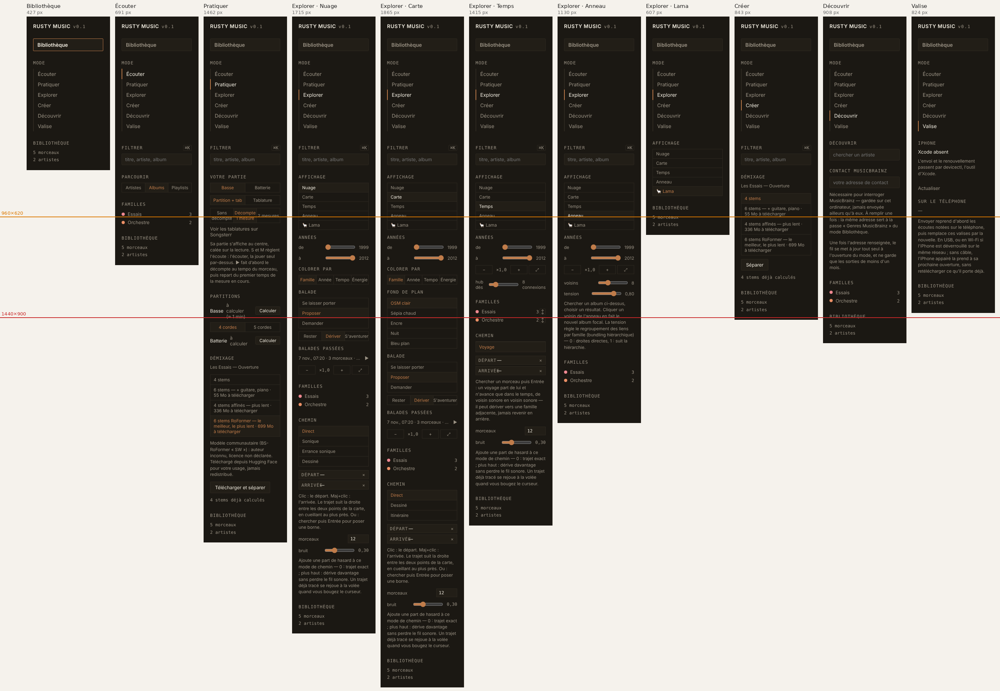

# Synthèse et plan : novembre 2026

> Faite le 7 nov. 2026 à la demande de François : faire le point sur tous les
> chantiers ouverts, comparer chaque étape de la chaîne à l'état de l'art pour
> voir quelles autres pistes explorer, vérifier la cohérence de l'interface
> (rôle de chaque zone, dans chaque mode) et l'organisation du code, puis poser
> un plan d'implémentation complet.
>
> **Lu** : `CLAUDE.md`, `suite.md`, la fin de `journal.md` (balade, Pratiquer
> et Créer, P4), `interface-guidelines.md`, `plan-balade.md`,
> `plan-editer-pratique-creation.md`, `recherche-coach-pratique.md`,
> `MODELES.md`, `rust-audio-stack.md`, le code (tailles, dépendances,
> `modes.js`, `maplibre.js`, `pratiquer.js`, `projection.rs`).
> **Lancé** : les 35 tests de fumée (tous verts sur l'arbre de travail du
> 7 nov. à 7 h 30 UTC, P5 compris) ; un relevé zone par zone de l'interface
> simulée (Chromium, `faux-tauri.js`, `fixtures.js`) sur 14 états, avec
> captures ; la hauteur du contenu du rail dans chaque écran.
> **Pas lancé** : `verifier.sh`, `audit-interface.sh` (il faut l'application
> native) et aucun build Rust.
> **Rien n'a été modifié dans le code** : une autre session travaillait sur P5
> au même moment (fichiers modifiés à 7 h 26 et 7 h 28).
>
> Convention : **(mesuré)** = relevé pour ce document ; **(lu)** = dans une
> source citée ; **(inférence)** = proposition, non vérifiée.

## En bref

- **Le projet est mûr et bien tenu.** 82 000 lignes de Rust, 19 000 de JS,
  211 commandes Tauri, et une documentation qui trace chaque décision et
  chaque mesure. Trois chantiers sont soldés : l'assainissement, les idées de
  Disc Player et Écouter v0.2/v0.3. La balade en est à P5 sur dix pistes.
  Pratiquer et Créer viennent d'être séparés. Le coach n'existe encore que
  comme recherche.
- **Le dépôt d'abord.** Deux chantiers non commités sont mêlés dans l'arbre de
  travail : la séparation Pratiquer/Créer et P5. Cela fait 33 fichiers
  modifiés et 5 nouveaux. Il faut les séparer en deux commits avant toute
  autre chose.
- **L'interface tient ses onze règles, mais le rôle du rail n'est écrit
  nulle part.** Le rail porte à la fois la navigation, les réglages de la vue,
  des outils, des réglages d'application, une douzaine de paragraphes d'aide
  et une mention de licence. (mesuré) En Explorer · Carte, le contenu du rail
  fait 1 865 px pour 836 px visibles à 1 440 × 900, soit 2,2 écrans. Il fait
  1 462 px en Pratiquer, et ce avec 2 familles seulement : la vraie
  bibliothèque en a 12. L'audit ne le détecte pas, parce que le rail défile.
  Ce document propose une Règle 12 (le rôle des zones) et une Règle 13 (un
  budget de hauteur pour le rail, mesuré).
- **Cinq défauts relevés sur l'interface simulée** (§ 2.3), dont une fuite de
  « Choisir l'édition… » dans quatre écrans et une aide « clic : écouter » qui
  contredit la Règle 1.
- **Le code.** Les frontières entre crates sont saines. Trois ensembles ont
  dérivé : `maplibre.js` porte tout Explorer ; `pratiquer.js` porte tout
  l'établi, y compris la greffe, qui relève de Créer ; `core` est devenu un sac
  de 41 modules. `modes.js` règle la visibilité par 26 affectations
  booléennes, et c'est cette forme qui produit les fuites.
- **La littérature confirme la plupart des choix** : Beat This!,
  BS-RoFormer, ADTOF sur le stem, Basic Pitch et MuScriptor, all-in-one, et
  pour le Lama le principe « le LLM traduit, le code exécute ».
  - **Quatre pistes méritent un banc.**
    - **L'empreinte.** MuQ-MuLan et CLaMP 3 passent devant CLAP. C'est le
      levier le plus en amont : vos propres mesures placent le plafond de la
      carte et de la balade dans l'empreinte.
    - **L'étirement.** Signalsmith Stretch ou Rubber Band contre WSOLA, avec
      la transposition en temps réel.
    - **La super-résolution.** Apollo, conçu pour restaurer le MP3.
    - **La compatibilité entre stems.** Stem-JEPA, à côté de COCOLA.
  - **Une piste neuve pour la balade** : apprendre les poids de la pente à
    partir des choix faits aux carrefours.
- **Le plan** (§ 5) :
  1. consolider (½ j) ;
  2. réparer et clarifier l'interface (2 j) ;
  3. ranger le code sans changer le comportement (3 j) ;
  4. puis trois fronts en parallèle : finir la balade ; donner une mémoire à
     Pratiquer, puis le coach ; chercher le greffon. Chaque remplacement de
     modèle passe d'abord par un banc.

---

## 1. Où en est chaque chantier

| Chantier | État au 7 nov. | Ce qui reste | Où dans le plan |
|---|---|---|---|
| Assainir le dépôt (31 oct.) | phases 0 à 8 faites | — | clos |
| Idées reprises de Disc Player (1ᵉʳ nov.) | fait | essais sur l'iPhone (passages, valise par le Wi-Fi) | hors plan |
| Écouter v0.2, v0.3 | soldés | Opus lent (`opus-decoder`, 11 à 13 s pour ouvrir un morceau) ; aucune case pour couper la popularité ni les pochettes de repli | G4 |
| Balade musicale (5 nov.) | P0 à P4 commités ; **P5 fait, non commité, sans entrée de journal** ; P7 essayé, sans effet net | mesure d'usage (`balade-mesure.json`, à relever vers le 12 nov.) ; P8, P6 ; P9 selon l'usage | A1, D |
| Pratiquer / Créer (5 nov.) | séparation faite, **non commitée** (l'entrée de journal, elle, est commitée) | mémoire par morceau (question ouverte, décision 13) ; 1.5 corriger la transcription ; 2.2 chercher le greffon ; 2.3, 2.5 à 2.7 ; un inspecteur propre à chaque usage | A1, E, F |
| Coach de pratique (5 nov.) | recherche faite (`recherche-coach-pratique.md`), rien de codé | neuf étapes, à commencer par la calibration et la batterie MIDI | E4, E5 |
| Compagnon iOS « Rusty Valise » | il tourne ; valise et passages faits | étapes 1, 3 et 7 ; essais ; mesures de batterie | hors plan (inchangé) |
| Backend `burn/metal` | parité, sauf htdemucs_6s | localiser l'écart MSL dans `demucs-core` | hors plan |
| Contrat d'interface | 234 cellules, 0 violation (6 nov.) | le document a pris du retard sur le code (§ 2.6) ; le rôle du rail n'est pas écrit | A3, B |

---

## 2. L'interface : le rôle de chaque zone, mode par mode

### 2.1 Les zones, telles que le code les fait

| Zone | Ce qu'elle porte aujourd'hui | Verdict |
|---|---|---|
| **Rail gauche** (232 px) | l'identité, Bibliothèque, les six modes, puis des blocs propres à l'écran : réglages de vue (filtrer, affichage, années, couleurs, familles) **mêlés** à des outils (chemin, balade, démixage, partitions), à des réglages d'application (contact MusicBrainz), à des aides de 5 à 10 lignes et à une mention de licence | rôle non défini ; trop chargé en Explorer et en Pratiquer |
| **Centre** | l'objet du mode : grille ou liste, établi, nuage, carte, frise, anneau, Lama, fil, valise, tableau de bord. Sur la carte, quelques commandes sont posées sur l'objet : « Entendre autour », le bandeau de la balade, le panneau du carrefour | conforme ; mais le zoom et le fond de plan sont restés dans le rail alors que l'aura et la balade vivent sur la carte |
| **Inspecteur droit** (300 px) | ce qui est sélectionné ou ce qui joue, et ses actions (▶ ✦ ♡) ; le détail d'un stem | conforme (un seul arbre DOM partout). En Pratiquer et Créer, il ne montre rien de propre à l'usage (doigtés, candidats de greffe) : prévu par la décision 13, pas encore fait |
| **Bas** | le transport (toujours) ; la barre de l'établi (vitesse, hauteur, export) quand des stems ont la main | conforme |
| **Surimpressions** | la file (à droite), la palette ⌘K, la vue « En cours », les éditions face à face, le menu du clic droit, le panneau du carrefour | conformes |

### 2.2 Mode par mode (mesuré, interface simulée, 1 440 × 900)

Hauteur du rail = hauteur de son contenu, avec les 2 familles de `fixtures.js`.
Avec les 12 familles de la vraie bibliothèque, il faut compter environ
230 px de plus dans les écrans qui montrent la légende (inférence : 23 px par
ligne).

| Écran | Rail : blocs visibles | Rail (px) | Centre | Inspecteur | Bas |
|---|---|---:|---|---|---|
| Bibliothèque | — | 427 | tableau de bord, réglages repliés | ce qui joue | transport |
| Écouter | Filtrer, Parcourir, Familles | 691 | grille / liste / bandeau d'artiste | sélection, sinon ce qui joue | transport (+ file) |
| Pratiquer | Filtrer, Votre partie (+ aide de 7 lignes), Partitions, Démixage (+ mention de licence) | **1 462** | choisir → séparer → établi (partition et bande de stems) | morceau source ; stem sélectionné | barre de l'établi + transport |
| Explorer · Nuage | Filtrer, Affichage, Années, Colorer par, Balade, Balades passées, Zoom, Familles, Chemin (+ aide), morceaux, bruit (+ aide) | **1 715** | nuage, aura, balade | idem | transport |
| Explorer · Carte | les mêmes, plus Fond de plan | **1 865** | carte | idem | transport |
| Explorer · Temps | Filtrer, Affichage, Années, Zoom, seuil de liens, Familles, Chemin « Voyage » (+ aide), bruit (+ aide) | **1 415** | frise | idem | transport |
| Explorer · Anneau | Filtrer, Affichage, Années, Zoom, voisins et tension (+ aide), Familles | **1 130** | anneau | idem | transport |
| Explorer · Lama | Affichage | 607 | panneau du Lama | idem | transport |
| Créer | Filtrer, Démixage (4 variantes) | 843 | choisir → séparer → pile | morceau source ; stem | barre de l'établi + transport |
| Découvrir | Chercher un artiste, Contact MusicBrainz (+ 2 aides), Familles | 908 | fil | ce qui joue | transport |
| Valise | iPhone (+ 2 aides) | 824 | composition et albums | ce qui joue | transport |



*Les lignes marquent la hauteur visible du rail : en rouge à 1 440 × 900
(836 px), en orange à 960 × 620 (556 px).*

### 2.3 Défauts relevés

Les cinq premiers sont des défauts nets, reproduits sur l'interface simulée.
Les suivants sont des écarts au principe de divulgation progressive.

| # | Défaut | Preuve | Correction |
|---|---|---|---|
| I1 | **« Choisir l'édition… » fuit** dans l'en-tête d'Explorer, de Découvrir, de Valise et de Bibliothèque quand on y arrive depuis un album ouvert dans Écouter | (mesuré) visible dans les quatre écrans. `poser()` le règle (`ecouter.js:447`), mais `basculerMode()` ne le masque jamais | masquer hors d'Écouter ; un test de fumée par contrôle d'en-tête |
| I2 | **Le titre dit « Carte » en Nuage, Temps et Anneau** (il dit « Lama » en Lama) | (mesuré) `#fil-titre` | le titre prend le nom de l'affichage |
| I3 | **L'aide de la carte dit « clic : écouter »**, alors que le clic sélectionne en silence depuis le 14 sept. (Règle 1) | `index.html:621`, `fond-de-plan.js:285` ; le gestionnaire (`maplibre.js:2227`) appelle `selectionner` et jamais `play` | « clic : choisir » |
| I4 | **« Filtrer » reste dans le rail de Pratiquer et de Créer établi ouvert**, alors qu'il n'y a plus rien à filtrer. Bibliothèque, Découvrir et Valise le masquent pour cette raison | (mesuré) | le montrer dans l'état « choisir » seulement |
| I5 | **Les stems s'appellent Drums, Bass, Other, Vocals, Guitar, Piano** (le nom du moteur, `.stem__nom` = `s.nom`), quand le rail dit Basse et Batterie : un même objet sous deux noms (Nielsen) | `pratiquer.js:1903`, `roformer/mod.rs:73` | une table de libellés français côté interface ; le nom du moteur reste la clé |
| I6 | **Le rail déborde** : de 1 130 à 1 865 px en Explorer et 1 462 en Pratiquer, soit 2,2 hauteurs visibles à 1 440 × 900 et 3,4 à 960 × 620 | (mesuré) § 2.2. G3 ne le voit pas, puisque le rail défile | Règle 13, plus G8 dans `audit.js` |
| I7 | **Une douzaine d'aides permanentes de 5 à 10 lignes** dans les rails (chemin, bruit, tension de l'anneau, partie, valise, contact) | captures | état vide du centre, ou « ? » qui déplie |
| I8 | **Un réglage à deux endroits** : l'adresse de contact MusicBrainz est dans Découvrir et dans Bibliothèque (l'aide le dit elle-même) | capture de Découvrir | un seul endroit, Bibliothèque ; Découvrir y renvoie depuis son état vide |
| I9 | **Une mention de licence permanente dans le rail de Pratiquer** (« Modèle communautaire (BS-RoFormer « SW ») : auteur inconnu… ») | capture | dans « À propos » et dans la boîte du premier téléchargement |
| I10 | Pratiquer : le segment du décompte (« Sans décompte · Décompte 1 mesure · 2 mesures ») passe sur deux lignes, serré dans 232 px | capture | deux libellés courts (« sans », « 1 mes. », « 2 mes. ») ou une liste |

### 2.4 Proposition : deux règles de plus

**Règle 12 — Une zone, un rôle.**

- **Le rail dit où je suis et ce que je regarde.** On y trouve la navigation,
  puis les réglages de la *vue* : filtrer, affichage, années, couleurs,
  familles. On n'y met pas d'outil qui agit sur un objet, pas de réglage
  d'application, pas d'aide de plus d'une ligne, pas de mention légale.
- **Le centre porte l'objet, et les commandes qui s'y posent** : zoom,
  calques, aura, chemin, bandeau de balade, carrefour. C'est la convention de
  toute carte en ligne, et c'est déjà celle de l'aura et de la balade.
- **L'inspecteur porte ce qui est choisi ou ce qui joue**, et ce qu'on peut
  en faire.
- **Le bas porte le temps** : le transport, et la barre de l'établi quand des
  stems ont la main.
- **Une aide de plus d'une ligne** vit dans l'état vide du centre, ou derrière
  un « ? ». **Une mention de licence** vit dans « À propos » et au moment du
  téléchargement.

**Règle 13 — Le rail tient dans la fenêtre.** À 1 400 × 900, avec les douze
familles, ce que le rail montre sans geste tient dans sa hauteur ; un
`<details>` fermé ne compte que pour son titre. On le mesure par un G8 dans
`audit.js` (l'outil de ce relevé en donne la méthode : le bas du dernier
élément visible).

**Ce que ça déplace** (inférence ; gains estimés sur les captures) :

| Écran | Dans le rail aujourd'hui | Où le mettre | Gain |
|---|---|---|---:|
| Explorer (Nuage, Carte, Temps, Anneau) | zoom − ×1,0 + ⤢ | coin de la carte, à côté de « Entendre autour » (la molette fait déjà le même geste) | ~60 px |
| Explorer · Carte | Fond de plan : 5 palettes, Pentes, Brouillard, Sentiers battus | un bouton « Calques » sur la carte, qui ouvre un panneau flottant | ~250 px |
| Explorer · Nuage, Carte | Balade : intervention, allure | le bandeau de la balade (ces réglages ne servent qu'une fois la balade lancée ; au départ, on reprend les derniers choisis) | ~100 px |
| Explorer · Nuage, Carte | Balades passées | `<details>` fermé | ~50 px |
| Explorer (sauf Lama) | Chemin : mode, départ, arrivée, morceaux, bruit, deux aides | un outil « Chemin » sur la carte, dont le panneau s'ouvre au premier Maj+clic ou au bouton ; le rail n'en garde rien | ~400 px |
| Explorer · Anneau | l'aide de la tension | « ? » | ~100 px |
| Pratiquer | l'aide « Sa partie s'affiche au centre… » | l'état vide du centre, avant la première lecture | ~150 px |
| Pratiquer | la mention de licence de SW | « À propos », boîte de téléchargement | ~100 px |
| Pratiquer, Créer (établi ouvert) | Démixage : les 4 variantes | une ligne « 6 stems RoFormer · changer » ; la liste reste dans l'état « séparer », au centre | ~200 px |
| Pratiquer, Créer (établi ouvert) | Filtrer | masqué (I4) | ~70 px |
| Découvrir | Contact MusicBrainz, 2 aides | Bibliothèque (I8) | ~280 px |
| Valise | 2 aides | état vide ou « ? » | ~150 px |

Avec ces déplacements, Explorer · Carte passerait d'environ 2 100 px (avec 12
familles) à environ 1 000 px. Il resterait à gagner environ 170 px. Deux
façons d'y arriver : un Affichage plus compact (deux rangées de trois au lieu
d'une liste de cinq), ou une légende des familles en deux colonnes. Il faut
le mesurer, pas le deviner.

### 2.5 Décisions à prendre

1. **Valise : un mode, ou un lieu ?** Les cinq autres modes sont des façons
   d'être avec la musique : écouter, pratiquer, explorer, créer, découvrir.
   Valise règle un appareil, comme Bibliothèque règle la collection.
   Proposition (inférence) : poser Valise à côté de Bibliothèque, au-dessus
   du sélecteur. On aurait alors cinq modes et deux lieux. Règle candidate :
   « un mode est une activité sur la musique ».
2. **Les outils de la carte sur la carte** (zoom, calques, chemin) : oui ou
   non ? C'est la plus grosse part du gain de la Règle 13. **Tranché le
   7 nov. : oui** (prompt B4), avec trois compactages choisis sur mesure :
   les modes et la légende des familles sur deux colonnes, le compte de la
   bibliothèque dans son bouton. Les décisions 1, 3 et 4 restent ouvertes.
3. **« Flâner d'ici »**. Cette action n'est aujourd'hui qu'au clic droit :
   elle a été retirée de l'inspecteur le 5 nov., parce qu'à côté de ✦ elle ne
   disait pas en quoi elle diffère. Selon la Règle 12, une action sur un
   élément a sa place dans l'inspecteur, et un clic droit ne se devine pas.
   Option : la remettre avec un libellé qui la distingue (« Flâner d'ici ·
   la suite se choisit en marchant »). Votre retour d'usage décide.
4. **L'inspecteur de Pratiquer et de Créer.** La décision 13 annonce
   « doigtés et corrections » d'un côté, « candidats de greffe » de l'autre.
   Il faut écrire ce que montre chacun avant E2 et F1, sinon chaque chantier
   le décidera pour lui-même.

### 2.6 Le document de contrat a pris du retard

`interface-guidelines.md` :

- parle encore de « quatre boutons » et de « cinq écrans » dans le socle
  commun ;
- donne la bio d'artiste au centre comme « 🔧 chantier de code ouvert » dans
  l'audit d'Écouter, alors qu'elle est faite (`#autour-artiste`,
  `bio_artiste`) ;
- cite des numéros de ligne d'`index.html` qui ne sont plus les bons
  (`index.html:604`, `:698`, `:797-807`…) ;
- a une seule ligne d'audit « Éditer », au lieu d'une pour Pratiquer et une
  pour Créer ;
- n'a pas de ligne pour les surimpressions de la balade (bandeau, carrefour,
  aura, brouillard).

Proposition : un document de règles court et normatif (les règles 1 à 13,
la checklist), et un document d'audit à part, daté. Les bandeaux « Sept
écrans… », « Sixième écran… » passent dans l'historique.

---

## 3. L'organisation du code

### 3.1 Les tailles (mesuré, `src/` seulement)

| Partie | Lignes | Plus gros fichiers |
|---|---:|---|
| `crates/core` | 24 720 (41 modules + `db/`) | `db/tests.rs` 2 704, `ollama.rs` 2 590, `db/carte.rs` 2 044, `valise.rs` 1 325, `db/enrichissement.rs` 1 300 |
| `crates/carto` | 16 439 | `style.rs` 2 279, `affectation.rs` 2 024, `tuiles.rs` 2 000, `ville.rs` 1 579, `balade.rs` 1 156 |
| `apps/desktop/src` | 16 329 (211 commandes) | `bibliotheque.rs` 2 092 (60 commandes), `editer.rs` 2 042, `explorer/lama.rs` 1 805, `explorer/carte.rs` 1 279, `explorer/balade.rs` 1 201 |
| `crates/analysis` | 7 352 | `reseau.rs` 1 694, `chemin.rs` 1 578, `descripteurs.rs` 1 198 |
| `crates/transcription` | 5 181 | `tablature.rs` 732, `muscriptor/` |
| `crates/player` | 4 205 | `lib.rs` 1 513, `multipiste.rs` 1 343 |
| `crates/editor` | 3 533 | `greffe.rs` 1 011 |
| `crates/cli` | 2 780 | un seul fichier |
| `apps/desktop/ui/js` | 19 145 (30 modules) | `maplibre.js` 2 671, `pratiquer.js` 2 666, `bibliotheque.js` 1 759, `ecouter.js` 1 661, `lama.js` 1 172, `lecteur.js` 1 161 |
| `index.html`, `style.css` | 1 597, 2 348 | |

**Ce qui va bien.** Le graphe des crates est sans cycle, et `analysis` ne
dépend de `player` que pour un banc (`dev-dependencies`). Les moteurs sont
purs et testés : `carto::balade`, `pentes`, `accrochage`, `seriation`. Les
migrations sont versionnées. L'interface est en modules ES, avec une seule
copie de l'état de lecture. Les tests de fumée tournent en moins d'une minute, sans Rust.

### 3.2 Ce qui a dérivé

| # | Constat | Proposition |
|---|---|---|
| O1 | **Deux chantiers mêlés dans l'arbre de travail**, et une seconde session qui écrit en même temps | A1 : deux commits séparés, par fichiers ; un seul chantier ouvert par session |
| O2 | **`modes.js` décide de la visibilité par 26 affectations booléennes** (`$("x").hidden = explorer \|\| bibliotheque \|\| …`). Ses commentaires racontent déjà trois fuites corrigées une à une (bandeau d'artiste, repère A–Z, tri) ; I1 est la quatrième | une table déclarative : écran → blocs du rail, contrôles d'en-tête, vue centrale. Une fonction l'applique, et chaque élément n'est décidé qu'à un seul endroit. Un test de fumée vérifie la table écran par écran |
| O3 | **Les noms n'ont pas suivi la séparation.** `editer.js` porte l'état `edition` et un peu de Créer. `pratiquer.js` porte tout l'établi : stems, variantes, vitesse, hauteur, spectres, mais aussi la greffe (`zoneGreffe`, `greffer`), qui relève de Créer. `apps/desktop/src/editer.rs`, `#editer-separer`, `#editer-etabli` ; la crate `editor` | JS : `etabli.js` (le commun), `pratiquer.js` (partition, décompte, partie, transcription), `creer.js` (greffe, candidats). Rust : `etabli.rs`, `pratiquer.rs`, `creer.rs`. Les identifiants DOM et la crate peuvent rester : ce sont des clés internes |
| O4 | **`maplibre.js` est tout Explorer** : nuage, frise, anneau (et son regroupement des liens), carte GL, filtres d'années, zoom, chemins, lasso, légende des familles (partagée par trois modes) | `explorer/nuage.js`, `temps.js`, `anneau.js`, `carte-gl.js`, `chemins.js` ; `familles.js` au niveau commun |
| O5 | **`core` est un sac** : base et scan, mais aussi les clients d'enrichissement (MusicBrainz, Deezer, Last.fm, ListenBrainz, TheAudioDB, CritiqueBrainz, Discogs, Cover Art Archive), le LLM (`ollama.rs`, `llm_local.rs`, `filtres_playlist.rs` ; la feature `lama-local` compile llama.cpp dans `core`), la Valise (`valise`, `passage`, `appairage`) et des briques audio (`decode`, `opus`, `gapless`, `loudness`, `volume`). Toucher `core` recompile tout | quatre crates : `core` (base, scan, tags, surveillance, session) ; `enrichissement` ; `lama` ; `valise`. Les briques audio partent dans `player` ou dans une petite crate `audio` |
| O6 | **`apps/desktop/src/bibliotheque.rs` : 60 commandes** | un module par domaine : passes d'enrichissement, vérifications, réglages, stockage |
| O7 | **211 commandes recopiées à la main dans `fixtures.js`** : la forme dérive sans bruit, et c'est la règle « mettre à jour `fixtures.js` » qui la retient | option (inférence) : générer les types depuis Rust (`tauri-specta`) et vérifier les réponses figées contre eux. Compatibilité avec Tauri 2.11 à confirmer |
| O8 | **La projection est recalculée depuis zéro** à chaque passe (`passe.rs:282`) : le nuage peut tout redistribuer après un ajout d'albums (Règle 4, mémoire spatiale) | partir des coordonnées précédentes, et ne placer que les nouveaux (voir § 4, Kiite World) |
| O9 | `target/` pèse **84 Go** (mesuré), malgré la compilation incrémentale coupée | `cargo sweep` ou nettoyage par crate, en routine ; à écrire dans le README |
| O10 | Le monde fictif (`peuplement.rs`, `relief.rs`, `projection.rs`, une partie de `tuiles.rs` et de `source.rs` : au moins 1 350 lignes) ne sert que sans ville importée | à garder, mais figé : aucune nouvelle fonction n'y va. Question : un premier lancement sans ville est-il encore un cas réel ? |

---

## 4. La chaîne, étape par étape, face à la littérature

Verdicts : **garder** (rien de mieux pour nos contraintes), **banc** (un
candidat mérite une mesure sur nos données), **changer** (gain déjà
mesuré). Rappel des contraintes : exécution locale, Rust, binaire GPL-3,
poids sous toute licence (NC comprise) selon la politique du 8 oct.

| Étape | Choix actuel | Ce que dit la littérature (2024-2026) | Verdict |
|---|---|---|---|
| Décodage | symphonia + `opus-decoder` | (mesuré, P4) `opus-pure` décode 15 s en 10,5 ms contre 787 ms | **changer** (G4) |
| Identification, doublons | tags + MusicBrainz, pas d'empreinte acoustique | Chromaprint/AcoustID est la référence (beets, Picard) ; `rusty-chromaprint` (MIT, 0.2.0, févr. 2024) est un portage « en cours » | option (G5) |
| Normalisation | `ebur128`, ReplayGain 2.0 | standard | garder |
| **Empreinte** | CLAP `laion/clap-htsat-unfused` (2023) | MuQ-MuLan bat LAION-CLAP sur la similarité perçue entre extraits d'un même morceau (96,6 % contre 89,3 %), fait jeu égal entre morceaux différents (72,4 % contre 71,9 %), et la pondération par instrument profite surtout à lui (90,4 %). Le jeu est petit (~330 triplets synthétiques Slakh) et le checkpoint CLAP testé n'est pas le nôtre. CLaMP 3 bat CLAP en texte → audio (MRR 0,199 contre 0,131 sur Song Describer). MuQ-MuLan : ~700 M paramètres, 24 kHz, code MIT, **poids CC BY-NC 4.0**, export ONNX publié par un tiers | **banc prioritaire** (G1) |
| Projection 2D | t-SNE Barnes-Hut (`bhtsne`), recalculée à chaque passe | (lu, votre code) 13 % des 12 plus proches voisins survivent, 43 % de pureté de genre ; « le plafond est dans l'empreinte » (`projection.rs`). Kiite World (AIST, 440 000 morceaux) initialise chaque mise à jour quotidienne de son UMAP depuis les coordonnées de la veille, pour que la carte reste stable | **piste** de stabilité (D5) ; le reste suit G1 |
| Familles | vocabulaire de genres + k-means++ | « multi-représentation » (son + relations + étiquettes) chez MusicAtlas | garder ; revoir après G1 |
| Placement de la ville | croissance chronologique ; P7 sans effet | les mises en grille qui préservent les distances (Linear Assignment Sorting, Barthel et al. 2023 ; tri par gradient, 2025) optimisent un voisinage en 2D, alors que la sériation de P7 était un chemin en 1D. Mais P7 a montré que la limite est le *contenu* des cellules (0,152 entre albums d'une même famille), pas leur ordre | garder (décision du 23 août) |
| **Balade, pente** | 5 termes, poids réglés à la main, 3 allures | les recommandeurs interactifs apprennent des choix : bandit bayésien qui dose nouveauté et goût (Wang et al., 2013) ; préférences de transitions apprises (DJ-MC, Liebman et al. 2019). Un carrefour est exactement un choix discret entre 2 ou 3 voies décrites par les mêmes facettes : c'est un logit conditionnel | **piste neuve** (D3), après la mesure d'usage |
| Lama | Gemma 4 E4B (llama.cpp), sortie contrainte par schéma JSON (`llguidance`) | conforme à l'état de l'art (« le LLM traduit, le code exécute ») ; la recherche vectorielle gagnerait avec une meilleure tour texte (CLaMP 3, MuQ-MuLan) | garder ; suit G1 |
| Démixage | HTDemucs (Créer), BS-RoFormer SW (Pratiquer) | Moises-Light : ~5 M paramètres, 9,96 dB de moyenne sur MUSDB-HQ, contre 9,80 pour BS-RoFormer (72 M) et 7,68 pour HTDemucs ; aucun poids publié à notre connaissance. SCNet-S : 10 M, 9,00 dB | garder ; surveiller un modèle léger pour démixer les candidats de greffe (F1) |
| Batterie en fûts (2.5) | prévu : LarsNet | LarsNet (poids CC BY-NC) ; DrumSep (MDX23C, communautaire, MVSep) | **banc** (F3) |
| Pulsation | Beat This! | reste la référence de 2026 : c'est la base qu'analyse un article de mai 2026 sur les échecs du suivi de temps (F = 0,627 sur SMC, le jeu rythmiquement difficile) | garder |
| Sections | all-in-one | SongFormer (oct. 2025) fait mieux : HR.5F 0,703 contre 0,596, étiquettes 0,807 contre 0,740 sur Harmonix. Mais il repose sur MuQ **et** MusicFM, gelés ; code CC BY 4.0 | garder ; à revoir **seulement si** G1 retient MuQ (le tronc serait alors déjà là) |
| Transcription basse | Basic Pitch ; MuScriptor (2026) en « Qualité » | à jour | garder |
| Transcription batterie | ADTOF sur le stem | Weyers et al. (ISMIR 2025) : F ≈ 0,91 sur batterie seule, ≈ 0,78 dans le mélange ; les coups simultanés et les coups faibles (cymbales, notes fantômes) sont les limites ; changer de kit coûte 17 à 21 % (en relatif). Un transformeur entraîné sur données synthétiques annonce mieux qu'ADTOF sur des enregistrements de batterie seule (Melucci et al., janv. 2026 ; code publié, poids non mentionnés) | garder ; **le coach doit tenir cymbales et notes fantômes pour incertaines** (E4) |
| Tablature | programmation dynamique maison (`tablature.rs`) | Fretting-Transformer (2025) et MIDI-to-Tab (2024), guitare seulement : 72 % contre 63 % pour A* sur Leduc | garder (basse monophonique, 4-5 cordes) ; la correction par l'utilisateur (1.5) vaut plus qu'un modèle |
| **Étirement, hauteur** | `wsola` (temporel) ; transposition = étirer puis rééchantillonner, 17,9 s par stem, mise en cache par réglage | WSOLA est le choix d'`atempo` et de VLC ; les vocodeurs de phase modernes font temps et hauteur ensemble, en temps réel : Signalsmith Stretch (MIT, enveloppe Rust `signalsmith-stretch` 0.1.3 qui compile le C++) ; Rubber Band R3 (GPL, déjà noté « disponible » dans `rust-audio-stack.md`). Aucune écoute comparée n'est au journal | **banc d'écoute** (E3) : ralenti à 0,5-0,8× sur du polyphonique, et transposition instantanée |
| **Super-résolution « HD »** | AERO (extension de bande, entraîné sur MUSDB18-HQ) | Apollo (2024) restaure la compression MP3 de 24 à 128 kbit/s : 16,5 M paramètres, causal (flux), SDR 16,64 contre 14,07 et ViSQOL 4,12 contre 3,29 face à SR-GAN. Code CC BY-SA 4.0 (compatible GPL-3 dans un sens), poids sur Hugging Face (licence non dite). FlashSR (2025) : diffusion distillée en un pas | **banc** (G2) sur les MP3 de la bibliothèque |
| **Compatibilité de stems** (2.3) | prévu : COCOLA | Stem-JEPA (ISMIR 2024), puis sa version zéro-shot (Sony CSL) : prédit l'empreinte d'un stem qui irait avec un mélange, l'instrument étant donné en texte par une tour texte **CLAP** (nous en avons une) ; R@1 22,0 % contre 9,9 % sur MoisesDB. Code publié, licence à lire | **banc** (F2) |
| Génération (2.7) | prévu : MusicGen-Stem, STAGE, ACE-Step 1.5 | inchangé depuis le plan d'oct. | garder l'ordre ; en dernier |
| Coach | recherche du 5 nov. | voir `recherche-coach-pratique.md` | E4, E5 |

**Pourquoi l'empreinte vient en tête.** Trois de vos propres mesures butent
sur la même limite :

- la projection ne garde que 13 % des voisins ;
- certaines familles sont *plus dispersées que le hasard* (Jazz 1,08 ×,
  Classique 1,31 ×) ;
- P7 conclut qu'« une famille est trop large pour faire une progression »
  (0,152 entre albums d'une même famille, 0,205 entre familles).

Un meilleur espace améliorerait d'un coup le nuage, les familles, les
voisins, le chemin sonique, la pente de la balade, l'aura et la recherche
texte du Lama. Mais changer d'empreinte coûte cher : réanalyser
27 800 morceaux, régénérer la carte, invalider tout ce qui a été réglé sur
CLAP. D'où un banc avant toute décision (G1), avec un seuil fixé d'avance.

**Ce que la littérature ne remet pas en cause.**

- **La ville comme plan.** La mémoire spatiale demande des emplacements
  stables. Kiite World en fait aussi une condition et tient sa carte stable
  d'un jour à l'autre.
- **L'aura.** Elle répond à « une carte qui se parcourt en silence n'est pas
  un environnement ».
- **La balade qui avance seule.** Les interfaces cartographiques qu'il faut
  piloter n'ont pas pris.
- **« Le LLM traduit, le code exécute ».**

---

## 5. Plan d'implémentation

Effort : **S** < 1 j · **M** 1 à 3 j · **L** > 3 j. Chaque étape suit les
contraintes communes de `plan-balade.md` :

- `CLAUDE.md` avant tout ;
- Rust seul à l'exécution, et ne rien réécrire qui existe ;
- `fixtures.js` à jour si une commande change de forme, une migration si le
  schéma change ;
- `interface-guidelines.md`, puis `audit-interface.sh` après toute mise en
  page ;
- `verifier.sh` vert, une entrée datée au journal, `suite.md` à jour ;
- ne pas toucher à `livre/`.

Pour les prompts ci-dessous, **une seule session à la fois** sur l'arbre de
travail.

### Phase A — Consolider (½ j)

| Étape | Contenu | Critère | Effort |
|---|---|---|---|
| A1 | Commiter séparément la séparation Pratiquer/Créer, puis P5 | `verifier.sh` vert à chaque commit ; `git status` propre | S |
| A2 | Ajouter au journal l'entrée de P5 (chiffres : 98,5 % sous le brouillard, migration n° 5…), mettre à jour le tableau d'avancement de `plan-balade.md` | P5 « fait » partout, avec date et où lire | S |
| A3 | Remettre `interface-guidelines.md` à jour (§ 2.6), sans nouvelle règle | plus aucune mention « quatre boutons », « cinq écrans », « Éditer » seul ; une ligne d'audit pour Pratiquer et une pour Créer ; numéros de ligne retirés | S |

```text
Prompt A1-A2
Lis CLAUDE.md, docs/suite.md et docs/synthese-novembre-2026.md (§ 1, § 3.2 O1).
L'arbre de travail porte deux chantiers non commités : la séparation d'Éditer en
Pratiquer et Créer (décision 13 de ui-spec-editeur.md) et P5 de la balade
(traces, brouillard : migration-005-balades.sql, db/balades.rs,
explorer/traces.rs, js/traces.js). Range les fichiers modifiés en deux groupes
(git diff fichier par fichier ; un fichier touché par les deux : git add -p).
Lance scripts/verifier.sh, puis commite la séparation, relance verifier.sh et
commite P5. Écris ensuite l'entrée de journal de P5 (ce qui a été fait ET
mesuré, comme pour P4) et mets P5 à « fait » dans le tableau d'avancement de
docs/plan-balade.md, dans un troisième commit. Ne change aucun comportement.
```

```text
Prompt A3
Lis docs/interface-guidelines.md et docs/synthese-novembre-2026.md (§ 2.6).
Mets le contrat à jour sans ajouter de règle : six modes et Bibliothèque dans le
socle commun ; la bio d'artiste au centre est faite (#autour-artiste,
bio_artiste), passe la ligne Règle 1 d'Écouter à ✅ ; retire les numéros de
ligne d'index.html ; remplace la section « Éditer » par deux sections
« Pratiquer » et « Créer » (vérifie chaque règle dans le code) ; ajoute une
section « Surimpressions de la carte » (bandeau de balade, carrefour, aura,
brouillard, menu du clic droit) avec les mêmes verdicts. Range les bandeaux
d'historique (« Sept écrans », « Sixième écran ») dans une section
« Historique » en fin de document.
```

### Phase B — L'interface (2 j)

| Étape | Contenu | Critère | Effort |
|---|---|---|---|
| B1 | Corriger I1 à I5 et I10 | un test de fumée par défaut ; 0 violation à l'audit | S |
| B2 | Table déclarative de la visibilité par écran (O2) | `basculerMode` sans affectation `hidden` au cas par cas ; un test parcourt les écrans et compare à la table | M |
| B3 | Écrire les Règles 12 et 13 ; ajouter G8 (hauteur du rail) à `audit.js`, avec une variante de fixtures à 12 familles | l'audit dit combien de px dépassent par écran | S |
| B4 | Désencombrer selon le tableau du § 2.4, après les décisions du § 2.5 | G8 vert à 1 400 × 900 ; aucun contrôle perdu (chaque geste a une place) | M |

```text
Prompt B1
Lis docs/interface-guidelines.md et docs/synthese-novembre-2026.md (§ 2.3).
Corrige, chacun avec son test de fumée dans apps/desktop/ui-tests/fumee.spec.js :
I1 #choisir-edition visible hors d'Écouter après un album ouvert (masque-le dans
basculerMode) ; I2 #fil-titre dit « Carte » en Nuage, Temps, Anneau (le titre
prend le nom de l'affichage) ; I3 l'aide « clic : écouter » (index.html et
fond-de-plan.js) devient « clic : choisir » ; I4 « Filtrer » masqué en
Pratiquer et Créer hors de l'état « choisir » ; I5 libellés français des stems
(Batterie, Basse, Voix, Autres, Guitare, Piano) par une table côté interface,
le nom du moteur restant la clé ; I10 segment du décompte qui tient sur une
ligne dans 232 px. Puis verifier.sh, audit-interface.sh, journal.
```

```text
Prompt B2-B3
Lis docs/interface-guidelines.md, apps/desktop/ui/js/modes.js et
docs/synthese-novembre-2026.md (§ 2.4, § 3.2 O2).
1. Remplace les affectations `hidden` de basculerMode par une table
   déclarative (écran → blocs du rail, contrôles de l'en-tête, vue centrale),
   appliquée par une seule fonction ; les états internes (sélecteur / séparer /
   établi, Lama) restent aux fonctions qui les gèrent, mais ne touchent plus
   aux éléments de la table. Ajoute un test de fumée qui parcourt les écrans et
   vérifie la table. Aucun changement visible.
2. Écris dans interface-guidelines.md la Règle 12 (une zone, un rôle) et la
   Règle 13 (le rail tient dans la fenêtre), telles que proposées au § 2.4, et
   la ligne correspondante de la checklist. Ajoute G8 à audit.js : bas du
   dernier élément visible du rail ≤ sa hauteur, à 1 400 × 900, avec une
   bibliothèque d'essai à 12 familles. Lance l'audit et reporte les dépassements
   par écran dans le journal (sans encore les corriger).
```

```text
Prompt B4 (après les décisions du § 2.5)
Lis docs/interface-guidelines.md (Règles 12 et 13), docs/synthese-novembre-2026.md
(§ 2.4, § 2.5 et les décisions prises) et le résultat de G8 au journal.
Explorer : zoom et « Calques » (palettes, Pentes, Brouillard, Sentiers) en
commandes posées sur la carte, à côté de « Entendre autour » ; les réglages de
la balade dans son bandeau ; l'outil Chemin sur la carte (son panneau s'ouvre
au premier Maj+clic ou au bouton) ; « Balades passées » repliées. Pratiquer et
Créer : Démixage réduit à une ligne quand l'établi est ouvert ; l'aide de
« Votre partie » dans l'état vide du centre ; la mention de licence dans
« À propos » et la boîte de téléchargement. Découvrir : l'adresse de contact
seulement dans Bibliothèque. Les aides de plus d'une ligne derrière un « ? ».
Aucun geste ne doit disparaître. Tests de fumée, G8 vert, audit, captures
avant/après au journal.
```

### Phase C — Ranger le code, sans changement visible (3 j)

| Étape | Contenu | Critère | Effort |
|---|---|---|---|
| C1 | JS : découper `maplibre.js` (O4) ; `etabli.js`, `pratiquer.js`, `creer.js` (O3) | 35 tests de fumée verts, aucun fichier de plus de 1 500 lignes dans `ui/js/` hors Lama et Bibliothèque | M |
| C2 | Rust, application : `editer.rs` → `etabli.rs`, `pratiquer.rs`, `creer.rs` ; `bibliotheque.rs` par domaine (O3, O6) | `verifier.sh` vert ; noms de commandes Tauri inchangés | M |
| C3 | Séparer `core` en `core`, `enrichissement`, `lama`, `valise` (O5) | `verifier.sh` vert ; temps de recompilation après une modification de `ollama.rs`, mesuré avant/après | M/L |
| C4 | Option : types générés (`tauri-specta`) et contrôle de `fixtures.js` (O7) | d'abord un essai sur 5 commandes, puis décision | S + ? |

```text
Prompt C1
Lis CLAUDE.md, docs/synthese-novembre-2026.md (§ 3.2 O3, O4) et
apps/desktop/ui/js/{maplibre,pratiquer,editer,carte}.js. Sans changer aucun
comportement : découpe maplibre.js en js/explorer/{nuage,temps,anneau,carte-gl,
chemins}.js et js/familles.js (la légende, partagée par Écouter, Explorer,
Découvrir) ; découpe pratiquer.js et editer.js en js/etabli.js (stems,
variantes, vitesse, hauteur, playhead, spectres, état `edition`),
js/pratiquer.js (partition, décompte, partie, transcription) et js/creer.js
(greffe, candidats). Un commit par découpage, les 35 tests de fumée verts à
chaque fois ; mets à jour l'ordre d'import (main.js) et les mentions de
fichiers dans docs/interface-guidelines.md.
```

```text
Prompt C3
Lis CLAUDE.md, docs/rust-audio-stack.md et docs/synthese-novembre-2026.md
(§ 3.2 O5). Mesure d'abord le temps de `cargo build -p rusty-music-desktop`
après avoir touché crates/core/src/ollama.rs. Puis sépare crates/core en :
core (db, scan, tags, watch, session, error, http), enrichissement
(musicbrainz, discogs, deezer, lastfm, listenbrainz, theaudiodb,
critiquebrainz, pochettes, popularité, éditions, biographies, enrichir),
lama (ollama, llm_local, filtres_playlist ; la feature lama-local y
déménage), valise (valise, passage, appairage). Les briques audio (decode,
opus, gapless, loudness, volume) : propose où les mettre avant de les
déplacer. Un commit par crate extraite, verifier.sh vert à chaque fois,
cargo deny vert. Remesure le temps de compilation et reporte-le au journal.
```

### Phase D — Finir la balade

| Étape | Contenu | Critère | Effort |
|---|---|---|---|
| D1 | Vers le 12 nov. : relever `balade-mesure.json` (carrefours vus, choix, « ailleurs », retours) | chiffres au journal ; décision sur P9 (moins d'un carrefour sur cinq avec un choix → P9 abandonné, la pente compte davantage) | S |
| D2 | P8, lieux à soi (épingles, chaînes) — tel que `plan-balade.md` | survivent à une régénération et à une réanalyse | M |
| D3 | **Nouveau** : apprendre la pente des choix faits aux carrefours (logit conditionnel sur les 5 facettes déjà calculées), en local, lisible (« vous prenez plus souvent le neuf que la pente ne le pense ») | pouvoir prédictif mesuré sur les choix tenus à l'écart, contre les poids fixes de *dériver* ; seulement s'il y a assez de choix (≥ 50) | M |
| D4 | P6, relief d'énergie — tel que `plan-balade.md` | celui de P6 | L |
| D5 | **Nouveau** : stabilité du nuage. Projection initialisée depuis les coordonnées précédentes ; les nouveaux morceaux placés près de leurs voisins puis optimisés seuls | déplacement médian des anciens points < 2 % de la largeur après l'ajout de 5 % de morceaux ; conservation de voisinage inchangée (~13 %) | M |

```text
Prompt D3
Lis docs/plan-balade.md (P2, P3), docs/synthese-novembre-2026.md (§ 4, ligne
« Balade, pente ») et l'entrée de journal qui relève balade-mesure.json.
Enregistre, pour chaque carrefour présenté, les facettes de chaque voie
(proximité, nouveauté, déjà-visité, usure, relation) et la voie prise (geste
ou défaut), dans balade_pas ou une table voisine (migration). Ajoute à
crates/carto un ajustement de logit conditionnel (descente de gradient, sans
dépendance nouvelle) qui estime les cinq poids. Mesure, par validation
croisée sur les carrefours enregistrés, la log-vraisemblance et la part de
voies bien prédites, contre les poids fixes de « dériver ». Pas d'interface
tant que le gain n'est pas mesuré ; s'il l'est, une quatrième allure « à mon
goût » qui affiche ses poids. Journal, suite.md, plan-balade.md.
```

```text
Prompt D5
Lis crates/analysis/src/projection.rs, crates/analysis/src/passe.rs et
docs/synthese-novembre-2026.md (§ 3.2 O8, § 4). Écris un banc qui projette la
bibliothèque, retire 5 % des morceaux au hasard (graine fixe), reprojette en
les rajoutant (a) depuis zéro, comme aujourd'hui, et (b) depuis les
coordonnées précédentes, les nouveaux placés au barycentre de leurs voisins
CLAP puis optimisés seuls quelques centaines d'itérations si bhtsne le
permet (sinon toute la projection, initialisée). Mesure le déplacement
médian et au 9ᵉ décile des anciens points, et la conservation des 12 voisins.
Si (b) tient le critère, branche-le dans la passe. Journal.
```

### Phase E — Pratiquer : mémoire, étirement, coach

| Étape | Contenu | Critère | Effort |
|---|---|---|---|
| E1 | Mémoire par morceau : une table SQLite (boucles nommées, vitesse atteinte, instrument, notation, décompte, variante de démixage) ; trancher la question ouverte de la décision 13 | rouvrir un morceau rend la séance comme on l'a laissée | M |
| E2 | 1.5 corriger la transcription : éditer une note de la partition ou de la tablature, et garder la correction | survit à une relance de la transcription ; prérequis du coach (« ne noter que contre une référence sûre ») | M |
| E3 | **Banc d'écoute** : `wsola` contre Signalsmith Stretch (MIT) et Rubber Band R3 (GPL), à 0,5, 0,7 et 0,8× et à ±2 demi-tons, sur 6 extraits polyphoniques ; coût CPU par bloc de 128 trames ; transposition en temps réel possible ? | décision écrite ; si un candidat gagne, la transposition sans attente (plus de 17,9 s par stem ni de cache par réglage) | M |
| E4 | Coach, étapes 1 à 3 de `recherche-coach-pratique.md` : calibration de latence, batterie MIDI, table par mesure, escalier de tempo ; cymbales et notes fantômes de la référence marquées incertaines (Weyers et al. 2025) | ceux de la recherche | L |
| E5 | Coach, étapes 4 à 6 : dynamique et groove MIDI, basse DI, éditeur de référence (avec E2) | ceux de la recherche | L |

```text
Prompt E1
Lis docs/ui-spec-editeur.md (décision 13, questions ouvertes),
docs/plan-editer-pratique-creation.md (1.5) et docs/recherche-coach-pratique.md
(« table par mesure »). Propose puis écris (migration) le schéma de la mémoire
de Pratiquer par morceau : boucles nommées (bornes en temps d'origine),
vitesse atteinte, instrument, notation, décompte, variante de démixage, et
une place pour les corrections de transcription (E2) et la table par mesure du
coach (E4), vides pour l'instant. Branche-la : ce qui est réglé est gardé, et
rouvrir le morceau rend la séance. Créer n'a rien à y mettre. Tests, fixtures,
fumée, journal, ui-spec-editeur.md (question tranchée).
```

```text
Prompt E3
Lis docs/journal.md (« wsola, et pas un vocodeur écrit à la main », 19 août),
docs/rust-audio-stack.md et docs/synthese-novembre-2026.md (§ 4, ligne
« Étirement, hauteur »). Dans experiments/ (hors workspace), écris un banc qui
rend 6 extraits de 20 s de la bibliothèque (batterie seule, basse seule, pop
dense, piano, voix, jazz) à 0,5, 0,7 et 0,8× et à ±2 demi-tons par : wsola
(+ rééchantillonnage pour la hauteur, comme aujourd'hui), signalsmith-stretch
(crate Rust, MIT) et Rubber Band (R3, GPL ; par sa bibliothèque C). Mesure le
coût par bloc de 128 trames (pire salve, comme cout_bloc) et le temps de
transposition d'un stem de 184 s. Écris les fichiers rendus pour une écoute à
l'aveugle et laisse-moi juger ; ne change rien dans l'application avant.
```

### Phase F — Créer : trouver le greffon

| Étape | Contenu | Critère | Effort |
|---|---|---|---|
| F1 | 2.2 chercher le greffon (préfiltre CLAP guidé par le texte, filtres de tempo, de métrique et de tonalité, démixage à la demande des 5 à 10 premiers, descripteurs de groove) — tel que le plan d'oct. | « une batterie plus funk » donne un classement que l'interface explique | M |
| F2 | **Banc** de compatibilité : COCOLA contre Stem-JEPA zéro-shot (instrument donné par la tour texte de CLAP) sur une vingtaine de greffes jugées à l'oreille | corrélation avec le jugement ; licence des deux lue avant tout port | M |
| F3 | Banc de séparation en fûts : LarsNet contre DrumSep | SDR sur un petit jeu annoté + écoute ; un seul porté en Burn | M |
| F4 | 2.7 générer un stem — ordre du plan d'oct. inchangé | — | L |

```text
Prompt F2
Lis docs/plan-editer-pratique-creation.md (2.2, 2.3), MODELES.md et
docs/synthese-novembre-2026.md (§ 4, ligne « Compatibilité de stems »).
Dans experiments/, mets côte à côte COCOLA et Stem-JEPA zéro-shot
(github.com/SonyCSLParis/Stem-JEPA) : lis d'abord les licences du code et
des poids, et écris-les. Sur 20 morceaux sources de la bibliothèque, prends
pour chacun 10 batteries candidates (voisins CLAP au tempo replié), fais
classer les candidats par les deux modèles et par la proximité CLAP seule ;
prépare les 20 × 3 greffes du premier choix de chaque méthode (greffer_par_
mesures) pour que je les juge à l'aveugle. Ne porte rien en Burn avant mon
jugement. Journal.
```

### Phase G — Bancs de modèles, avant tout remplacement

| Étape | Contenu | Critère de décision (fixé d'avance) | Effort |
|---|---|---|---|
| G1 | **Empreinte** : CLAP (actuel) contre MuQ-MuLan et CLaMP 3, sur 2 000 morceaux tirés au hasard (graine fixe) | adopter seulement si les deux gains dépassent 10 % : pureté de genre du voisinage (aujourd'hui 43 % après projection) et distance entre albums d'une même famille rapportée à la distance entre familles (0,152 / 0,205 aujourd'hui). Puis : recherche texte → audio sur une trentaine de demandes types du Lama, et coût par morceau sur le Mac | M |
| G2 | **Super-résolution** : Apollo contre AERO, sur 20 MP3 de 128 à 192 kbit/s de la bibliothèque, comparés à leur source FLAC quand elle existe | ViSQOL ou écoute à l'aveugle ; coût par minute de son | M |
| G3 | Sections : SongFormer, **seulement si G1 retient MuQ** | HR.5F sur 30 morceaux annotés à la main | M |
| G4 | Opus : `opus-pure` à la place d'`opus-decoder` dans le cœur | les 10 morceaux de Fingathing s'ouvrent en moins de 200 ms ; parité des échantillons décodés | S |
| G5 | Option : empreinte Chromaprint pour les doublons et l'identification | doublons trouvés en plus de ceux des tags ; licence et maturité de `rusty-chromaprint` | S/M |

```text
Prompt G1
Lis CLAUDE.md, docs/rust-audio-stack.md (politique des poids), MODELES.md,
crates/analysis/src/projection.rs (commentaire de tête) et
docs/synthese-novembre-2026.md (§ 4, « Pourquoi l'empreinte vient en tête »).
Dans experiments/ (Python permis pour un banc), calcule pour 2 000 morceaux
tirés au hasard (graine fixe) les empreintes CLAP (celles en base),
MuQ-MuLan (poids CC BY-NC 4.0, téléchargés à la source, jamais republiés) et
CLaMP 3 (lis sa licence d'abord). Pour chacune : pureté de genre des 12
voisins (genres MusicBrainz), même chose après t-SNE, distance médiane entre
albums d'une même famille et entre familles, recherche texte → audio sur les
exemples de prompts du Lama (rang du premier morceau jugé pertinent, une
liste que je validerai), coût par morceau sur ce Mac. Reporte un tableau au
journal et applique le critère de la synthèse (G1) ; ne touche pas à
l'application.
```

```text
Prompt G2
Lis docs/module3-superresolution.md, MODELES.md et
docs/synthese-novembre-2026.md (§ 4, ligne « Super-résolution »). Dans
experiments/, compare AERO (actuel) et Apollo (github.com/JusperLee/Apollo,
code CC BY-SA 4.0 ; lis la licence des poids) sur 20 MP3 de la bibliothèque
entre 128 et 192 kbit/s, et, quand le même album existe en FLAC, contre la
source. ViSQOL si disponible, sinon spectre et écoute à l'aveugle (prépare
les fichiers). Coût par minute de son sur le CPU et sur Metal. Décide si un
port Burn d'Apollo vaut la peine ; journal.
```

```text
Prompt G4
Lis docs/journal.md (P4, mesure opus-decoder contre opus-pure) et
crates/core/src/opus.rs. Remplace opus-decoder par opus-pure dans le cœur
(cargo deny vert), vérifie la parité des échantillons décodés sur les 10
morceaux Opus de la bibliothèque (écart maximal), mesure le temps
d'ouverture avant/après, et le gapless. Retire opus-pure des
dev-dependencies d'analysis s'il devient une dépendance normale. Journal,
suite.md (Cœur d'ingestion).
```

### Ordre et dépendances

```
A1 ─ A2 ─ A3 ─┬─ B1 ─ B2 ─ B3 ─ [décisions § 2.5] ─ B4
              │
              ├─ C1 (après B2 : même fichier modes.js) ─ C2 ─ C3 ─ (C4)
              │
              ├─ D1 (12 nov.) ─┬─ D3 (si ≥ 50 choix)
              │                ├─ D2 ─ D4
              │                └─ (P9 selon D1)
              ├─ D5
              │
              ├─ E1 ─ E2 ─ E4 ─ E5
              │   └── E3 (indépendant ; avant E4 si la transposition change)
              │
              ├─ F1 ─ F2 ─ F3 ─ F4
              │
              └─ G4 ; G1 ─ (G3 si MuQ) ; G2 ; (G5)
```

Les bancs (E3, F2, G1, G2) se mènent en parallèle du reste : ils ne touchent
pas l'application. B et C touchent les mêmes fichiers, donc l'un après
l'autre. G1 décide de beaucoup : s'il retient une autre empreinte, la carte
est à régénérer, et D3 et D5 sont à remesurer. Mieux vaut le lancer tôt.

### Avancement

| étape | état | date | où lire |
|---|---|---|---|
| A1-A2 consolider | fait : séparation, P5 (code, puis journal), P6, P8, chacun son commit, `verifier.sh` vert à chaque fois | 7 nov. 2026 | `git log` ; `journal.md`, « P5 » |
| A3 contrat à jour | fait : six modes, bio au centre ✅, sections Pratiquer et Créer, surimpressions de la carte, historique en fin ; aucune règle ajoutée | 7 nov. 2026 | `interface-guidelines.md` |
| B1 défauts I1-I5, I10 | fait : six corrections, six tests de fumée (45 en tout), audit 252 cellules, 0 violation | 7 nov. 2026 | `journal.md`, « B1 » ; `interface-guidelines.md` |
| B2 table des écrans | fait : `js/ecrans.js`, une seule fonction écrit `hidden` ; un test de fumée parcourt les écrans ; audit sans violation G1-G7 | 7 nov. 2026 | `journal.md`, « B2-B3 » |
| B3 Règles 12-13, G8 | fait : règles et checklist écrites ; G8 dans l'audit, 8 écrans sur 13 dépassent à 1 400 × 900 (Carte : +1 409 px) | 7 nov. 2026 | `journal.md`, « B2-B3 » ; `interface-guidelines.md` |
| B4 désencombrer | fait : outils de la carte posés sur elle, réglages de la balade dans son bandeau, aides derrière « ? », contact dans Bibliothèque ; puis Affichage, modes et légende compactés ; G8 vert sur les 13 écrans, audit 252 cellules, 0 violation | 7 nov. 2026 | `journal.md`, « B4 » ; `images/rails-b4.png` |
| C1 JS | fait : `maplibre.js` → `explorer/{carte-gl,nuage,temps,anneau,chemins}.js` et `familles.js` ; `editer.js`, `pratiquer.js` → `etabli.js`, `pratiquer.js`, `creer.js` ; deux commits, tests verts à chacun | 7 nov. 2026 | `journal.md`, « C1 » |
| C2 Rust, application | fait : `editer.rs` → `etabli.rs`, `pratiquer.rs`, `creer.rs` ; `bibliotheque.rs` → `bibliotheque/{mod,scan,analyse,verifications,enrichissement,discogs,pochettes}.rs` ; deux commits, noms de commandes inchangés, `verifier.sh` vert | 7 nov. 2026 | `journal.md`, « C2 » |
| C3 `core` | fait : `valise`, `enrichissement`, `lama` extraites, trois commits, `verifier.sh` et `cargo deny` verts ; après une modification de `ollama.rs`, 96 s → 19 s ; `gapless` dans `player`, `decode`, `opus`, `loudness` restent | 7 nov. 2026 | `journal.md`, « C3 » |
| C4 types générés | option | | |
| D1 mesure d'usage | vers le 12 nov. | | |
| D2 P8 | à faire | | |
| D3 pente apprise | conditionnel (D1) | | |
| D4 P6 | à faire | | |
| D5 nuage stable | à faire | | |
| E1 mémoire de Pratiquer | à faire | | |
| E2 corriger la transcription | à faire | | |
| E3 banc d'étirement | à faire | | |
| E4-E5 coach | à faire | | |
| F1 chercher le greffon | à faire | | |
| F2 banc de compatibilité | à faire | | |
| F3 fûts | à faire | | |
| F4 génération | à faire | | |
| G1 banc d'empreinte | à faire | | |
| G2 banc HD | à faire | | |
| G3 sections | conditionnel (G1) | | |
| G4 `opus-pure` | à faire | | |
| G5 Chromaprint | option | | |

---

## Sources

Consultées le 7 nov. 2026.

- Interpretable and Perceptually-Aligned Music Similarity with Pretrained Embeddings, arXiv 2601.19109 (janv. 2026). <https://arxiv.org/html/2601.19109v1>
- MuQ et MuQ-MuLan (Tencent AI Lab) : licences et tailles. <https://huggingface.co/papamoth/muq-mulan-large> ; <https://www.github.com/tencent-ailab/MuQ> ; export ONNX tiers : <https://huggingface.co/PGSCOM/MuQ-MuLan-large-onnx>
- CLaMP 3: Universal Music Information Retrieval Across Unaligned Modalities, arXiv 2502.10362. <https://arxiv.org/html/2502.10362v3>
- Tsukuda, Takahashi, Ishida, Hamasaki, Goto, *Kiite World*, IEICE Trans. Inf. & Syst. E109-D(7), 2026. <https://staff.aist.go.jp/m.goto/PAPER/TIEICE202607tsukuda.pdf>
- Barthel et al., *Improved Evaluation and Generation of Grid Layouts using Distance Preservation Quality and Linear Assignment Sorting*, Computer Graphics Forum 42(1), 2023. <https://arxiv.org/pdf/2205.04255> ; *Creating Sorted Grid Layouts with Gradient-based Optimization*, 2025. <https://arxiv.org/html/2503.02730v1>
- Wang et al., *Exploration in Interactive Personalized Music Recommendation: A Reinforcement Learning Approach*, arXiv, 2013. <https://arxiv.org/pdf/1311.6355>
- Liebman, Saar-Tsechansky, Stone, *The Right Music at the Right Time: Adaptive Personalized Playlists Based on Sequence Modeling*, MIS Quarterly, 2019. <https://doi.org/10.25300/misq/2019/14750>
- Moises-Light: Resource-efficient Band-split U-Net for Music Source Separation, arXiv 2510.06785. <https://arxiv.org/html/2510.06785v1>
- Mel-Band RoFormer, arXiv 2310.01809. <https://arxiv.org/pdf/2310.01809> ; BS-RoFormer, arXiv 2309.02612. <https://arxiv.org/abs/2309.02612v2>
- Séparation de batterie : LarsNet, *Toward Deep Drum Source Separation*. <https://ar5iv.labs.arxiv.org/html/2312.09663> ; DrumSep (MVSep). <https://mvsep.com/algorithms/29>
- *The SMC Blind Spot: A Failure Mode Analysis of State-of-the-Art Beat Tracking*, arXiv 2605.12287 (mai 2026). <https://arxiv.org/html/2605.12287> ; Beat This!, arXiv 2407.21658. <https://arxiv.org/pdf/2407.21658>
- SongFormer: Scaling Music Structure Analysis with Heterogeneous Supervision, arXiv 2510.02797. <https://arxiv.org/html/2510.02797v2> ; dépôt (licence CC BY 4.0) : <https://github.com/aslp-lab/songformer>
- Weyers, Uhle, Müller, Lang, *Understanding Performance Limitations in Automatic Drum Transcription*, ISMIR 2025. <https://www.audiolabs-erlangen.de/content/05_fau/professor/00_mueller/03_publications/2025_WeyersUML_LimitationsADT_ISMIR_ePrint.pdf>
- Melucci, Merialdo, Akama, *Towards Realistic Synthetic Data for Automatic Drum Transcription*, arXiv 2601.09520 (janv. 2026). <https://arxiv.org/pdf/2601.09520>
- Fretting-Transformer: Encoder-Decoder Model for MIDI to Tablature Transcription, arXiv 2506.14223. <https://arxiv.org/html/2506.14223v1> ; MIDI-to-Tab, arXiv 2408.05024. <https://www.emergentmind.com/papers/2408.05024>
- `signalsmith-stretch` (enveloppe Rust, MIT). <https://docs.rs/signalsmith-stretch>
- Apollo: Band-sequence Modeling for High-Quality Audio Restoration, arXiv 2409.08514. <https://arxiv.org/html/2409.08514v2> ; dépôt (CC BY-SA 4.0) : <https://github.com/JusperLee/Apollo>
- FlashSR: One-step Versatile Audio Super-resolution via Diffusion Distillation, arXiv 2501.10807. <https://arxiv.org/html/2501.10807v1>
- Stem-JEPA, ISMIR 2024. <https://arxiv.org/html/2408.02514v1> ; Zero-shot Musical Stem Retrieval with Joint-Embedding Predictive Architectures, arXiv 2411.19806. <https://arxiv.org/html/2411.19806v2>
- STAGE: Stemmed Accompaniment Generation through Prefix-Based Conditioning, arXiv 2504.05690. <https://arxiv.org/html/2504.05690v2>
- `rusty-chromaprint`. <https://lib.rs/crates/rusty-chromaprint>
